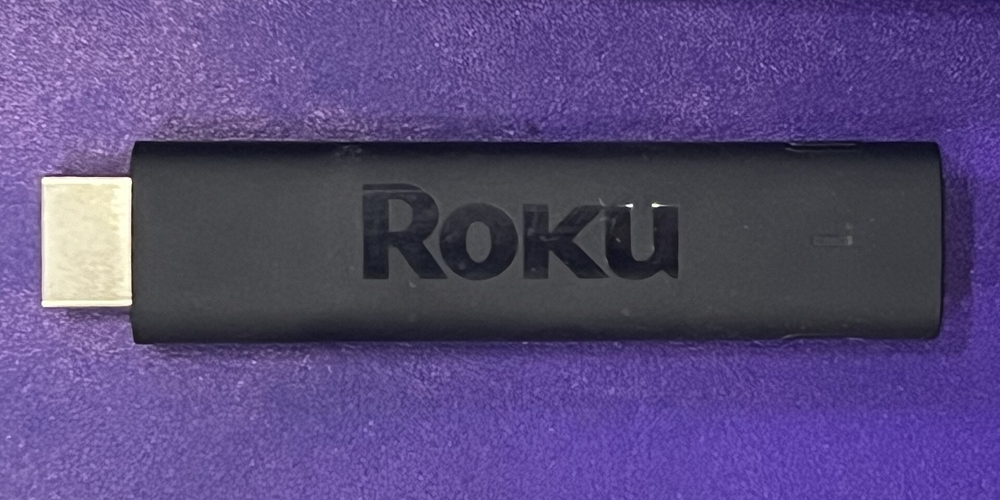
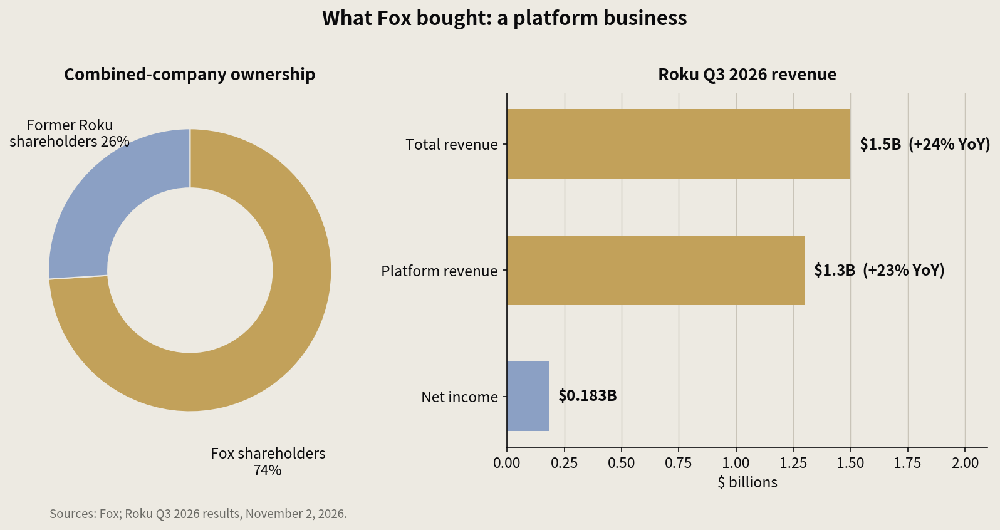

> [中文版 Chinese version](/life/fox-roku-22b-close-zh/)

*A Roku Streaming Stick 4K. Fox did not pay $22 billion for the hardware — but the stick is still the front door to the living room. Photo: Wikimedia Commons.*

## What closed

Fox Corporation completed its $22 billion acquisition of Roku on Friday, November 6, 2026 — less than five months after the deal was announced in June, and well ahead of the first-half-2027 timetable the companies had originally projected. Roku shares stopped trading on the Nasdaq the same day.

The deal makes Fox the owner of the operating system on the TV in more than 100 million US households, and, by Fox's own account, the third-largest television business in the country by viewership. It also turns a company built on live news and sports into a scaled streaming and connected-TV operator that owns both the content and the distribution.

## The terms

Roku stockholders received $95.30 in cash plus 0.9799 shares of Fox Class A common stock for each Roku share — about $160 per share in total at announcement. Fox stockholders own roughly 74 percent of the combined company; former Roku stockholders own about 26 percent.

Roku founder Anthony Wood joins Fox's board and becomes co-chair of a newly formed division, Fox Digital Platforms, alongside Paul Cheesbrough as co-chair and CEO. The division folds together Roku, Tubi, Fox One and Red Seat Ventures. Fox expects about $400 million of run-rate cost synergies within two years, and says the deal should be accretive to free cash flow per share by the second full year after closing.

The antitrust review was the part everyone watched. The Justice Department issued a second request for information in September, then closed its review on the same day the deal closed. Fox gave behavioral undertakings to regulators: keep Roku open to rival media companies' content for at least three years, and do not discriminate against competitors using the platform.

## Why Fox paid

Roku is not a hardware story anymore, and Fox did not pay $22 billion for plastic remotes. Roku's third-quarter 2026 results, reported November 2, show the shape of the business Fox actually bought: total revenue of $1.5 billion, up 24 percent year over year, with platform revenue of $1.3 billion, up 23 percent, and net income of $183 million. The money is in the platform — advertising, subscriptions and the cut of transactions that flow through the home screen.

For Fox, the deal fills the hole in its own strategy. Tubi is a strong free streaming service, Fox One is its paid bet, but neither owned the front door to the living room. Roku is the front door. Owning it means Fox no longer pays rent to reach its own audience, and it gets a say in what every other streamer pays too.

*Left: ownership of the combined company. Right: Roku's third-quarter 2026 revenue — the platform is the business Fox bought. Chart: this site, from Fox and Roku's Q3 2026 results.*

## The judgment

The deal's official story is clean: Roku stays open, Fox gets scale, everyone keeps their apps. The three-year open-platform commitment is the load-bearing piece of that story, and it is a promise, not a structure. It expires. It is enforced by regulators who will have moved on to other fights. And the incentives run the other way: every dollar of prominence Fox gives its own services on the home screen is a dollar of leverage over rivals who now depend on a competitor's platform.

That is the tension to watch. The first test will be small and deniable — placement on the home screen, terms for rival apps, how Tubi and Fox One are bundled against everyone else. The second test is the $400 million in synergies: if they come from duplicated headcount, fine; if they come from squeezing the platform's economics, the "open" promise gets expensive to keep.

Fox bought the last big neutral ground in television. Whether it stays neutral is now a three-year promise attached to a $22 billion asset. Promises expire. Assets do not.

*Deal figures in this post are from Fox, Roku, TechCrunch, Goodwin and Deadline reporting on the November 6, 2026 closing.*
