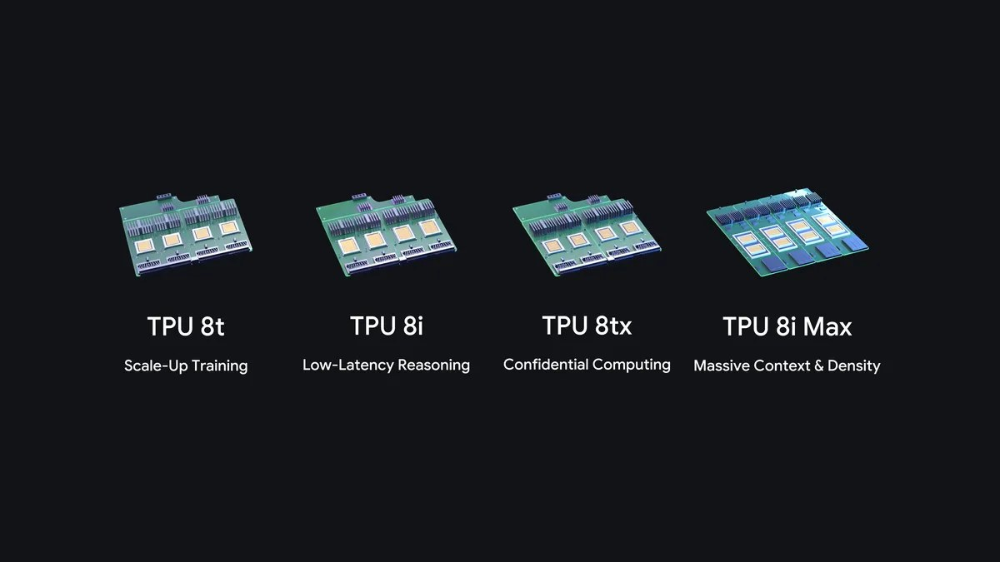
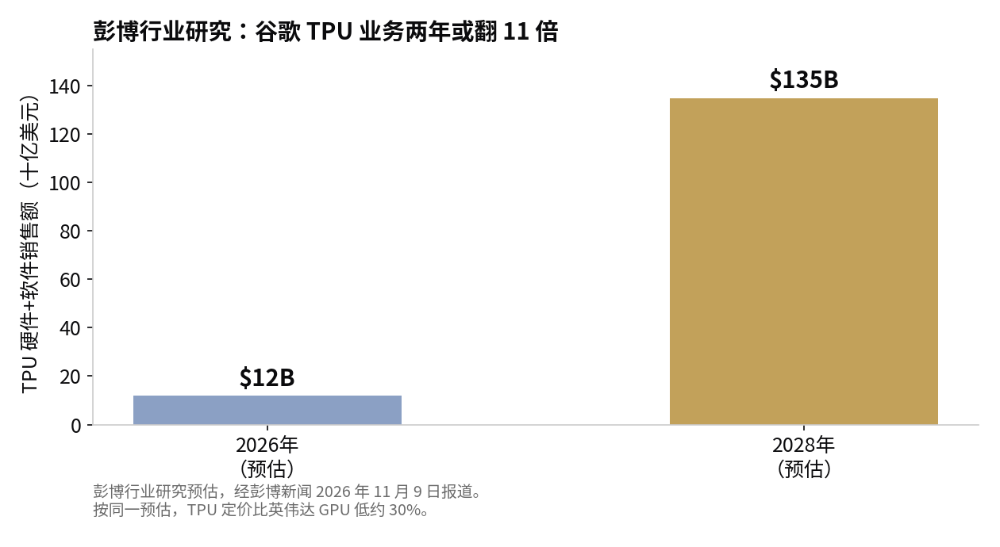

> [English version](/life/google-tpu-8tx-8i-max/)

*谷歌第八代 TPU 产品线：8t、8i、8tx 与 8i Max。图片：谷歌。*

## 谷歌发布了什么

11 月 9 日周一，谷歌将其第八代 TPU 产品线扩充了两个新系统：TPU 8tx，主打安全与机密推理；TPU 8i Max，主打超大上下文窗口。加上 4 月在 Google Cloud Next 上发布的 TPU 8t（训练）与 TPU 8i（推理），一年内共推出四款 TPU 系统——谷歌 AI 与基础设施首席技术官 Amin Vahdat 在官方博客中称，这是公司第一次在一年内推出四款 TPU 系统。

时机并不微妙。消息发布的同一个早上，英伟达正因董事会调查而股价下跌，这是谷歌迄今为止最激进的一步：把定制 AI 芯片卖给其他公司，而不只是内部供 Gemini 使用。据早期市场报道，消息公布后 Alphabet 股价盘前上涨，英伟达下跌。

## 两个新系统

**TPU 8tx——保险箱。**它采用与 TPU 8t 相同的芯片，搭配第五代 AMD EPYC 处理器作为宿主 CPU——AMD 在自己的公告中确认，8tx 是首款具备硬件级机密计算的云端 TPU 系统。通常数据在存储和传输时是加密的，但在计算机处理时必须在内存中解密。谷歌称，8tx 能让敏感数据和模型权重即使在被使用时也受到保护和隔离，因此受监管企业和政府可以用它对最敏感的数据运行前沿模型和自主智能体。它还采用了 8i 的低延迟 Boardfly 网络，谷歌称与 TPU 8t 相比延迟最多降低 2 倍，性能损失几乎为零；同时支持小规模训练——微调、蒸馏和强化学习——无需在不同集群之间搬运隐私数据。

**TPU 8i Max——内存牌。**它攻击的是谷歌所说的"内存墙"：当数十个 AI 智能体同时对整个代码库或数小时视频进行推理时，内存带宽会成为瓶颈。谷歌的办法是把两颗低延迟 TPU 8i 芯片封装进同一个封装体，算力、SRAM 与 HBM 带宽全部翻倍，同时在现有服务器占用空间内塞进两倍的芯片。作为参照，单颗 TPU 8i 搭配 288 GB 高带宽内存与 384 MB 片上 SRAM。

第八代的基线来自 4 月：据谷歌称，TPU 8t 的训练性能比上一代高出最多 2.7 倍，TPU 8i 的推理性价比高出 80%。TPU 业务如今服务近 100 家客户，包括前沿实验室、交易公司、零售商和大学；据彭博社报道，苹果、Meta 与甲骨文也在客户之列。

## 细则

仔细读这份公告，保留意见很快就堆起来了：

- **是系统，不是芯片。**谷歌明确区分了这一点，而且它很重要。两个新产品都不是新硅片：8tx 复用 8t 的芯片，8i Max 把两颗现有的 8i 重新封装。谷歌卖的是封装速度——能在几个月内围绕已有芯片拼出针对特定需求的系统，而不是等几年流片。
- **上市日期只有"2027 年"。**博客没有给出具体时间。Vahdat 向彭博社表示，这两个系统将于明年上市。没有价格、没有具名客户、没有地区。
- **没有独立数字。**所有性能数据——延迟降低 2 倍、算力与带宽翻倍、训练性能提升 2.7 倍——都是谷歌对自己硬件的宣称。两个新系统均无独立跑分、无第三方审计、无客户实测结果。谷歌引用了其 vLLM-TorchTPU 软件栈在行业标准的 InferenceX 与 AgentX 基准上取得领先性价比，但那是现有硬件上的软件栈成绩，不是两个新系统的测试。
- **1350 亿美元是预估。**彭博行业研究估计，谷歌 TPU 硬件与软件的直接销售额到 2028 年可超过 1350 亿美元，高于 2026 年预估的 120 亿美元，且 TPU 定价比英伟达 GPU 低约 30%。这是预测，不是收入——而且它假设谷歌能以从未证明过的速度把内部产能转化为外部销售。

*彭博行业研究预估，经彭博新闻 2026 年 11 月 9 日报道。图表：本站制作。*

软件层面的推进是真实的，而且都附带了明确日期：谷歌上月开源了 TorchTPU，让 PyTorch 代码和 Hugging Face 模型无需改写即可在 TPU 上原生运行；正在开源 TPU Sync——TPU 集群的模型状态层；GKE 上的 Cloud Pathways 与 GKE 动态切片现已全面可用。传递的信息是，TPU 正在变得像通用硬件一样易用——这正是过去人们不买它的主要理由。

## 同一天的另一边

英伟达当天早上也没有闲着。它同样在 11 月 9 日宣布扩大与韩国科学技术信息通信部的 sovereign AI 合作，核心是 Rebellions 的 R200 处理器通过 NVLink Fusion 与英伟达平台互联，预计 2028 年在 SK Telecom 的 AI 数据中心部署。硬件分工是刻意的：英伟达 GPU 负责 prefill，Rebellions 的 NPU 负责 decode。NVLink Fusion——向第三方芯片开放的英伟达互联技术——才是战略信号：如果谷歌的卖点是"我们的芯片更便宜"，英伟达的回答就是"我们的互联才是所有人都要基于其构建的平台"。

## 判断

诚实地读这份公告，它讲的是封装的故事，不是芯片的故事。谷歌真正的优势不在于今年设计出了更好的芯片——它没有，它只是重新封装了已有的两款。它的优势在于，能在几个月内为某个具体客户问题（加密推理、超大上下文）拿出一套专用系统，而新芯片要等几年。这是真实的能力，而机密计算这个切入点选得很准：政府与受监管企业构成的市场，英伟达的通用 GPU 本来就不直接服务，而"你的数据永远不出保险箱"在那里是采购标准，不是功能卖点。

但这一切都尚未证实。没有价格、没有客户、没有跑分，日期只精确到"2027 年"。1350 亿美元这个数字，为一项今年预估只有 120 亿美元的业务承担了太多。谷歌已经赢得了作为芯片厂商被认真对待的资格——一年四款系统、近 100 家客户、软件栈终于走到开发者身边。它还没有赢得 1350 亿美元。这两句话之间的差距，就是 2027 年要填的东西。

*来源：谷歌博客，Amin Vahdat《Introducing TPU 8tx and TPU 8i Max》，2026 年 11 月 9 日（blog.google）；彭博新闻 2026 年 11 月 9 日报道，经 JournalArta 与 abloominst-247 转述（彭博行业研究 1350 亿美元预估、约 30% 价差、2027 年上市、Alphabet/英伟达盘前走势、苹果/Meta/甲骨文为客户）；Pulse2，2026 年 11 月 9 日；AI Weekly，2026 年 11 月 9 日（第五代 AMD EPYC 宿主、8i Max 规格）；WebProNews，2026 年 11 月 9 日（AMD 机密计算公告、美东时间上午 9 点发布会）；Chris Abraham，2026 年 11 月 9 日（英伟达–韩国 sovereign AI、Rebellions R200、NVLink Fusion、SK Telecom 2028 年部署）。*
