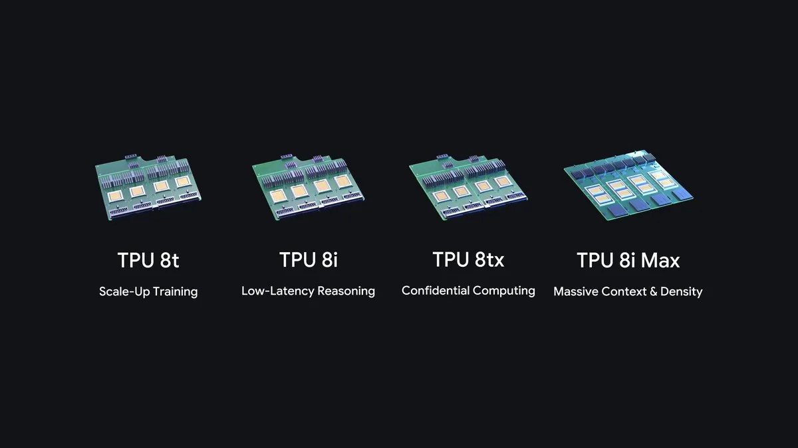
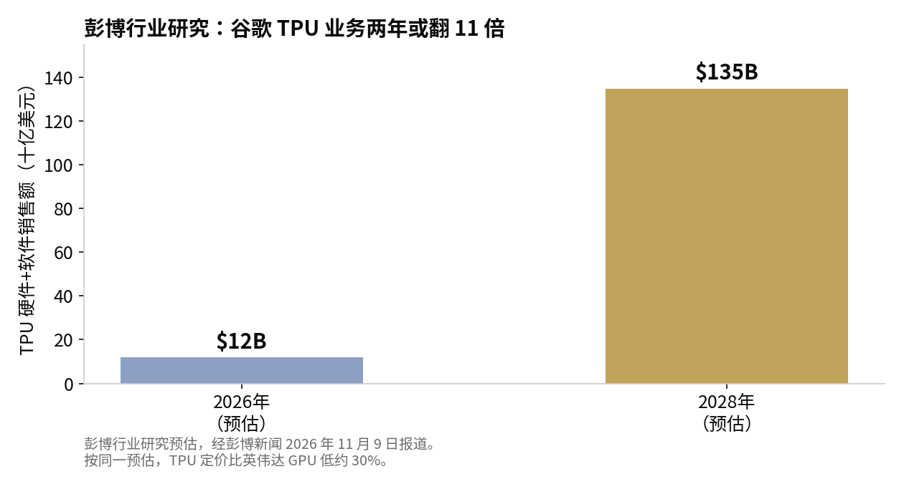

> [English version](/life/google-tpu-8tx-8i-max/)

*谷歌第八代 TPU 产品线：8t、8i、8tx 与 8i Max。图片：谷歌。*

## 谷歌发布了什么

11 月 9 日周一，谷歌将其第八代 TPU 产品线扩充了两个新系统：TPU 8tx，主打安全与机密推理；TPU 8i Max，主打超大上下文窗口。加上 4 月在 Google Cloud Next 上发布的 TPU 8t（训练）与 TPU 8i（推理），一年内共推出四款 TPU 系统——谷歌 AI 与基础设施首席技术官 Amin Vahdat 在官方博客中称，这是公司第一次在一年内推出四款 TPU 系统。

时机并不微妙。消息发布的同一个早上，英伟达正因董事会调查而股价下跌，这是谷歌迄今为止最激进的一步：把定制 AI 芯片卖给其他公司，而不只是内部供 Gemini 使用。据早期市场报道，消息公布后 Alphabet 股价盘前上涨，英伟达下跌。

## 十年的 TPU

一年四款听起来像冲刺，其实是十多年前就开始的项目的回报。谷歌在 2013 年开始设计第一款定制 AI 加速器，起因是一个测算：如果用户每天只用神经网络做几分钟语音搜索，公司就需要把整个数据中心算力翻倍。第一代 TPU 于 2015 年在谷歌数据中心投产，2016 年 Google I/O 上公开——一颗 28nm 芯片，约 92 TOPS 算力、75 瓦功耗，在世人知道它存在之前，就已经支撑着搜索、翻译和 2016 年 AlphaGo 对阵李世石的比赛。2017 年发布的 TPU v2 是第一代既能训练又能推理的芯片，2018 年谷歌开始通过 Google Cloud 对外出租 TPU。

此后的爬升是稳步的：Trillium（TPU v6e）于 2024 年 5 月发布，单芯片峰值算力达到 v5e 的 4.7 倍；Ironwood（TPU v7）于 2025 年 4 月发布，是第一款专为推理设计的 TPU，单芯片 4614 FP8 TFLOPS，配备 192 GB HBM3e 内存，集群规模可达 9216 颗芯片。博通（Broadcom）参与联合设计并供货，双方协议延续至 2031 年。

客户名单才是把内部项目变成生意的关键。2025 年 10 月，Anthropic 同意使用最多 100 万颗 TPU，合作规模达数百亿美元。2026 年 2 月，The Information 报道称，英伟达最大的客户 Meta 已签署数十亿美元的 TPU 租用协议，并另在谈判从 2027 年起直接为自家数据中心购买芯片。谷歌云 2026 年第二季度收入增长 82%，达到 248 亿美元。十年来，"能买 TPU 吗"的答案一直是"不能"；2026 年，对少数客户来说，答案变成了"能"。

## 两个新系统

**TPU 8tx——保险箱。**它采用与 TPU 8t 相同的芯片，搭配第五代 AMD EPYC 处理器作为宿主 CPU——AMD 在自己的公告中确认，8tx 是首款具备硬件级机密计算的云端 TPU 系统。通常数据在存储和传输时是加密的，但在计算机处理时必须在内存中解密。谷歌称，8tx 能让敏感数据和模型权重即使在被使用时也受到保护和隔离，因此受监管企业和政府可以用它对最敏感的数据运行前沿模型和自主智能体。它还采用了 8i 的低延迟 Boardfly 网络，谷歌称与 TPU 8t 相比延迟最多降低 2 倍，性能损失几乎为零；同时支持小规模训练——微调、蒸馏和强化学习——无需在不同集群之间搬运隐私数据。

**TPU 8i Max——内存牌。**它攻击的是谷歌所说的"内存墙"：当数十个 AI 智能体同时对整个代码库或数小时视频进行推理时，内存带宽会成为瓶颈。谷歌的办法是把两颗低延迟 TPU 8i 芯片封装进同一个封装体，算力、SRAM 与 HBM 带宽全部翻倍，同时在现有服务器占用空间内塞进两倍的芯片。作为参照，单颗 TPU 8i 搭配 288 GB 高带宽内存与 384 MB 片上 SRAM。

第八代的基线来自 4 月：据谷歌称，TPU 8t 的训练性能比上一代高出最多 2.7 倍，TPU 8i 的推理性价比高出 80%。TPU 业务如今服务近 100 家客户，包括前沿实验室、交易公司、零售商和大学；据彭博社报道，苹果、Meta 与甲骨文也在客户之列。

## 内存墙是怎么回事

8i Max 的存在，是因为 AI  workloads 实际在做的事情变了。聊天机器人回答一个问题，只需要模型权重加一小块工作内存；而一个智能体对整个代码库进行推理、或数十个智能体同时对数小时视频进行推理时，需要的是另一回事：KV 缓存——模型已经读过的所有内容的键与值——它随上下文的每个 token 一起增长，存放在高带宽内存里。缓存大到一定程度，瓶颈就不再是芯片乘法算得有多快，而是缓存读回来的速度有多快。这就是内存墙：算力在等内存。

把两颗芯片封装在一起，从两个方向攻击这堵墙：HBM 带宽翻倍，缓存读取速度翻倍；片上 SRAM 也翻倍——那是最快、最近的内存，更多的工作集根本不用离开芯片。两颗芯片封装在一起，也比通过网络连接的两颗芯片距离更近，这正是谷歌敢宣称延迟保持低位的原因。这个思路并不新鲜——英伟达自己的 NVL72 机柜就是用 72 颗 GPU 与 NVLink 做同样的事——但这是谷歌第一次把它作为针对特定负载的 TPU 产品来卖，而不是作为一块碰巧带了内存的通用芯片。

## 机密计算：保险箱到底是什么

8tx 的卖点——数据在 AI 处理时仍保持加密——听起来像魔法，而它的机制值得弄明白，因为它既定义了这个产品能做什么，也定义了它不能做什么。它堵上的缺口叫"使用中的数据"：数据在磁盘上是加密的，在网络传输中是加密的，但计算机一开始处理它，就要在内存与 GPU 显存里解密。任何能接触到宿主机的人——被攻破的 hypervisor、流氓云管理员、内存转储攻击——都能读到明文。

机密计算用硬件可信执行环境（TEE）堵上这个缺口：CPU 或 GPU 上的一块区域，其内存由芯片自己生成并持有的密钥加密，宿主机永远看不到。AMD 的版本叫 SEV-SNP，英特尔的叫 TDX，英伟达从 Hopper 一代 GPU 开始加入了机密计算模式。宿主机仍然可以调度、饿死甚至杀死这台虚拟机，但它读不到内存，而 CPU 会签署一份报告（称为 attestation，证明），说明虚拟机启动时用的是什么固件和镜像。远程一方在放行任何密钥或机密之前，会先核查这份签名。这份签名的报告就是整个产品：可以验证的信任，而不是一份需要你凭信仰接受的隐私政策。

开销是真实的，但很小：在 H100 机密计算上的公开测量显示，GPU 吞吐量损失约为 4–8%，英伟达称可达非加密部署 98% 的性能。TEE 覆盖不到的地方同样重要：它防不住侧信道攻击，拦不住宿主机监听网络流量，也无法证明 enclave 里的代码会拿你的提示做什么——它只能证明正在运行的是哪段代码。谷歌的宣称比"第一款机密 AI 芯片"要窄：8tx 是首款具备硬件级机密计算的云端 TPU 系统。英伟达的 Hopper 与 Blackwell 早就有了这项能力。真正的切入点在于：这是一颗 TPU，在谷歌的云上，卖给那些宁愿不买英伟达的客户。

## 细则

仔细读这份公告，保留意见很快就堆起来了：

- **是系统，不是芯片。**谷歌明确区分了这一点，而且它很重要。两个新产品都不是新硅片：8tx 复用 8t 的芯片，8i Max 把两颗现有的 8i 重新封装。谷歌卖的是封装速度——能在几个月内围绕已有芯片拼出针对特定需求的系统，而不是等几年流片。
- **上市日期只有"2027 年"。**博客没有给出具体时间。Vahdat 向彭博社表示，这两个系统将于明年上市。没有价格、没有具名客户、没有地区。
- **没有独立数字。**所有性能数据——延迟降低 2 倍、算力与带宽翻倍、训练性能提升 2.7 倍——都是谷歌对自己硬件的宣称。两个新系统均无独立跑分、无第三方审计、无客户实测结果。谷歌引用了其 vLLM-TorchTPU 软件栈在行业标准的 InferenceX 与 AgentX 基准上取得领先性价比，但那是现有硬件上的软件栈成绩，不是两个新系统的测试。
- **1350 亿美元是预估。**彭博行业研究估计，谷歌 TPU 硬件与软件的直接销售额到 2028 年可超过 1350 亿美元，高于 2026 年预估的 120 亿美元，且 TPU 定价比英伟达 GPU 低约 30%。这是预测，不是收入——而且它假设谷歌能以从未证明过的速度把内部产能转化为外部销售。

*彭博行业研究预估，经彭博新闻 2026 年 11 月 9 日报道。图表：本站制作。*

软件层面的推进是真实的，而且都附带了明确日期：谷歌上月开源了 TorchTPU，让 PyTorch 代码和 Hugging Face 模型无需改写即可在 TPU 上原生运行；正在开源 TPU Sync——TPU 集群的模型状态层；GKE 上的 Cloud Pathways 与 GKE 动态切片现已全面可用。传递的信息是，TPU 正在变得像通用硬件一样易用——这正是过去人们不买它的主要理由。

## 1350 亿美元的算术

彭博行业研究的预估值得单独写一段，因为它在这篇报道里承担了太多。2026 年 120 亿美元，到 2028 年超过 1350 亿美元——两年增长 11 倍，这个增速没有任何一家芯片公司维持过，包括英伟达。它同时假设了三件事：谷歌能按这个规模生产 TPU、Anthropic 与 Meta 这样的客户会按这个速度继续购买、谷歌会选择把产能对外出售而不是留给 Gemini。第一条撞上博通的产能爬坡；第二条撞上一个事实——Anthropic 的百万 TPU 协议是"使用"协议，不是固定排期的采购订单；第三条撞上谷歌自己的历史——十年来 TPU 就是护城河，而谷歌一直把护城河留在自己手里。比英伟达 GPU 低约 30% 的定价是这份预估里最具体的部分，同时也是最脆弱的：英伟达可以降价，而且它有降价的体量。把 1350 亿美元当作一种情景，而不是预测——那是所有事情连续两次都走对时得到的数字。

## CUDA 的护城河：谷歌真正的敌人不是芯片

读到这里，一个问题自然会出现：既然 TPU 的性价比更高、客户名单越来越长，为什么英伟达仍然是默认选择？答案不在芯片上，而在软件里。CUDA 是英伟达二十年积累下来的护城河：几乎所有 AI 研究人员都会写 CUDA，几乎所有 AI 框架都优先支持 CUDA，几乎所有新模型的第一个版本都是在 CUDA 上跑通的。换一块芯片不只是换硬件，而是换掉整个开发流程——重写代码、重新调优、重新验证结果。这就是为什么"便宜 30%"这个数字说服力有限：对一家实验室来说，迁移成本往往超过硬件差价。

谷歌的软件推进——TorchTPU 开源、TPU Sync 开源、vLLM-TorchTPU 在 InferenceX 与 AgentX 上取得领先性价比——正是冲着这条护城河去的。它的逻辑是：让 PyTorch 代码与 Hugging Face 模型无需改写就能在 TPU 上原生运行，把迁移成本压到接近于零。如果开发者感觉不到自己换了芯片，芯片的性价比才能真正参与竞争。这也是为什么公告里软件部分的日期比硬件部分更具体：TorchTPU 已经开源，TPU Sync 正在开源，GKE 的功能已经全面可用——软件是谷歌现在就能交付的东西，而硬件还要等到 2027 年。

但护城河的另一面是：CUDA 的优势不只是代码兼容，而是人才。全球会写 CUDA 的工程师以百万计，会调 TPU 的要少得多。每一次招聘、每一次调试、每一次深夜排查，都会提醒团队"换芯片"的真实成本。谷歌要打赢这场仗，需要的不是一款更便宜的芯片，而是一代在 TPU 上长大的开发者——而这需要的时间，是以年计的。

## 谁在买单：Anthropic 的 100 万颗 TPU 意味着什么

Anthropic 的协议值得单独算一笔账，因为它是整个 TPU 外销故事里最大的一块拼图。2025 年 10 月，Anthropic 同意使用最多 100 万颗 TPU，合作规模达数百亿美元，并计划扩展到超过 1 GW 的 Ironwood 容量，用于训练与服务未来的 Claude 模型。100 万颗是什么概念？Ironwood 的集群规模是 9216 颗芯片，100 万颗相当于 100 多个这样的集群；按每颗芯片数千美元的量级估算，这笔合作的硬件价值本身就是百亿美元级别。

这笔协议对谷歌提出了两难：TPU 产能是有限的，每一颗卖给 Anthropic 的芯片，都是不能留给 Gemini 的一颗。谷歌的选择是两边都给——这正是 8t 与 8i 拆分的背景：训练与推理分开设计，产能可以按需分配。但两难并没有消失：Anthropic 的需求在增长，Gemini 的需求也在增长，而博通的产能爬坡有自己的节奏。2027 年 8tx 与 8i Max 上市时，谷歌要回答的第一个问题不是"性能有多强"，而是"有多少货"。Meta 的租用协议同样如此：租用是弹性的，购买才是承诺，而谷歌至今没有公布任何一家客户的购买数量。客户名单很长，订单簿的深度仍然未知。

## 同一天的另一边

英伟达当天早上也没有闲着。它同样在 11 月 9 日宣布扩大与韩国科学技术信息通信部的 sovereign AI 合作，核心是 Rebellions 的 R200 处理器通过 NVLink Fusion 与英伟达平台互联，预计 2028 年在 SK Telecom 的 AI 数据中心部署。硬件分工是刻意的：英伟达 GPU 负责 prefill，Rebellions 的 NPU 负责 decode。NVLink Fusion——向第三方芯片开放的英伟达互联技术——才是战略信号：如果谷歌的卖点是"我们的芯片更便宜"，英伟达的回答就是"我们的互联才是所有人都要基于其构建的平台"。

## 2027 年要验证的三件事

把公告里的宣称翻译成可验证的清单，2027 年有三件事值得盯住。第一，有没有具名的客户为 8tx 或 8i Max 付钱——不是"租用"、不是"合作"、不是"评估"，而是一份写明数量与价格的订单。第二，有没有独立的第三方跑分：不是谷歌自己的博客数字，而是一家客户、一家评测机构或者一个公开基准上跑出来的结果。第三，8tx 的机密计算有没有通过真实的安全审计：attestation 机制有没有被独立验证、开销是不是真的只有个位数百分比、以及有没有受监管行业的客户真的把敏感数据放上去。这三件事里任何一件落地，都会比 1350 亿美元的预估更有说服力；三件都不落地，2027 年的公告就会和 2026 年的一样：很好的故事，缺一张发票。

## 判断

诚实地读这份公告，它讲的是封装的故事，不是芯片的故事。谷歌真正的优势不在于今年设计出了更好的芯片——它没有，它只是重新封装了已有的两款。它的优势在于，能在几个月内为某个具体客户问题（加密推理、超大上下文）拿出一套专用系统，而新芯片要等几年。这是真实的能力，而机密计算这个切入点选得很准：政府与受监管企业构成的市场，英伟达的通用 GPU 本来就不直接服务，而"你的数据永远不出保险箱"在那里是采购标准，不是功能卖点。

但这一切都尚未证实。没有价格、没有客户、没有跑分，日期只精确到"2027 年"。1350 亿美元这个数字，为一项今年预估只有 120 亿美元的业务承担了太多。谷歌已经赢得了作为芯片厂商被认真对待的资格——一年四款系统、近 100 家客户、软件栈终于走到开发者身边。它还没有赢得 1350 亿美元。这两句话之间的差距，就是 2027 年要填的东西。

最后值得把视线拉远一点：TPU 外销的故事，本质上是谷歌在回答一个十年前就存在的问题——一家以软件与服务为生的公司，能不能靠卖芯片赚钱。过去十年，谷歌的答案是不卖，TPU 是护城河，护城河是用来保卫搜索与 Gemini 的。2026 年的答案变了：Anthropic 的百万 TPU 协议、Meta 的租用、一年四款系统，都在说同一件事——谷歌开始把护城河当成商品。这个转变的风险在于，卖芯片与用芯片是两种生意，需要不同的产能规划、不同的客户关系、不同的定价纪律。谷歌能不能同时做好这两件生意，2027 年的订单簿会给出答案。而答案的另一面是英伟达：它会不会降价、会不会开放更多互联、会不会把护城河挖得更深。
*来源：谷歌博客，Amin Vahdat《Introducing TPU 8tx and TPU 8i Max》，2026 年 11 月 9 日（blog.google）；彭博新闻 2026 年 11 月 9 日报道，经 JournalArta 与 abloominst-247 转述（彭博行业研究 1350 亿美元预估、约 30% 价差、2027 年上市、Alphabet/英伟达盘前走势、苹果/Meta/甲骨文为客户）；Pulse2，2026 年 11 月 9 日；AI Weekly，2026 年 11 月 9 日（第五代 AMD EPYC 宿主、8i Max 规格）；WebProNews，2026 年 11 月 9 日（AMD 机密计算公告、美东时间上午 9 点发布会）；Chris Abraham，2026 年 11 月 9 日（英伟达–韩国 sovereign AI、Rebellions R200、NVLink Fusion、SK Telecom 2028 年部署）。扩写部分新增来源：AI Wiki / Clarigital（TPU 历史：2013 年语音搜索测算、v1 2015 年 28nm、92 TOPS、75 瓦、AlphaGo 2016、v2 2017 年、Cloud TPU 2018 年、Trillium v6e 2024 年 5 月 4.7 倍、Ironwood v7 2025 年 4 月 4614 FP8 TFLOPS、192 GB HBM3e、9216 颗芯片集群、博通联合设计与至 2031 年协议、Anthropic 最多 100 万颗 TPU 2025 年 10 月、Meta 数十亿美元租用 2026 年 2 月、谷歌云 2026 年第二季度增长 82% 至 248 亿美元）；Ajay K. / Cohere / DEAI / System Hardening（机密计算：AMD SEV-SNP、英特尔 TDX、英伟达 Hopper 机密计算模式、attestation、苏黎世联邦理工学院 4–8% 开销、英伟达 98%、TEE 的局限）。*
