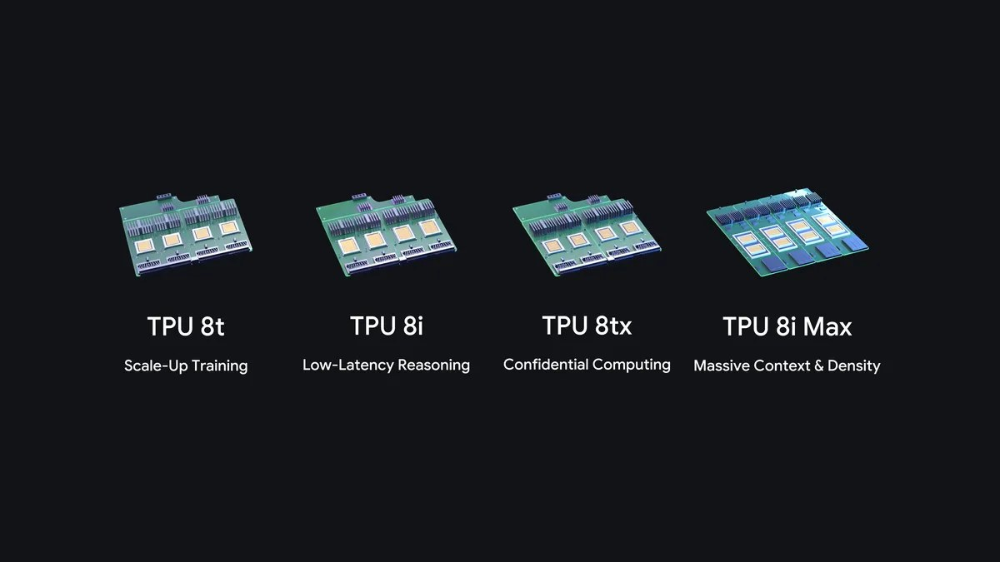
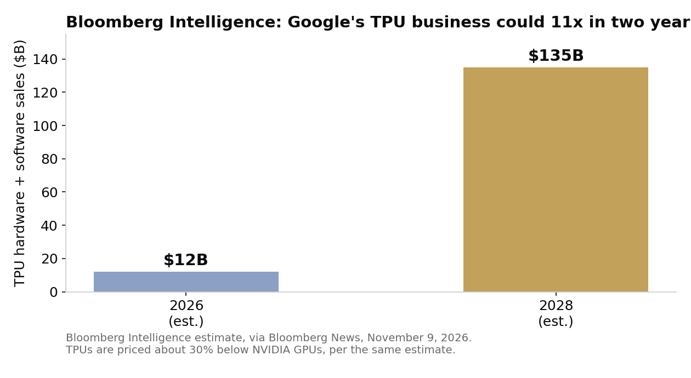

> [中文版 Chinese version](/life/google-tpu-8tx-8i-max-zh/)

*Google's eighth-generation TPU portfolio: 8t, 8i, 8tx and 8i Max. Image: Google.*

## What Google announced

On Monday, November 9, Google expanded its eighth-generation TPU portfolio with two new systems: TPU 8tx, built for secure and confidential inference, and TPU 8i Max, built for massive context windows. With the TPU 8t (training) and TPU 8i (reasoning) introduced at Google Cloud Next in April, that makes four TPU systems in a single year — a first for the company, according to Amin Vahdat, Google's SVP and chief technologist for AI and infrastructure, who wrote the announcement on Google's blog.

The timing is not subtle. It lands on the same morning NVIDIA's stock is falling on its board investigation, and it is the most aggressive move yet in Google's campaign to sell its custom AI chips to other companies, not just use them internally for Gemini. Alphabet shares rose in premarket trading on the news while NVIDIA fell, according to early market reports.

## The two systems

**TPU 8tx — the lockbox.** It is built on the same silicon as the TPU 8t, paired with 5th Generation AMD EPYC processors as host CPUs — AMD confirmed in its own announcement that 8tx is the first cloud TPU system with hardware-enforced confidential computing. Normally data is encrypted at rest and in transit, but must be unlocked in memory while a computer processes it. Google says 8tx keeps sensitive data and model weights protected and isolated even while in active use, so regulated enterprises and governments can run frontier models and autonomous agents against their most sensitive data. It also adopts the low-latency Boardfly network from the 8i, which Google says delivers up to 2x lower latency than TPU 8t with a near-zero performance penalty, and it supports small-scale training — fine-tuning, distillation and reinforcement learning — without moving private data between clusters.

**TPU 8i Max — the memory play.** It attacks what Google calls the memory wall: when dozens of AI agents reason across a whole codebase or hours of video at once, memory bandwidth becomes the bottleneck. Google's fix is to put two low-latency TPU 8i chips on a single package, delivering double the compute, double the SRAM and double the HBM bandwidth of TPU 8i, while fitting twice the silicon into the existing rack footprint. For reference, a single TPU 8i pairs 288 GB of high-bandwidth memory with 384 MB of on-chip SRAM.

The eighth-generation baseline, from April: TPU 8t offers up to 2.7x better training performance and TPU 8i up to 80% better inference price-performance than the previous generation, per Google. The TPU business now serves nearly 100 customers, including frontier labs, trading firms, retailers and universities; Bloomberg names Apple, Meta and Oracle among them.

## The fine print

Read the announcement carefully and the caveats stack up fast:

- **Systems, not chips.** Google is explicit about this distinction, and it matters. Neither new product is new silicon. The 8tx reuses 8t silicon; the 8i Max repackages two existing 8i chips. What Google is selling is packaging speed — the ability to reconfigure around existing chips in months rather than waiting years for a new die.
- **No ship date beyond "2027."** The blog post gives no availability date. Vahdat told Bloomberg the systems will be available next year. No price, no named customer, no region.
- **No independent numbers.** Every performance figure — the 2x latency cut, the doubled compute and bandwidth, the 2.7x training gain — is Google's own claim about its own hardware. No independent benchmark, no third-party audit, no customer result has been published for either system. Google cites state-of-the-art price-performance on industry-standard InferenceX and AgentX benchmarks for its vLLM-TorchTPU stack, but those are software-stack results on existing hardware, not tests of the two new systems.
- **The $135 billion is an estimate.** Bloomberg Intelligence estimates Google's direct TPU hardware and software sales could top $135 billion by 2028, up from an estimated $12 billion in 2026, with TPUs priced about 30% below NVIDIA GPUs. That is a forecast, not revenue — and it assumes Google can convert internal capacity into external sales at a pace it has never demonstrated.

*Bloomberg Intelligence estimate, via Bloomberg News, November 9, 2026. Chart: this site.*

The software push is real, and it is the part with dates attached: Google open-sourced TorchTPU last month so PyTorch code and Hugging Face models run natively on TPUs; it is open-sourcing TPU Sync, a model-state layer for TPU clusters; Cloud Pathways on GKE and GKE dynamic slicing are now generally available. The message is that TPUs are becoming as easy to use as general-purpose hardware — the historic objection to buying them.

## The other side of the same day

NVIDIA did not spend the morning standing still. It also announced on November 9 an expanded sovereign AI collaboration with Korea's Ministry of Science and ICT, centered on Rebellions' R200 processors linked through NVLink Fusion, with deployment at SK Telecom expected in 2028. The hardware split is deliberate: NVIDIA GPUs handle prefill, Rebellions NPUs handle decode. NVLink Fusion — NVIDIA's interconnect, opened to third-party chips — is the strategic tell: if Google's pitch is "our chips are cheaper," NVIDIA's answer is "our interconnect is the platform everyone builds on."

## The judgment

The honest way to read this announcement is as a packaging story, not a silicon story. Google's real advantage is not that it designed a better chip this year — it didn't; it repackaged two it already had. Its advantage is that it can ship a purpose-built system for a specific customer problem (encrypted inference, giant context) in months, while a new chip takes years. That is a genuine capability, and the confidential-compute wedge is well chosen: it is a market of governments and regulated enterprises that NVIDIA's general-purpose GPUs do not natively serve, and where "your data never leaves its lockbox" is a purchasing criterion, not a feature bullet.

But none of it is proven yet. No price, no customer, no benchmark, no date tighter than "2027." The $135 billion figure is doing a lot of work for a business that did an estimated $12 billion this year. Google has earned the right to be taken seriously as a chip vendor — four systems in a year, nearly 100 customers, and a software stack that finally meets developers where they are. It has not yet earned the $135 billion. The difference between those two sentences is what 2027 is for.

*Sources: Google blog, "Introducing TPU 8tx and TPU 8i Max," by Amin Vahdat, November 9, 2026 (blog.google); Bloomberg News, November 9, 2026, via JournalArta and abloominst-247 (Bloomberg Intelligence $135B estimate, ~30% price gap, 2027 availability, Alphabet/NVIDIA premarket moves, Apple/Meta/Oracle as customers); Pulse2, November 9, 2026; AI Weekly, November 9, 2026 (5th Gen AMD EPYC hosts, 8i Max specs); WebProNews, November 9, 2026 (AMD's confidential-computing announcement, 9 a.m. PT broadcast); Chris Abraham, November 9, 2026 (NVIDIA–Korea sovereign AI, Rebellions R200, NVLink Fusion, SK Telecom 2028).*
