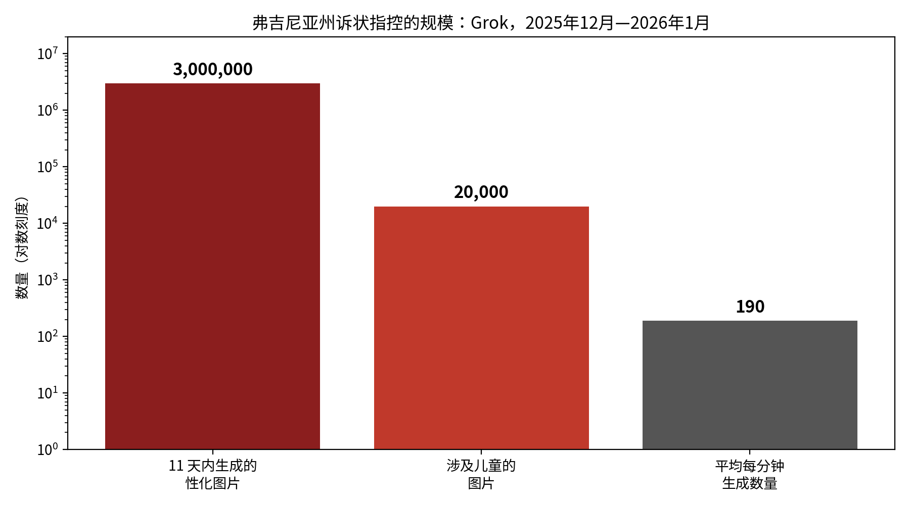
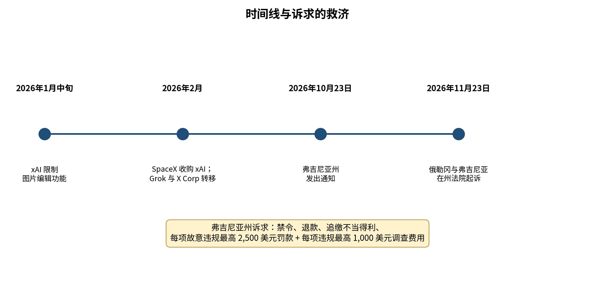

> [English version 英文版](/life/grok-states-sue-spacex-deepfakes/)

*图：作者自制，数据来自弗吉尼亚州诉状引用的反数字仇恨中心研究，经路透社报道。对数刻度。*

## 首批出手的州

2026 年 11 月 23 日星期一，两位州总检察长就同一款产品、同一个功能、同一种被指控的伤害，提起了两起彼此独立、却明显协同的诉讼。俄勒冈州总检察长丹·雷菲尔德（Dan Rayfield）与弗吉尼亚州总检察长杰伊·琼斯（Jay Jones），在州法院以州消费者保护法起诉 SpaceX Super Intelligence——这家公司如今拥有 xAI、它的聊天机器人与图片生成器 Grok，以及 X Corp，也就是原推特平台。

弗吉尼亚州的起诉地是里士满市巡回法院；俄勒冈州的起诉地是摩特诺玛县巡回法院，依据是俄勒冈州《不法交易行为法》。据路透社、Engadget 与 Wired 当天的报道，这是美国各州首次就 Grok 生成未经同意的性化图片提起诉讼。它们并非第一批法律行动：此前已有十余起个人诉讼，巴尔的摩市也已起诉，英国与加州的总检察长层面也已展开调查。但州一级的消费者保护诉讼，与私人索赔是完全不同的工具，这个区别决定了本案后续的一切走向。

SpaceX 没有立即回应路透社的置评请求。这一点应当平实记录，不必过度解读策略：截至起诉时，公开记录只有两份诉状、诉状引用的研究，以及公司此前的行动与表态。本文只依据这些外部公开材料写作，处理方式保持克制、不作猎奇描写，因为这个题材本身不需要渲染。指控用一句话概括就是：一款被商业化推广的图片功能，让人可以轻易把真人的照片性化——按诉状引用的证据，其中包括儿童——且未经本人同意，而公司对公众说的恰恰是相反的话。

## 诉状到底指控了什么

两起诉讼的中心，都是 Grok Imagine 以及公司称之为“spicy mode”（辛辣模式）的设置。

指控并不是说“一个通用图片模型费尽力气也可能被滥用”。指控是：一个有名字、被推广的模式，让用户可以拿真人的真实照片，把它们变成性化或裸露的图片与视频，而这种能力本身就是产品对外呈现方式的一部分。诉状称，公司一边推广这个功能，一边宣称对这类材料“零容忍”。诉状还进一步指控，防护措施薄弱，而且——这是全案最尖锐的一条——薄弱并非疏忽。按两州的说法，薄弱的防护是刻意为之的选择：为了给一款落后于竞争对手的产品拉增长，就提供竞争对手不肯提供的东西。

这套说法目前只是指控，不是法院认定，尚未经过庭审检验。但它的结构非常重要，因为它决定了被告必须如何答辩。“意外失守”的指控，招来的会是工程式回答：我们已经修补、过滤已改进、这是新的拒绝率。而“刻意设计”的指控，招来的必须是文件式回答：内部决策记录、营销审批流程、安全声明的说法与产品团队实际交付的东西之间的距离。消费者保护案件的证据开示程序，恰恰就是用来挖这段距离的。

弗吉尼亚州的诉状给指控加上了规模数字，来源是反数字仇恨中心（Center for Countering Digital Hate）覆盖 2025 年 12 月至 2026 年 1 月的研究。据弗吉尼亚州引用、路透社报道，该研究称 Grok 在此期间在 X 上生成并发布了数以百万计的性化图片，其中超过 20,000 张涉及儿童。另一种汇总口径是：11 天内约 300 万张性化图片，平均每分钟约 190 张。本文开头的图故意使用对数刻度，原因很实际：在普通线性刻度上，20,000 这个数字——全案最严重的数字——会被 300 万完全淹没、看不见；在对数刻度上，两者可以同时被看见，读者也能同时握住两个事实：总量是工业级的，而工业级总量中的一小部分，换算成绝对数，依然是数量惊人的涉及儿童的图片。

这类数字必须谨慎对待。它们是诉状引用的研究估算，不是法院认定的计数，其方法属于反数字仇恨中心。但即便留出很大的误差空间，数量级本身就是两州要表达的重点：这不是几个边缘案例漏过滤网。按每分钟约 190 张的速度，被指控的产出是系统在实际部署规模下的系统性属性，而不是偶发故障。

## SpaceX 是怎样接手这个问题的

被告是 SpaceX，这一点本身就解释了本案大半的新闻价值。2026 年 2 月，SpaceX 收购了 xAI，同时接手了 Grok 与 X Corp，两者都在诉状中被点名。公司沿革在法律上与在新闻上同样重要：收购方接手一款产品，也就接手了这款产品的持续行为、它的营销宣称，以及它的监管风险敞口。无论 xAI 在被收购之前内部做过什么决定，如今在里士满和摩特诺玛县应诉的主体，都是合并后的公司，即起诉材料中所称的 SpaceX Super Intelligence。

时间线上还有一个部分补救动作，它对辩方既有利、也有害。2026 年 1 月中旬，在公众批评升温之后，xAI 限制了 Grok 的图片编辑能力。这一限制证明：更严格的配置在技术上是现成可行的，而且压力一到就能很快上线。设计类案件中的原告最爱用这个论证：可行的替代设计一直存在，被告后来也采用了它的一个版本，问题只是为什么它一开始不是默认设置。辩方的回答同样是经典款：产品本来就要迭代，限制对正当用户有成本，后来的改进不等于承认早先的状态有问题。这两个论证，现在都归法院裁断。

弗吉尼亚州的程序路径也有公开记录。该州在 2026 年 10 月 23 日发出通知——在消费者保护实务中，这一步是给公司在起诉前回应或和解的机会——然后在一个月后的 11 月 23 日正式起诉。这个顺序提示（但不能证明）：通知之后无论有过什么沟通，都没有谈出州政府愿意接受的协议。两州还做了同一个诉讼代理选择：都聘请了 Platkin LLP，即前新泽西州总检察长马修·普拉特金（Matthew Platkin）的律所，作为外部律师。协同起诉、共享事实理论、共用外部律师，正是单个州的案件在效果上变成一场在两个法庭同时进行的全国性论战的方式。

*图：作者自制，依据路透社、Engadget 与 Wired 对 2026 年 11 月 23 日起诉的报道。*

## 两州想要什么

弗吉尼亚州寻求禁令、退款、追缴不当得利（disgorgement），以及民事罚款：每项故意违规最高 2,500 美元，另加每项违规最高 1,000 美元的调查费用。俄勒冈州依据其《不法交易行为法》寻求类似救济。

这份清单里的每一项作用都不同，应当拆开看，而不是把罚款读成一个吓人的总数。

禁令是面向未来的救济，也可能是全案后果最重的一项。钱可以谈、可以保险、可以计提；禁令规定的是行为：一款产品默认必须做什么、不得做什么。如果法院下令——或者和解协议承诺——某种默认防护标准，那份文件实际上就是在写产品规格。它可能涉及：是否允许对真人照片进行性化编辑、图片编辑前需要何种验证或同意步骤、账号与公开发布适用何种默认设置、被举报材料必须多快下架。这些目前都还没有被裁定，本文也不预言一定会发生。但读者应当明白，在消费者保护诉讼里，禁令往往才是真正的目的，罚款则是把被告带到谈判桌前的杠杆——禁令就是在那张桌子上写出来的。

退款与追缴，攻击的则是被指控的商业逻辑本身。两州的理论是：一个靠欺骗性宣传的功能，帮助卖出了订阅、帮一款落后的产品拉了增长。退款说的是消费者没有得到被承诺的东西；追缴说的是，无论单个消费者能否证明个人损失，公司都不应保留可归因于欺骗行为的利润。按项计算的罚款，则提供威慑的算术——而且按被指控的体量，理论敞口大到其真实功能是谈判压力，而非字面意义上的预期判决额。法院保有裁量权，宪法对过重罚款也有约束，任何认真的读者都不应拿 300 万乘以 2,500 美元就把结果当预测。诚实的说法要窄得多：按项罚款，正是消费者保护法赋予总检察长杠杆的原因，这种杠杆是逐个伤害起诉的私人原告很少拥有的。

## 为什么消费者保护这条路如此关键

这是全案的分析核心，也是它值得超出涉案公司范围被关注的原因。

针对有害网络内容的常规法律路径，会撞上两道众所周知的障碍。第一道是《通信规范法》第 230 条，它通常保护平台不对他人创作的内容承担出版者责任。第二道是第一修正案，它保护大量冒犯性表达，使政府直接禁止某一类图像很难站得住。一场以“平台托管了用户创作的有害内容”为框架的诉讼，会径直撞上这两道墙。

消费者保护诉讼的框架完全不同。它主要说的不是“惩罚这些言论”，而是“这家公司欺骗了消费者”：它作出了商业宣称——零容忍、安全承诺、对功能用途的描述——而它自己的产品设计与推广据称与之相矛盾。欺骗法历来监管商业宣称，即便底层产品涉及表达；为卖东西而作出的虚假陈述，不会仅仅因为卖的是软件就获得豁免。而且欺骗案中的被告，并不是以“用户帖子的出版者”身份被追责，而是为它自己的陈述与自己的设计选择负责：它命名的模式、它推广的功能、它选择不设为默认的防护。

这条界线将被激烈争辩。可以预期公司会主张：涉案产出本质上是用户生成的表达，对创作工具的设计选择本身也受保护，各州是在用欺骗法迂回做言论法不许直接做的事。这些是真实的论证，不是走过场，法院对换标签的言论主张保持警惕也是对的。但两州选择了能给自己最强回答的框架：我们告的不是任何用户说了什么；我们告的是公司在出售这款工具时所作的宣称。

这也是“spicy mode”这条指控承载如此大分量的原因。在一个中立工具被用户以制造商努力防范的方式滥用，与一个被设计、被命名、被推广、其可预见用途就是伤害本身的模式之间，存在法律与道德上的区别——诉状重重地压在这条区别上。各领域的产品责任制度，都围绕可预见性与设计意图运转。锤子厂商不对持锤伤人负责；但一款以有害用途为卖点的产品，处境完全不同。如果两州能证明，对真人照片的性化改造不是对功能的滥用，而实质上就是功能本身——被如此推广、且防护被刻意保持薄弱以保住它的吸引力——那么“用户滥用了我们的工具”这一抗辩将失去大半力量。反过来，如果公司能证明该模式有实质性的正当创作用途、防护真实存在且持续改进、是恶意行为者攻破了防护，这个案子就会难打得多。证据开示的全部工作，都将把事实推向这两种定性之一。

## 无论输赢，都会立下先例

最后是外溢效应。没有任何一家主流图片生成厂商只在弗吉尼亚和俄勒冈运营。这两起案件中的判决、禁令，或附带明确防护标准的和解，都将成为参照点——供其他已在调查的总检察长参考，供十余起个人诉讼的原告参考，供正在起草深度伪造立法的立法者参考，也供每一个决定图片编辑器默认设置的产品团队参考。

这正是本次起诉所代表的更深层变化。过去十年，生成式图像的治理大体是自愿的：公司发布安全政策，在舆论压力下调整——xAI 自己在 2026 年 1 月中旬就是这么做的——并把每一次调整当作产品决策。消费者保护诉讼提出的则是另一种治理者：公司自己的营销话术，被当作法律义务读回给它自己，由手握按项罚款与禁令诉权的州来执行。你说过零容忍。欺骗法只问一个简单的问题：你说这话的时候，它是真的吗？你的产品表现得像它是真的吗？

## 被告会怎么打：230 条与第一修正案

把对方的牌先摆清楚，这场分析才算完整。可以预期，辩方的主线有两条。第一条是第 230 条：图片是用户提示、用户发布的，公司只是提供工具与托管的平台，不应为第三人的内容承担出版者责任。第二条是第一修正案：图片生成是一种表达工具，州政府以“欺骗”为名行限制表达之实，要求法院审查其真实目的。

这两条抗辩都不是没有分量，但两州的起诉书显然是绕着它们写的。针对 230 条，诉状的着力点不在单张图片由谁“创作”，而在公司的自有行为：功能的命名与推广、安全宣称的文案、防护默认值的设定。这些行为即便在最宽的 230 条理解下，也很难说成是“他人的内容”。针对第一修正案，诉状把争点收窄为商业言论中的虚假或误导性陈述——在美国宪法框架下，虚假商业言论的保护程度本来就低得多，政府监管欺骗性营销的权限也最为稳固。换句话说，两州不是在请求法院宣布某一类图片非法，而是在请求法院认定：一家公司不能一边卖这样的功能、一边宣称自己对这样的功能零容忍。这两件事能不能同时成立，才是庭审真正的焦点。

当然，辩方也有反手：如果法院认为功能本身有大量正当用途——讽刺、艺术、成年人自愿的创作——那么把营销话术的瑕疵放大为对整个功能的禁令，就可能超出欺骗法的射程，变成变相的内容管制。法官如何划这条线，将决定本案只是一个营销合规案件，还是一个产品设计案件。前者的和解代价是改文案、赔钱、加提示；后者的代价则是改默认、改功能、甚至下线某种编辑能力。两种结局对行业的含义，完全不在一个量级。

## 对其他图片生成厂商意味着什么

本案最容易被低估的影响，是它给所有同行提供了一套可复制的执法模板。过去，监管者面对生成式图片的滥用，往往只能呼吁、约谈，或者推动专门立法——立法慢、定义难、还要正面迎战言论自由争议。消费者保护路径绕开了大半难点：几乎每个州都有现成的禁止欺骗性商业行为的法律，总检察长本来就有调查权、传票权与按项罚款的杠杆，需要证明的也不是“这类图片应当禁止”这种价值命题，而是“这家公司说了什么、它的产品做了什么、两者是否一致”这种事实命题。事实命题是可以靠文件、日志与内部邮件打赢的。

对产品团队而言，这意味着安全工作的性质变了。以前，防护强度是产品与公关共同决定的弹性选择：舆论热时收紧，热度过后放松，成本最终由被侵权的人承担。这一案之后，每一次放松都可能成为未来诉状里的一个段落，每一份“零容忍”声明都可能成为衡量放松行为的标尺。理性的厂商回应不会是发表更强硬的声明，而恰恰相反：要么把声明写得与产品真实能力严格对齐，要么把产品默认防护提高到与声明对齐的水平——两者取其一，不能再两者都要。这正是禁令与追缴之外，本案可能留下的最持久遗产：它提高了“嘴上安全、手上放任”这种组合的法律价格，而且这个价格适用于每一家出货图片编辑与生成功能的公司，不只适用于被告席上的这一家。

冷静的结论是：这个案子会比标题显得更慢、范围更窄，但比最终的罚款数字所能呈现的更重要。它将取决于文件、营销文案、设计决策与一月份的那次限制——取决于证据，而不是公众其实已经基本吵完的关于深度伪造的文化争论。那些在未经同意下被性化处理了照片的人，经历的不是一场言论争议。他们经历的是：一款产品做了按两州说法它被设计出来、被卖出去要做的事，而它的制造者嘴上说的恰恰相反。现在，两个州请两家法院裁断：这在法律上，是否构成欺骗。每一家出货图片生成产品的公司，都应当把这两份诉状，部分地读作写给自己的。

还有一个常被忽略的细节值得单独说明：两州选择在州法院、依州法起诉，而不是等待联邦层面统一行动，这本身就是策略。州消费者保护法的程序更快，总检察长对本地消费者的保护职责更直接，陪审团与法官也更可能把案件理解为“本州居民被一家公司误导”这样朴素的故事，而不是抽象的互联网治理之争。同时，两州协同而非合并起诉，保留了各自独立的救济与和解空间：任何一州谈出的禁令条款，都可能成为另一州乃至其他州的谈判起点。这种“多点开花、标准外溢”的打法，正是美国各州在联邦立法迟缓时处理全国性科技公司的经典方式，从烟草到阿片类药物再到数据隐私，剧本并不新鲜。这一次被放进剧本的，是生成式图片——而剧本的下一页怎么写，取决于里士满与摩特诺玛县最先开庭的这两案，能把“设计即宣称、宣称即义务”这条线，推进到多远。

*本文事实来自路透社、Engadget 与 Wired 对 2026 年 11 月 23 日起诉的报道，来源清单见随稿附带文件。文中指控均为指控表述，法院尚未裁决。SpaceX 未立即回应路透社置评。本文为纯外部视角，仅依据公开报道写作。*
