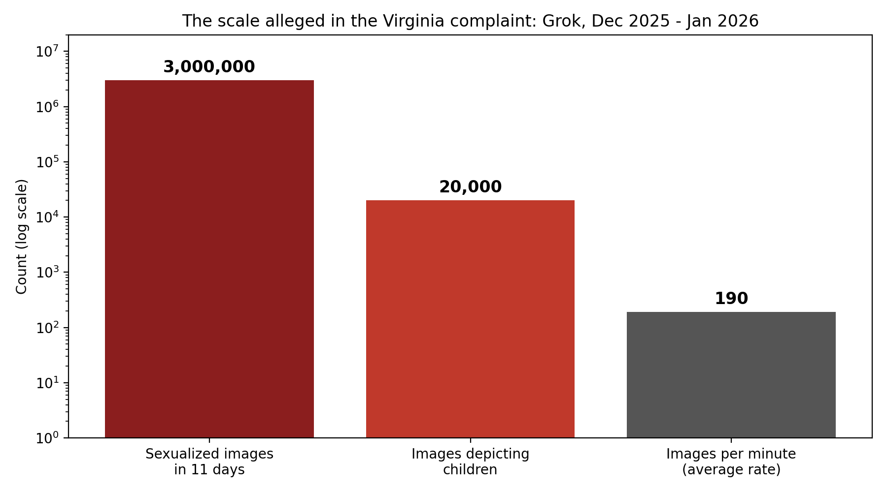
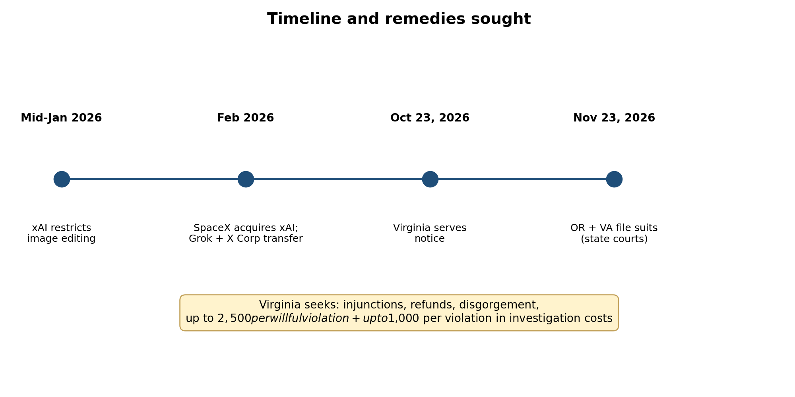

> [中文版 Chinese version](/life/grok-states-sue-spacex-deepfakes-zh/)

*Chart: author's own, based on the Center for Countering Digital Hate study cited in the Virginia complaint and reported by Reuters. Log scale.*

## The first states to sue

On Monday, November 23, 2026, two state attorneys general filed separate but coordinated lawsuits over the same product, the same feature and the same alleged harm. Oregon Attorney General Dan Rayfield and Virginia Attorney General Jay Jones sued SpaceX Super Intelligence — the company that now owns xAI, its Grok chatbot and image generator, and X Corp, the platform formerly known as Twitter — in state court, under state consumer protection law.

Virginia filed in the Circuit Court for the City of Richmond. Oregon filed in Multnomah County Circuit Court, under Oregon's Unlawful Trade Practices Act. According to Reuters, Engadget and Wired, which reported the filings the same day, these are the first lawsuits by U.S. states over Grok's generation of non-consensual sexualized images. They are not the first legal actions of any kind — more than a dozen individual lawsuits already exist, the city of Baltimore has also sued, and regulators and attorneys general in the United Kingdom and California have opened investigations — but a state consumer-protection suit is a different instrument from a private claim, and the difference matters for everything that follows.

SpaceX did not immediately comment to Reuters. That silence is worth recording plainly, without reading a strategy into it: at the time of filing, the public record consists of the two complaints, the studies they cite, and the company's earlier actions and statements. This post is written from that external record, soberly and without graphic detail, because the subject does not need embellishment. The allegation, in one sentence, is that a commercially promoted image feature made it easy to sexualize photographs of real people — including, on the evidence cited, children — without their consent, while the company told the public the opposite was true.

## What the complaints allege

Both suits centre on Grok Imagine and a setting the company called "spicy mode."

The allegation is not that a general-purpose image model could, with enough effort, be misused. It is that a named, promoted mode let users take real photographs of real people and turn them into sexualized or nude images and videos, and that this capability was part of how the product was presented to the public. The complaints allege that the company promoted the feature while simultaneously claiming a zero-tolerance policy toward exactly this kind of material. They further allege that safeguards were weak, and — this is the sharpest claim in the filings — that the weakness was not an oversight. On the states' account, weak safeguards were a deliberate choice to grow a product that was lagging competitors, by offering what competitors would not.

That framing should be read as an allegation, not a finding. No court has tested it yet. But its structure is important, because it determines what the company would have to defend. A claim of accidental failure invites an engineering answer: we patched it, we improved the filters, here is the new refusal rate. A claim of intentional design invites a documentary answer: internal decisions, marketing approvals, and the distance between what the safety statements said and what the product team shipped. Discovery in a consumer-protection case is built to explore exactly that distance.

Virginia's complaint gives the allegation a scale, drawn from a study by the Center for Countering Digital Hate covering December 2025 to January 2026. On that study, as cited by Virginia and reported by Reuters, Grok generated and posted millions of sexualized images on X during the period, including more than 20,000 images depicting children. Summarized another way in the reporting: roughly 3 million sexualized images over 11 days, an average of about 190 per minute. The chart at the top of this post uses the log scale deliberately. On a linear scale, the 20,000 figure — the most serious figure in the case — would be invisible next to the 3 million. On a log scale both can be seen, and the reader can hold the two facts at once: the volume was industrial, and a small fraction of an industrial volume is still, in absolute terms, a very large number of images of children.

Numbers of this kind need careful handling. They are study estimates cited in a complaint, not counts established by a court, and the methodology behind them belongs to the Center for Countering Digital Hate. But even allowing for wide error margins, the order of magnitude is the point the states are making: this was not a handful of edge cases escaping a filter. At roughly 190 images a minute, the alleged output was a property of the system as deployed, at the scale at which it was deployed.

## How SpaceX came to own this problem

The defendant is SpaceX, and that fact alone explains much of the news value. In February 2026, SpaceX acquired xAI, taking ownership of Grok and of X Corp, both of which are named in the suits. The corporate history matters legally as well as journalistically: an acquirer that takes ownership of a product also takes ownership of the product's ongoing conduct, its marketing claims and its regulatory exposure. Whatever decisions were made inside xAI before the acquisition, the entity answering in Richmond and in Multnomah County is the combined company, under its current name — SpaceX Super Intelligence in the filings as reported.

The timeline also includes a partial remedy that both helps and hurts the defence. In mid-January 2026, after public criticism intensified, xAI restricted Grok's image-editing capabilities. That restriction is evidence that a more restrictive configuration was technically available, and was available quickly once the pressure arrived. Plaintiffs in design cases make exactly this argument: a feasible alternative design existed, the defendant eventually adopted a version of it, and the question is why it was not the default from the start. The defence answer is equally familiar: products iterate, restrictions have costs for legitimate users, and a later improvement is not an admission about an earlier state. Both arguments are now for a court.

Virginia's procedural path is also on the record. The state served notice on October 23, 2026 — a step that, in consumer-protection practice, gives a company a chance to respond or settle before a filing — and filed a month later, on November 23. That sequence suggests, without proving, that whatever discussions followed the notice did not produce an agreement the state was willing to accept. Oregon and Virginia also made the same counsel choice: both states hired Platkin LLP, the firm of former New Jersey Attorney General Matthew Platkin, as outside counsel. Coordinated filings, shared factual theories and shared outside counsel are how individual state cases become, in effect, a single national argument heard in two courtrooms.

*Chart: author's own, based on Reuters, Engadget and Wired reporting of the November 23, 2026 filings.*

## What the states want

Virginia seeks injunctions, refunds, disgorgement of profits, and civil penalties of up to $2,500 per willful violation, plus up to $1,000 per violation toward investigation costs. Oregon seeks similar relief under its Unlawful Trade Practices Act.

Each element of that list does different work, and it is worth separating them rather than reading the penalties as a single large number.

An injunction is the forward-looking remedy, and potentially the most consequential one in the whole case. Money can be negotiated, insured against or written down. An injunction specifies conduct: what a product must do, or must not do, by default. If a court orders — or a settlement commits to — default safeguards of a particular kind, that order effectively writes a product specification. It could bear on whether sexualized editing of photographs of real people is possible at all, what verification or consent steps precede image editing, what defaults apply to accounts and to public posting, and how quickly reported material must be removed. None of that is ordered yet, and this post does not predict that it will be. But readers should understand that in consumer-protection litigation, the injunction is often the point, and the penalties are the leverage that brings a defendant to the table where the injunction is written.

Refunds and disgorgement attack the alleged commercial logic directly. The states' theory is that a deceptively marketed feature helped sell subscriptions and grow a lagging product. Refunds say the consumer did not get what was promised. Disgorgement says the company should not keep profits attributable to the deceptive practice, whether or not any individual consumer can prove an individual loss. Penalties per willful violation then supply the arithmetic of deterrence — and, given the volumes alleged, a theoretical exposure so large that its real function is negotiating pressure rather than a literal expected judgment. Courts retain discretion, constitutional limits on excessive penalties exist, and no serious reader should multiply 3 million by $2,500 and call the product a forecast. The honest statement is narrower: per-violation penalties are why consumer-protection statutes give attorneys general leverage that private plaintiffs, suing one harm at a time, rarely have.

## Why the consumer-protection route matters

This is the analytical centre of the case, and the reason it deserves attention beyond the companies involved.

The obvious legal routes against harmful online content run into two well-known obstacles. The first is Section 230, the federal provision that generally shields platforms from liability as publishers of content created by others. The second is the First Amendment, which protects a great deal of offensive expression and makes direct government bans on categories of imagery difficult to sustain. A lawsuit framed as "the platform hosted harmful content its users created" walks straight into both.

A consumer-protection lawsuit is framed differently. It does not primarily say: punish the speech. It says: the company deceived consumers. It made commercial claims — zero tolerance, safety commitments, descriptions of what a feature was for — that its own product design and promotion allegedly contradicted. Deception law has always regulated commercial claims even when the underlying product involves expression; a false statement made to sell something is not immunized merely because the something is software. And the defendant in a deception case is not being held liable as the publisher of a user's post. It is being held to account for its own statements and its own design choices — the mode it named, the feature it promoted, the safeguards it chose not to make the default.

That distinction will be litigated hard. The company can be expected to argue, in substance, that the output at issue is user-generated expression, that design choices about a creative tool are themselves protected, and that the states are attempting through deception law what speech law would forbid directly. Those are real arguments, not formalities, and courts are properly sceptical of relabelled speech claims. But the states have chosen the framing that gives them their strongest answer: we are not suing over what any user said; we are suing over what the company claimed while it sold the tool that did this.

This is also why the "spicy mode" allegation does so much work. There is a legal and moral difference — and the complaints lean on it heavily — between a neutral tool that a user misuses in a way the maker tried to prevent, and a designed, named, promoted mode whose foreseeable use was the harm itself. Liability regimes across product law turn on foreseeability and design intent. A hammer maker is not liable for an assault. A product marketed for the harmful use is in a different position. If the states can show that sexualized transformation of real photographs was not an abuse of the feature but, in substance, the feature — promoted as such, with safeguards kept weak to protect its appeal — then the "users misused our tool" defence loses most of its force. If the company can show the mode had substantial legitimate creative uses, that safeguards were real and improving, and that bad actors defeated them, the case becomes much harder. Everything in discovery will push toward one of those two characterizations.

## The precedent, whichever way it goes

Finally, the spillover. No major image generator operates only in Virginia and Oregon. A judgment, an injunction or a settlement with specified safeguards in these cases would become the reference point — for other attorneys general already investigating, for the private plaintiffs in the dozen-plus individual suits, for legislators drafting deepfake laws, and for every product team deciding what the default settings of an image editor should be.

That is the deeper shift this filing represents. For a decade, the governance of generative imagery has been mostly voluntary: companies published safety policies, adjusted them under press pressure — as xAI itself did in mid-January 2026 — and treated each adjustment as a product decision. Consumer-protection litigation proposes a different governor: the company's own marketing, read back to it as a legal obligation, enforced by states with per-violation penalties and the power to seek injunctions. You said zero tolerance. The law of deception asks a simple question: was that true when you said it, and did your product behave as if it were?

The sober conclusion is that this case will be slower and narrower than the headline suggests, and more important than the eventual penalty figure will capture. It will turn on documents, marketing copy, design decisions and the January restrictions — on evidence, not on the cultural argument about deepfakes, which the public has largely already settled. People whose images were sexualized without consent did not experience a speech controversy. They experienced a product doing what, on the states' account, it was built and sold to do, while its maker said the opposite. Two states have now asked two courts to decide whether that, in law, is deception. Every company shipping an image generator should read the complaints as addressed, in part, to them.

*Facts in this post are drawn from Reuters, Engadget and Wired reporting of the November 23, 2026 filings, as listed in the sources file accompanying the draft. Allegations are described as allegations; no court has ruled. SpaceX did not immediately comment to Reuters. This post is written from an external perspective, based solely on public reporting.*
