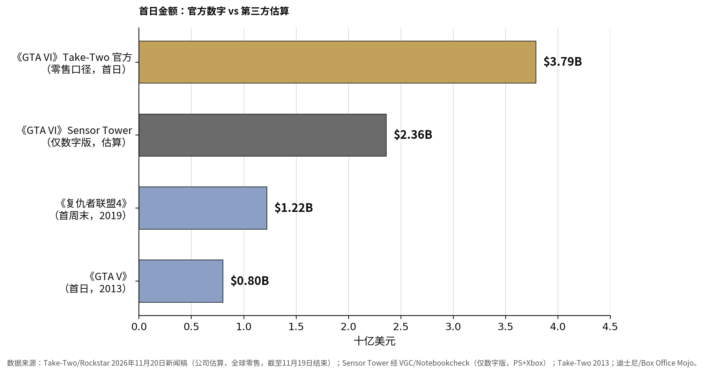
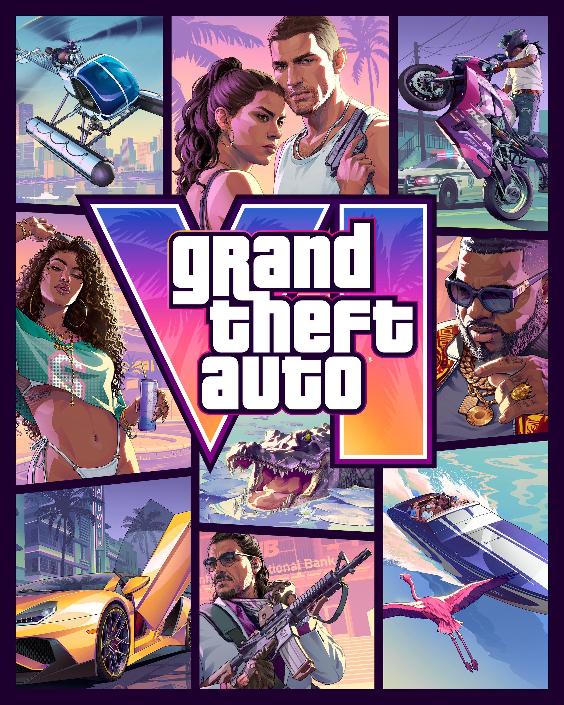

> [English version 英文版](/life/gta-6-first-weekend-379b-update/)

> **更新——本文是[《GTA 6 发售日：24 小时 23.6 亿美元》](/life/gta-6-launch-day-record-sales-zh/)的后续更新。**那篇文章昨天发表时，Take-Two 尚未公布任何官方销量数字，全文只能建立在 Sensor Tower 的第三方估算之上。11 月 20 日星期五，Take-Two 与 Rockstar 公布了官方数字。本文用官方数字替换估算，解释两者为什么相差 14.3 亿美元，并补上首周末的第二条故事线：PlayStation 5 上的闪退，以及一场销量纪录并没有平息的帧率之争。

*《GTA 6》官方主视觉。图片来源：Rockstar Games。*

## 先把更正放在最前面

昨天的标题数字是 23.6 亿美元。官方的标题数字是 37.9 亿美元。

11 月 20 日星期五，Take-Two Interactive 与 Rockstar Games 在新闻稿中表示，《GTA 6》在发售首日、截至 11 月 19 日结束，全球零售额达到 **37.9 亿美元**——这是公司自己的估算，新闻稿称之为娱乐史上最大的首发。同一份新闻稿还给出另一个数字：**发售前销量 3250 万份，覆盖所有平台，本身就是一项纪录**；此外新闻稿也提到了游戏在 Metacritic 上的 99 分。Polygon、Kotaku、GameSpot、Engadget、Fox Business、TweakTown 等媒体都在周五报道了这份新闻稿。

在任何人急着改写纪录簿之前，有两个澄清必须先说清楚。它们不是咬文嚼字，而是决定这个数字应该怎么读的分析要点。

第一，**37.9 亿美元是零售额，不是 Take-Two 的收入。**正如 Motley Fool 在报道中指出的，零售额衡量的是消费者在收银台实际花掉的钱——包括数字商店和实体店、覆盖所有地区。而 Take-Two 最终入账的只是其中的一部分：数字销售要先被平台方抽成，实体销售要先被零售商抽成。所以 37.9 亿美元适合用来和电影票房、和《GTA V》的首发做比较——因为那些同样是消费者支出数字——但不适合直接塞进收入模型里。把两者混为一谈，会大幅高估真正落到 Take-Two 利润表上的金额。这一点在中文报道里尤其容易被丢掉：很多转述直接把 37.9 亿美元写成"Take-Two 首日收入 37.9 亿"，这是错的，而且错得不小。

第二，**不能拿 37.9 亿美元除以 3250 万份来算平均售价。**这个算法很诱人——算出来大约 116 美元，比 99.99 美元的终极版还贵——但它是错的，因为两个数字描述的根本不是同一批游戏。3250 万份是**发售前**卖出的份数：游戏解锁之前就已经买下的那些。而 37.9 亿美元是**截至首日结束**的零售额，其中既包括这批预购，也包括发售日当天新卖出的全部。分子和分母不是一回事，时间窗口也对不上。值得注意的是，新闻稿并没有公布首日总销量，所以真实的平均售价用 Take-Two 已披露的数据根本算不出来。任何引用"平均每份 116 美元"的人，都是把两个从未打算相遇的数字硬除在了一起。

这种口径错位不是新闻稿的毛病，恰恰是它最有意思的地方。Take-Two 选择披露的是两个各自独立成纪录的数字——发售前份数，和首日金额——而不是一对严丝合缝的配对数据。正确的读法是把它们当作两项分开的纪录，而不是一个方程式的两边。这也是本文想立住的一个方法论立场：面对发行商的新闻稿，先问每个数字的口径，再问它大不大。口径不清的"大"，只是营销；口径清楚的数字，才是可以拿来推理的事实。

## 官方数字为什么比估算高出 14.3 亿美元

昨天的文章依靠的是 Sensor Tower 的估算：约 2460 万份、23.6 亿美元。这个估算并不粗糙，它只是口径有限。Sensor Tower 统计的是**仅数字版、仅 PlayStation 与 Xbox** 的销售。它完全看不到实体零售——盒装版、装着下载码的盒子、GameStop 门口午夜排队的人群，以及全世界同类场景。而恰恰是在这种量级的文化事件里，实体版的占比会被放大：收藏者买盒装，家长买盒装，想为"十三年一次"的事件在架子上留个实物的人买盒装。

所以这 14.3 亿美元的差距，原则上可以分解为三部分：全球实体零售、Sensor Tower 模型可能低估的数字销量、以及"什么算一次销售、何时算"的定义差异。Take-Two 没有公布渠道拆分，所以确切的分解比例从公开数据里无从得知——这一点同样应该明说，而不是用一个猜出来的百分比填上。可以确定的只有方向：估算是地板，不是天花板。昨天的文章当时就写了这一点——"真实总额更可能更高，而不是更低"。事实确实如此，而且高了 61%。

这里还有一个对所有发售数字报道都适用的教训。第三方追踪机构发布得快、修订得悄无声息；官方数字发布得晚、且口径由自己定义。在大约 24 小时里，娱乐史上最大首发的公共记录，是一个仅统计数字版、低估了实际规模三分之一以上的估算。周四写下的每一篇头条——包括本站的——都带着这个低估。这不是什么丑闻，而是发售周数据的正常物理规律。但它应该让读者对任何不注明渠道口径的首日数字保持警惕：一个数字如果说不清自己数了什么，它的可信度就应该打折，无论它看起来多精确。2460 万份、23.6 亿美元，精确到小数点后两位，口径却只覆盖了一部分货架——精确和准确，从来是两回事。

*首日零售额对照。数据来源：Take-Two/Rockstar 2026 年 11 月 20 日新闻稿（公司估算，全球零售，截至 11 月 19 日结束）；Sensor Tower 估算，经 VGC/Notebookcheck 报道（仅数字版，PS+Xbox）；Take-Two（《GTA V》，2013 年）；迪士尼/Box Office Mojo（《复仇者联盟 4》首周末）。图表：作者自制。*

## 把 37.9 亿美元放回它该在的坐标系

和《GTA V》比：TweakTown 计算得出，《GTA VI》首日卖出的份数，相当于《GTA V》**头三个月**累计的销量；而首发收入比《GTA V》整个发售季度还高出 **154%**。需要标明：这是 TweakTown 基于官方新闻稿做的计算，不是 Take-Two 自己的官方对比口径。但即便打上很大的折扣，形状也不会变。《GTA V》2013 年首日 8 亿美元，当时是有史以来最快达到 10 亿美元的娱乐产品；十三年后，它的续作首日做到了 4.7 倍，定价更高，面对的却是本世代主机相对更小的装机基础。

和好莱坞比：《复仇者联盟 4：终局之战》2019 年整个全球首周末票房 12.2 亿美元，是影史最大的电影开画。《GTA VI》一天之内做到了它的 3.1 倍，只在两台主机上，没有 PC 版。昨天基于估算的说法是"一天接近翻倍"，官方数字把它变成了三倍多。比较做到这个份上，其实已经停止提供信息、开始变成范畴错误了：好莱坞已经没有同量级的事件可供对照。诚实的说法是，《GTA VI》的首发现在是其他所有首发拿来对比的基准，而不是反过来。这句话听起来像夸张，但数字摆在这里：当一个产品一天的消费者支出是影史最大开画三天的三倍多时，"史上最大"就不再是修辞，而是一个会计事实。

和预测机构比：Newzoo 今年夏天发布的发售前估算预测，到发售周结束，《GTA VI》有望达到 **45 亿美元、最高 5100 万份**。这同样是分析师在发售前做的估算，必须按估算来读——但值得注意的是官方首日数字已经站在了这条预测线的什么位置：仅仅一天，就完成了预测整周收入的 84% 左右。除非周末销量断崖式下跌——而从直播数据、售罄报道和整体文化热度来看，没有任何迹象表明会这样——Newzoo 的首周预测现在看起来更像是一个途经点，而不是上限。本文写作时，首个完整周末的周六还没有计入，接下来两天会检验这个判断。

还有一个常被忽略的对照维度：时间。《GTA V》花了三天达到 10 亿美元，当时已经是吉尼斯纪录。《GTA VI》在游戏解锁之前——仅凭预购——就已经越过了这条线，然后在首日结束时把纪录推到了 37.9 亿美元。这意味着这次发售的收入结构是高度前置的：钱在产品被消费之前就已经收完了。这种模式对发行商是完美的现金流，对玩家则是一种信任的预支。3250 万人在玩到游戏之前就付了钱，其中相当一部分人付的是 99.99 美元的终极版价格。这种信任不是凭空来的，它是 Rockstar 用前作十三年长尾口碑存下的资产。而这也正是为什么首周末的硬件问题——接下来要讲的闪退和帧率——在道义上比在商业上更重要：当你提前收了 3250 万人的钱，你欠他们的不只是一个好游戏，还有一个能正常跑起来的游戏。

## 3250 万份预购，单独看也是一项纪录

在 37.9 亿美元的光芒下，3250 万份这个数字容易被当成陪衬，但它值得单独停留一会儿。它的含义是：在任何人能玩到这款游戏之前——在评测解禁之后、但在亲自上手之前——已经有 3250 万人付了全款。这在娱乐史上没有先例。电影的预售票房纪录以千万美元计，不以千万张票计；演唱会门票可以在开演前售罄，但场馆容量给它封了顶。游戏是唯一一种可以在"产品被消费之前"就以这种规模完成交易的娱乐品类，而《GTA VI》把这条赛道推到了一个其他产品短期内够不着的位置。

这个数字还改变了发售日的性质。传统上，发售日是发行商最紧张的一天：口碑在那一天形成，销量在那一天验证。3250 万份预购意味着，对 Rockstar 来说，发售日的商业验证在解锁前就已经完成了大半——37.9 亿美元里有相当大的一部分，是在游戏可玩之前就锁定的收入。发售日真正要验证的，只剩下口碑的持续性：玩家上手之后的评价、直播的热度曲线、以及第二周、第三周的长尾。这也是为什么首周末的故障报告虽然在商业上掀不起波澜，在信誉上却格外敏感：预购模式本质上是玩家把判断权提前让渡给了发行商，发行商回馈这份信任的方式，只能是产品在每一台机器上都如约运行。

还有一个产业层面的推论。如果"发售前 3250 万份"成为新的标杆，其他大型发行商会试图复制它：更早开启预购、更高比例的终极版与收藏版、把营销预算进一步前置到发售之前。但这种模式有它的前提——一个十三年不发续作、且前作至今仍在畅销榜上的系列。把《GTA VI》的预购数字当成可复制的打法，是对因果的误读：它不是预购运营的胜利，而是一个文化符号在十三年沉默之后兑现的利息。利息只能收一次，这也是为什么这个数字大概率会长期留在纪录簿上。

## 对 Take-Two 的账本意味着什么

零售额不是收入，前面已经说过，但这不意味着 37.9 亿美元与 Take-Two 的财务无关。方向上，它意味着公司此前向投资者给出的发售季度净预订额指引——约 81 亿美元，据 TweakTown 此前报道——在发售日第一天就获得了最强的支撑。净预订额与零售额同样不是一回事，它扣除平台分成与递延等因素，但两者的相关性是直接的：消费者在收银台花的钱越多，公司能确认的预订额就越高。首日完成预测整周收入的八成以上，也让"这个季度会不会不及预期"的问题基本失去悬念，剩下的悬念只在超预期多少。

对股价的含义则需要冷静。这个量级的成功，在很大程度上已经被市场提前定价——毕竟预购曲线一周以来就挂在所有人的屏幕上，Sensor Tower 的估算再怎么低估，也早已把"史上最大首发"写进了预期。官方数字的作用不是制造惊喜，而是消除尾部风险：它证明了实体渠道没有掉链子，证明了第三方估算的误差方向是向上而不是向下。对投资者来说，发售周真正的信息增量不在首日，而在接下来几个季度的留存与 GTA Online 的接棒——那才是《GTA V》用十三年证明过的、把一次发售变成一台印钞机的机制。目前没有任何数据能提前回答那个问题，所以对 37.9 亿美元最准确的财务解读是：它兑现了预期中最好的一部分，但它本身不是故事的结局，只是把结局的门槛抬高了。

## 首周末的另一条故事线：开机几分钟就闪退的 PS5

这个量级的发售，压力测试的不只是服务器。自 11 月 19 日起，越来越多 PlayStation 5 玩家报告《GTA VI》在开始游玩后几分钟内闪退，报错代码 **CE-108255-1**。据报道，常规手段——重装游戏、清缓存、重建数据库——对受影响的玩家都不起作用。报告覆盖基础版 PS5、Slim 和 Pro，也有少量 Xbox 报告。Wccftech 等媒体的报道（经 TechPowerUp、ixbt 等汇总）把这一模式与可能的过热联系起来：老化主机内部积灰，以及 PS5 已知的液金导热问题——随着多年使用，APU 上的液态金属导热材料可能出现干涸点（dry spots），主机竖放时据报道更容易发生。

这个关联必须小心处理，因为它目前是一个穿着解释外衣的假说。正如 Softonic 的报道所指出的，**CE-108255-1 是一个通用的应用错误代码，不是过热诊断**。它只是 PS5 在应用崩溃时显示的代码，本身并不说明崩溃的原因。目前没有任何受控的散热测试证明高温导致了这一批闪退，而且截至 11 月 20 日，**索尼和 Rockstar 都没有公开承认这一问题，也没有发布修复**。过热理论有它的合理性——一款把 CPU 推到这种程度的游戏，确实会最先在装机基础中散热最差的机器上出问题，而最早的 PS5 现在已经五到六年了——但"合理"不等于"已证实"，本文不会把它升级为事实。

抛开推测，可以确定的是结构性的一层。《GTA VI》是第一款要求一台 2020 年的主机连续数小时维持最高模拟负载的游戏。一台散热已经悄悄退化的主机——散热片里有灰、液金有干涸点——可以跑过所有负载更轻的游戏，唯独在这一款上倒下。如果过热理论哪怕只有一部分成立，那么闪退报告本质上就不是一个《GTA VI》的 bug 故事，而是主机老化故事的开端：这一代的旗舰作品，成了揭示整个装机基础老化程度的诊断工具。遇到 CE-108255-1 的玩家，现阶段能做的还是那些无聊但有用的事——清理主机、检查通风和摆放方式、保留好购买凭证——同时等索尼或 Rockstar 的官方说法。在官方开口之前，社交媒体上任何斩钉截铁的解释都跑在了证据前面。

还要补一句关于信息环境的话。这类故障在发售周的传播有一个固定模式：先是零星的玩家报告，然后是科技媒体汇总，然后是汇总被二次转述时丢掉限定词，最后变成"PS5 玩 GTA 6 会过热烧机"这样的标题在社交平台流传。本文坚持的标注方式——谁报道的、代码的通用性质、官方尚未回应、因果未经受控测试证明——不是繁琐，而是对读者的基本责任。受影响的玩家规模目前同样没有可靠数字：报告"越来越多"是事实，但分母是上千万台 PS5，个案的传播密度不能换算成故障率。在索尼或 Rockstar 给出任何口径之前，关于"有多普遍"和"为什么"的问题，诚实的答案都是：尚不知道。

## 以及，仍然是每秒 30 帧

帧率之争从昨天到今天没有移动，因为事实没有移动。Rockstar 已向 Kotaku 表示，不会推出 40 帧或 60 帧模式，即便在 PS5 Pro 上也不会。原因据技术制作总监马克·钱伯斯（Marc Chambers）的解释在 CPU：模拟运算——人群、交通、野生动物、彼此交互的系统——装不进这一代处理器每帧 16.7 毫秒的预算里，而 Pro 的 CPU 相比基础版只有小幅提升。

Digital Foundry 的测试仍然是参照点：PS5 Pro 保持锁定的 30 帧和完美的帧 pacing，基础版 PS5 在最激烈的场面会掉到 25 帧上下。DF 进一步的判断——需要标明，这是专家分析判断而非仪器测量——是：即便是 PC 级硬件也难以稳定守住 60 帧，因为瓶颈在模拟复杂度，不在渲染。Engadget 与 VGC 的报道也印证了"无性能模式"这一立场。换句话说，约束不是 Rockstar 不愿意拨一个开关，而是这款游戏的定义性特征——一个比任何主机游戏都更稠密的活模拟——是用 CPU 毫秒计价的，而这一代主机没有两倍的毫秒可卖。

把两条硬件故事连起来看，它们其实是同一条。闪退指向散热：老化冷却系统上的持续最高负载。帧率指向算力：一套在 30 帧就已经吃满 CPU 的模拟，60 帧更是无从谈起。两者是同一个底层事实的两个视角——《GTA VI》在任何时刻都用掉了 2020 年主机几乎全部的余量。留有余裕的游戏不会让积灰的主机闪退，也不需要去向 Kotaku 解释自己的帧率。这一款不留余量，而且是刻意如此。

对玩家而言，这里面有一个消费层面的提醒值得单独说。PS5 Pro 的定价是 700 美元，它在这款定义本世代的游戏上买到的，是光线追踪阴影和更清晰的超分画面，而不是更高的帧率。如果你是专门为了《GTA VI》考虑购入或升级 Pro 的玩家，正确的预期是"同样的 30 帧、更好看的 30 帧"，而不是"更流畅的 GTA"。这个预期管理不是 Rockstar 的责任——他们已经明确说了不会有性能模式——而是购买决策时应该计入的事实。价格为 2026 年 11 月 21 日查询的快照，可能变动：标准版 79.99 美元、终极版 99.99 美元。

## 周末正中央的冲突

于是首周末同时装着两个真实、却彼此别扭的故事。

故事一：娱乐史上最大的首发，现在是官方的了。一天 37.9 亿美元。游戏还不能玩的时候就卖出了 3250 万份。Metacritic 99 分。一个第三方估算，因为看不见被清空的实体货架，事后被证明低估了整整 14.3 亿美元。

故事二：一款暴露了其发售平台上限的游戏。开机几分钟就闪退的主机，原因尚未得到官方解释。在一台 700 美元的高端主机上锁定的 30 帧，开发商明确表示不会有补丁改变它。一台 2020 年的基础版主机在激烈场面掉到 25 帧上下，它五年积灰与液金的散热系统，成了发售故事的一部分。

诱惑是选一个故事、把另一个降级处理：要么销量证明抱怨只是噪音，要么抱怨证明这次发售问题重重。两种做法都是错的，而且错在同一个地方——把一次发售当成判决，而不是测量。销量测量的是需求，而需求是彻底的：人们以任何娱乐产品都未曾达到的数量买了这款游戏，被 99.99 美元终极版拉高的平均支出，在他们中的大多数人玩到一分钟之前就已经付清。硬件故事测量的是供给——一台 2020 年的主机以 2026 年的状态究竟能交付什么——答案是：它的一切，一滴不剩。一款产品完全可以同时是空前的商业成功和其平台上的一道应力裂缝。这个周末，就是一款这样的产品。

我的判断，在昨天的基础上更新如下：关于钱的争论已经结束了，而且结束得比估算所显示的更彻底。真正还敞着口的，是硬件之争，而且它变宽了——从"30 帧能不能接受"，变成"这一代的定义之作把平台推到红线，究竟意味着什么"。这个问题会比发售周末的头条活得久得多。它甚至可能是下一代主机能要求的最强论证：不是营销部门递交的，而是 3250 万名预购顾客、以及少数客厅里那些正在努力跟上自己所购之物的机器，共同递交的。

也要对昨天的自己做一个诚实的交代。昨天的文章在官方数字缺席时，用估算写了头条，并且明确标注了估算的来源与局限——这是当时唯一能做的写法。今天官方数字出来，估算被替换，差距的原因被解释，这个过程本身就应该是发售报道的常态：数字会更新，口径要交代，先前写错或写低了的地方要公开更正，而不是悄悄改掉。一篇发售报道的价值，不在于它第一天就全对，而在于它每一天都知道自己哪些数字是事实、哪些是估算、哪些是假说，并且如实告诉读者。本文对闪退与过热关联的处理、对平均售价陷阱的拆解、对 Newzoo 与 TweakTown 数字的标注，都是同一条纪律的不同应用。

*《GTA VI》标准版官方美术图。图片来源：Rockstar Games。标准版 79.99 美元，终极版 99.99 美元，2026 年 11 月 21 日查询；本文价格为 2026 年 11 月 21 日快照，价格可能变动。*

## 为什么这场冲突不会很快消失

值得多想一层的是：这场"纪录与极限"的冲突，为什么偏偏发生在这款游戏、这个时间点上。答案藏在主机世代的节奏里。PS5 与 Xbox Series X|S 发售于 2020 年，至今已进入第六个年头——一个世代通常在第五到第七年交棒。也就是说，《GTA VI》落在了这一代硬件生命周期的最末端：装机量最大、机器最老、玩家期待最高，而芯片的实际能力已经被六年来的软件优化榨得所剩无几。任何一款野心较小的游戏，都可以在这个阶段靠成熟的引擎和保守的目标安稳过关；Rockstar 偏偏选择在这个节点交付其历史上模拟密度最高的世界。冲突几乎是时间表注定的。

这也解释了为什么同样的 30 帧，放在 2023 年的《星空》身上是丑闻，放在 2026 年的《GTA VI》身上却主要是争论而非丑闻：玩家能感知到密度差异。屏幕上的雷奥奈达每一帧都在向玩家展示 CPU 预算花在了哪里——人群的密度、交通的连贯、野生动物与天气系统的交互。当交换是肉眼可见的时候，玩家的容忍度会显著提高。这不是双重标准，而是价值判断：帧率从来不是孤立的数字，它是与画面里发生的事情一起被定价的。

往前看，这场冲突真正的遗产可能是它给下一代主机定下的隐含规格表。下一代机器的 CPU 必须强到足以让"《GTA VI》级别的模拟跑到 60 帧"成为可演示的卖点；它的散热设计必须能在一台用了五年的机器上依然守住持续满载。这两条都不是营销部门能决定的，它们是工程约束，而《GTA VI》的首周末把这两条约束以最公开的方式摆上了台面。从这个意义上说，闪退报告和帧率之争非但不是这次发售的污点，反而可能是它对行业最持久的影响：销量纪录会被下一款大作刷新，但"一款游戏如何重新定义硬件的及格线"，会被写进下一代主机的设计会议里。

## 接下来看什么

三件事。第一，索尼或 Rockstar 是否会承认 CE-108255-1 的报告，以及任何承认是否会给出原因——在此之前，过热关联在本站保持"已报道、未证实"的标注。第二，完整首周数字与 Newzoo 45 亿美元 / 5100 万份预测的对照：首日已经完成了预测整周收入的约 84%，所以这个周末决定了那份估算到底是大胆还是保守。第三，Take-Two 是否会公布一个口径匹配的首日总销量——只有到那时，平均售价才能被诚实地算出来，而不是靠两个错位数字相除。

第四件事，是黑色星期五。发售日 11 月 19 日距离北美最大的购物季只有一周，主机厂商和零售商都有充分的动机把《GTA VI》做成假期同捆与引流的主角。如果首日 3250 万份预购加首日销量只是开始，那么到年底，这个数字的量级还会再上一个台阶——而《GTA V》的历史提醒我们，这个系列的销量从来不是一次性事件，它发售十三年后仍在销售。首日纪录回答的是"有多大"，假期与明年回答的才是"有多久"，而后一个问题的答案，才决定这次发售在十年后被如何讲述：是一次空前的爆发，还是一个长青系列的又一个起点。

第五件事，是用户口碑与媒体口碑的对照。评论者给出了 99 分，玩家社区的声音则会通过用户评分、论坛帖子和直播弹幕在接下来几周里慢慢成形。如果玩家评分同样稳在高位，30 帧之争就可以定性为一场声量很大、但不影响大多数人实际体验的圈内争论；如果玩家评分明显低于媒体评分，最可能的裂口就是帧率、Series S 的表现和这一批闪退报告。无论哪种结果，这个对照都值得记录，因为它会影响未来几年发行商在"保真度还是帧率"这个问题上的站位——开发者真正听的，从来不是争论的音量，而是争论是否传导到了销量和评分上。到目前为止，37.9 亿美元说明它没有传导到销量上；评分这一关，还在进行中。

昨天我们写道：钱的事已经尘埃落定，争论才刚刚开始。官方数字修正了前半句：钱的事并没有尘埃落定——它被低估了。后半句不变。

*本文价格为 2026 年 11 月 21 日查询的价格快照，价格可能变动。37.9 亿美元与 3250 万份为 Take-Two/Rockstar 2026 年 11 月 20 日新闻稿中的公司估算；37.9 亿美元为截至 11 月 19 日结束的全球零售额，不是 Take-Two 的收入。Sensor Tower 数字为第三方估算，仅覆盖数字版。Newzoo 的 45 亿美元 / 5100 万份为发售前分析师估算。闪退与过热相关报道截至 2026 年 11 月 20 日，未经索尼或 Rockstar 证实。*
