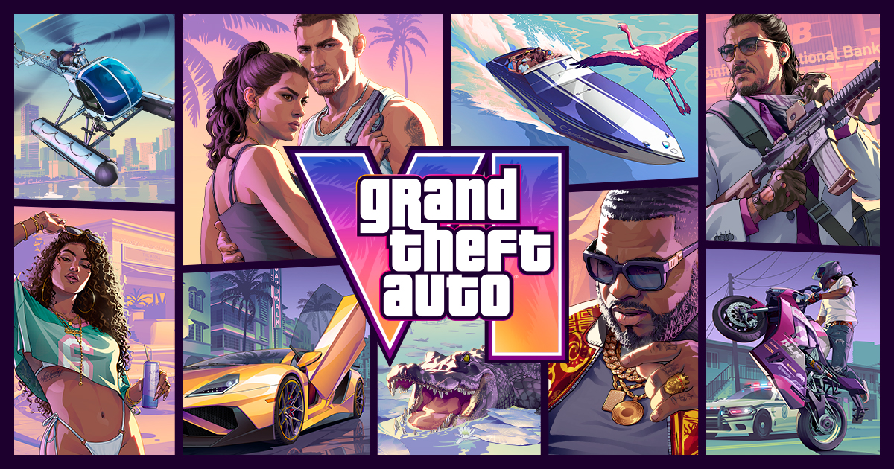
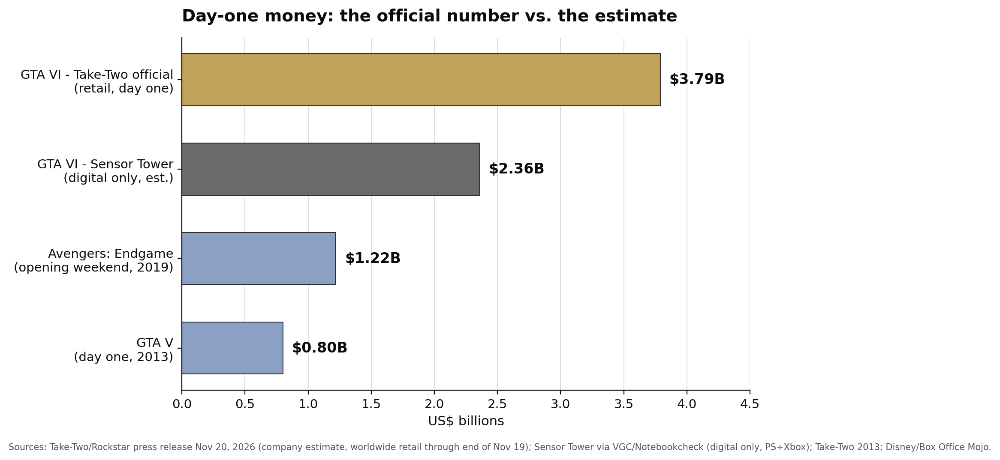
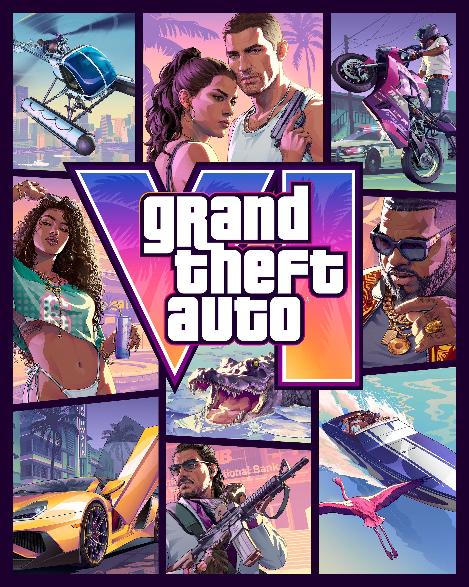

> [中文版 Chinese version](/life/gta-6-first-weekend-379b-update-zh/)

> **UPDATE — follow-up to [GTA 6 Launch Day: $2.36 Billion in 24 Hours](/life/gta-6-launch-day-record-sales/).** That post, published yesterday, was built on Sensor Tower's third-party estimate because Take-Two had not yet published an official figure. On Friday, November 20, Take-Two and Rockstar did. This update replaces the estimate with the official number, explains why the two differ by $1.43 billion, and covers the first weekend's second story: crashes on PlayStation 5 and a frame-rate argument that the sales record has not settled.

*Official key art for Grand Theft Auto VI. Image: Rockstar Games.*

## The correction, up front

Yesterday's headline was $2.36 billion. The official headline is $3.79 billion.

In a press release on Friday, November 20, Take-Two Interactive and Rockstar Games said *Grand Theft Auto VI* generated **$3.79 billion in day-one retail sales worldwide through the end of November 19**, a company estimate the release calls the biggest entertainment launch in history. The same release put **pre-release unit sales at 32.5 million copies across all platforms — itself a record** — and noted the game's 99 score on Metacritic. Polygon, Kotaku, GameSpot, Engadget, Fox Business and TweakTown all carried the release on Friday.

Two clarifications matter before anyone rewrites the record books, and both are analytical, not pedantic.

First, **$3.79 billion is retail spend, not Take-Two revenue.** As Motley Fool's coverage pointed out, retail sales measure what consumers spent at the till — across digital storefronts and physical shops, in every territory. Take-Two books only its share of that, after platform holders take their cut on digital sales and retailers take theirs on physical ones. The $3.79 billion is therefore the right number for comparing *GTA VI* with a movie's box office or with *GTA V*'s launch — those are consumer-spend numbers too — and the wrong number to drop into a revenue model. Conflating the two would overstate what lands on Take-Two's income statement by a wide margin.

Second, **you cannot divide $3.79 billion by 32.5 million and get an average price.** It is tempting — the arithmetic gives roughly $116, well above even the $99.99 Ultimate Edition — and it is wrong, because the two figures do not describe the same pile of copies. The 32.5 million is units sold *pre-release*: copies bought before the game unlocked. The $3.79 billion is retail spend *through the end of day one*, which includes those pre-release copies **plus** everything bought during launch day itself. Different numerators, different denominators, different time windows. The release, notably, did not publish a total day-one unit count, so the true average price cannot be computed from what Take-Two disclosed. Anyone quoting "$116 per copy" has divided two numbers that were never meant to meet.

That scope mismatch is not a flaw in the release; it is the interesting part. Take-Two chose to disclose the two numbers that each set a record on their own terms — pre-release units, and day-one money — rather than a single matched pair. Read them as two separate records, not as one equation.

## Why the official number is $1.43 billion higher than the estimate

Yesterday's post relied on Sensor Tower, which estimated about 24.6 million copies and $2.36 billion. That estimate was not sloppy; it was scoped. Sensor Tower counted **digital sales only, on PlayStation and Xbox**. It could not see physical retail at all — the boxed copies, the download-code boxes, the midnight queues at GameStop and their equivalents worldwide — and physical is exactly where a launch of this cultural weight over-indexes. Collectors buy boxes. Parents buy boxes. People who want something on a shelf for a once-in-thirteen-years event buy boxes.

So the $1.43 billion gap decomposes, in principle, into three parts: physical retail worldwide, any digital sales Sensor Tower's modelling undercounted, and definitional differences in what counts as a sale and when. Take-Two has not published a channel split, so the exact decomposition is unknowable from public data — and that, too, is worth saying plainly rather than filling with a guessed percentage. What can be said is directional: the estimate was a floor, not a ceiling, and yesterday's post said so at the time ("the true total is likely higher, not lower"). It was. By 61 percent.

There is a broader lesson here for how launch numbers get reported. Third-party trackers publish fast and revise quietly; official figures publish late and define their own scope. For roughly 24 hours, the public record of the biggest launch in entertainment history was a digital-only estimate that understated the event by more than a third. Every headline written on Thursday — including ours — carried that understatement. The correction is not an embarrassment; it is the normal physics of launch-week data. But it should make readers suspicious of any day-one number that does not state its channels.

*Day-one retail spend in context. Sources: Take-Two/Rockstar press release, November 20, 2026 (company estimate, worldwide retail through end of November 19); Sensor Tower estimate via VGC/Notebookcheck (digital only, PlayStation + Xbox); Take-Two (GTA V, 2013); Disney/Box Office Mojo (Endgame opening weekend). Chart: author's own.*

## Putting $3.79 billion in its proper frame

Against *GTA V*: TweakTown calculated that *GTA VI*'s day one matched the unit volume *GTA V* accumulated across its **first three months**, and that launch revenue exceeded *GTA V*'s entire launch quarter by **154 percent**. Those are TweakTown's calculations from the official release, not Take-Two's own comparisons, and they should be labelled that way — but even discounting generously, the shape is unmistakable. *GTA V* made $800 million on day one in 2013 and was, at the time, the fastest entertainment property ever to a billion dollars. Its sequel made 4.7 times that on day one, thirteen years later, at higher prices, on a smaller relative installed base of current-generation consoles.

Against Hollywood: *Avengers: Endgame* took $1.22 billion across its entire global opening weekend in 2019, the biggest movie opening ever. *GTA VI* did 3.1 times that in a single day, on two console platforms, with no PC version. Yesterday's comparison — "nearly double Endgame in a day" — was based on the estimate. The official figure makes it more than triple. At some point the comparison stops being informative and becomes a category error: there is no longer a Hollywood event in the same weight class, and the honest framing is that *GTA VI*'s launch is now the benchmark other launches get compared against, not the other way round.

Against the forecasters: Newzoo's pre-launch estimate, published over the summer, projected up to **$4.5 billion and 51 million units by the end of launch week**. That was an analyst estimate made before launch, and it should be read as one — but note where the official day-one figure already sits relative to it. One day produced $3.79 billion of the projected week's $4.5 billion. Unless sales fall off a cliff over the weekend — and nothing in the streaming numbers, the sell-through reporting or the cultural temperature suggests they will — Newzoo's week-one projection now looks less like a ceiling and more like a waypoint. The first full weekend, with Saturday still to count at the time of writing, will test that.

## The other first-weekend story: PS5s that crash minutes in

A launch this size stress-tests more than servers. Since November 19, a growing number of PlayStation 5 owners have reported *GTA VI* crashing minutes into play, returning error **CE-108255-1**. The standard remedies — reinstalling the game, clearing the cache, rebuilding the database — do not fix it for the affected players, according to the reporting. The reports span the base PS5, the Slim and the Pro, with some Xbox reports as well. Coverage by Wccftech and others, summarised by TechPowerUp and ixbt, has linked the pattern to possible overheating: dust build-up inside ageing consoles, and the PS5's known liquid-metal thermal-interface issue, where dry spots can form on the APU over years of use, particularly in consoles kept vertical.

That link needs to be handled carefully, because it is currently a hypothesis wearing the clothes of an explanation. As Softonic's coverage notes, **CE-108255-1 is a generic application error code, not an overheating diagnosis.** It is the code the PS5 shows when an application fails; it does not, by itself, say why. No controlled thermal testing has established that heat causes these particular crashes, and as of November 20 **neither Sony nor Rockstar had publicly acknowledged the issue or issued a fix**. The overheating theory is plausible — a game that pushes the CPU this hard will find the weakest cooling in the installed base first, and the oldest PS5s are now five to six years old — but plausible is not proven, and this post will not upgrade it.

What can be said without speculation is structural. *GTA VI* is the first game that asks a 2020 console to sustain its maximum simulation load for hours at a time. A console whose cooling has quietly degraded — dust in the heatsink, a dry spot in the liquid metal — can pass every lighter game and fail this one. If the thermal theory is even partly right, the crash reports are not really a *GTA VI* bug story; they are the leading edge of a console-ageing story, in which the generation's flagship title becomes the diagnostic tool that reveals how the fleet has aged. Owners hitting CE-108255-1 should treat the boring advice seriously — clean the console, check its ventilation and orientation, keep the receipts — while waiting for Sony or Rockstar to say something official. Until they do, every confident explanation on social media is ahead of the evidence.

## And still: 30 frames per second

The frame-rate argument from yesterday has not moved, because the facts have not moved. Rockstar told Kotaku that no 40fps or 60fps mode is coming, even on PS5 Pro. The reason, in technology production director Marc Chambers' explanation, is CPU: the simulation — crowds, traffic, wildlife, systems interacting — does not fit in a 16.7-millisecond frame budget on this generation's processors, whose per-core performance the Pro improves only slightly over the base machine.

Digital Foundry's testing remains the reference point: the PS5 Pro holds a locked 30fps with perfect frame pacing, while the base PS5 dips into the mid-20s in the heaviest scenes. DF's further judgment — and it is a judgment, an expert analysis rather than a measurement — is that even PC-class hardware would struggle to hold a steady 60, because the bottleneck is simulation complexity, not rendering. Engadget and VGC's coverage corroborates the no-performance-mode position. In other words: the constraint is not that Rockstar declined to flip a switch. The constraint is that the game's defining feature — a living simulation denser than anything else on console — is priced in CPU milliseconds, and this generation does not have twice as many to sell.

Connect the two hardware stories and they become one. The crashes point at thermals: sustained maximum load on ageing cooling. The frame rate points at compute: a simulation that saturates the CPU at 30fps, let alone 60. Both are the same underlying fact viewed from different ends — *GTA VI* uses essentially all of a 2020 console, all the time. Games that leave headroom do not crash dusty consoles and do not need to explain their frame rates to Kotaku. This one leaves none, by design.

## The conflict at the centre of the weekend

So the first weekend holds two true stories that sit uncomfortably together.

Story one: the biggest entertainment launch in history, now officially. $3.79 billion in a day. 32.5 million copies sold before the game was even playable. A 99 on Metacritic. A third-party estimate that turned out to understate the event by $1.43 billion because it could not see the physical shelves emptying.

Story two: a game that exposes the limits of the hardware it launched on. Consoles crashing minutes in, for reasons not yet officially explained. A locked 30fps on a $700 premium console, with the developer on record saying no patch will change it. A base machine from 2020 dipping into the mid-20s in heavy scenes, and its cooling system — five years of dust and liquid metal later — becoming part of the launch story.

The temptation is to pick one story and demote the other: either the sales prove the complaints are noise, or the complaints prove the launch is troubled. Both moves are wrong, and they are wrong in the same way — they treat a launch as a verdict instead of a measurement. The sales measure demand, and demand is total: people bought this game in numbers no entertainment product has ever matched, at an average spend pulled upward by a $99.99 Ultimate Edition, before most of them had played a minute of it. The hardware stories measure supply — what a 2020 console, in 2026 condition, can actually deliver — and the answer is: everything it has, with nothing left over. A product can be both an unprecedented commercial success and a stress fracture in its platform. This weekend, one is.

My judgment, updated from yesterday: the money argument is over, and it ended more decisively than the estimate suggested. What remains genuinely open is the hardware argument, and it has widened — from "is 30fps acceptable?" to "what does it mean that the defining game of this generation runs its platform at the redline?" That question will outlast the launch-weekend headlines. It is, among other things, the strongest argument the next console generation could ask for, delivered not by a marketing department but by 32.5 million pre-release customers and the machines struggling, in a small but real number of living rooms, to keep up with what they bought.

*Official Standard Edition artwork. Image: Rockstar Games. Standard $79.99 / Ultimate $99.99, checked November 21, 2026; prices are a snapshot as of November 21, 2026 and subject to change.*

## What to watch next

Three things. First, whether Sony or Rockstar acknowledges the CE-108255-1 reports, and whether any acknowledgement names a cause — until then, the overheating link stays labelled as reported and unproven here. Second, the full first-week numbers against Newzoo's $4.5 billion / 51-million-unit projection: day one alone reached 84 percent of the projected week's revenue, so the weekend decides whether that estimate was bold or conservative. Third, whether Take-Two ever publishes a matched day-one unit total, which would finally let the average price be computed honestly instead of by dividing mismatched figures.

Yesterday we wrote that the money was settled and the argument was just getting started. The official figure revises the first half: the money was not settled — it was understated. The second half stands.

*Prices checked November 21, 2026, subject to change. The $3.79 billion and 32.5 million figures are Take-Two/Rockstar's own company estimates from the November 20, 2026 press release; $3.79 billion is worldwide retail sales through the end of November 19, not Take-Two revenue. Sensor Tower figures are third-party estimates covering digital sales only. Newzoo's $4.5 billion / 51 million figures are pre-launch analyst estimates. Crash and overheating reporting is as of November 20, 2026 and unconfirmed by Sony or Rockstar.*
