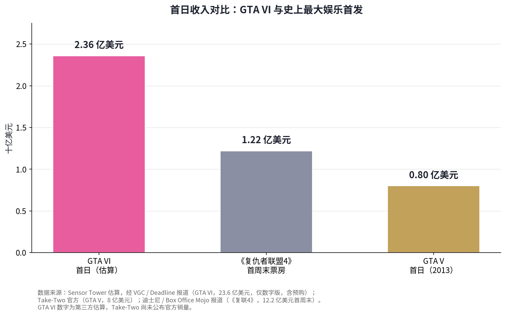
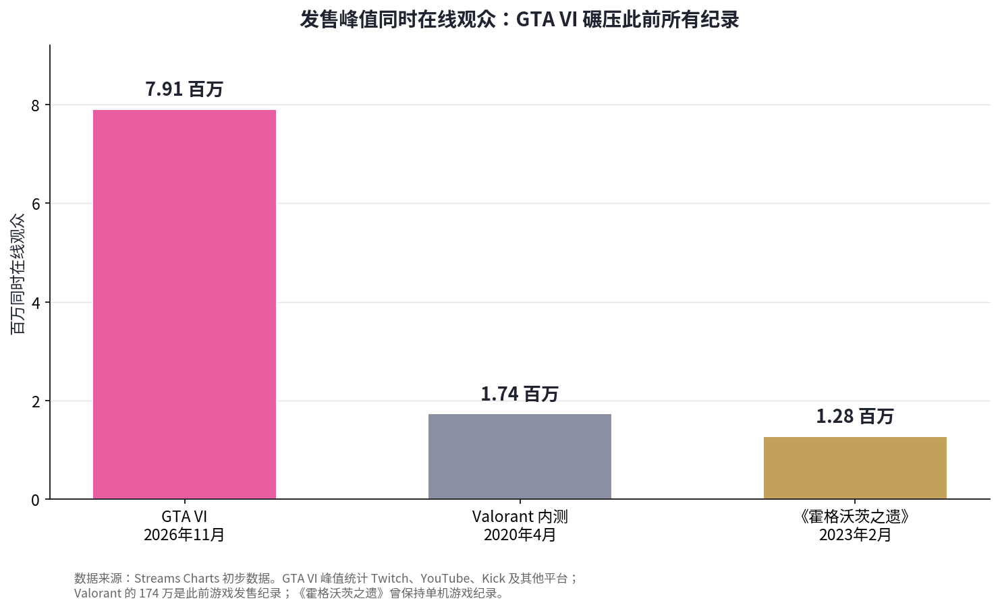
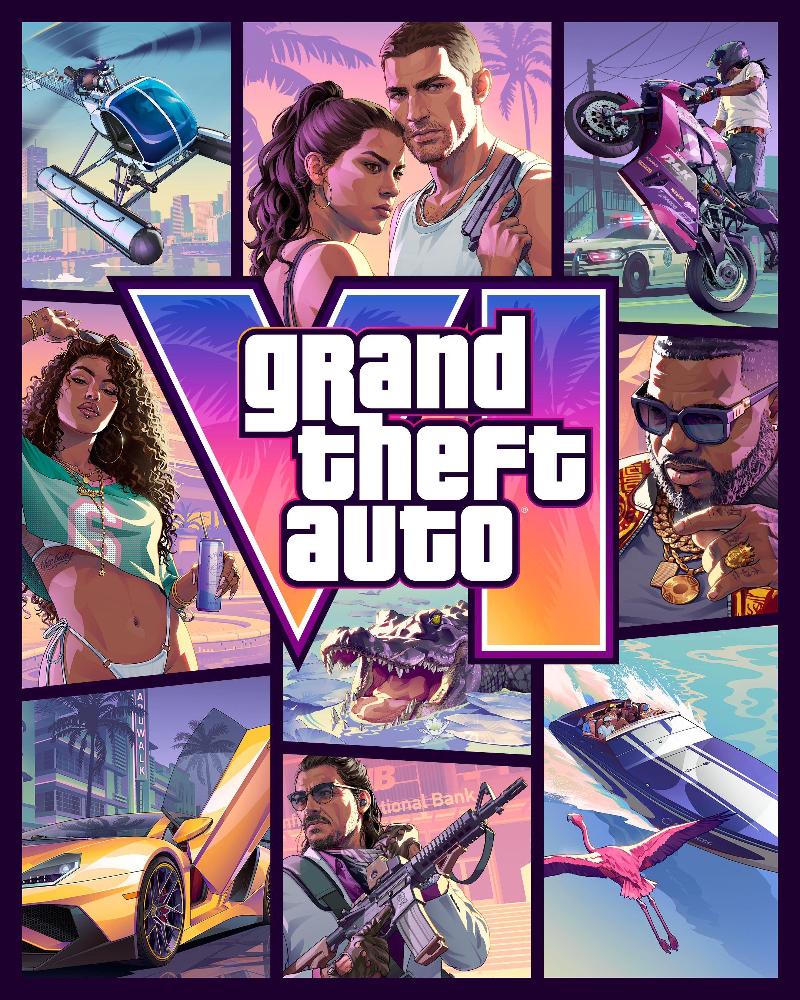
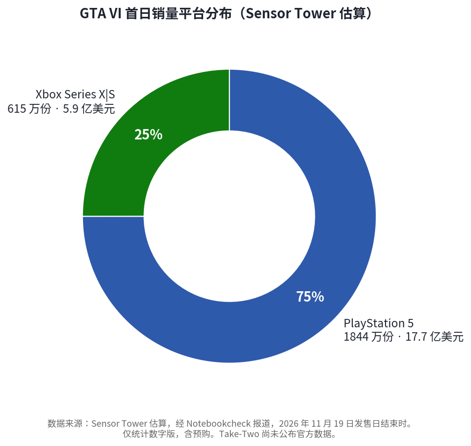

> [English version 英文版](/life/gta-6-launch-day-record-sales/)

> **系列第三篇：**这是本站 GTA 6 发售周系列的第三篇。此前两篇分别是[发售周](/life/gta-6-launch-week-record-preorders-zh/)（破纪录的预购与 212GB 下载）和[评测日](/life/gta-6-reviews-99-metacritic-zh/)（Metacritic 99 分）。本篇讲发售日当天真正发生的事——销量、直播、服务器，以及争吵。

*《GTA 6》官方主视觉。图片来源：Rockstar Games。*

11 月 19 日星期四，当大多数美国人醒来时，《GTA 6》已经改写了纪录——而游戏在洛杉矶甚至还没解锁。新西兰玩家已经玩了好几个小时，超过 200 万 Xbox 玩家临时"搬家"到新西兰加入了他们，Sensor Tower 的销量追踪器也已经突破了 18 亿美元。随后发售日正式到来：截至当天结束，Sensor Tower 估算《GTA 6》卖出约 2460 万份数字版，消费者支出约 23.6 亿美元，其中包括预购。Take-Two Interactive 尚未公布任何官方销量数字，这一点很重要——本文中所有来自 Sensor Tower 的美元数字都是第三方估算，不是经过审计的结果。但即便估算有相当大的误差，这一天的轮廓也不容置疑：这是娱乐史上最大的首发。而在这场游戏行业有史以来最大的商业胜利正中间，本周最响亮的争论却与金钱无关：每秒 30 帧。

## 数字，先对齐

标题数字需要仔细解读，因为 Sensor Tower 的追踪器一整天都在变动。周三中午，估算约为 1710 万份、16.5 亿美元——全部是预购，因为除了新西兰，游戏在任何地方都还没解锁。到周四早上，随着游戏在全球陆续解锁，数字爬升到 1910 万份、18.4 亿美元。《今日美国》引用的就是这个早上读数：PlayStation 13.8 亿美元、Xbox 约 4.64 亿美元。到周四晚上：2458 万份、约 23.6 亿美元，全天平台分布约为 PlayStation 1844 万份、17.7 亿美元，对 Xbox 615 万份、5.88 亿美元——以上来自 Notebookcheck 对同一组 Sensor Tower 数据的解读。

有两点值得停下来想一想。第一，发售当天广泛流传的 13.8 亿和 4.64 亿美元只是早上预购的快照，不是全天结果——把它当成全天成绩，会把 PlayStation 的总额低估近 4 亿美元。第二，销售不是细水长流：追踪器在周四早上到晚上之间又增加了 500 多万份。

平台分布悄悄回答了业界问了一整年的问题：Xbox 在顶级市场还重要吗？答案是重要，但要按索尼的规矩来。每四份中就有三份卖在 PlayStation 5 上。Xbox 的 615 万份仍然是个巨大的数字——超过大多数热门游戏的终身销量——但 3 比 1 的比例才是重点。需要注意，估算只统计数字版，实体光盘不在其中，PC 版则根本不存在，所以真实的首日消费者支出高于 23.6 亿美元。

*首日收入与史上最大娱乐首发对比。GTA VI 与 GTA V 为首日数据，《复仇者联盟 4》为三天首周末数据。数据来源：Sensor Tower 估算（经 VGC / Deadline 报道）、Take-Two、迪士尼 / Box Office Mojo 报道。图表：作者自制。*

## 为什么 23.6 亿美元不只是一个更大的数字

拿上一次"这种事"发生时来对照一下。《GTA V》2013 年 9 月 17 日发售，Take-Two 宣布首日 8 亿美元、三天 10 亿美元——当时是有史以来最快达到 10 亿美元的娱乐产品，并载入吉尼斯世界纪录。《GTA VI》一天之内就达到了前作首日数字的大约三倍，而且在游戏发售之前就已经跨过了 10 亿美元大关。只看倍数还低估了差距：《GTA V》以 60 美元的定价发售于两台已走到生命末期的主机上，而《GTA VI》标准版 79.99 美元、终极版 99.99 美元，发售于 Take-Two 统计的 1.38 亿台 PS5 与 Xbox Series X|S 之上（截至 2025 年 12 月）。也就是说，大约每六台本世代主机中就有一台现在装着《GTA VI》。从来没有一款娱乐产品以这么快的速度转化过它的潜在受众。

预购曲线本身就说明问题：发售前八天，预购总额就从约 1031 万份跨过了 10 亿美元；到 11 月 17 日星期二，达到 1588 万份、15.4 亿美元；周三中午 1710 万份、16.5 亿美元。Sensor Tower 高级副总裁卡尔·孔图斯（Karl Kontus）表示，仅凭预购，《GTA VI》就已经成为"2026 年最畅销的游戏"。纪录其实在发售前一周就已经破了，发售日只是让它正式生效。另一个值得注意的细节是，预购收入在发售日当天就突破了 20 亿美元——这意味着相当一部分销售额是在玩家还没玩到游戏的情况下就已经锁定的。这在任何其他娱乐品类里都是不可想象的：电影不会预售出全年票房，演唱会不会在开唱前卖掉所有场次。

好莱坞的对照最能让不关注游戏的人感受到规模。《复仇者联盟 4：终局之战》是影史最大的电影开画，2019 年整个首周末全球票房 12.2 亿美元。《GTA VI》一天就几乎翻了一倍。按 Notebookcheck 的数据，今年票房最高的电影《奥德赛》（The Odyssey）整个院线周期总票房约 18 亿美元——《GTA VI》在周四结束之前就超过了它。一款游戏，卖给同一批受众，只在两台主机上，24 小时，收入超过了影史最大开画和今年票房最高的电影。游戏行业的收入规模超过好莱坞已经很多年了，但从来没有哪一天把这一点说得这么直白。

标题数字里还藏着一个更微妙的数字：Polygon 指出，平均售价算下来约为 93.57 美元，远高于 79.99 美元的标准版定价——这意味着相当大一部分买家加钱买了 99.99 美元的终极版。Rockstar 不需要打折、不需要捆绑，也不需要为 80 美元的定价道歉。玩家平均花了比标价更多的钱，提前购买一款他们大多还没玩过的游戏。这是任何电影公司、任何其他发行商都不具备的定价权，也是竞争对手的高管们会研究最久的一个数字。它还说明了一个正在成形的行业现实：高端版本的组合销售已经悄悄成为 3A 游戏最重要的价格杠杆，基础版定价的争论反而越来越不重要。Take-Two 还向投资者表示，预计发售后的季度净预订额将达到创纪录的 81 亿美元（据 TweakTown 报道）——公司自己预计这次发售会在整个假期持续发酵，而不是冲高回落。

还有一个对照能说明这次发售的量级：据 TweakTown 对 Sensor Tower 数据的报道，《GTA VI》首日 23.6 亿美元的估算，比《GTA V》整个发售季度的 13.4 亿美元高出 76%。一款游戏用一天时间，超过了前作一个季度的收入。这个比较需要加一个限定：2013 年的季度统计口径与今天的数字追踪并不完全相同，而且《GTA V》的长尾收入——尤其是 GTA Online 带来的持续收入——才是它真正的商业奇迹。但即便如此，一天超过一个季度，仍然是一个值得停下来想一想的数字。它说明游戏行业的收入结构已经变了：过去靠长尾，现在靠首发。预购、终极版、首日直播共同构成了一个高度前置的收入模型，发行商在发售日之前就已经锁定了大部分利润。这种模式的风险也同样前置：一旦口碑翻车，退款和差评会在同一个 24 小时内反噬。但《GTA VI》没有给这种风险留机会——99 分的评测和 790 万观众同时到场，相当于给前置收入模型上了一道双保险。

当然，估算不是福音。Sensor Tower 是根据商店数据建模推算销量，它看不到 Rockstar 自己的数字，估算也不包含退款。Take-Two 首席执行官斯特劳斯·泽尔尼克（Strauss Zelnick）当天表示，公司很快会公布官方销售数据。在那之前，23.6 亿美元前面都应该挂着"估算"二字。但误差的方向值得想一想：估算完全不包括实体版，而在这个量级的发售中，光盘仍然占相当大的份额。如果说真实数字与估算有出入，真实的消费者支出更可能是更高，而不是更低。

## 另一项纪录：790 万人同时在看

如果说销量数字讲的是钱，直播数字讲的就是注意力——而这可能是发售日更令人惊讶的另一半。根据 Streams Charts 的初步数据，《GTA VI》在最初 24 小时内，Twitch、YouTube、Kick 等平台的峰值同时在线观众达到 791 万。仅 Twitch 就达到 331 万，超过了《英雄联盟》在 2022 年全球总决赛上创下的纪录，成为 Twitch 历史上观看人数最多的游戏分类。YouTube 峰值 322 万，Kick 150 万。首日总观看时长约 1.25 亿小时，两天内达到 2.1463 亿小时——超过了《艾尔登法环》《霍格沃茨之遗》和《赛博朋克 2077》发售周观看时长之和（Streams Charts 数据）。

此前的游戏发售纪录属于《Valorant》2020 年 4 月的封闭测试，174 万同时在线观众——这个数字本身在当时看来已经高不可攀，毕竟有疫情封锁和掉落奖励的封闭测试资格加持。《GTA VI》把它翻了四倍半还多。单机游戏此前的纪录属于《霍格沃茨之遗》的 128 万，《GTA VI》达到了它的六倍多。头部主播各自也吸引了体育场级别的观众：IShowSpeed 以 447 万小时观看时长领先，西班牙主播 IlloJuan 的单频道峰值约为 56.2 万观众。

*游戏发售峰值同时在线观众对比，数据来源：Streams Charts（初步数据）。图表：作者自制。*

这组数字的意义不止于炫耀。它说明这次发售不只是一次交易，而是一场共享的文化事件——那种没玩的人也想看的罕见时刻。这种动态过去属于超级碗或皇室婚礼：直播的、共同参与的、不容错过的时刻。游戏行业以前也有过直播大日子，但从来没有一次，观看的人数达到游玩人数的三分之一。约 2460 万人买了游戏，峰值时刻还有近 800 万人在看别人玩。这个比例才是把一次产品发售变成共同历史的东西，也是《GTA VI》会成为未来十年每个发行商案例研究的原因。它也解释了为什么 Rockstar 两年几乎什么都没说也无所谓：观众自己完成了营销。

更值得注意的是观看时长所揭示的参与深度。1.25 亿小时意味着在发售的第一天，平均每位购买者之外，还有相当于数百万人花了数小时观看。这不是路过点开看一眼的流量，而是持续的、沉浸的注意力。对于一款单机叙事游戏来说，这一点尤其反常：多人竞技游戏的直播有天然的观赏性和不确定性，而单机游戏的剧情直播通常意味着"剧透"，观众看完就可能不再购买。但《GTA VI》打破了这个逻辑——看别人玩并没有替代自己玩，反而成了购买的催化剂。这对整个行业的营销思路都有启发：对于足够大的文化事件，剧透不是敌人，缺席才是。

平台之间的分布也值得细看。Twitch 占了约 44% 的观看时长，YouTube 约 34%，Kick 约 22%——但 Kick 的故事最有意思：发售日当天有 1798 个频道同时在播《GTA VI》，超过此前《堡垒之夜》纪录的两倍多。Kick 作为挑战者平台，一直靠高分成和头部主播挖角来抢市场，而《GTA VI》发售日给了它一个证明自己的舞台：它不仅接住了流量，还创下了自己的单日观看纪录。对于 Twitch 来说，这次发售则是一次守擂成功——331 万的单游戏峰值超过了《英雄联盟》总决赛的纪录，证明即便在短视频和多平台分流的时代，Twitch 仍然是游戏直播的中心。YouTube 的 322 万峰值同样说明，游戏直播早已不是单一平台的生意，而是一场多平台同时进行的注意力争夺战。

## 本周的争吵：每秒 30 帧

赚了这么多钱、吸引了这么多人，发售周最激烈的争论却不是游戏好不好——评论界已经有了定论：Metacritic 上 150 位 PS5 评论者打出 99 分，全部为正面评价，追平了《塞尔达传说：时之笛》（1998 年）保持的史上最高分纪录；OpenCritic 99 分，89 位评论者中有 99% 推荐——而是游戏跑得有多快。《GTA VI》在所有主机上锁定每秒 30 帧，包括 700 美元的 PS5 Pro。没有性能模式，没有 40 帧选项，没有任何开关。Rockstar 向 Kotaku 确认，未来补丁也不会加入 60 帧模式，即便是在 PS5 Pro 上。

原因据 Rockstar 技术制作总监马克·钱伯斯（Marc Chambers）所说，不在显卡，而在 CPU。"我们的基础画面使用了光线追踪反射和全局光照，"钱伯斯告诉 Kotaku，"在 PS5 Pro 上，还增加了光线追踪阴影，以及通过 PlayStation Spectral Super Resolution（PSSR）带来的整体清晰度提升。PS5 Pro 拥有更强的图形处理器和超分技术，我们利用它们来提升游戏的视觉保真度。但 PS5 Pro 的中央处理器只比基础版 PS5 稍强，不足以用更高的帧率运行游戏复杂的模拟运算。"Digital Foundry 的测试印证了这一解释：四台主机内部渲染分辨率都是 1440p——PS5 Pro 通过 PSSR 超分到接近 4K，基础版 PS5 和 Series X 使用 Rockstar 自家的空间超分，Series S 则是 720p 通过 FSR 4 超分到约 1080p。瓶颈在于模拟运算——人群、交通、野生动物，那些让雷奥奈达显得生机勃勃的系统——把帧率翻倍意味着把每一帧的时间预算减半，从 33.3 毫秒压缩到 16.7 毫秒。Digital Foundry 称这一决定"完全合理"，并指出 Pro 在约 75 小时的测试中保持了锁定的 30 帧和"完美的帧 pacing"，而基础版 PS5 和 Series X 在激烈场面会掉到 20 多帧，Series S 在大部分日常游玩中都处于 20 多帧的中高段，最激烈的战斗中低至 18 到 19 帧。

那为什么大家还在吵？因为上一次 Rockstar 游戏以 30 帧发售以来，环境已经变了。PS5 和 Xbox Series X|S 这一代主机在很大程度上就是靠"60 帧成为新常态"卖出去的——五年下来，这个承诺大体上也兑现了。那些专门为这款游戏买了 PS5 Pro 的玩家发现，市场上最贵的主机买到的是更漂亮的阴影，而不是更快的游戏。玩笑话自己就写好了："恭喜所有专门为 GTA 6 买了 PS5 Pro 加 OLED 的人，你们的 30 帧在 OLED 上看起来绝对美极了。"也有人尖锐地指出了双重标准：正如一条广为流传的帖子所说，《星空》（Starfield）发售时锁定 30 帧"被围攻"，如今却在 Xbox 和 PS5 上都跑到了 60 帧。Rockstar 是不是得到了别的厂商得不到的优待？

诚实的回答是：部分是，部分不是。是，因为 Rockstar 的履历确实能换来"先相信再说"的优待，而且 99 分的 Metacritic 会压住那些在 79 分时会被放大的抱怨。不是，因为两种情况并不相同。《星空》的 30 帧上限当时被广泛解读为性能失败——游戏世界本身就显得空旷；而从技术证据看，《GTA VI》的 30 帧是任何主机游戏都不曾尝试过的模拟密度的代价。Digital Foundry 的结论在这里很重要：靠测量吃饭的人看了这个权衡之后，认为以现有硬件的水平，这款游戏不可能同时做到这么密集、又这么快。而真正玩过它的人——Kotaku 的评测者就是其中之一，他在 PS5 Pro 上玩了 130 多个小时，自称"有点帧率洁癖"——一直在说同一件事：前一个小时能感觉到帧数上限，然后游戏就把你吸进去了。

我的判断是：愤怒是真实的，但瞄错了靶子。合理的抱怨不是 Rockstar 选择了 30 帧，而是整个行业花了一代人的时间向玩家承诺再也不用做这种选择，然后这一代最重要的游戏偏偏又做了这个选择。受打击的是 PS5 Pro 的价值主张，而不是游戏本身：一台 700 美元的中期改款主机，主打卖点是画质而不是速度，如果你为之买单的那款游戏根本无法用它的性能跑得更快，那事后看起来就成了一笔奇怪的消费。索尼反正还会卖出大把 Pro——1844 万份 PS5 销量本身就是极强的带动效应——但 Pro 往后的卖点比周一之前要窄了。而 Series S 值得比现在得到的更严肃的审视：一台在十年最大游戏里连 30 帧都稳不住的主机，对于把它当作唯一游戏机的数百万玩家来说，是个真正的问题。微软坚持 Series S 与 Series X 功能对等的要求，在这周之后会面临更尖锐的质疑。30 帧之争其实是穿着一件外衣的三个争论——关于 Rockstar 的优先级、关于索尼的硬件、关于微软的策略——三个都值得争。

还有一点经常被忽略：帧率之争本质上是一场关于"游戏应该是什么"的争论。主张 60 帧的人认为，流畅度是游戏体验的基础设施，就像电影的 24 帧一样不可谈判；主张 30 帧可以接受的人则认为，模拟密度和画面保真度才是 Rockstar 游戏的核心，帧率只是实现手段。双方都有道理，但只有一方掌握了硬件现实：在现有的主机 CPU 上，你不可能两者兼得。真正的问题不是 Rockstar 选错了，而是这个世代的主机在设计之初就没有为这种量级的模拟运算留出余地。当下一代主机到来时，30 帧之争会像上一个世代的 720p 之争一样成为历史注脚——但在那之前，它会一直是玩家社区里最容易点燃的话题。

Series S 的情况值得单独拿出来说。Digital Foundry 的测试发现，Series S 在大部分日常游玩中都处于 20 多帧的中高段，最激烈的战斗中低至 18 到 19 帧，而且它的输入延迟在 Series X 上测得约为 180 毫秒——与同样 30 帧的《荒野大镖客 2》相当。180 毫秒是什么概念？职业电竞选手能感知到的延迟阈值大约在 50 毫秒以内，普通玩家在 100 毫秒以上就会觉得操作"黏手"。对于一款以驾驶和枪战为核心的游戏，180 毫秒的延迟意味着你的每一次转向和开火都要比你的意图晚将近五分之一秒。Rockstar 在 Series S 上保留了几乎全部视觉特性——包括 strand-based 发丝和两项光线追踪效果——这本身是了不起的工程成就，但代价是帧率和响应速度。微软坚持 Series S 与 Series X 功能对等，这次发售让这项政策的代价第一次变得具体：它不是一个抽象的"性能分层"问题，而是数百万玩家每天实际感受到的操作体验。

## 新西兰 trick，以及它说明了什么

发售日第二大的新闻不是一个数字，而是一种行为：数百万玩家拒绝等到午夜。因为 Rockstar 选择按各地区当地时间午夜解锁，而不是全球同步，新西兰最先解锁——而任何一台 Xbox，只要改一下设置就能加入他们。据 Ampere Analysis 估算，仅美国和英国就有约 210 万 Xbox 玩家把主机地区切换到新西兰来提前游玩：美国约 150 万，英国约 60 万，此外加拿大和巴西各约 20 万，墨西哥约 10 万。在 PlayStation 上，这个 trick 需要创建一个单独的新西兰账号并通过该地区商店购买游戏——而且存档是锁区的，在新西兰玩的进度可能带不回来——所以美国只有约 10 万玩家费这个事。Xbox 的存档不锁区，切换只需改个设置、重启一下。

规模本身就是重点。新西兰总人口约 530 万。11 月 18 日的几个小时里，仅美国和英国就多了 200 多万"居民"，新西兰旅游局甚至在社交媒体上跟着玩起了梗。而微软和 Rockstar 似乎什么都没做。从严格意义上说，这个 trick 违反 Xbox 的服务条款，但微软从来没有因为切换地区而执行过这条规则，发售周也没有出现封号的迹象。

这说明了什么？两件事。第一，分地区午夜解锁已经是个过时的模式。它存在的意义是让每个地区都有自己的午夜时刻，这个想法来自实体店午夜首发的年代。但在数字优先的世界里，它制造了一个长达近一天的窗口：游戏已经出了、直播了、切片了、剧透了，而还没解锁的玩家只能干等。唯一体验到无剧透发售的，是新西兰人和加入他们的 200 万玩家。其他所有大作发行商早就改成全球同步解锁，正是出于这个原因；最大的发行商 Rockstar 却坚持旧模式，它的玩家于是以工业级的规模绕过了它。第二，Xbox 与 PlayStation 的不对称，悄悄打了一则关于各平台如何对待玩家的广告。Xbox 开放、不锁区的做法让 trick 变得轻而易举；PlayStation 的账号锁区则把它变成了一件麻烦事。索尼在商业上没有付出任何代价——75% 的销量就是 75% 的销量——但它把本周关于"哪台主机更尊重玩家时间"的最好故事拱手让给了微软。

这个事件还有一层更深的含义：它暴露了"发售日"这个概念本身正在瓦解。过去，发售日是一个清晰的时刻：午夜、排队、开箱。现在，发售变成了一个持续近 24 小时的滚动过程，不同地区的玩家在不同时间进入，直播和社交媒体让"先玩到"变成了一种可以炫耀的资本。Rockstar 的分地区解锁本意是给每个时区一个仪式感，结果却制造了一个套利空间——时间差本身成了可以被利用的资源。未来所有大作都会从这件事吸取教训：要么全球同步，要么接受玩家自己"同步"。而对玩家来说，这次事件也确立了一个新的默认预期：只要存在时间差，就一定会有人跨过去，平台方的默许只会让这种行为越来越普遍。

新西兰 trick 还有一个附带效应：主播们的风险。发售日流传的警告称，通过新西兰 trick 提前直播可能导致 Twitch 封号，YouTube 上的直播也可能因裸露和性内容政策被警告。这些警告吓到了不少创作者；但截至本文写作时，是否有知名频道真的受到处罚，尚未得到证实。有意思的是，警告本身比处罚更有影响力：在规则模糊、处罚标准不透明的情况下，创作者宁愿保守也不愿冒险。结果是，发售日最早的几个小时里，最有流量的主播们反而最谨慎，而小主播和不知名频道成了最早的直播主力。这种"谨慎者吃亏"的局面，恰恰说明了平台规则在面对史无前例的发售时有多么滞后——规则是为日常情况写的，而《GTA VI》的发售日不是日常情况。

## 光鲜之外的混乱

没有这个量级的发售是干干净净的，《GTA VI》的边缘也比头条显示的要乱。PlayStation Network 在发售日出现了登录问题，11 月 19 日当天近 1 万名用户报告了服务器连接、登录、下载和更新方面的问题（据 Cybernews 对故障报告的汇总）；索尼没有公开解释原因。一些购买实体版的玩家报告说，盒子里的下载码缺失或已被使用——Insider Gaming 和 Dexerto 都写了这个问题，但没有任何一方、包括 Rockstar，确认过它有多普遍，Reddit 和 X 上的个别案例还不能证明这是系统性故障。210GB 的下载本身对网速慢或有流量上限的玩家就是一道门槛，而盒装版里装的是一张下载码，不是光盘——这个细节至今仍让不少买家感到意外。

日本版成了自己的故事。玩家在发售后发现，日版比全球版小约 1.1GB——Xbox 商店上约为 208.7GB 对 209.9GB——而且差别在于内容，不在语言：淋浴场景中角色穿着内衣，一些性和海滩场景被修改或删除，血液减少、消失得更快，而且日版完全没有血腥程度调节选项。这是发售后玩家报告和对比测试得出的结论。Rockstar 在发售前没有确认过任何改动，日本的 CERO 分级也省略了其他地区列出的性内容描述词。游戏在日本获得 CERO Z 分级——最严格的一档，仅限 18 岁以上购买。这事是有前科的：《GTA V》的日版也是同样处理的，"按章办事"（By the Book）任务中的拷问段落被替换成了黑场。但沉默才是痛点：日本玩家花了同样的价钱，只有玩起来才知道自己买到的是什么。Rockstar 至今没有公开解释这些改动。

这里值得多说一句：审查本身不是新闻，沉默才是。日本市场对游戏内容的审查有漫长的历史，发行商为了拿到 CERO 分级而修改内容是常规操作，几乎所有 3A 大作都经历过。问题在于 Rockstar 事前只字不提。玩家不是不能接受一个经过修改的版本——他们不能接受的是在不知情的情况下买到它。在一个预购已经占了绝大多数销量的时代，"先买后知"尤其刺眼：当 2460 万份里的大部分都是提前付款的，发行商在版本差异上的透明度就不再是礼貌问题，而是商业诚信问题。日本玩家社区的反应也说明了这一点：抱怨的焦点不是"为什么改"，而是"为什么不早说"。这对 Rockstar 是个教训，对整个行业也是——当预购成为默认购买方式，信息披露就必须跑在收款前面。

日本玩家也不是完全没有选择，只不过每个选择都有代价。理论上可以购买海外版，但北美版的盒装下载码只能用美国 PlayStation 账号兑换，日本账号无法兑换；而日本版盒装内的下载码按当地法律必须在发售后 170 天内兑换。换句话说，想玩到完整版的日本玩家，要么注册一个海外账号、走海外商店重新购买，要么接受审查版。这种"花钱买麻烦"的处境，正是区域版本差异最让玩家恼火的地方：审查本身可以讨论，但当它和账号锁区、兑换期限这些技术细节叠加在一起，玩家感受到的就不是"本地化"，而是"被区别对待"。

然后是那个不算泄露的"泄露"。发售当天，自称 Cyberleek 的泄密者宣称放出了 2026 年 11 月的 Xbox 版游戏——约 209GB 文件通过种子传播，主程序被扣下，倒计时到 11 月 23 日到期，或者如果泄密者自己的加密货币市值达到 1500 万美元就提前放出。这是个传闻，必须标明是传闻：没有任何媒体或安全研究人员独立证实这些文件是真正的《GTA VI》构建版本，Rockstar 和 Take-Two 也没有评论，而且网络安全公司 Netcraft 此前已经确认过多个冒充 Cyberleek 的欺诈网站在传播恶意软件。这个说法作为盗版的意义不大——没有主程序的 Xbox 构建版本在任何设备上都运行不了——但作为发售日马戏团的一环，它很说明问题：现在连海盗都在搞代币预售了。

*《GTA VI》标准版官方美术图。图片来源：Rockstar Games。标准版 79.99 美元，终极版 99.99 美元，2026 年 11 月 20 日查询，价格可能变动。*

发售日还流传着针对主播的警告：通过新西兰 trick 提前直播可能导致 Twitch 封号，而 YouTube 上的直播可能因裸露和性内容政策被警告。这些警告确实吓到了不少创作者；但截至本文写作时，是否有知名频道真的受到处罚，尚未得到证实。主播们的谨慎本身就很说明问题：在平台规则模糊、处罚标准不透明的情况下，创作者宁愿保守也不愿冒险——而这种自我审查，恰恰是发售日混乱中最安静、也最普遍的一种。

## 涟漪：超出游戏之外

发售的影响溢出了游戏圈，进入了整个经济。人力资源平台 BambooHR 报告称，18% 的美国受薪员工——接近五分之一——计划在 11 月 19 日请假，其中 Z 世代为 32%、千禧一代为 27%；当天的请假申请比往年可比日期高出约 13%，而计划请假的人中约有一半表示打算请病假而不是休年假。另一项针对 1000 名美国成年人的 GameSquare 调查发现，39% 的人提前请了假，平均四天。两项调查中可能有一项高估了——关于"装病"的调查通常如此——但方向是明确的：娱乐史上最大的发售，也是一次可以衡量的、对美国职场的冲击。一家公司的请假系统大概不会把"侠盗猎车手"列为请假理由，但 11 月 19 日这一天，全美国的经理们都知道发生了什么。

*GTA VI 首日销量平台分布。数据来源：Sensor Tower 估算，经 Notebookcheck 报道，2026 年 11 月 19 日发售日结束时。仅统计数字版，含预购。图表：作者自制。*

3 比 1 的平台分布还值得单独看一眼，因为它正在改写主机战争的叙事。PlayStation 5 卖出 1844 万份、17.7 亿美元，Xbox Series X|S 卖出 615 万份、5.88 亿美元。这个差距比两台主机的装机量差距要大得多——它说明在 3A 大作这个层面，PlayStation 已经成为默认平台，是玩家因为一款游戏而买主机时首先想到的平台。Xbox 的 615 万份本身仍然是个巨大的数字，但趋势很清楚：索尼赢得的不仅是这一代的销量，还有"大作首选平台"的心智地位。对微软来说，真正的考验在后面：当玩家已经认定某个平台是玩大作的地方，下一代的竞争还没开始就已经输了一半。Game Pass 和云游戏可以讲别的故事，但在这个发售日，故事是 PlayStation 的。

颁奖季在游戏发售之前就注意到了它。The Game Awards 提名于 11 月 17 日星期二公布——发售前两天——《GTA VI》以八项提名领跑，包括年度游戏、最佳游戏指导、最佳叙事、最佳艺术指导、最佳配乐、最佳音效设计、最佳动作冒险游戏，以及曼尼·L·佩雷斯（Manni L. Perez）凭借露西娅一角获得的最佳表演提名。（一些早期报道写的是六项；完整名单是八项，这个更正很重要——它是今年提名最多的游戏。）颁奖典礼于 12 月 10 日在洛杉矶孔雀剧院举行。一款游戏在任何付费玩家玩到它之前就获得年度游戏提名，是颁奖日历造成的奇怪产物，但在这周之后，没人会说这是过早的。

而那只没有叫的狗：PC。至今没有 PC 版，也没有 PC 版的发售日期，Rockstar 没有说过任何改变这一点的话。有报道指向 2027 年的 PC 移植，但那是传闻，不是公告，Take-Two 自己的发售清单上也只有 PS5 和 Xbox Series X|S。Cyberleek 的闹剧在某种程度上正是这种真空的症状：PC 玩家群体——正是他们通过模组和角色扮演服务器让《GTA V》成为长达十年的收入机器——被排除在史上最大发售之外，而这种需求正在以奇怪的方式表达出来。PC 版到来的时候——历史经验说它一定会来——那将是第二次发售，会有它自己的一组纪录要破。顺带一提，30 帧的争论到那时会一夜蒸发：在 PC 上，帧率取决于你的硬件能跑多快。

## 结论：13 年的等待，值了吗？

13 年是很长的时间。《GTA V》发售于 2013 年 9 月，那时 iPhone 5s 还是新品，PlayStation 4 还不存在。13 年的等待积累的期待，是任何产品都无法完全满足的。诚实地说，发售日在所有可以衡量的方面都达到了期待，只留下一个真正的争论没有解决。

可以衡量的方面：销售纪录、评测分数、直播观众、职场缺勤、奖项提名——全部指向同一个方向。这不是一次勉强越过 hype 的发售，而是一次把它远远甩在身后的发售。估算首日 23.6 亿美元、150 位评论者打出 99 分且零中评零差评、790 万同时在线观众：这些不是一款令人失望的游戏的数字。这些数字重新定义了一次发售可以是什么样子，也将成为未来十年衡量每个发行商的标尺。更重要的是，这些数字不是孤立的：它们互相印证。预购破纪录、评测破纪录、直播破纪录、请假破纪录——当四个完全独立的指标同时指向同一个结论时，结论就不再是某个统计口径的产物，而是事实本身。

13 年这个时间跨度本身也值得想一想。《GTA V》发售时还是青少年的玩家，现在很多人已经成家、有了孩子；当年和父母一起玩《GTA V》的人，现在可能正在和自己的孩子一起玩《GTA VI》。这种代际传递是任何其他娱乐产品都很难复制的：电影系列可以拍续集，但很少有哪个系列能让同一批观众在人生的两个阶段都守在发售日。Rockstar 等了 13 年才交出续作，这个等待本身成了一种营销——越久越神圣，越神圣越不能失败。发售日的数字证明，这种策略赌赢了。但它也留下了一个问题：如果下一代《GTA》还要再等 13 年，等待它的会不会是另一批已经长大的人？这个问题没有答案，但它提醒我们：这次发售的纪录不只是商业上的，它还是一代人共同记忆的一部分。

没有解决的方面：帧率。不是因为 30 帧毁了游戏——从 Digital Foundry 的仪器数据到玩了 130 个小时的评论者，证据都表明它没有毁掉游戏——而是因为它暴露了这一代主机所承诺的与它最大的游戏所能交付的之间的差距。愤怒的玩家生气并没有错，只是气错了对象。Rockstar 做了一个站得住脚的工程选择，硬件让这个选择成为必要。如果非要找一个反派，那就是每台现役主机里那颗有着八年历史的 CPU 架构，而不是打造了有史以来要求最高的模拟运算的那家工作室。

立场说清楚：《GTA VI》的发售是娱乐史上最大的一天，它背后的游戏按我们拥有的唯一共识标准来看，是有史以来最好的游戏之一，而 30 帧之争是关于真实权衡的真实争论，销售数字解决不了它，也不应该被允许解决它。如果你有 PS5 或 Xbox，对开放世界游戏有任何兴趣，那就买吧——标准版 79.99 美元、终极版 99.99 美元，2026 年 11 月 20 日查询的价格。期待人类建造过的最好的雷奥奈达，以每秒 30 帧运行，在所有主机上，而且不会有补丁来改变这一点。至于主机欠玩家什么的讨论，会在销售纪录不再是新闻之后继续很久。钱的事已经尘埃落定，争论才刚刚开始。而这场争论的走向，会比首日销量更能决定这个世代主机游戏的未来。

## 发售日之后看什么

发售日只是第一章，接下来有几件事值得盯着。第一是 Take-Two 的官方数字：泽尔尼克说很快就会公布，到时候可以验证 Sensor Tower 的估算到底准不准，以及实体版到底加了多少。第二是玩家口碑：Metacritic 的用户评分在 11 月 19 日中午 12 点（太平洋时间）开放，评论者给出的 99 分和玩家打出的分数之间的落差，会是未来几周最有意思的对照——尤其是 30 帧的争论会不会在用户评分里发酵。如果用户评分明显低于媒体评分，最可能的裂口就是帧率和 Series S 的表现——那将是评论界与玩家社区第一次公开分歧的时刻。反过来，如果用户评分也稳定在高位，30 帧之争就基本可以定性为一场圈内争论：声音很大，但不影响绝大多数玩家的实际体验。无论哪种结果，这个对照都值得记录，因为它会决定未来几年里，发行商在保真度还是帧率这个问题上的站位。第三是 11 月 23 日：Cyberleek 倒计时的到期日，看看那颗被扣下的主程序到底会不会出现，还是说这整件事从头到尾就是一场代币营销。第四是圣诞档：Take-Two 预计本季度 81 亿美元的净预订额，意味着这场发售的真正考验不是首日，而是它能不能在整个假期里持续卖下去。最后是 The Game Awards：12 月 10 日，八项提名能变成几座奖杯，将是对"史上最佳游戏之一"这个判断的第一次公开检验。发售日的纪录已经写进历史，接下来要看的是，这款游戏能不能在纪录之外，再写出点别的东西。

还有一个时间点值得标注：黑色星期五。发售日是 11 月 19 日星期四，距离北美最大的购物季只有一周。Take-Two 预计的 81 亿美元季度净预订额，相当一部分要靠圣诞档的主机捆绑销售来实现——而《GTA VI》是最强的捆绑理由。索尼和微软都有动机在假期推出同捆套装，而零售商则会把《GTA VI》当作吸引客流的招牌。如果首日 2460 万份只是开始，那么到年底，这个数字可能会变成一个更难想象的量级。历史经验是，GTA 系列的销量从来不是一次性的：《GTA V》在发售 13 年后仍然在卖。首日纪录回答的是"有多大"，假期和明年回答的才是"有多久"。

*本文价格为 2026 年 11 月 20 日查询，价格可能变动。所有来自 Sensor Tower 的销量数字均为第三方估算；Take-Two 尚未公布官方发售日销量。Streams Charts 的直播数据为初步数据。*
