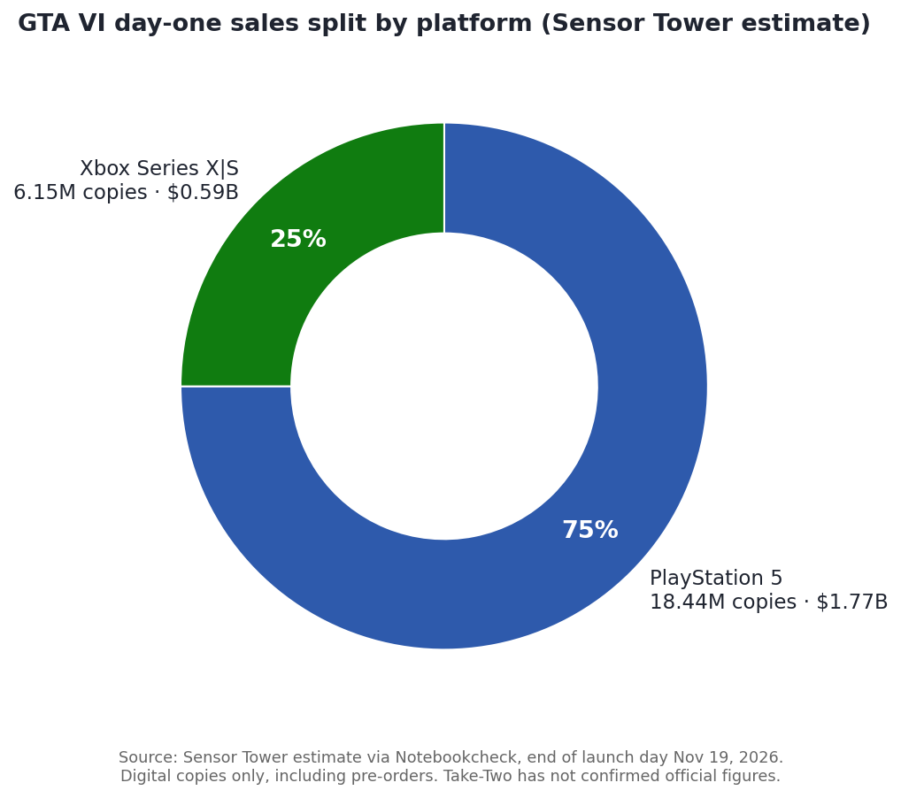
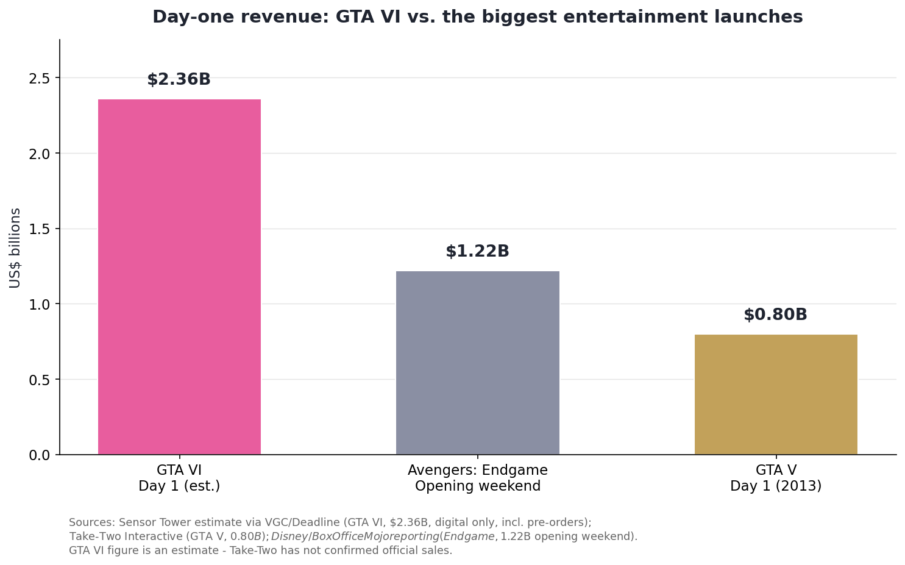
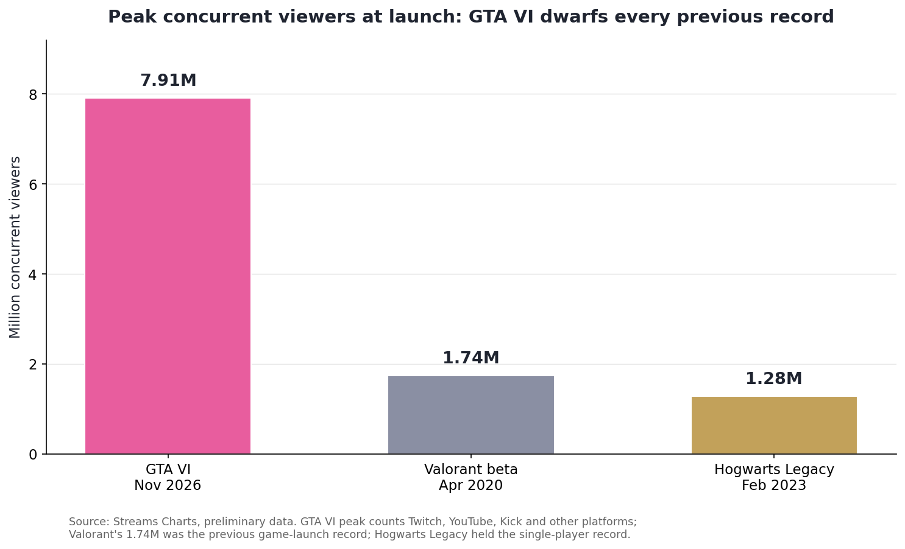
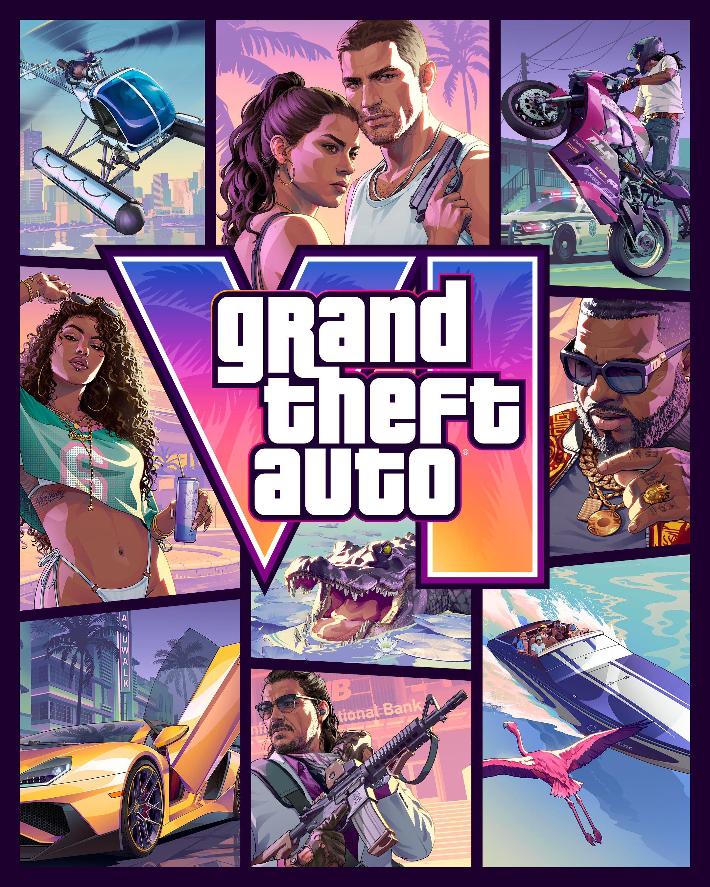

> [中文版 Chinese version](/life/gta-6-launch-day-record-sales-zh/)

> **Follow-up:** third post in our GTA 6 launch-week series, after [launch week](/life/gta-6-launch-week-record-preorders/) and [reviews day](/life/gta-6-reviews-99-metacritic/). This one covers launch day itself — the sales, the streams, the servers, and the fights.

*Official key art for Grand Theft Auto VI. Image: Rockstar Games.*

By the time most of America woke up on Thursday, November 19, *Grand Theft Auto VI* had already broken the record books — and the game had not even unlocked in Los Angeles yet. New Zealanders had been playing for hours, and Sensor Tower's sales tracker was already past $1.8 billion. By the end of launch day, Sensor Tower estimated *GTA VI* had sold about 24.6 million digital copies for roughly $2.36 billion, pre-orders included. Take-Two Interactive has not confirmed any official sales figure — every dollar figure here from Sensor Tower is a third-party estimate, not an audited result. Even so, the shape of the day is not in doubt: this was the biggest launch in entertainment history. And in the middle of it, the loudest argument of the week was about a number that had nothing to do with money: 30 frames per second.

## The numbers, reconciled

The headline figure needs a careful reading, because Sensor Tower's tracker moved all day. On Wednesday at midday, the estimate stood at about 17.1 million copies and $1.65 billion — all pre-orders. By Thursday morning it had climbed to 19.1 million copies and $1.84 billion. USA Today quoted that morning reading as $1.38 billion on PlayStation and $464 million on Xbox. By Thursday evening: 24.58 million copies and about $2.36 billion, with the full-day split at roughly 18.44 million copies and $1.77 billion on PlayStation versus 6.15 million copies and $588 million on Xbox, per Notebookcheck's reading of the same data.

First, the $1.38 billion and $464 million figures that circulated widely on launch day were a morning snapshot of pre-orders, not the final tally — anyone quoting them as the day's result understates PlayStation's total by nearly $400 million. Second, the sales were not a slow burn: the tracker gained more than five million copies between Thursday morning and Thursday evening.

The platform split quietly answers a question the industry has asked all year: does Xbox still matter at the top end? The answer is yes, but on Sony's terms. Three out of every four copies sold were on PlayStation 5. Xbox's 6.15 million copies are still an enormous number, but the 3-to-1 split is the story.

*Day-one sales split by platform. Source: Sensor Tower estimate via Notebookcheck, end of launch day Nov 19, 2026. Digital copies only, including pre-orders. Chart: author's own.*

*Day-one revenue vs. the biggest entertainment launches. Sources: Sensor Tower estimate via VGC/Deadline; Take-Two; Disney/Box Office Mojo. Chart: author's own.*

## Why $2.36 billion is not just a bigger number

Put it against the last time this happened. *GTA V* launched on September 17, 2013, and Take-Two announced $800 million in first-day sales and $1 billion within three days — then the fastest entertainment property ever to reach a billion dollars, a Guinness World Record. *GTA VI* took in roughly three times its predecessor's day-one total in a single day, and crossed the $1 billion line before the game was even out. The comparison is even more lopsided than the multiple suggests: *GTA V* launched at $60 on two consoles at the end of their lives, while *GTA VI* launched at $79.99 standard and $99.99 Ultimate, on a combined installed base Take-Two put at 138 million consoles as of December 2025.

The Hollywood comparison makes the scale land for people who do not follow games. *Avengers: Endgame*, the biggest movie opening in history, took $1.22 billion worldwide across its entire opening weekend in 2019. *GTA VI* nearly doubled that in one day. The games industry has been bigger than Hollywood by revenue for years, but it has never had a single day that made the point this bluntly.

There is a subtler number inside the headline: Polygon noted the average sale price worked out to about $93.57, well above the $79.99 standard edition price — meaning a large share of buyers paid up for the $99.99 Ultimate Edition. Rockstar did not need to discount or apologize for an $80 game: players paid more than the sticker price on average, in advance, for a game most had not yet played. But with physical copies excluded from the estimate, the true total is likely higher, not lower — and Take-Two has not confirmed official figures.

## The other record: 7.9 million people watching at once

If the sales figures are about money, the streaming figures are about attention. According to preliminary data from Streams Charts, *GTA VI* peaked at 7.91 million concurrent viewers across Twitch, YouTube, Kick, and other platforms in its first 24 hours. On Twitch alone it hit 3.31 million, passing the record League of Legends set at its 2022 World Championship final. YouTube peaked at 3.22 million, Kick at 1.50 million. Total watch time hit about 125 million hours in the first 24 hours.

The previous record for a game launch was Valorant's closed beta in April 2020, at 1.74 million concurrent viewers. *GTA VI* beat it by more than four and a half times. Among single-player games, the old mark belonged to *Hogwarts Legacy* at 1.28 million; *GTA VI* cleared six times that.

*Peak concurrent viewers for game launches, per Streams Charts (preliminary data). Chart: author's own.*

That ratio — 24.6 million buyers, nearly 8 million watching at the peak — is what turns a product launch into shared history, and why *GTA VI* will be the case study every publisher cites for the next decade.

## The fight of the week: 30 frames per second

For all the money and all the viewers, the fiercest argument of launch week was not about whether the game was good — the critics had settled that, with a 99 on Metacritic from 150 PS5 reviewers, all positive, tying *Ocarina of Time* (1998) as the highest-scored game ever — but about how fast it moves. *GTA VI* is locked at 30 frames per second on every console, including the $700 PS5 Pro. Rockstar confirmed to Kotaku that a 60fps mode is not coming in a future patch either, even on PS5 Pro.

The reason, according to Rockstar technology production director Marc Chambers, is the CPU, not the graphics chip. "Our base presentation makes use of ray-traced reflections and global illumination," Chambers told Kotaku. "On the PS5 Pro, this is enhanced with the addition of ray-traced shadows, as well as overall added clarity through the use of PlayStation Spectral Super Resolution (PSSR). […] While the PS5 Pro's central processor is slightly better than the PS5 base console, it is not powerful enough to run the game's complex simulation at higher frame rates." Digital Foundry's testing backs the explanation up: all four consoles render at 1440p internally — the PS5 Pro upscaling to near-4K via PSSR, the base PS5 and Series X upscaling in-house, and the Series S at 720p upscaled to about 1080p with FSR 4. The bottleneck is the simulation — the crowds, the traffic, the wildlife. Digital Foundry called the decision "entirely justified," noting the Pro holds a locked 30fps with "perfect frame pacing," while the base PS5 and Series X dip into the high 20s in heavy scenes.

So why is everyone arguing? Because this console generation was sold, in large part, on 60fps as the new normal — and for five years, that promise mostly held. Players who bought a PS5 Pro specifically for this game discovered that the most expensive console on the market buys them prettier shadows, not a faster game. Is Rockstar getting a pass other studios do not get? Partly yes — its track record buys benefit of the doubt, and a 99 Metascore muffles complaints a 79 would amplify. But the situations differ: *Starfield*'s 30fps cap was read as a performance failure in a game whose worlds felt empty, while *GTA VI*'s is, on the technical evidence, the price of a simulation no other console game attempts.

My judgment: the backlash is real but misaimed. The legitimate complaint is not that Rockstar chose 30fps — it is that the industry spent a generation promising players they would never have to make that choice again, and then the most important game of the generation made it anyway. The PS5 Pro's value proposition took the hit, not the game: a $700 refresh whose headline feature is image quality, not speed, looks like a strange purchase in hindsight.

## The New Zealand trick, and what it says about launch day

The second-biggest story of launch day was not a number but a behavior: millions of players refused to wait for midnight. Because Rockstar released *GTA VI* at midnight local time in each region rather than simultaneously worldwide, New Zealand unlocked first — and anyone with an Xbox and a settings menu could join them. Ampere Analysis estimated that about 2.1 million Xbox players in the US and UK alone switched their console region to New Zealand to play early: roughly 1.5 million in the United States, 600,000 in the UK, plus about 200,000 each in Canada and Brazil. On PlayStation, where the trick needs a separate New Zealand account, only about 100,000 US players bothered.

The sheer scale is the point. New Zealand has a population of about 5.3 million people. For a few hours on November 18, more than two million additional "residents" joined it from the US and UK alone. What does it mean? First, the staggered midnight launch is an anachronism: in a digital-first world, it creates a window of nearly a day in which the game is out, streamed, clipped, and spoiled for everyone who has not unlocked yet. Every other publisher of a big game has moved to simultaneous global unlocks for exactly this reason; Rockstar held out, and its players routed around it at industrial scale.

## The mess around the edges

No launch of this size goes cleanly. PlayStation Network sign-in problems hit on launch day, with nearly 10,000 users reporting issues with server connections, logins, downloads, and updates on November 19, according to Cybernews' summary of outage reports; Sony did not publicly explain the cause. Some physical buyers reported missing or already-used download codes, though how widespread that is remains unconfirmed.

The Japanese version became its own story. Players discovered after launch that the Japanese build is about 1.1 GB smaller than the global version — roughly 208.7 GB against 209.9 GB on the Xbox Store — and that the difference is content, not language: shower scenes play with characters in underwear, some sex and beach scenes are altered or removed, blood is reduced and fades faster, and the Japanese version has no gore-intensity setting at all, according to player reports and side-by-side comparisons published after launch. The silence is the sore point: Japanese players paid the same price and learned what they had bought only by playing it.

Then there is the leak that was not quite a leak. On launch day, the leaker known as Cyberleek claimed to have released a November 2026 Xbox build of the game — about 209 GB of files distributed by torrent, with the main executable withheld on a countdown expiring November 23. That is a rumor, and it should be labeled as one: no outlet or security researcher has independently confirmed the files are a genuine *GTA VI* build, and Rockstar and Take-Two have not commented. An Xbox build without an executable does not run on anything — but even the pirates are running a token presale now.

*Official Standard Edition artwork. Image: Rockstar Games. Standard $79.99 / Ultimate $99.99, checked November 20, 2026; subject to change.*

## The ripples beyond the game

The launch leaked out of gaming and into the rest of the economy. BambooHR reported that 18% of salaried US workers — nearly one in five — planned to take November 19 off, with the figure at 32% among Gen Z workers and 27% among millennials; PTO requests for the day ran about 13% higher than comparable days in past years. The direction is unambiguous: the biggest entertainment launch in history was also a measurable shock to the American workplace.

The awards circuit noticed before the game was even out. The Game Awards nominations were announced on Tuesday, November 17 — two days before launch — and *GTA VI* leads the field with eight nominations, including Game of the Year and Best Performance for Manni L. Perez as Lucia. (Some early coverage said six; the full list is eight.)

And the dog that did not bark: PC. There is still no PC version and no PC release date, and Rockstar has said nothing to change that. Reports have pointed to a PC port in 2027, but those are rumors, not announcements, and Take-Two's own release lists name only PS5 and Xbox Series X|S. That vacuum explains the Cyberleek stunt in part: the PC audience, which made *GTA V* a decade-long revenue machine through mods and roleplay servers, is locked out of the biggest launch ever.

## Verdict: did it live up to 13 years?

Thirteen years of waiting built expectations no product could meet in full. Launch day met them in every way that can be measured — and left one genuine argument unresolved.

Measured: the sales record, the review scores, the streaming audience, the workplace absence, the awards haul — all of it points the same way. This was not a launch that squeaked past the hype; it lapped it. An estimated $2.36 billion, a 99 Metascore, 7.9 million concurrent viewers: not the numbers of a disappointment.

Unresolved: the frame rate. Not because 30fps ruins the game, but because it exposes the gap between what this console generation promised and what its biggest game could deliver. Rockstar made a defensible engineering choice. The hardware made the choice necessary.

Plainly put: *GTA VI*'s launch was the biggest day in entertainment history, the game underneath it is, by the only consensus measure we have, one of the best ever made, and the 30fps fight is a real argument about real trade-offs that the sales figures do not settle and should not be allowed to. The money is settled. The argument is just getting started.

*Prices checked November 20, 2026, subject to change. Sensor Tower sales figures are third-party estimates; Take-Two has not published official launch-day sales. Streams Charts figures are preliminary.*
<!-- rebuild trigger 2026-11-20 -->
