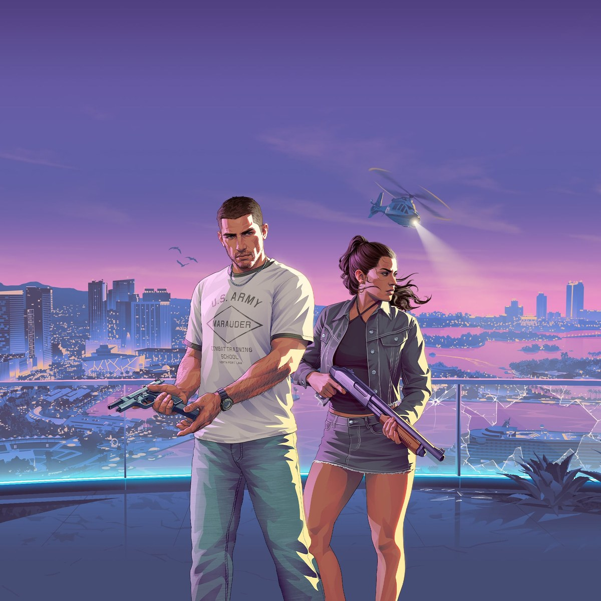
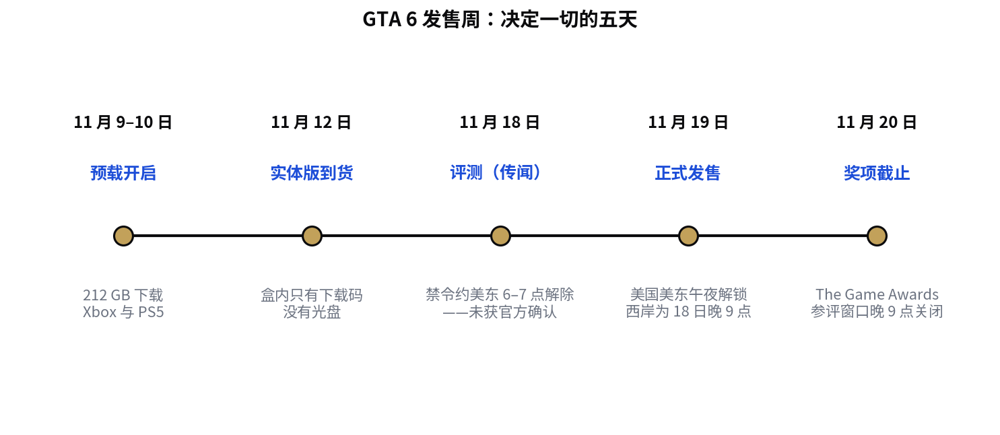

> [English version](/life/gta-6-launch-week-record-preorders/)

*黄昏的罪恶都市上空，杰森与露西娅。官方美术图：Rockstar Games。*

## 发生了什么

《侠盗猎车手 6》将于 **2026 年 11 月 19 日周四**登陆 PlayStation 5 与 Xbox Series X|S——这是 Rockstar 十三年来首款新作——而在任何人玩到它之前，纪录已经破了。索尼与微软均已确认，它成为 **PlayStation Store 与微软商店历史上预购量最高的游戏**。预购于 6 月 25 日开启。两家公司都没有公布具体预购数字，所以这个纪录是排名、不是数字——但此前没有任何一款游戏占据过这个位置。

发售周的节奏安排得非常精确，而且大部分已经启动。预载于 11 月 9 日在 Xbox 开启（美东晚 7 点）、11 月 10 日在 PS5 开启（当地午夜），下载量**最高 212 GB**——首日补丁很可能还要另算。实体版 11 月 12 日到达零售商，但盒内装的是**下载码，不是光盘**。评测据传于 **11 月 18 日周三**解禁，约美东早上 6–7 点，消息来自爆料者 NateTheHate，以及称已独立核实该日期的 Insider Gaming。Rockstar **尚未确认**禁令时间，因此请将其视为传闻而非官方消息——11 月 18 日之前看到的任何“Metascore”都不可信。

*发售周时间线。来源：Rockstar Games；PlayStation Blog；Insider Gaming（禁令时间为传闻，未获确认）。*

## 关键数字

- 标准版 **79.99 美元**，终极版 **99.99 美元**（2026 年 11 月 17 日商店标价，价格可能变动）。
- 预载 **212 GB**——主机史上最大的下载量之一，对 1 TB 硬盘里还装着别的游戏的玩家来说是实打实的约束。
- **33.5–35 亿美元**：Take-Two 预计本季度净预订额，主要由本次发售推动。据 CEO Strauss Zelnick 在最新财报电话会上的说法，预购量已超出公司内部预期。
- **24 小时**：如果传闻的禁令时间属实，玩家在发售前能看到评测的时间大约只有一天——部分视频评测可能要等到发售当天才放出。
- **一天**：GTA 6 赶上 The Game Awards 参评窗口的余量，该窗口于 11 月 20 日晚 9 点（太平洋时间）关闭。颁奖典礼于 12 月 10 日直播。

美国解锁时间为 11 月 19 日美东午夜——西岸玩家为 **11 月 18 日周三晚 9 点**；多数其他地区为当地午夜。新西兰最先解锁。发售时没有 PC 版，也没有 PS4 与 Xbox One 版；Xbox One 玩家可通过 Xbox 云游戏游玩。

## 为什么这件事重要

本周真正接受检验的有三件事，其中只有一件是游戏本身。

第一是 **80 美元定价**。GTA 6 是 79.99 美元新标准版定价迄今最受瞩目的试金石。破纪录的预购量表明玩家已经接受了它——但预购者是最坚定的买家，真正的 verdict 在发售后几周才会出现，届时尚未决定的大多数玩家将决定 80 美元是新常态还是天花板。

第二是**评测窗口**。如果传闻的禁令时间属实，Rockstar 只给媒体大约一天时间——对这种量级的游戏来说，这是自信之举，也是冒险之举：糟糕的评分几乎没有时间让市场消化，开卖的钟声就敲响了。这个赌注的前提是评分会非常好。预测市场已经像交易股票一样在交易它的 Metacritic 分数。

第三是 **Take-Two 自身**。33.5–35 亿美元的季度净预订额将使它成为历史上收入最高的娱乐产品发售，超过任何电影开画。公司实际上把整个季度——以及考虑到十三年的等待，还有它的声誉——都押在了这一个周四上。如果游戏落地顺利，话题将变成这个纪录能保持多久。如果不顺利，没有第二次发售可以遮掩。

*本文反映 2026 年 11 月 17 日上午（太平洋时间）的状况。价格为 2026 年 11 月 17 日查询的快照，可能变动。来源：Rockstar Games；PlayStation Blog；Nerdism；GTA 6 Daily；Insert Future；Action Network。*
