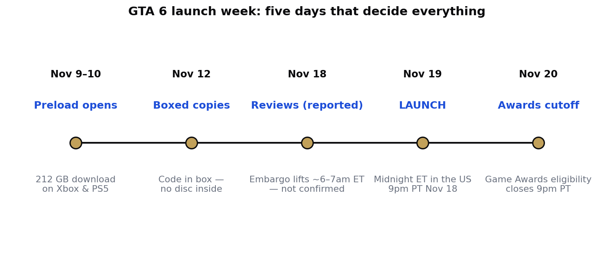

> [中文版 Chinese version](/life/gta-6-launch-week-record-preorders-zh/)

*Jason and Lucia above Vice City at dusk. Official artwork: Rockstar Games.*

## What happened

Grand Theft Auto VI launches **Thursday, November 19, 2026**, on PlayStation 5 and Xbox Series X|S — Rockstar's first new game in 13 years — and it is already breaking records before anyone has played it. Sony and Microsoft have both confirmed it is now the **most pre-ordered game in the history of the PlayStation Store and the Microsoft Store**. Pre-orders opened June 25. Neither company has released an actual pre-order number, so the record is a ranking, not a figure — but it is a ranking no game has held before.

The launch week has a precise choreography, and most of it is already in motion. Preloading opened November 9 on Xbox (7 p.m. ET) and November 10 on PS5 (local midnight), with a download of **up to 212 GB** — plus a day-one patch that is likely on top of that. Boxed copies reach retailers November 12, but the box contains a **download code, not a disc**. Reviews are reportedly embargoed until **Wednesday, November 18**, around 6–7 a.m. ET, according to leaker NateTheHate and Insider Gaming, which says it independently verified the date. Rockstar has **not** confirmed the embargo, so treat the timing as reported rather than official — and be wary of any "Metascore" you see before the 18th.

*Launch-week timeline. Sources: Rockstar Games; PlayStation Blog; Insider Gaming (embargo reported, not confirmed).*

## The road to November 19

Thursday has been a long time coming — nearly three years since the reveal, and about eight years since full development reportedly began around 2018. Rockstar confirmed the game was in development in February 2022, and the first trailer arrived on December 4, 2023, after leaking early. It drew 90.4 million YouTube views in its first 24 hours, a Guinness World Record for a video game reveal, and ended with a simple promise: 2025.

The date moved twice after that, and both moves came with a specific new date rather than a vague "later." In May 2025, Rockstar pushed the launch to May 26, 2026. In November 2025, it pushed again, to November 19, 2026, saying the extra months would let it finish the game "with the level of polish you have come to expect and deserve." Take-Two's shares fell sharply on the day of the second announcement, even as the company told investors it still expected record net bookings. Since then the date has held: Take-Two reaffirmed it in May 2026 and again in its November 9 earnings release, and Rockstar filled the gap with a second trailer in May 2025, an extended gameplay look in August 2026, and a launch trailer on October 15.

That history is the context for the pre-order record. This is not a game that appeared out of nowhere with a month of marketing behind it. It is a game the audience has been waiting on for thirteen years since GTA 5, watching two delays, and pre-ordering since June 25 — the record is the end of a three-year drumbeat, not the start of one.

## The numbers that matter

- **$79.99** for the Standard Edition, **$99.99** for the Ultimate Edition (prices as listed in stores on November 17, 2026; subject to change).
- **212 GB** for the preload — one of the largest console downloads ever, and a real constraint for anyone on a 1 TB drive with other games installed.
- **$3.35–3.5 billion**: Take-Two's projected net bookings for the current quarter, driven largely by the launch, according to CEO Strauss Zelnick on the company's latest earnings call. Pre-orders, he said, are exceeding internal expectations.
- **24 hours**: roughly how long players will have reviews before launch, if the reported embargo holds — and some video reviews may be held until launch itself.
- **One day**: the margin by which GTA 6 clears The Game Awards eligibility window, which closes November 20 at 9 p.m. PT. The ceremony streams December 10.

The launch itself is a rolling midnight, country by country, not a single global moment. PlayStation's support pages say the game releases at midnight local time on November 19, which makes New Zealand first — 11:00 UTC on November 18 — with the unlock moving westward as each country reaches midnight. The U.S. unlock is midnight Eastern on November 19, which is **9 p.m. PT on Wednesday the 18th** for West Coast players. The preload was moved forward on November 3 — from November 12 to November 10 — because, as Sony put it, the store had never carried a pre-order load like this one. On PS5, Sony tells owners to clear a minimum of 212 GB; Microsoft's catalog lists the Xbox download at about 209.9 GB. There is no PC version at launch, and no PS4 or Xbox One version; Xbox One owners can play through Xbox Cloud Gaming. And one detail that matters for launch night: the game arrives as a single-player experience only. GTA Online has no release date yet, so there is no online mode to crash — the risk on the night is the stores themselves, buckling under downloads and logins, not the game servers.

## The bar GTA 5 set

To understand what "biggest launch ever" has to beat, look at the game GTA 6 is replacing. Grand Theft Auto V launched on September 17, 2013, for PlayStation 3 and Xbox 360, and earned more than $800 million in its first 24 hours — about 11.21 million copies — then passed $1 billion in three days, the fastest any entertainment product had ever reached that figure. Guinness World Records confirmed seven records around the launch, including fastest entertainment property to gross $1 billion. Thirteen years and three console generations later, Take-Two's filings say GTA 5 has sold in more than 230 million units worldwide — a figure first given in August 2026 and repeated in the filing dated November 9, 2026 — making it the second best-selling game of all time, behind Minecraft, with lifetime revenue estimated at close to $10 billion.

That is the bar, and it explains both the hype and the caution. GTA 5's launch numbers were set in 2013, when a $60 game on two consoles could do $800 million in a day. GTA 6 launches at $79.99 on two consoles with a far larger installed base and a pre-order record already in hand — the ingredients are there for it to clear GTA 5's opening by a wide margin. But GTA 5's long tail is the harder act to follow: most of its $10 billion came not from the launch but from GTA Online, which kept selling for a decade after release. GTA 6 has no online mode at launch and no announced date for one. The opening weekend will be judged against GTA 5's opening weekend. The decade after will be judged against GTA Online, and that part of the story has not started yet.

## Why this one matters

Three things are being tested this week, and only one of them is the game.

The first is the **$80 price**. GTA 6 is the highest-profile test yet of the new $79.99 standard edition price. The record pre-orders suggest players have accepted it — but pre-orders are the most committed buyers, and the real verdict comes in the weeks after launch, when the undecided majority decides whether $80 is the new normal or the ceiling.

The second is the **review window**. Rockstar giving critics roughly a day — if the reported embargo is right — is a confident move for a game of this scale, and a risky one: a single day of reviews means a bad score lands with almost no time for the market to digest it before the tills open. The bet is that the scores will be very good. Prediction markets are already trading the Metacritic number like a stock.

The third is **Take-Two itself**. A $3.35–3.5 billion quarter would make this the biggest entertainment launch in history by revenue, dwarfing any film opening. The company has effectively bet its quarter — and, given the thirteen-year wait, its reputation — on one Thursday. If the game lands well, the conversation shifts to how long the record stands. If it doesn't, there is no second launch to hide behind.

## What happens after Thursday

The launch is not the end of the story; it is the end of the waiting. The first thing to watch is the review embargo on Wednesday morning, November 18 — if the reported 6–7 a.m. ET window holds, the Metacritic score will be public a full day before launch, and the prediction markets will settle within hours. The second is the sales number: Take-Two reports fiscal second-quarter net bookings of $1.60 billion for the period ended September 30, down 18 percent from $1.96 billion a year earlier, and has reiterated an $8.2 billion net bookings target for fiscal 2027 — a target that assumes GTA 6 does what the company says it will do. The first hard sales figure, when it comes, will be measured against GTA 5's $800 million day one and $1 billion in three days.

Then the questions shift. The Game Awards eligibility window closes November 20 at 9 p.m. PT — one day after launch — so GTA 6 will be eligible for this year's awards, with the ceremony streaming December 10. The PC version remains unannounced, as it was for GTA 5, which took a year and a half to reach PC; the pattern suggests a wait, not a refusal, but Rockstar has said nothing. GTA Online's timing is the biggest open question of all, because it is the part of GTA 5 that generated most of the $10 billion — and because a single-player-only launch means the first weeks of GTA 6 will be judged purely as a game, not as a platform. Zelnick told investors on the latest earnings call that Rockstar will turn to its next project once GTA 6 reaches players, and that development on the game itself is finished. What that next project is, he did not say.

*This post reflects the status as of the morning of November 17, 2026 (PT). Prices are a snapshot as of November 17, 2026, and are subject to change. Sources: Rockstar Games; PlayStation Blog; Nerdism; GTA 6 Daily; Insert Future; Action Network; Take-Two Interactive; Guinness World Records; Mission Marker.*

