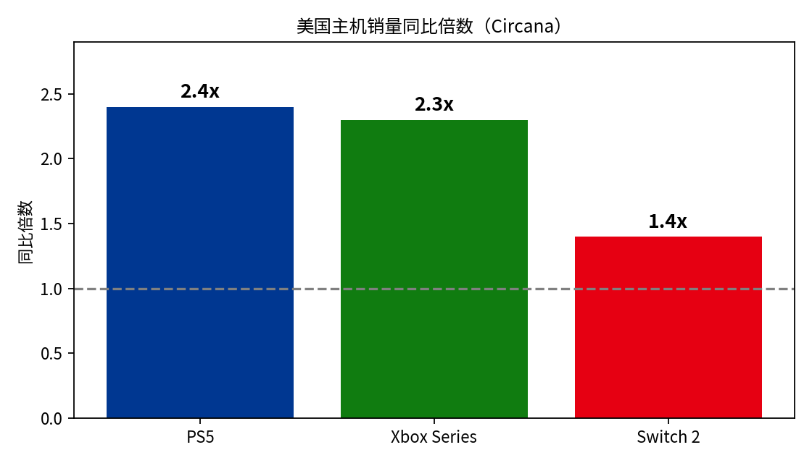
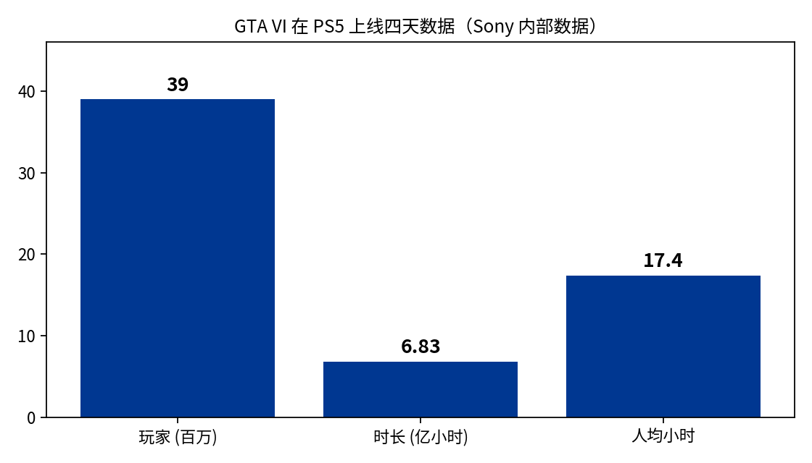

> [English version 英文版](/life/gta-6-ps5-hardware-surge/)

> **本系列更新篇：** 继[发售日](/life/gta-6-launch-day-record-sales-zh/)、[首周末更新](/life/gta-6-first-weekend-379b-update-zh/)与昨天的 [Xbox 帧率漏洞](/life/gta-6-xbox-glitch-60fps-zh/)之后，本文只讲 11 月 24 日新公布的一组数字——这场发售对主机本身做了什么。首周销量不再重复，只在新数据改变其含义时提及。

*《Grand Theft Auto VI》官方主视觉图。图片：Rockstar Games。*

## Sony 在 11 月 24 日到底公布了什么

Sony Interactive Entertainment 于 2026 年 11 月 24 日公布内部数据，覆盖《GTA VI》在 PlayStation 5 上线后的头四天，即 11 月 19 日发售至 11 月 22 日。Notebookcheck 转引 PlayStation Blog 披露的核心数字如下：

- **超过 3,900 万独立玩家**在四天内在 PS5 上开始了游戏。Sony 称《GTA VI》是 PlayStation 三十年、五代主机历史上最大的游戏发售。
- **70% 的新激活 PS5** 把《GTA VI》作为第一款游戏。换个方向读：发售窗口内每十台新连接的 PS5，有七台本质上就是为了这一款游戏而存在的。
- **2020 年 PS5 上市以来单日新连接数量最高的一天**，前提是排除年末假期。这个限定词很重要，后文会专门讨论。
- **四天累计游玩 6.83 亿小时**，人均 **17.4 小时**——相当于每位玩家连续四天、每天平均玩约 4.35 小时。
- **PlayStation 同时在线人数纪录**，但 Sony 没有公布峰值数字。

Sony 还推出了两款以游戏罪恶城（Vice City）设定为主题的限量版 DualSense 手柄。这个小细节说明平台方是把整个硬件生意都围绕这一周来组织的。

有两个口径警告必须放在第一部分，而不是脚注里，因为它们决定这些数字能被推多远。第一，Sony 数的是**独立玩家账号**，不是主机、也不是销量。一个主机可以有多个账号，所以 3,900 万玩家不等于 3,900 万台机器，更不等于 3,900 万份销量。第二，Sony 的 PS5 累计出货量——**截至 9 月 30 日为 9,790 万台**——数的是出给零售商的货，不是客厅里的机器。因此网上流传的"40% 的 PS5 用户都玩了 GTA VI"是用两个不同分母算出来的近似值：方向上惊人，算术上松散。两件事可以同时成立，认真的读者应该同时记住。

## 美国零售数据独立地说了同一件事

如果只有 Sony 的内部数据，打折看待会更容易。但它并不孤单。

Circana 分析师 Mat Piscatella 11 月 23 日报告：在美国，截至 11 月 14 日的那一周——也就是发售前一周、期待与预载达到峰值的那一周——**PS5 销量达到去年同期的 2.4 倍，Xbox Series 达到 2.3 倍**。GamingBolt 与 Stocktwits 在 11 月 23–24 日都报道了这组 Circana 数字。同一周 Nintendo Switch 2 销量也**同比增长超过 40%**，报道将其归因于任天堂自己的《塞尔达传说：时之笛》重制版（11 月 5 日发售，据报四天卖出 520 万份），而不是《GTA VI》——这款游戏并不登陆 Switch 2。

*作者制图。数据：Circana Retail Tracking Service，经 Mat Piscatella 于 2026 年 11 月 23 日报告，统计截至 11 月 14 日的一周。Switch 2 的增长在报道中归因于《塞尔达》，而非 GTA VI。*

"同一波涨潮、两个不同原因"恰恰是 Circana 这一周数据有价值的原因。它展示的市场图景是：一个具有独占感的大事件可以让拥有这款游戏的平台硬件销量翻倍还多，而没有这款游戏的平台也能靠自己的招牌作品增长。2026 年 11 月不是"一款游戏拯救了一个死市场"的故事，而是多款招牌作品共同做到了这一代任何一次降价都没做到的事。

还要注意时间结构。Circana 的 surge 是截至 11 月 14 日的一周，在发售前五天结束；Sony 的激活纪录是发售日 11 月 19 日本身及其后几天。拼在一起，它们描述了一个两段式漏斗：先为期待买机器，再为游戏连接机器。这是 PS2 与 PS4 时代的经典主机周期模式——许多分析师曾宣称，在不需要新硬件的服务型游戏时代，这个模式已经死了。2026 年 11 月的这一周，它以全强度回来了。

## 为什么重要：派对之下的硬件下滑

庆祝的底下，是一组一个月前看起来相当 bleak 的数字——而且 Sony 自己的披露里就包含它们。

Sony 在 7–9 月季度出货 **260 万台 PS5，同比下降 35%**（去年同期 400 万台）。2026 财年上半年出货降至 **420 万台**，去年同期为 650 万台。按任何通常读法，上市六年的 PS5 正在急剧减速，这正是成熟主机在剩余受众对价格敏感、最大作品已经发售之后的表现。

但同一季度又产生了一个悖论，它解释了整个现代主机生意：PlayStation 营业利润**增长 83%，至 2,201 亿日元（约 13.8 亿美元）**，因为软件与网络服务收入完全抵消并超过了硬件下滑。机器本身已经不再是生意；机器是通往生意的门——商店、订阅、30% 的抽成。正因如此，一个能推动"门"的数量的星期，其重要性远远超过每台机器的硬件毛利，而一台打折的六年老主机，硬件毛利本就薄到近乎不存在。

*作者制图。数据：Sony Interactive Entertainment 2026 年 11 月 19–22 日内部数据，11 月 24 日报道。"玩家"为独立账号，不是销量。*

这也是为什么 Sony 激活纪录里"排除假期"这个限定词值得尊重而不是嘲笑。11 月底到 12 月是主机作为礼物被购买、包装、并在同一个早晨被数百万家庭同时连接的时段。击败 2020 年以来每一个非假期日，意味着《GTA VI》发售日超过了六年 PS5 历史上的每一次主机发售、每一次降价、每一个捆绑包和每一款其他游戏的发售日。它唯一没有击败的，是圣诞节的早晨们。这不是一个被削弱的说法，这本身就是说法。

## 争论：一款游戏还能卖动一代主机吗？

怀疑派的立场是真实的，应该公平陈述。四天的激活尖峰不是趋势。为《GTA VI》在 2026 年 11 月买 PS5 的玩家，很大一部分是本来就打算玩的人——他们只是在等一个不再等待的理由。需求前置（pull-forward）在首周图表里和新增需求长得一模一样，而账单会在接下来的季度到来：本来会在春天买的那批人，已经在 11 月买完了。Sony 自己的出货史也警告不要外推：10–12 月季度在过去四个财年里都是 PS5 最强的季度（2024 年该季度出货 950 万台，2025 年 790 万台），所以一个强劲的假期季度本来就会到来，有没有 Rockstar 都一样。《GTA VI》效应的诚实检验，不是这个季度的出货数字，而是进入 2027 年时的装机量是否大于发售前轨迹所暗示的水平——而这个数字要等 Sony 公布季度数据才知道，严格说要再等一个季度。

看多派的立场更简单，而且就本周证据而言更强。四天人均 17.4 小时不是尝鲜行为，是定居。一名玩家在第一周就在 Leonida 里花了这么长时间，他会买扩展内容、买虚拟货币、续订订阅，而且——对 Sony 最重要的是——不会为了下一款招牌作品跳去 rival 平台。70% 的"第一款游戏"比例是 Sony 这份披露里最有价值的单个数字，因为它测量的是开箱那一刻的意图。那些家庭买的不是一台"也能玩游戏"的通用娱乐设备，他们买的是一台"GTA VI 机器"，顺便也能做 PS5 能做的一切。他们中的每一个人现在都在 Sony 的商店里、Sony 的订阅漏斗里、以及 Sony 对未来每一笔购买的抽成里，会待到这一代剩下的年份，并通过向下兼容与账号锁定，很可能待到下一代。

我们的判断是：两种读法在不同的时钟上都正确。在季度时钟上，预期需求前置与一个更软的春天，不要为此惊讶。在平台时钟上——决定谁赢得一代主机的那个时钟——这一周的意义比出货下滑所掩盖的要大得多。一台硬件销量同比下降 35% 的六年老主机，为一款游戏打出了有史以来最大的非假期单日激活。需求从来没有消失，它在等一个理由。对其他所有发行商来说，不舒服的推论是：如果你的游戏不是那个理由，再多的营销花费也替代不了它；主机生意将越来越围绕少数几款这样的作品来组织自己——发售日历、独占支票、手柄联名，全都是。

## 接下来看什么

三个日期会裁决这场争论。第一，**11 月 27 日黑色星期五**，在 Sony 披露四天后，发售受众将与折扣受众相遇，Circana 的 11 月完整拆分将显示 surge 是持续还是只是一周尖峰。第二，**Sony 下一份季度报告**，其中 10–12 月出货数字将与前两年的 790 万与 950 万台对比。第三，**再下一个季度的软件与网络服务收入**——3,900 万 Leonida 新老居民到底变成持续收入还是不变成，就看那里。如果服务收入跳升并维持，这次发售就是一次平台事件；如果尖峰后回落，它就是一个非常大的周末。

无论如何，2026 年 11 月已经回答了行业在硬件下滑中反复问的那个问题：一款游戏还能卖动主机吗？能——一周之内，2.4 倍，在一台六年的机器上。稀缺的从来不是受众，稀缺的是大到能推动受众的游戏。

*来源：Sony Interactive Entertainment 内部数据（经 PlayStation Blog），Notebookcheck 2026 年 11 月 24 日报道；Circana Retail Tracking Service（经 Mat Piscatella），GamingBolt 与 Stocktwits 2026 年 11 月 23–24 日报道；Sony 季度出货与 PlayStation 营业利润数字见 Notebookcheck 报道摘要。价格与销量数字为 2026 年 11 月 24 日报道口径，subject to change。Sensor Tower 的发售日早晨估计（全平台约 1,905 万份、约 75% 在 PlayStation）为分析机构估计，不是 Rockstar 或 Take-Two 的披露；截至 11 月 24 日，Rockstar 与 Take-Two 尚未公布 GTA VI 销量。*
