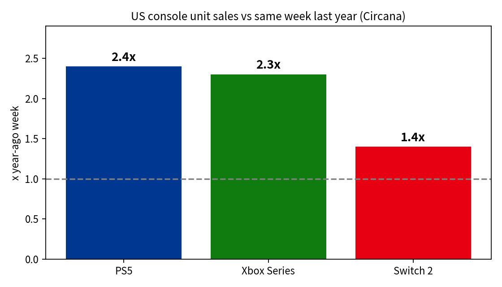
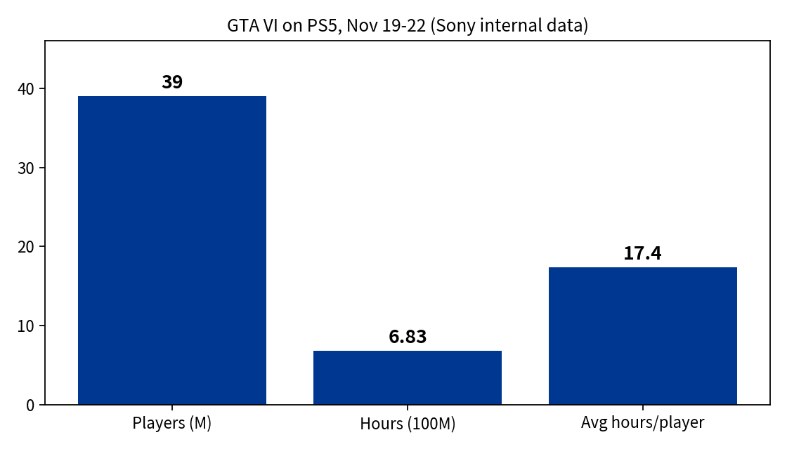

> [中文版 Chinese version](/life/gta-6-ps5-hardware-surge-zh/)

> **Update in our GTA VI launch series:** after [launch day](/life/gta-6-launch-day-record-sales/), the [first-weekend update](/life/gta-6-first-weekend-379b-update/) and yesterday's [Xbox frame-rate glitch](/life/gta-6-xbox-glitch-60fps/), this post covers a different set of numbers released on November 24 — what the launch did to the consoles themselves. Sales figures from launch week are not re-covered here except where the new data changes their meaning.

*Official key art for Grand Theft Auto VI. Image: Rockstar Games.*

## What Sony actually said on November 24

Sony Interactive Entertainment released internal data on November 24, 2026 covering the first four days of *Grand Theft Auto VI* on PlayStation 5, from the game's November 19 launch through November 22. The headline numbers, reported by Notebookcheck from Sony's PlayStation Blog disclosure, are these:

- **More than 39 million unique players** started the story on PS5 in four days. Sony calls *GTA VI* the biggest game launch in PlayStation history, across three decades and five console generations.
- **70% of newly activated PS5 consoles** played *GTA VI* as their first game. Read that the other way around: for seven in ten people who connected a new PS5 during launch window, the console existed, in effect, to play this one game.
- **The largest number of newly connected PS5s in a single day since the console launched in 2020**, excluding the end-of-year holiday period. That qualifier matters, and we will return to it.
- **683 million hours played** in four days, an average of **17.4 hours per player** — roughly 4.35 hours per player per day, every day, for four straight days.
- A **record for concurrent players** on PlayStation, although Sony did not publish the peak figure.

Sony also released two limited-edition DualSense controllers themed on the game's Vice City setting, a small detail that tells you how completely the platform holder organised its hardware business around this one week.

Two measurement warnings belong in the first section, not a footnote, because they decide how far these numbers can be pushed. First, Sony counts **unique player accounts**, not consoles and not copies sold. Several accounts can share one console, so 39 million players is not 39 million machines and is not 39 million sales. Second, Sony's cumulative PS5 shipment figure — **97.9 million units by September 30** — counts units shipped to retailers, not consoles in living rooms. The widely repeated line that "40% of all PS5 owners played GTA VI" is therefore an approximation built from two different denominators. It is directionally striking and arithmetically loose. Both things can be true, and a careful reader should hold both.

## The American retail data says the same thing, independently

Sony's internal data would be easier to discount if it stood alone. It does not.

Circana analyst Mat Piscatella reported on November 23 that, in the United States, for the week ending November 14 — the week *before* launch, when anticipation and pre-loading peaked — **PS5 unit sales were 2.4 times** the same week a year earlier and **Xbox Series unit sales were 2.3 times** their year-ago level. GamingBolt and Stocktwits both carried the Circana figures on November 23–24. Nintendo Switch 2 unit sales also rose **more than 40% year over year** in the same week, which reporting attributed not to *GTA VI* — the game is not on Switch 2 — but to Nintendo's own *The Legend of Zelda: Ocarina of Time* remake, released November 5 and reported to have sold 5.2 million copies in four days.

*Author's chart. Data: Circana Retail Tracking Service via Mat Piscatella, reported November 23, 2026, for the week ending November 14. Switch 2's rise is attributed in reporting to Zelda, not GTA VI.*

That distinction — one rising tide, two different causes — is exactly why the Circana week is useful evidence. It shows a market in which a single exclusive-feeling event can more than double hardware volume for the platforms that have the game, while a platform without it still grows on the strength of its own tentpole. November 2026 is not a story of one game rescuing a dead market. It is a story of tentpoles, plural, doing the job hardware price cuts have conspicuously failed to do this generation.

Note also the timing structure. The Circana surge is the week *ending November 14*, five days before launch. The Sony activation record is launch day itself, November 19, and the days immediately after. Put together, they describe a two-stage funnel: buy the box in anticipation, connect the box for the game. That is the classic console-cycle pattern of the PS2 and PS4 eras, a pattern many analysts had declared dead in an age of live-service games that never require new hardware. For one week in November 2026, it came back at full strength.

## Why this matters: the hardware slump underneath the party

The celebration sits on top of numbers that, a month ago, looked bleak — and Sony's own disclosure includes them.

Sony shipped **2.6 million PS5 consoles in the July–September quarter, down 35%** from 4.0 million in the same quarter a year earlier. First-half shipments for Sony's 2026 financial year fell to **4.2 million, from 6.5 million** in the same period of 2025. By any ordinary reading, the PS5 — six years into its life — was decelerating hard, exactly as a mature console does when its remaining audience is price-sensitive and its biggest games are already out.

And yet the same quarter produced a paradox that explains the whole modern console business: PlayStation operating income **rose 83% to ¥220.1 billion (about $1.38 billion)**, because software and network services more than offset the hardware decline. The box is no longer the business. The box is the doorway into the business — the store, the subscription, the 30% cut. That is why a week that moves doorways matters out of proportion to the hardware margin on each unit, which on a discounted six-year-old console is thin to non-existent.

*Author's chart. Data: Sony Interactive Entertainment internal data for November 19–22, 2026, as reported November 24. "Players" are unique accounts, not copies sold.*

This is also why the "excluding holidays" qualifier on Sony's activation record deserves respect rather than mockery. Late November and December are when consoles are bought as gifts, wrapped, and connected on a single morning by millions of households at once. Beating every non-holiday day since 2020 means *GTA VI*'s launch day outperformed every console launch, every price cut, every bundle and every other game's release day in six years of PS5 history. The only days it did not beat are Christmas mornings. That is not a weakened claim. That is the claim.

## The argument: can one game still sell a console generation?

The sceptical position is real and should be stated fairly. A four-day activation spike is not a trend. Players who bought a PS5 for *GTA VI* in November 2026 were, in large part, the already-convinced — people who always intended to play it and were waiting for a reason to stop waiting. Pull-forward demand looks identical to new demand in a launch-week chart, and the bill arrives in the following quarters, when the audience that would have bought in spring has already bought in November. Sony's own shipment history warns against extrapolation: the October–December quarter has been the PS5's strongest in each of the past four financial years (9.5 million shipped in that quarter in 2024, 7.9 million in 2025), so a strong holiday quarter was coming with or without Rockstar. The honest test of the *GTA VI* effect is not this quarter's shipment number. It is whether the installed base entering 2027 is larger than the pre-launch trajectory implied — and that number will not be knowable until Sony reports the quarter, and arguably not until the quarter after.

The bullish position is simpler and, on this week's evidence, stronger. Seventeen point four hours per player in four days is not sampling behaviour; it is residency. A player who spends that long in Leonida in the first week buys expansions, buys currency, renews subscriptions and — most importantly for Sony — does not churn to a rival platform for the next tentpole. The 70% first-game figure is the single most valuable number in Sony's disclosure, because it measures intent at the moment of unboxing. Those are not households that bought a general entertainment device that happens to play games. They bought a *GTA VI* machine that also does everything else a PS5 does. Every one of them is now inside Sony's store, Sony's subscription funnel and Sony's cut of every future purchase, for the remaining years of this generation and, via backwards compatibility and account lock-in, very probably the next one.

Our judgment: both readings are correct about different clocks. On the quarterly clock, expect pull-forward and a softer spring, and do not be surprised by it. On the platform clock — the one that decides who wins a generation — this week was decisive in a way the shipment slump had obscured. A six-year-old console whose hardware sales had fallen 35% year over year produced, for one game, its biggest non-holiday activation day ever. The demand was never gone. It was waiting for a reason. The uncomfortable implication for every other publisher is the corollary: if your game is not that reason, no marketing spend substitutes for it, and the console business will increasingly organise itself — release calendars, exclusivity cheques, controller variants and all — around the handful of titles that are.

## What to watch next

Three dates will settle the argument. First, **Black Friday on November 27**, four days after Sony's disclosure, when the launch audience meets the discount audience and Circana's full November breakdown will show whether the surge held or was a one-week spike. Second, **Sony's next quarterly report**, which will carry the October–December shipment figure against the 7.9 million and 9.5 million of the two prior years. Third, the **following quarter's software and network-services revenue**, which is where 39 million new and returning residents of Leonida either become recurring income or do not. If services revenue jumps and stays up, the launch was a platform event. If it spikes and fades, it was a very large weekend.

Either way, November 2026 has already answered the question the industry kept asking through the hardware slump. Can a single game still sell consoles? Yes — 2.4 times over, in a single week, on a six-year-old machine. The scarcity was never in the audience. It was in games big enough to move it.

*Sources: Sony Interactive Entertainment internal data via PlayStation Blog, as reported by Notebookcheck on November 24, 2026; Circana Retail Tracking Service via Mat Piscatella, as reported by GamingBolt and Stocktwits on November 23–24, 2026; Sony quarterly shipment and PlayStation operating income figures as summarised in the Notebookcheck report. Prices and sales figures are as reported on November 24, 2026 and are subject to change. Sensor Tower's launch-morning estimate (about 19.05 million copies across platforms, roughly 75% PlayStation) is an analyst estimate, not a Rockstar or Take-Two disclosure; Rockstar and Take-Two had not released GTA VI sales figures as of November 24.*
