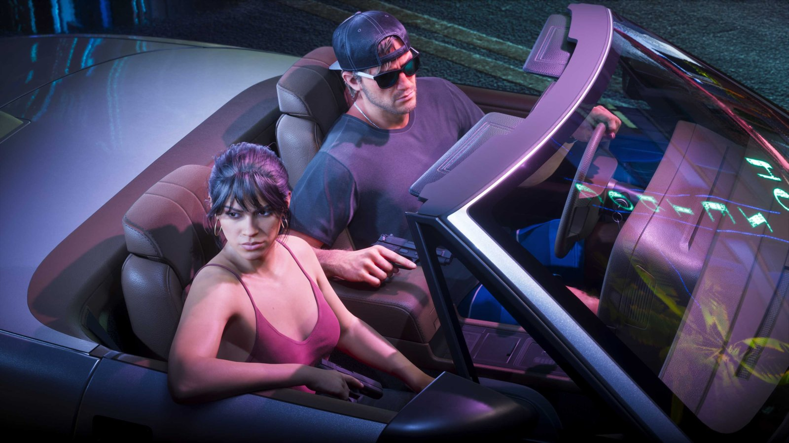
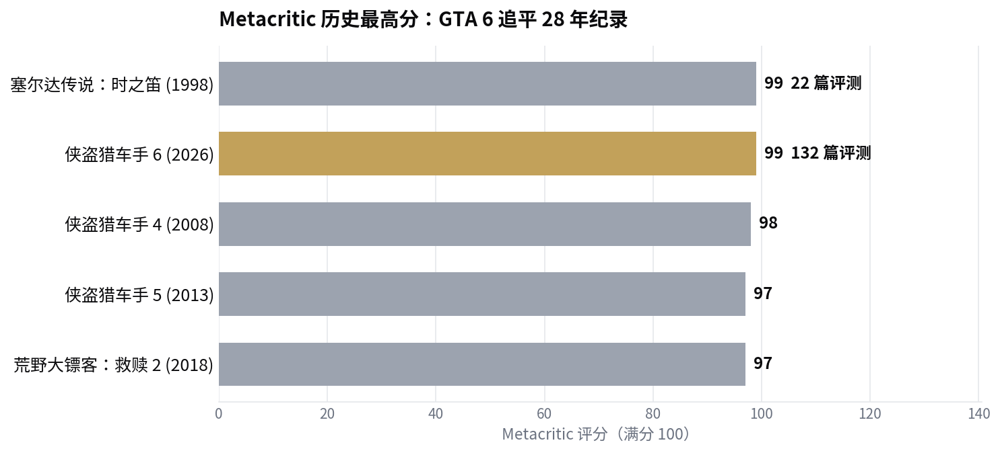

> [English version](/life/gta-6-reviews-99-metacritic/)

> **后续报道：**这是我们 GTA 6 发售周系列的第二篇。昨天的文章讲了预购破纪录、212 GB 下载和评测解禁时间；这一篇讲评测本身说了什么。[阅读发售周首篇](/life/gta-6-launch-week-record-preorders-zh/)。

*夜晚的雷奥奈达，杰森与露西娅坐在敞篷车里。官方游戏截图：Rockstar Games。*

## 发生了什么

评测禁令于**美东时间 11 月 18 日周三早上 6 点**解除——恰好是游戏在新西兰解锁的时刻——而结论的坚决程度，几乎是评测禁令所能达到的极限。《侠盗猎车手 6》在 PlayStation 5 平台上的 **Metacritic 均分为 99 分**，截至协调世界时上午 11 点 40 分共计 132 篇媒体评测，其中 **109 篇给了满分 100 分**。整个样本里最低分是 90 分。83% 的媒体给了满分，没有一篇低于 90 分。

这个数字追平了**《塞尔达传说：时之笛》**保持的历史最高分。时之笛自 1998 年以来一直握着 99 分，靠的是区区 22 篇评测。GTA 6 用六倍于此的评测数量追平了它，而这是一种不同量级的成就：均分越接近满分，维持它就越难，因为每多一篇评测，就多一次出现异议分数把均分拉下来的机会。截至当天上午，没有任何一篇做到这一点。

另一家聚合站的结论完全相同。在 OpenCritic 上，GTA 6 的**媒体均分为 99 分，61 位媒体评测者 100% 推荐**。Xbox Series X 版本的页面同样显示 99 分，但同一时刻只有 10 篇评测，因为大多数媒体在 PS5 上评测。随着更多评测在当天陆续发布，数字仍在变动，理论上均分可能上下浮动一分——但结果的形态已经定型：这是现代游戏史上评价最高的游戏，也是 Rockstar 史上评价最高的游戏。

最有分量的几家媒体全部给了最高分。**IGN 给出 10/10**，评测者卢克·赖利在游玩 120 多小时后称它是"我玩过的最令人印象深刻的电子游戏"。**Vice 给出 10/10**，布伦特·科普在游玩 130 多小时后称它"可能是有史以来最好的开放世界游戏"。**GameSpot、Eurogamer、GamesRadar+ 和《卫报》**全部给了最高分；《卫报》的五星评测称它是"游戏史上最堕落的世界"，如今"也是最伟大的爱情故事"。《纽约时报》给了 90 分，写道它"会偷走你的心"。《独立报》的评测者在游玩 65 小时后走得比所有人都远，称它"不只是一款世代之作，更是有史以来最好的游戏"。

## 评测者到底夸了什么

通读这些评测，三个主题反复出现。第一是**规模与密度的结合**：雷奥奈达不仅是 Rockstar 建造过的最大地图，也是最精细的一张，而精细本身就是重点。评测者不断回到同一个观察——这个世界经得起那种漫无目的、近距离的凝视，而大多数开放世界在这种凝视下都会露馅。第二是 Rockstar 在 11 月 17 日、也就是禁令解除前一天详细介绍的**动态天气系统**：本地化天气在雷奥奈达的不同区域以不同方式移动，新的截图展示了雨水、风暴和光线在城市、沼泽和海岸的不同表现。这是一个技术特性，但评测把它当作氛围特性来谈——世界给人的感觉是，无论你看不看，它都在自行运转。

第三个主题正是《卫报》那句话所捕捉到的：归根结底，这是一部**爱情故事**。杰森和露西娅不是早期 GTA 里那种插科打诨的罪犯；评测一致认为，他们的关系是这款游戏的情感引擎，是让上百小时的铺陈凝聚成整体的东西。对于一个以讽刺和混乱为品牌的系列来说，这是一次基调上的豪赌，而评测者认为赌赢了。Vice 的科普称它是 Rockstar"迄今为止最雄心勃勃、最成熟的作品"。"成熟"这个词在一篇篇评测里反复出现，它承担了很多含义：这是评测者在说，这款游戏长大了，却没有丢掉让这个系列成立的东西。

评测流程本身还有一个值得注意的故事。Rockstar 给了评测者三周时间——IGN 的赖利玩了 120 多小时，科普玩了 130 多小时——这是一个异常长的评测窗口，也是信心的标志。一家害怕自己游戏的发行商，不会提前三周把游戏交给评测者。禁令在发售前一整天解除，而不是在发售时或发售后解除，传递的是同样的信号。过去十年，整个行业已经学会把禁令时间当作信号来解读，而这一次的信号很明确：发行商知道自己手里有什么。

## 99 分是一个奇怪的数字

Metacritic 上的 99 分并不等同于"有史以来最好的游戏"，有必要精确地说清楚这个数字是什么。Metacritic 把每家媒体的分数换算成百分制，再计算加权平均值；99 分意味着加权平均值四舍五入后是 99 分，而不是每位评测者都达成了一致。分数的分布和平均值同样重要，而在这里，分布本身就是故事：109 个满分，8 个 95 分，8 个 90 分，再往下就没有了。所谓分歧，不过是在"完美"和"仅仅优秀"之间。

与时之笛的比较也需要同样的精确。时之笛的 99 分建立在 1998 年的 22 篇评测之上，那是一个不同的评测时代，评测池更小，评分文化也不同。GTA 6 的 99 分建立在 132 篇评测之上，处在一个 90 分是常态、100 分要省着给的时代。两个都是 99 分，但不是同一个 99 分。如果说有什么区别，GTA 6 的这个数字更难拿到，因为它经受住了 132 次被拉低的机会。Vice 正是这样指出的：GTA 6 的 99 分背后有远多得多的评测者，这让它对纪录的主张更强。

还有一个问题：99 分会对讨论本身产生什么影响。这么高、这么早的分数，造成了一种奇特的动态：剩下的争论不是游戏是否伟大，而是是否还允许有人说不。最早出现的低于 100 分的评测——那些 90 分——已经被当作反对意见来解读，而这本身就很荒谬：90 分是一个极好的分数。但当 83% 的同行都给出满分时，90 分就成了异议。这就是 99 分造成的扭曲，在玩家评价到来时值得记住。玩家评分在发售前一度被还没玩过游戏的人的打分污染，Metacritic 已经将其清除，但真正的玩家 verdict 尚未产生。评测者已经发言；玩家还没有机会。

*Metacritic 历史最高分。GTA 6 快照：2026 年 11 月 18 日协调世界时 11 点 40 分，PS5 平台 132 篇媒体评测，均分 99（timesaver.gg）；《塞尔达传说：时之笛》99 分，22 篇评测（Asbury Park Press）；GTA 4 为 98 分，GTA 5 为 97 分，《荒野大镖客：救赎 2》为 97 分。*

## 99 分背后的评分机制

要理解这个 99 分为什么罕见，需要先理解 Metacritic 的计分方式。Metacritic 把每家媒体的评分换算成百分制，再按各家媒体的权重计算加权平均值。加权意味着不是每张票都等值：IGN、GameSpot、《卫报》这样的媒体在平均值里占的比重，比一家小博客大得多。而一个 99 分意味着加权平均值四舍五入后是 99 分——这要求几乎所有高权重媒体都给出满分或接近满分。132 篇评测里有 109 篇满分，剩下的 23 篇里最低也是 90 分，这种分布在加权平均下几乎没有给任何"异议"留下空间。

评分文化本身也在变化，这让跨时代的比较变得微妙。1998 年，游戏媒体的评分尺度更紧缩，一家媒体给 90 分以上是件大事；今天，90 分已经成为 3A 大作的"及格线"，100 分也不再像过去那样罕见。换句话说，时之笛的 99 分是在一个更吝啬的时代里拿到的，而 GTA 6 的 99 分是在一个更慷慨的时代里拿到的——但它要面对的评测者是前者的六倍。在统计学上，样本越大，均值越难维持在极端位置：132 次独立打分，每一次都是一次把均分拉下来的机会。GTA 6 的 99 分经受住了 132 次这样的机会，而时之笛只需要经受 22 次。两个数字同样是 99 分，但 GTA 6 的这个数字在统计意义上更难复制。

还有一个因素值得单独说：Rockstar 给评测者的时间。IGN 的赖利玩了 120 多小时，Vice 的科普玩了 130 多小时，这意味着评测者不是在赶稿，而是在完整通关之后又花了数十小时在开放世界里闲逛。很多 3A 游戏的评测是基于 20 到 30 小时的主线体验写成的，评测者根本没有时间触及后期内容。Rockstar 提前三周交出游戏，等于主动邀请评测者去发现后期的问题——而评测者发现的后期内容，恰恰是他们夸得最厉害的部分。这种自信本身就是信息：在过去十年里，发行商学会了用禁令时间来管理预期，禁令越晚、评测时间越短，预期管理就越谨慎。GTA 6 的做法正好相反，这在今天的游戏行业里几乎是绝迹的。

## 评测没有解决的问题

评测分数哪怕是 99 分，评判的也只是评测者玩到的那个游戏——PS5 上的单人剧情战役，外加一个内容尚不为人知的首日补丁。有几件事仍然真正悬而未决。

第一是**性能**。Rockstar 已于 11 月 11 日确认，GTA 6 在 PS5、PS5 Pro 和 Xbox Series X|S 上的目标帧率是 30fps，发售时没有 60fps 性能模式；PS5 Pro 通过 PSSR 获得更清晰的画面和光线追踪阴影。没有任何一家顶级评测把 30fps 当作决定性缺陷，几家还称赞了画面表现力，但过去五年已经习惯 60fps 的主机玩家会有自己的判断，而且不会是一致的。Digital Foundry 等机构的技术分析尚未出炉，而它是可以继续推动讨论的唯一一篇评测。

第二是**发售本身**。游戏将于 11 月 19 日周四各地午夜解锁，全球滚动发售；美国东部玩家可在周三晚上 9 点（太平洋时间）玩到，而切换主机地区到新西兰的办法能让部分玩家提前数小时进入游戏。212 GB 的下载外加一个首日补丁，意味着服务器将承受非同寻常的负载。Rockstar 的发售日历史上并不总是平稳，而当预购量达到这个规模时，一个平稳的午夜比以往任何时候都重要。

第三，也是最大的一个，是**剧情之后的东西**。评测覆盖的是故事模式，不包括 GTA Online 的继承者——而 GTA 5 的大部分收入来自在线模式，GTA 6 未来十年的长尾也将由它决定。Rockstar 对此几乎没有透露什么，而 GTA 6 作为一个平台而非一款游戏的第一次真正考验，还要等上数月。PC 版也是如此：它尚不存在，也没有公布日期——参照 GTA 5 的历史，等待可能长达一年以上。

然后是价格。标准版 79.99 美元、终极版 99.99 美元（11 月 18 日快照，价格可能变动），GTA 6 是大多数玩家买过的最贵的标准版游戏，而评测实际上就是在裁决 80 美元是否会成为新的常态。一个 99 分比任何营销都更有说服力。但市场的答案将写在销量里，而不是评测分数里。

## 30fps 之争：唯一真正的争议点

如果说 132 篇评测里存在一个真正的争议点，那就是帧率。Rockstar 已确认 GTA 6 在 PS5、PS5 Pro 与 Xbox Series X|S 上以 30fps 为目标，发售时没有 60fps 性能模式。PS5 Pro 通过 PSSR 获得更清晰的画面与光线追踪阴影，但帧率上限仍然是 30fps。在过去五年里，60fps 已经成为 3A 游戏的默认期待，而 Rockstar 选择把算力全部投入到画面密度与世界细节上，而不是帧率上。

评测者的态度耐人寻味：没有人把 30fps 当作扣分项。原因部分在于 Rockstar 的取舍是透明的——这不是优化不足导致的 30fps，而是主动选择的结果：把每一份算力都花在让世界更密、更真上。IGN 的赖利在 120 小时里没有抱怨过帧率，Vice 的科普也没有。这种一致性说明，在评测者眼中，GTA 6 的视觉密度值得用 30fps 来交换。但评测者的容忍度不等于玩家的容忍度。主机玩家中有一部分人对帧率极为敏感，他们会在发售后用自己的眼睛投票，而 Digital Foundry 的技术分析将成为这场争论的裁判。一个可能的折中方案是，Rockstar 在未来通过补丁加入 60fps 性能模式——GTA 5 与《荒野大镖客 2》都在次世代升级中这样做过。但就发售日而言，30fps 是玩家必须接受的现实，而这也是 99 分里唯一一个带着星号的注脚。

## 钱的部分

商业背景在任何一篇评测发表之前就已经非同寻常。据 11 月 16 日引用的市场调研机构数据，预购收入**已超过 10 亿美元**，发售前售出**超过 1200 万份**，其中 PS5 约占预购量的 75%。本周报道的一份分析师预测认为，**首周末票房可能达到 20 亿美元**，这将使 GTA 6 成为历史上最大的娱乐产品首发，远超此前的任何电影、专辑或游戏。请把这个数字当作预测而非事实：真实数字下周才会公布，而 Take-Two 一旦能够公布，就会立刻公布。

市场在开盘前就动了。Take-Two 股价在评测出炉后盘前上涨；GTA 6 在评测解禁时吸引了 **Twitch 上超过 240 万同时在线观众**——这个数字既说明了游戏的受众，也说明了围绕它的讨论本身的受众。同一天公布的 The Game Awards 提名给了这个故事第二个头条：**GTA 6 以八项提名领跑，包括年度游戏**，对手包括《Control Resonant》、《生化危机：安魂曲》、时之笛重制版、《幻刃零》和《007：初光》。其中的讽刺意味很难忽视——这款游戏正在与它刚刚在 Metacritic 上追平的那款游戏的重制版竞争。

装机量也已经就绪。索尼于 11 月 12 日宣布，**PS5 销量已突破 1 亿台**，发售六年之后，而 GTA 6 显然是下一阶段增长的催化剂。索尼还在 11 月 17 日推送了 PS5 系统软件更新（26.07-14.23.00 版），描述为安全修复，背景是针对 PS5 固件的越狱尝试屡禁不止。平台方把这次发售既当作商业事件，也当作安全事件来对待。

## 对行业的意义：80 美元锚点与开放世界的标杆

GTA 6 的 99 分不只是一家公司的胜利，它会重塑整个行业的定价与设计坐标。最直接的是价格。79.99 美元的标准版是主机游戏价格带的一次正式跃升——从 60 美元到 70 美元的过渡花了整整一个世代，而 80 美元的台阶一直缺少一个有足够分量的理由。GTA 6 现在给了这个理由：一款 99 分的游戏，卖 80 美元，没有人会觉得贵。其他发行商会立刻跟进这个锚点，未来两年里 80 美元会成为 3A 游戏的新基准。玩家为此付出的代价是真实的，但评测分数让这笔交易在发售周变得无可辩驳。

更深远的影响在设计层面。过去十年，开放世界游戏的竞赛是"更大"：更大的地图、更多的图标、更长的清单。GTA 6 的评测传递了一个不同的信息——竞赛的维度变成了"更密"。评测者反复提到的不是地图有多大，而是世界在无人注视时仍在运转：天气系统在不同区域以不同方式移动，路人有自己的作息，细节在近距离凝视下不崩塌。这是 Rockstar 用 13 年时间与巨额投入买来的护城河，竞争对手很难在下一个世代里复制。开放世界的标杆从此不再是"有多少内容"，而是"有多少内容经得起细看"。

对索尼和微软而言，这个发售周同样关键。PS5 刚刚突破 1 亿台，GTA 6 是推动下一阶段销量的最强催化剂；Xbox 则把赌注押在云游戏上——GTA 6 发售当天即可通过 Xbox Cloud Gaming 在 Xbox Series X|S 甚至 Xbox One 上串流游玩，这让没有新主机的老用户也能在第一时间进入雷奥奈达。两家平台的策略完全不同，但目标一致：把 GTA 6 的发售周变成自己生态的增长事件。而对 Take-Two 来说，真正的考验在发售之后：GTA Online 的继承者能否复制前作十年长青的商业奇迹，将决定这款游戏最终是"一款伟大的游戏"，还是一台持续十年的印钞机。

还有一个值得注意的数字来自 Take-Two 自身的财报预期。公司预计本季度净预订额为 33.5 亿至 35 亿美元——这个数字本身就已经包含了 GTA 6 发售周的预期。如果首周末 20 亿美元的预测成立，GTA 6 一款游戏就能占到整个季度净预订额的一半以上。这种单一产品对一家上市公司的支配程度，在游戏行业里是空前的，也是在整个娱乐行业里空前的。它的另一面是风险集中：如果发售周出现严重的技术问题，冲击的将不只是一款游戏的口碑，而是 Take-Two 整个季度的财报。评测分数越高，这种集中度的赌注就越大——99 分让所有人都相信不会出问题，但相信本身并不能保证服务器在午夜不宕机。

## 结论

三年来一直悬在 GTA 6 头顶的问题——任何一款游戏能否承受如此之大的热度？——已经有了第一个真正的答案，而答案是肯定的。不是"基本可以"或"有保留的肯定"。132 篇评测，均分 99，109 篇满分，没有一篇低于 90 分，这是 28 年来一款游戏获得的最坚决的评测 verdict。热度没有压垮游戏。至少就评测者玩到的版本而言，游戏接住了热度。而这个 verdict 本身也值得记录：它证明了在炒作已经失控的时代，一款游戏仍然可以用质量本身来终结合成话题——不需要营销话术，只需要 132 位评测者各自独立地给出同一个答案。

但分数是一个开始，而不是结束。评测解决的是剧情战役的质量问题，没有解决发售、性能争议、在线模式、PC 版等待期或 80 美元定价的问题。接下来重要的数字不是 Metacritic 分数，而是销量：首日卖出多少份，首周末卖出多少份，20 亿美元的预测是否成立。评测者已经完成了他们的工作。现在轮到玩家了——从午夜开始。而玩家的 verdict 将以一种评测无法复制的方式呈现：不是 132 篇评测的加权平均，而是数千万份销量、数百万小时的游玩时间，以及 GTA Online 继承者上线那一天的服务器状态。99 分是一个非凡的开局，但 GTA 6 的故事从来都不是关于开局的，而是关于它能持续多久。

**值得关注：**午夜发售与服务器稳定性；首日补丁的大小与内容；Digital Foundry 的技术分析；Take-Two 预计在发售后几天内公布的首批销量；以及随着评测数量突破 150 篇，99 分能否守住。

*价格为 11 月 18 日快照，可能变动。评测数量为 2026 年 11 月 18 日协调世界时 11 点 40 分的报道数字，会随着更多评测发布而变化。*
