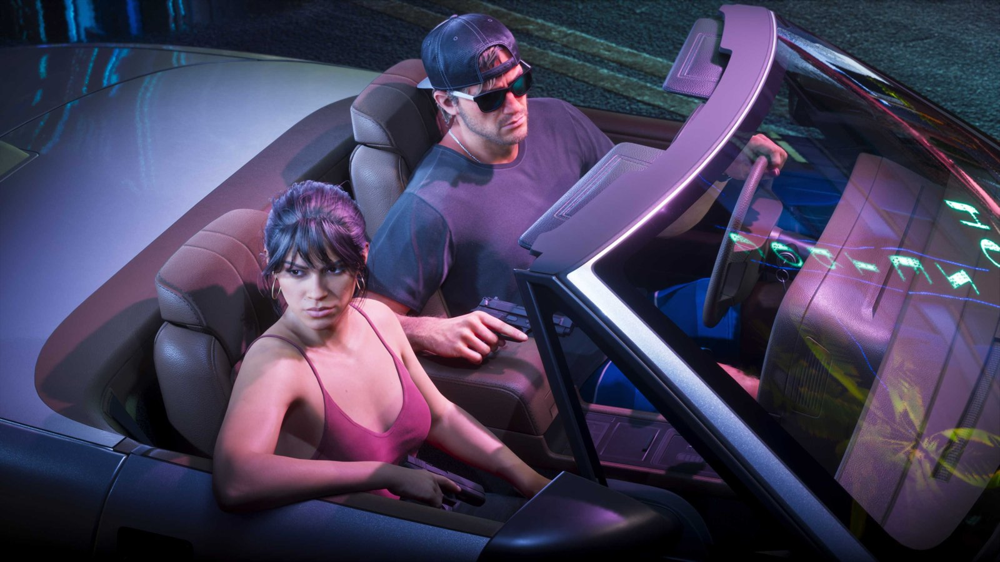
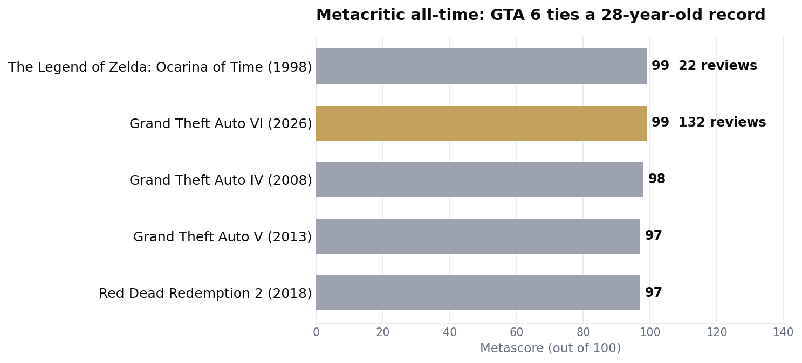

> [中文版 Chinese version](/life/gta-6-reviews-99-metacritic-zh/)

> **Follow-up:** this is the second post in our GTA 6 launch-week series. Yesterday's post covered the record pre-orders, the 212 GB download, and the review embargo; this one covers what the reviews actually said. [Read the launch-week post](/life/gta-6-launch-week-record-preorders/).

*Jason and Lucia in Leonida. Official in-game screenshot: Rockstar Games.*

## What happened

The review embargo lifted at **6:00 a.m. ET on Wednesday, November 18** — the moment the game unlocked in New Zealand — and the verdict was about as emphatic as a review embargo can produce. Grand Theft Auto VI holds a **99 Metascore on PlayStation 5**, based on 132 critic reviews counted at 11:40 a.m. UTC, with **109 of those 132 reviews awarding a perfect 100**. The lowest score in the entire set is a 90. Eighty-three percent of critics gave it a perfect score, and not one scored it below 90.

That number ties **The Legend of Zelda: Ocarina of Time** for the highest Metacritic score of all time. Ocarina has held its 99 since 1998, on the strength of just 22 reviews. GTA 6 matched it with six times as many critics, which is a different kind of achievement: holding a near-perfect average gets harder, not easier, as the review count grows, because every additional critic is another chance for a dissenting score to drag the average down. As of late morning, none had.

The second aggregator tells the same story. On OpenCritic, GTA 6 sits at a **99 Top Critic Average, with 100% of 61 critics recommending it**. The Xbox Series X page also shows 99, though from only 10 reviews at the same snapshot, because most outlets reviewed on PS5. The counts are still moving as more reviews publish through the day, and the score could in principle shift by a point in either direction — but the shape of the result is already settled: this is the best-reviewed game of the modern era, and the best-reviewed Rockstar game ever.

The outlets that matter most all landed at the top. **IGN gave it 10/10**, reviewer Luke Reilly calling it "the single most impressive video game I have ever played" after more than 120 hours. **Vice gave it 10/10**, Brent Koepp calling it "possibly the best open-world game of all time" after more than 130 hours. **GameSpot, Eurogamer, GamesRadar+, and The Guardian** all gave it their top marks; The Guardian's five-star review called it "gaming's most depraved world" that is now "also its greatest love story." The New York Times gave it 90, writing that it will "steal your heart." The Independent's reviewer, after 65 hours, went further than any of them and called it "not just the game of a generation but the very best game of all time."

## What the critics actually praised

Read across the reviews and three threads repeat. The first is **scale with density**: Leonida is not just the biggest map Rockstar has built, it is the most detailed one, and the detail is the point. Reviewers keep returning to the same observation — that the world holds up under the kind of close, idle inspection that breaks most open worlds. The second thread is the **dynamic weather system** Rockstar detailed on November 17, the day before the embargo lifted: localised weather that moves differently across Leonida's regions, with new screenshots showing rain, storms, and light behaving differently in the city, the swamps, and the coast. It is a technical feature, but the reviews treat it as an atmosphere feature — the world feels like it is happening whether or not you are looking at it.

The third thread is the one The Guardian's line captures: this is, at its core, **a love story**. Jason and Lucia are not the wisecracking criminals of earlier GTA games; the reviews consistently describe their relationship as the emotional engine of the game, and the thing that makes the 100-hour sprawl cohere. That is a tonal gamble for a series whose brand is satire and mayhem, and the critics are saying it paid off. Vice's Koepp called it Rockstar's "most ambitious and mature work to date." Maturity is a word that appears in review after review, and it is doing a lot of work: it is the critics' way of saying the game grew up without losing the thing that made the series work.

There is also a quieter story in the review process itself. Rockstar gave reviewers three weeks with the game — IGN's Reilly played for more than 120 hours, Koepp for more than 130 — which is an unusually long review window, and a sign of confidence. A publisher that fears its game does not hand it to critics three weeks early. The embargo lifting a full day before launch, rather than at launch or after it, is the same signal. The industry has spent the last decade learning to read embargo timing as a tell, and this one reads as a publisher that knew what it had.

## Why 99 is a strange number

A 99 on Metacritic is not the same thing as "the best game ever," and it is worth being precise about what the number is. Metacritic converts each outlet's score to a 100-point scale and computes a weighted average; a 99 means the weighted average rounds to 99, not that every critic agreed. The distribution matters as much as the average, and here the distribution is the story: 109 perfect scores, 8 at 95, 8 at 90, and nothing below that. The disagreement, such as it is, is between "perfect" and "merely excellent."

The comparison with Ocarina of Time deserves the same precision. Ocarina's 99 rests on 22 reviews from 1998, a different critical era, when the review pool was smaller and the scoring culture was different. GTA 6's 99 rests on 132 reviews in an era when a 90 is routine and a 100 is rationed. Both are 99s; they are not the same 99. If anything, the GTA 6 number is the harder one to achieve, because it survived 132 separate opportunities to be knocked down. Vice made exactly this point, noting that GTA 6 has far more reviewers behind its 99, which gives it the stronger claim to the record.

There is also the question of what a 99 does to the conversation. A score this high, this early, creates a peculiar dynamic: the remaining debate is not whether the game is great, but whether anyone is allowed to say otherwise. The first reviews below 100 — the 90s — are already being read as contrarian statements, which is absurd on its face: a 90 is a superb score. But when 83% of your peers hand out perfection, a 90 becomes the dissent. That is the distortion a 99 creates, and it is worth keeping in mind when the player verdicts arrive. The user score, which was briefly polluted before launch by ratings from people who had not played the game and which Metacritic removed, is still to be decided. Critics have spoken; players have not yet had the chance.

*Metacritic all-time scores. GTA 6 snapshot: 99 from 132 PS5 critic reviews at 11:40 UTC, November 18, 2026 (timesaver.gg); Ocarina of Time: 99 from 22 reviews (Asbury Park Press); GTA IV 98, GTA V 97, Red Dead Redemption 2 97.*

## What the reviews don't settle

A review score, even a 99, is a verdict on the game the critics played — which is the single-player campaign, on PS5, with a day-one patch whose contents are still unknown. Several things remain genuinely open.

The first is **performance**. Rockstar confirmed on November 11 that GTA 6 targets 30 frames per second on PS5, PS5 Pro, and Xbox Series X|S, with no 60fps performance mode at launch; the PS5 Pro gets improved image clarity through PSSR and ray-traced shadows. None of the top reviews treated 30fps as a dealbreaker, and several praised the visual fidelity, but console players who have spent the last five years playing at 60fps will have their own verdict to render, and it will not be unanimous. The technical analysis from Digital Foundry and its peers has not landed yet, and it is the one review that can still move the conversation.

The second is the **launch itself**. The game unlocks at midnight local time on Thursday, November 19, with a rolling global release; players in the US East get it at 9 p.m. PT on Wednesday, and the New Zealand trick — switching a console's region — lets some players in hours early. The 212 GB download plus a day-one patch means the servers will be under extraordinary load. Rockstar's launch days have historically been bumpy, and a smooth midnight matters more than usual when the pre-order numbers are this large.

The third, and largest, is **what comes after the campaign**. The reviews cover the story. They do not cover the successor to GTA Online, which is where GTA 5 made most of its money and where GTA 6's decade-long tail will be decided. Rockstar has said little about it, and the first real test of GTA 6 as a platform, rather than a game, is still months away. The same goes for the PC version, which does not exist yet and has no announced date — the history of GTA 5 suggests a wait of a year or more.

And then there is the price. At $79.99 for the standard edition and $99.99 for the ultimate edition (a November 18 snapshot, subject to change), GTA 6 is the most expensive standard-edition game most players have ever bought, and the reviews are, in effect, a verdict on whether $80 is the new normal. A 99 makes the case better than any marketing could. But the market's answer will be written in units sold, not in review scores.

## The money

The commercial context was already extraordinary before a single review published. Pre-orders have reportedly generated **more than $1 billion in revenue**, with over **12 million copies sold** before launch, according to a market research firm cited on November 16 — PS5 accounting for about 75% of pre-orders. At least one analyst projection reported this week puts the **opening weekend at $2 billion**, which would make GTA 6 the biggest entertainment launch in history by a wide margin, ahead of any film, album, or game before it. Treat that as a projection, not a fact: the real number lands next week, and Take-Two will announce it the moment it can.

The market moved before the opening bell. Take-Two shares popped in pre-market trading on the reviews, and GTA 6 drew **more than 2.4 million concurrent viewers on Twitch** as the reviews landed — a number that says as much about the audience for the discourse as about the game. The Game Awards nominations, announced the same day, gave the story a second headline: **GTA 6 leads with eight nominations, including Game of the Year**, competing against Control Resonant, Resident Evil Requiem, the Ocarina of Time remake, Phantom Blade Zero, and 007 First Light. The irony is hard to miss — the game is nominated against a remake of the very game it just tied on Metacritic.

The install base is ready, too. Sony announced on November 12 that the **PS5 has passed 100 million units sold**, six years after launch, and GTA 6 is the obvious accelerant for the next leg of that curve. Sony also pushed a PS5 system software update (version 26.07-14.23.00) on November 17, described as security fixes, arriving amid repeated attempts to jailbreak the PS5 firmware. The platform holders are treating this launch as a security event as much as a commercial one.

## The verdict

The question that has hung over GTA 6 for three years — can any game survive this much hype? — has its first real answer, and the answer is yes. Not "yes, mostly" or "yes, with caveats." A 99 from 132 critics, with 109 perfect scores and nothing below 90, is the most emphatic critical verdict a game has received in 28 years. The hype did not break the game. The game, at least as the critics played it, met the hype.

But the score is a beginning, not an ending. The reviews settle the quality of the campaign. They do not settle the launch, the performance debate, the online mode, the PC wait, or the $80 question. The numbers that will matter next are not Metascores but sales figures: how many copies in the first 24 hours, how many in the first weekend, and whether the $2 billion projection holds. The critics have done their part. Now the players get their turn — starting at midnight.

**What to watch:** the midnight launch and server stability; the day-one patch size and contents; Digital Foundry's technical analysis; Take-Two's first sales announcement, expected within days of launch; and whether the 99 holds as the review count climbs past 150.

*Prices are a November 18 snapshot and subject to change. Review counts are as reported at 11:40 UTC, November 18, 2026, and will move as more reviews publish.*
