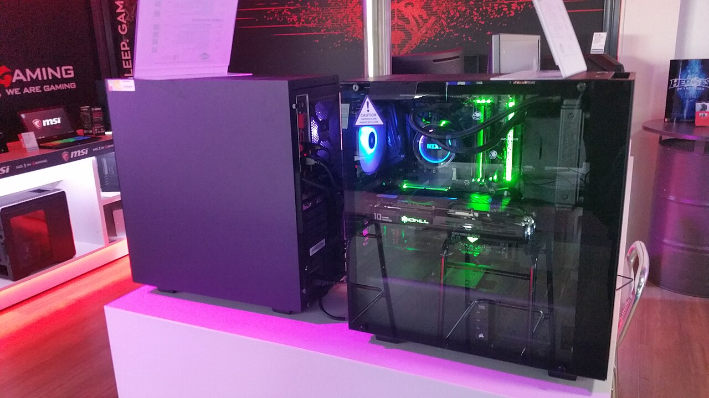
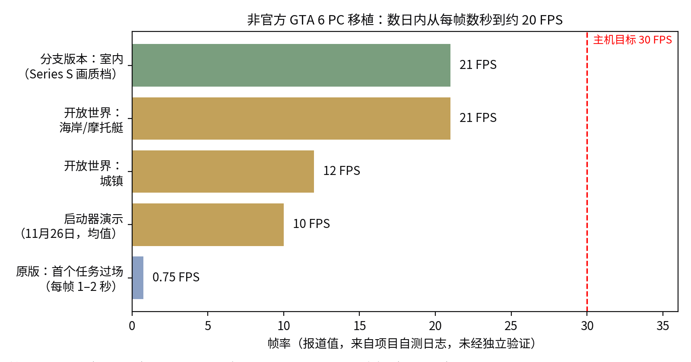

> [English version 英文版](/life/gta-6-unofficial-pc-port-20fps-dmca/)

*图片：荷兰 Bergschenhoek Informatique 店内的一台游戏 PC。摄影：Prolete，CC0，来自 Wikimedia Commons。*

## 起点：十年里最大的游戏，不在 PC 上

**《侠盗猎车手 VI》**于 **2026 年 11 月 19 日**发售，平台只有 **PlayStation 5 与 Xbox Series X|S**。Rockstar 没有公布 PC 版，没有给日期，截至 11 月 27 日对 PC 版只字未提；一条指向 2027 年第一季度的报道，目前仍属传闻。对大多数游戏来说，这种沉默没什么稀奇；对这一部来说，沉默本身就是新闻。因为 GTA 6 不是大多数游戏：它是这十年最受期待的娱乐产品，发售时却只覆盖两个主机家族，而全球最大的游戏平台——拥有数亿 Steam 账户的 Windows PC——被告知无限期等待。

真空不会存在太久，模组圈子尤其不会允许。发售后几天内，本作 Xbox 版本的文件在网上泄露，其中包括一份此前缺失的可执行文件。接下来发生的事，就是本文的主题：一群爱好者在 GitHub 上公开协作，做出一个兼容层，把 GTA 6 的 Xbox 版本“劝”进了 Windows 里运行——并且在大约一周之内，把它从以“秒/帧”计量的幻灯片，推进到最好场景下约 **20 帧每秒**。发行商的回应同样迅速，只是工具不同：**11 月 24 日**，Take-Two Interactive 向 GitHub 提交 DMCA 通知，一次行动禁用了 **3,007 个仓库**组成的网络。两天后的 **11 月 26 日**，这个圈子还是展示了本作第一个游戏内修改菜单和一个专用 PC 启动器。

这个故事里的每一个数字都要打个问号，本文会逐个标注：帧率来自项目自己的日志和立场友好的报道，没有独立基准测试背书；这些项目依赖泄露文件，这正是它们不断被删的原因；而此刻在网上传播的大多数“GTA 6 PC 版 60 帧实录”，按盯着这个圈子的粉丝追踪站的说法，根本不是 PC 画面。把这些保留意见摆上桌之后，底层事件本身是真实的、有据可查的，也值得讲透——因为它近乎完美地演示了：当积压的需求遇上现代逆向工程工具会发生什么，以及用版权法去阻挡一个成千上万人都能复制的技术过程，边界在哪里。

## 原理：这不是移植，是兼容层

先纠正标题党们的用词：没有人把 GTA 6“移植”到了 PC。移植意味着拿源代码为新平台重新编译，而源代码只有 Rockstar 有。社区做的是**兼容层**——一个叫 **VIctory** 的开源项目。思路与 Wine、Proton 相同，后两者让 Windows 游戏能在 Linux 和 Steam Deck 上跑：不翻译游戏本身，翻译游戏所处的*环境*。VIctory 拿本作的 Xbox 构建——为 Xbox Series 主机的 AMD 硬件和微软主机系统环境编写的机器码——在 Windows 上提供这份代码预期能找到的系统服务、图形调用和平台功能，实时翻译成 PC 能理解的东西。游戏文件由用户自备，兼容层本身不分发任何游戏内容——这类项目通常就站在这一法律理论上。

为什么这条路走得通？因为现代主机在塑料外壳之下就是 PC。Xbox Series X|S 与 PlayStation 5 都用 AMD 的 x86-64 处理器和 AMD 图形芯片，与 Windows 游戏电脑是同一套指令集。为 Xbox 编译的游戏，说的不是外星语言，而是 x86 代码加上一套微软味的主机平台 API。真正的难点在差异处：图形栈、主机的内存模型、着色器格式，以及主机游戏默认存在的一千种小服务。这些差异正是最初成果惨不忍睹的原因：据 TweakTown 11 月 26 日报道，VIctory 自己的 README 把第一个任务过场的渲染速度标为**每帧 1 到 2 秒**——大约每秒半帧——与此同时菜单已经能跑 30 帧。菜单主要是二维合成；开放世界则是整条渲染管线同时上场，还要全程翻译。

此后的提速来自翻译效率这种不性感的活：教会兼容层把 Xbox 构建里数以万计的着色器程序提前转换好，而不是运行时卡住现转；能缓存的都缓存；砍掉每帧在 CPU 与 GPU 内存之间来回拷贝数据的开销——早期兼容层的性能大头往往就在这里。一份被广泛引用的单帧分析显示，早期构建里一帧长达 390 毫秒，其中约 130 毫秒是准备工作、187 毫秒在显卡上、66 毫秒在把数据拷回来。当一帧里近一半时间是记账开销时，可供改进的空间巨大——而这个圈子接下来的表现，恰好就是把这块空间吃掉。

## 数字：“20 帧”到底是什么意思

把标题数字还原成诚实版本。以下数据来自 TweakTown 11 月 26 日的两篇报道（分别引 VIctory 的 README 与德国硬件媒体 **PC Games Hardware**）、粉丝追踪站 VGNW 11 月 27 日的状态页：

- **起点：**原项目 README 标注第一个任务过场为**每帧 1–2 秒**，即 0.5 到 1 帧每秒；菜单为 30 帧。
- **最快的分支：**PC Games Hardware 报道的一个公开社区分支，室内场景平均 **20–22 帧**，用的是 **Xbox Series S 的画质档**：内部分辨率 **960×540**、再放大输出，**光线追踪基本关闭**。
- **开放世界：**11 月 26 日报道的画面显示，骑摩托艇和沿海岸开车时为 **19–23 帧**，进城后掉到**约 12 帧**。
- **启动器演示：**巴西主播 Suco 在 11 月 26 日演示了专用 GTA VI 启动器和一个调试向的游戏内修改菜单——TweakTown 称之为本作第一批非官方 PC 模组工具——在高端 AMD 显卡加 64GB 内存的机器上平均**约 10 帧**，低点掉到 **2 帧**。
- **目前的天花板：**VGNW 追踪页交叉核对各项目日志后表示，**尚无任何有记录的测量达到 30 帧**；在大多数显卡上性能只有个位数帧，崩溃频繁。作为对照，主机版本身的目标就是 30 帧。

*作者自制图。数据：TweakTown（2026-11-26）引 VIctory README 与 PC Games Hardware；VGNW 追踪页（2026-11-27）。所有数字均为项目方报告值，未经独立验证。*

请像工程师一样读这些数字：在远强于该画质档出处主机的硬件上，以 540p 内部分辨率、关掉招牌视觉特性，跑出 20 帧——这不是能玩的产品，而是带加速度的概念验证。一周内四十倍的提升才是真正的信号：它说明瓶颈在翻译开销，而翻译开销恰恰是大量志愿者公开并行迭代最擅长磨掉的那类问题。此前的主机模拟与兼容层项目走过同样的轨迹，通常以月而不是天为单位从“能启动”走到“能玩”。本周的数字并不保证终点必然到达——剩下的难题，以着色器完整性和稳定性为首，都是硬骨头——但方向与斜率并无太大争议。

## 下架：一纸通知，3,007 个仓库

Take-Two 的反击有罕见的精确记录，因为 GitHub 会公开它所执行的通知。该公司 **11 月 24 日的 DMCA 通知**，经 TweakTown 与 VGNW 双方汇总，瞄准了这个圈子里一个较早项目 Leonida 的分支网络，结果是 **3,007 个仓库被禁用**——原项目及其数千个分支一并消失——Take-Two 援引的理由包括 Rockstar 对逆向工程的禁令。此前的 11 月 18 日，还有四份针对 GTA V 移植项目的通知。相关片段在 X 上也在消失，至少一段 YouTube 分析视频因一份署名 Take-Two Interactive 的版权请求被下架；公司对这一切没有公开评论。

这里有两件事可以同时成立。法律上，Take-Two 的立场在对它重要的方面很硬：这些项目建立在泄露的 Xbox 文件之上——VGNW 追踪页直白地称其依赖被盗文件——任何兼容层法律理论都保护不了再分发发行商的游戏数据。公司扫荡 GitHub 完全在其权利之内，而且显然打算扫到底。但实效上，这场扫荡的边界已经显形：修改菜单和启动器出现在 3,007 个仓库被下架*之后*；新分支换个名字继续冒头；而真正的知识——该翻译哪些函数、哪些着色器卡住进度——已经活在成千上万人的脑子和硬盘里，任何通知都够不着。DMCA 通知能删掉一个仓库，删不掉一种技术。

这个圈子里还有一个真正的危害值得强调，它的受害者会比任何诉讼都多：**假货**。VGNW 追踪页警告，市面上以“GTA 6 PC 下载”名义流通的文件，大多数带着**盗密码的恶意软件**；声称 60 帧或 4K 120 帧“PC 实录”的视频，大多数是把主机画面冒充 PC。真实项目没有一个在分发成品游戏。任何想去找的人都应该明白：搜索结果就是一片雷区，专为利用这份需求而建——而这份需求，正是 Rockstar 的沉默亲手造出来的。

## 判断：一个 Rockstar 不该无视的需求信号

剥掉这摊与盗版相邻的浑水，剩下的是一份清晰得罕见的市场信号。主机独占发售后的八天内，没拿一分钱的志愿者们自发组织起来，在公开场合做平台移植的活——做得很烂、游走在违法边缘、只有 540p——而不是等待。这就是积压需求在拥有工程能力时的样子。PC 玩家不是 Rockstar 迟来移植时顺手照顾的小众：是这个平台让 GTA V 卖了整整十年，撑起 GTA Online 的长尾，也产出了这个系列的模组文化——角色扮演服务器、全面转换模组、无穷无尽的视频内容——这些都是任何广告买不来的免费营销。上一作的 PC 版在主机版之后十九个月才到，这个系列的经济学当时扛住了；但环境已经变了：2026 年的观众能实时*看着自己*被排除在外，也能比以往任何时候都更快地绕开这种排除。

最可能的结局平淡无奇。Rockstar 会在最符合其“二次收割”经济学的时点公布 PC 版——先主机、后 PC，与从前一样——而官方版到来的那一天，非官方项目就会沦为轶事，因为原生分辨率、带光线追踪的真移植会在每个维度上击败 540p 的兼容层。在此之前，Take-Two 的律师会继续扫荡，继续在法律上正确、在事实上落后。20 帧不是这个故事的重点。重点是：在 2026 年，“你的平台玩不到”已经不再是一堵墙，而是一声发令枪——把墙当墙的发行商，会继续以一份泄露可执行文件一次的频率，学到这一课。

*来源：TweakTown《GTA 6 PC port hits 20 FPS just days after drawing one frame every two seconds》与《GTA 6 gets its first unofficial PC mod menu and launcher》，均 2026-11-26；VGNW《Is GTA 6 on PC? Fans Got There Before Rockstar》，2026-11-27 更新；GitHub 公开的 Take-Two Interactive 2026-11-24 DMCA 通知（经上述两家报道）。帧率均为项目方与所引媒体的报告值，未经独立验证。本文不链接任何非官方项目或泄露材料。*
