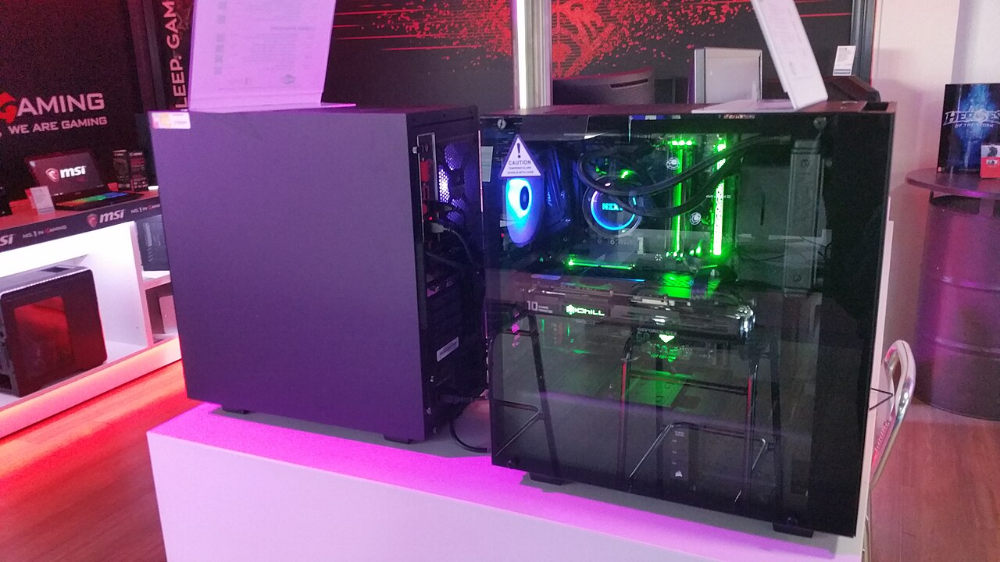
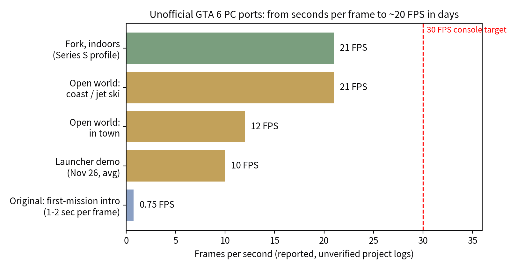

> [中文版 Chinese version](/life/gta-6-unofficial-pc-port-20fps-dmca-zh/)

*Image: Gaming PC at Informatique, Bergschenhoek. Photo: Prolete, CC0, via Wikimedia Commons.*

## The situation: the biggest game of the decade is not on PC

**Grand Theft Auto VI** launched on **November 19, 2026** for **PlayStation 5 and Xbox Series X|S only**. Rockstar Games has not announced a PC version, has given no date, and — as of November 27 — has said nothing at all about one. A report pointing to the first quarter of 2027 remains, at this point, a rumour. That silence would be unremarkable for most games. For this one it is the whole story, because GTA 6 is not most games: it is the most anticipated entertainment release of the decade, arriving on exactly two console families while the largest gaming platform in the world — the Windows PC, with its hundreds of millions of Steam accounts — is told to wait indefinitely.

Nature abhors a vacuum, and so does the modding scene. Within days of launch, files from the game's Xbox version leaked online, including a previously missing executable. What happened next is the subject of this post: a community of hobbyists, working in public on GitHub, built a compatibility layer that coaxes the Xbox build of GTA 6 into running on Windows — and improved it, in the space of about a week, from a slideshow measured in seconds per frame to something that moves at roughly **20 frames per second** in its best scenes. The publisher's response was equally fast and considerably more legal: on **November 24**, Take-Two Interactive filed a DMCA notice with GitHub that disabled a network of **3,007 repositories** in a single action. Two days later, on **November 26**, the scene showed off its first in-game mod menu and a dedicated PC launcher anyway.

Every number in this story needs a health warning, and this post will give them: the frame rates come from the projects' own logs and sympathetic coverage, not from independent benchmarking; the projects depend on leaked files, which is why they keep being deleted; and most of the viral "GTA 6 PC gameplay at 60 FPS" videos circulating right now are, according to the fan-run trackers who monitor this scene, not PC footage at all. With those caveats on the table, the underlying event is real, documented, and worth understanding — because it is a near-perfect demonstration of what happens when pent-up demand meets modern reverse-engineering tooling, and of the limits of using copyright law to hold back a technical process that thousands of people can replicate.

## How the trick works: a compatibility layer, not a port

First, terminology, because the headlines get it wrong. Nobody has "ported" GTA 6 to PC. A port means recompiling the game's source code for a new platform, which requires the source code — which only Rockstar has. What the community built instead is a **compatibility layer**, an open-source project called **VIctory**. The idea is the same one behind Wine and Proton, the layers that run Windows games on Linux and the Steam Deck: instead of translating the game, you translate the *environment*. VIctory takes the Xbox build of GTA 6 — machine code written for the Xbox Series consoles' AMD hardware and Microsoft's console operating environment — and provides, on Windows, the system services, graphics calls and platform functions that code expects to find, translating them on the fly into things a PC understands. The user supplies their own game files; the layer itself ships no game content, which is the legal theory on which such projects usually stand.

Why is this even feasible? Because the modern consoles are, under the plastic, PCs. The Xbox Series X|S and PlayStation 5 are built on AMD x86-64 processors with AMD graphics — the same instruction set as a Windows gaming PC. A game compiled for Xbox is not written in some alien tongue; it is x86 code calling a Microsoft-flavoured set of platform APIs. The hard parts are the differences in the graphics stack, the console's memory model, its shader formats, and the thousand small services a console game assumes exist. Those differences are exactly why the first results were so rough: VIctory's own README, as reported by TweakTown on November 26, lists the game's first mission intro rendering at **one frame every one to two seconds** — call it half a frame per second — even while the menus already ran at 30 FPS. A menu is mostly 2D compositing. The open world is the entire rendering pipeline, all at once, translated.

The performance jump since then has come from the unglamorous work of translation efficiency: teaching the layer to convert the Xbox build's roughly tens of thousands of shader programs ahead of time instead of stalling on them, caching what can be cached, and cutting the per-frame copying between CPU and GPU memory that dominates early compatibility-layer performance. One widely followed analysis of a single frame — 390 milliseconds long in an early build — broke it down into about 130 milliseconds of preparation, 187 milliseconds on the graphics card, and 66 milliseconds copying data back. When nearly half your frame time is bookkeeping, there is enormous headroom for exactly the kind of rapid improvement the scene then produced.

## The numbers: what "20 FPS" actually means

Here is the honest version of the headline figure, assembled from TweakTown's November 26 reporting (which cites VIctory's README and **PC Games Hardware**), from the fan-run tracking site VGNW's November 27 status page, and from TweakTown's separate November 26 report on the first mod menu and launcher.

- **The starting point:** the original project's README lists the first mission's intro at **1–2 seconds per frame** — 0.5 to 1 FPS — with menus at 30 FPS.
- **The best fork:** a public community fork reported by PC Games Hardware averages **20–22 FPS indoors**, rendering with the **Xbox Series S graphics profile**: an internal resolution of **960 × 540**, upscaled, with **ray tracing largely disabled**.
- **The open world:** footage reported November 26 shows **19–23 FPS** riding a jet ski and driving along the coast, dropping to **around 12 FPS in town**.
- **The launcher demo:** Brazilian streamer Suco demonstrated a dedicated GTA VI launcher and an in-game, debugging-focused mod menu on November 26 — reported by TweakTown as the game's first unofficial PC modding tools — averaging **about 10 FPS**, with drops to **2 FPS**, on a PC with a high-end AMD graphics card and 64 GB of RAM.
- **The ceiling so far:** VGNW's tracker, cross-checking project logs, states that **no logged measurement has reached 30 FPS**; on most graphics cards performance is in single digits, and crashes are frequent. On consoles, the game targets 30 FPS.

*Author's chart. Data: TweakTown, November 26, 2026, citing the VIctory README and PC Games Hardware; VGNW tracker, November 27, 2026. All figures are project-reported and independently unverified.*

Read those numbers the way an engineer would. Twenty frames per second at a 540p internal render, with the flagship visual feature switched off, on hardware far more powerful than the console the profile came from, is not a playable product — it is a proof of concept with momentum. The forty-fold improvement in a week is the real signal: it says the bottleneck is translation overhead, and translation overhead is the kind of problem that many parallel volunteers, iterating in public, are historically very good at grinding down. The same trajectory played out with earlier console-emulation and compatibility projects, which typically go from "it boots" to "it plays" over months, not days. Nothing about this week's numbers guarantees that endpoint — the remaining problems, shader completeness and stability chief among them, are the hard kind — but the direction and the slope are not in serious dispute.

## The takedown: 3,007 repositories in one notice

Take-Two's countermove is documented with unusual precision because GitHub publishes the notices it acts on. The company's **November 24 DMCA notice**, as summarised by both TweakTown and VGNW, targeted the fork network of an earlier project in this scene, known as Leonida, and resulted in **3,007 repositories being disabled** — the original project and its thousands of forks — with Take-Two citing, among other grounds, Rockstar's prohibition on reverse engineering. Four further notices against GTA V port projects had been filed on November 18. Clips have also been disappearing from X, and at least one YouTube analysis video was removed following a copyright request naming Take-Two Interactive; the company has not commented publicly on any of it.

Two things can be true at once here. Legally, Take-Two's position is strong in the ways that matter to it: these projects are built around leaked Xbox files — VGNW's tracker describes them bluntly as relying on stolen files — and no compatibility-layer legal theory protects redistributing a publisher's game data. The company is entirely within its rights to sweep GitHub, and it plainly intends to. Practically, though, the sweep's limits are already visible: the mod menu and launcher appeared *after* the 3,007-repository takedown, new forks surface under new names, and the knowledge — which functions to translate, which shaders block progress — now lives in thousands of heads and hard drives that no notice can reach. A DMCA notice can delete a repository. It cannot delete a technique.

There is also a genuine hazard in this scene that deserves emphasis, because it will hurt more people than any lawsuit: **the fakes**. VGNW's tracker warns that most files circulating as a "GTA 6 PC download" carry **password-stealing malware**, and that most videos claiming 60 FPS or 4K 120 FPS "PC gameplay" are console footage passed off as PC. None of the real projects distributes a finished game. Anyone tempted to go looking should understand that the search results are a minefield built to exploit exactly this demand — the same demand Rockstar's silence created.

## The judgement: a demand signal Rockstar should not ignore

Strip away the piracy-adjacent mess, and what remains is a market signal of unusual clarity. Within eight days of a console-only launch, unpaid volunteers organised themselves, in public, to do the work of a platform port — badly, illegally-adjacently, at 540p — rather than wait. That is what unmet demand looks like when it has engineering skills. PC players are not a niche Rockstar is graciously accommodating with late ports; they are the platform that kept GTA V selling for a decade, that sustains GTA Online's long tail, and that produces the modding culture — the roleplay servers, the total conversions, the endless video content — that functions as free marketing no campaign can buy. The previous game's PC version arrived nineteen months after consoles, and the franchise's economics survived it, but the environment has changed: in 2026 the audience can *watch itself* being excluded in real time, and can route around the exclusion faster than ever.

The likeliest endgame is mundane. Rockstar will announce a PC version when it suits Rockstar's double-dip economics — console sales first, PC sales second, exactly as before — and the unofficial projects will fade into trivia the day a native version exists, because a real port at native resolution with ray tracing will beat a compatibility layer at 540p on every axis. Take-Two's lawyers will keep sweeping in the meantime, and they will keep being right on the law and behind on the facts. The 20 FPS headline is not the story. The story is that in 2026, "not available on your platform" has stopped being a wall and become a starting gun — and publishers who treat it as a wall will keep learning that lesson one leaked executable at a time.

*Sources: TweakTown, "GTA 6 PC port hits 20 FPS just days after drawing one frame every two seconds" and "GTA 6 gets its first unofficial PC mod menu and launcher," both November 26, 2026; VGNW, "Is GTA 6 on PC? Fans Got There Before Rockstar," updated November 27, 2026; GitHub's published DMCA notice from Take-Two Interactive dated November 24, 2026, as reported by both outlets. Frame rates are as reported by the projects and the cited outlets and have not been independently verified. This post does not link to any unofficial project or to any leaked material.*
