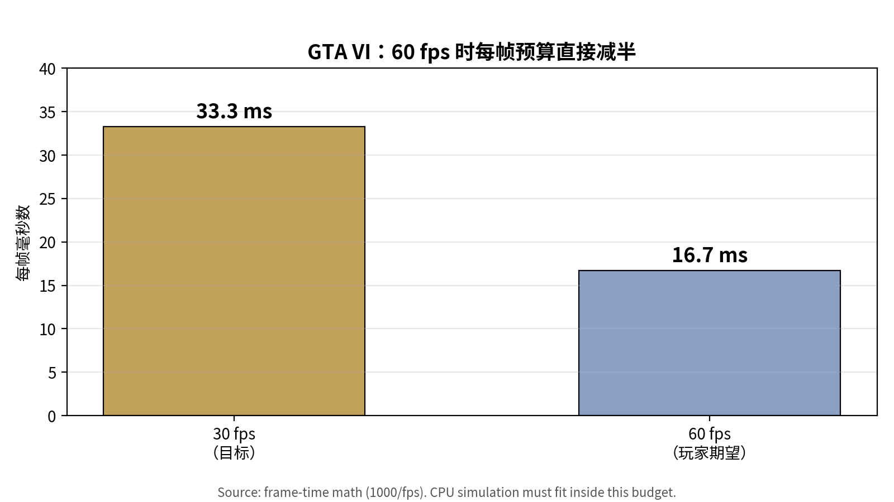
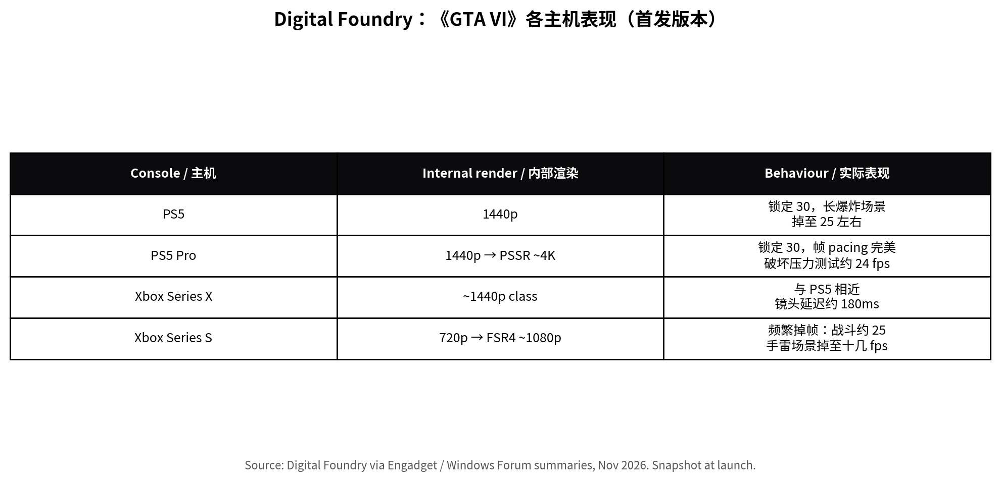

> [English version 英文版](/life/gta-6-xbox-glitch-60fps/)

*《Grand Theft Auto VI》官方主视觉图。图片：Rockstar Games。*

## 承接首发周：这篇不谈销量，只谈性能

本站自 2026 年 11 月 19 日《Grand Theft Auto VI》发售以来，已经连续覆盖了它的首发周——发售本身、口碑评价和首周末的各项数字。这篇不再重复销量，那些已经写过了。这篇只讲一个更窄、也更奇怪的故事，发生在 11 月 23 日：一个看似能给 Xbox 玩家带来 Rockstar 明确承诺永远不会给的 60 帧的方法出现了，而它在出现的同时，用最直观的方式解释了为什么这个 60 帧永远不会来。

据 TLDR Daily News 2026 年 11 月 23 日报道，一份疯传的指南正在玩家之间流传：Xbox Series X 用户通过操纵显示设置、再配合快速恢复（Quick Resume），可以强行把帧率推到约 60 fps。只看前几秒的片段，这像是一次平反。镜头移动明显更顺了。那个从发售前就存在的最大抱怨——这一代最大的游戏居然没有性能模式——好像被玩家自己用设置菜单解决了，根本不需要等补丁。

但只要多看一会儿，幻觉就会以一种非常具体、也非常有信息量的方式破掉。去掉限制器，并不是把同一个世界画得更频繁，而是把游戏时间、物理和动画按比例一起加速了，唯独过场动画保持正常速度。人物跑得太快，车辆窜得太快，整个世界不是更顺滑，而是在快进。这一条细节，把整个故事的性质彻底改变了：这不是一个藏起来的 60 帧模式等着被解锁，而是无意中公开证明了《GTA VI》的模拟是与帧率绑定的，30 帧的锁不是任性、不是商业协议、更不是偷懒，而是这款游戏运转方式里那面承重墙。

## Rockstar 在漏洞出现之前，就已经把话说死了

如果 Rockstar 留过任何余地，这个漏洞的分量不会这么重。问题是，它没有留。

《GTA VI》于 2026 年 11 月 19 日发售，在 PlayStation 5、PS5 Pro 和 Xbox Series X|S 上全部锁定并以 30 fps 为目标。没有性能模式，没有其他大作常用的、在 120Hz 显示器上折中的 40 帧平衡模式，而且——这一点很不寻常——没有任何"以后会加"的承诺。

Rockstar 向 Kotaku 确认，经 Engadget 与 Polygon 于 11 月 18 日报道：任何未来补丁都不会带来 60 帧或 40 帧模式，PS5 Pro 也不例外。这比开发商通常的措辞要强得多。通常的说法是"我们正在评估"或者"目前没有计划"，这些话保留了回旋余地。Rockstar 把回旋余地本身关掉了。

Rockstar 技术制作总监 Marc Chambers 给出的解释，正好直指这个漏洞。他表示，PS5 Pro 的 GPU 和超分确实带来了光线追踪阴影和画面清晰度，但 Pro 的 CPU 只比基础版 PS5 稍快一点，跑不动这款游戏复杂的模拟，无法支撑更高的帧率。请仔细读这句话，因为整件事的逻辑全浓缩在里面了：他点名的瓶颈不是像素，不是着色、不是光追、不是分辨率——那些恰恰是更强 GPU 和更好超分能改善的东西。他点名的是模拟，是游戏在"画出来"之前、先决定"世界要做什么"的那一部分。

当一位开发者说"CPU 跑不动更快的模拟"，一周之后，一个漏洞去掉帧率限制器，结果模拟不是变得更细腻、而是直接变得更快——这不是两个孤立的事实。这是同一个事实被演示了两遍：一遍在采访里，一遍在成千上万台 Xbox 上以事故的方式。

## 数字怎么说：Digital Foundry 实际测到了什么

如果上限是 GPU 问题，硬件阶梯应该呈现另一种样子：显卡越强，帧数越高。Digital Foundry 的首发分析（经 Engadget 与 Windows Forum 的汇总报道）呈现的却几乎是相反的图景：分辨率和画质随 GPU 实力提升，帧率却在所有关键机型上都被钉死在 30。

两台 PS5 的内部渲染分辨率都是 1440p。PS5 Pro 通过 PSSR 超分，把 1440p 提升为接近干净的 4K 呈现，普通游玩时锁定 30 帧、帧 pacing 完美；在一个刻意的车辆摧毁压力测试中，Pro 短暂掉到约 24 帧。基础版 PS5 大多数时候也能守住 30，但在长时间、爆炸密集的场景中会掉到 25 帧左右。Xbox Series X 的表现与基础版 PS5 相近，实测端到端镜头延迟约 180 毫秒——这个数字本身就在提示，从摇杆输入到世界响应之间，塞着多少模拟与缓冲。家族里最弱的 Xbox Series S 内部只渲染 720p，用 FSR 4 超分到约 1080p，却依然守不住：频繁掉帧，战斗中掉到 25 帧左右，手雷场景掉到十几帧，而且预计要靠减少人群与车流密度，才能勉强保持可玩。

*帧时间换算：作者自制图。到了 60 fps，每帧的总预算——包括模拟在内——直接减半。*

请特别注意 Series S 的结果，因为它是这组数据里最干净的证据。Series S 渲染的是 720p，像素量大幅低于 1440p，GPU 负载已经被砍掉了一大截，可它偏偏是表现最差的机器。如果《GTA VI》是 GPU 受限，把分辨率砍得这么狠，本应换来稳定性。结果却是：分辨率最低的版本帧率最差，还得再把人群和车流变稀。这就是 CPU 受限的典型签名：你把"画"的工作降得再低，"想"的工作依然太贵。

帧时间的基本算术，不用任何评测也能得出同样的结论。30 fps 时，每帧有 33.3 毫秒；60 fps 时，每帧只有 16.7 毫秒。输入、模拟、物理、动画、渲染、呈现，全部必须塞进这个预算里。而帧率翻倍，并不是让模拟"把同一件小事做得更勤"，在一个密集开放世界里，它是让模拟"用一半的时间、做大致同样规模的事，而且做两次"。一台在爆炸场景里、用 33.3 毫秒的预算都已经掉到 25 帧左右的 CPU，不可能藏着 16.7 毫秒的余量。它是在用数字直接告诉你：没有余量。

*各主机对比：作者自制图，数据基于 Digital Foundry，经 Engadget 与 Windows Forum 汇总，2026 年 11 月。*

## 先把概念说清：CPU 受限和 GPU 受限，到底差在哪

关于这款游戏的绝大多数争吵，都错在同一个地方，所以值得把概念讲精确。

GPU 受限的游戏，瓶颈在"画"：像素、阴影、反射、特效。它的帧率会对经典杠杆做出可预测的反应——降分辨率、减特效、用更聪明的超分、换更强的显卡——因为最贵的工作正是这些杠杆能变便宜的工作。大多数线性游戏、赛车游戏和竞技场射击游戏，很大程度上活在这个世界里。这也正是"性能模式"成为这一代惯例的原因：从原生 4K 降到 1440p 甚至更低，让超分把差距糊过去，再把省下的 GPU 时间花在帧率翻倍上。这套打法经常非常有效，甚至很漂亮。

CPU 受限的游戏，瓶颈在"决定"。在一个像 Leonida 这样的开放世界里，CPU 要持续回答一堆与"画得好不好看"无关的问题：每个行人要去哪、车冲上人行道时他们会怎么反应；车流如何流动、让行、惊慌失措；多车相撞时物理如何结算；警察、动物、天气、任务和环境系统在彼此碰撞、又撞上一个可以去任何地方的玩家时，会产生什么连锁反应。在这类游戏里，人群密度和车流密度——不管菜单里把它们标成什么——本质上不是画质设置，而是模拟设置。每多一个行人，贵的不是"多画一个人"，而是多了一个行为必须被计算的智能体，每一个 tick 都要算，不管它在不在画面里、不管画得多细。

这就是为什么超分救不了 CPU 上限，也是 PS5 Pro 的结果如此有说服力的原因。按 Digital Foundry 的说法，PSSR 干得非常出色：1440p 渲染变成接近干净的 4K 画面，还附带更好的光追阴影。Pro 版本在观感上明显更好。但它不是、也不可能是模拟跑得更快的版本，因为它的 CPU 只比基础版快一点点。超分省的是 GPU 时间，而《GTA VI》缺的不是 GPU 时间，缺的是 CPU 时间——而世界上不存在"思考的超分"。

这也解释了 Rockstar 那个乍看反常的决定：连 40 帧都不给。40 fps，也就是每帧 25 毫秒，在其他游戏里已经成了懂行玩家的折中方案，恰恰因为它对游戏的要求比 60 帧低得多。如果约束只是差一点点，40 帧就是最廉价的善意。Rockstar 却提前、永久地把它也否决了。合理的推断是：模拟的成本不是"差一点点"。一家工作室不会主动放弃一个平衡模式带来的廉价好感，除非它真心认为余量根本不存在。

## 为什么漏洞让世界加速，而不是让世界顺滑

现在回到漏洞本身。它是这场争议里最好的教学工具。

在一款模拟以固定步长推进、且步进与帧率绑定的游戏里——按它设计时的节奏，每渲染一帧、模拟就走一步——帧率和游戏速度是同一个旋钮。在预定的 30 fps 下，世界每秒前进三十步，一秒游戏时间正好等于一秒真实时间。去掉限制器，让机器以大约两倍的速率出帧，如果模拟仍然是每帧走完整一步，世界就变成每秒前进六十步。物理以相同的步长积分两次，动画每秒多推进一倍的帧，游戏时间就以两倍速流逝。这不需要用恶意或无能来解释，这就是"模拟与帧率绑定"在机械层面的含义。老玩家会立刻认出它：这正是许多经典游戏在比设计目标更快的硬件上运行时的行为，也是为什么模拟器和重制版社区把"解锁帧率"当作一款游戏一个工程来做，而不是一个开关。

"过场动画保持正常"这个细节同样说明问题。过场动画在很大程度上是被创作、被定时好的表演，是按时钟回放的，而不是逐 tick 涌现出来的模拟。于是这个操作制造出一个奇异的世界：同一款游戏里，创作层按真实速度运行，模拟层却在快进。这一道裂缝就是指纹。它在 Rockstar 没有公布一行引擎文档的情况下，精确地告诉了你：《GTA VI》的哪些部分是时钟驱动的，哪些部分是 tick 驱动的。

它同时也说明了，为什么"干脆解锁，让玩家自己选"从来不是一个真实选项。解锁后的《GTA VI》在现役主机上不会是一款更顺滑的《GTA VI》，而会是一款坏掉的《GTA VI》：任务计时要对着一个双倍速的世界、为一种步进速率调好的物理要在另一种速率下结算、动画与音频彼此漂移；而且在那些连 30 帧都已经守不住的压力场景里，根本无法保证机器能稳住更高的帧率，最后得到的不是 60 帧，而是忽快忽慢的变速快进。疯传片段之所以好玩，正因为它是漏洞；如果它是正式出厂的模式，那会是一桩丑闻。

这里必须给一个公平的反面观点留位置。与帧率绑定的模拟是一种设计选择，不是自然定律。其他引擎会把模拟与渲染解耦——物理和 AI 用固定时间步运行，渲染则有多快跑多快，在模拟状态之间做插值——也有一些开放世界游戏在同一批主机上确实提供了 60 帧模式。Rockstar 显然是权衡之后，选择了 30 帧下的密度与确定性，放弃了为解耦或为一个缩水版 60 帧模式所要付出的工程成本与模拟妥协。那些主张"应该做另一种选择"的玩家——人少一点、车稀一点、给一个肉眼可见更空的 Leonida 换性能模式——提出的是一个正当的价值判断，而不是技术错误。这个漏洞并不能证明 Rockstar 选对了。它证明的是：这个选择是真实的。这份模拟、以这个密度、在这颗 CPU 上，成本就是这个成本。你可以争论密度值不值，但不要争论帧数是被扣下不发的。

## Rockstar 在违逆什么预期，又为什么只有 GTA 敢

把视角拉远，这场争议的本质其实是一条规范。这一代主机把玩家训练出了一个预期：要么 30 帧的画质、要么 60 帧的性能，二选一；而性能模式越来越不被看作加分项，而是被看作基线权利——一个称职、尊重玩家的版本"理应"包含的东西。面对这条规范，地球上最畅销的娱乐产品出厂时不给任何选择，还明说以后也不会给，然后照样大卖。这才是这个故事里比漏洞活得更久的部分。

只有 GTA 能这么干，原因在结构上：这条规范靠恐惧来执行。工作室提供性能模式，是因为它们害怕评分、害怕论坛帖子、害怕退款窗口，甚于害怕工程成本。而 Rockstar 恰恰是唯一不需要害怕的。对《GTA VI》的需求，从来不取决于一个帧率菜单，业内所有人都知道这一点。这让本次发售成了一次天然实验，检验 60 帧预期到底是什么：它是一个足够强、强到能惩罚违逆者的真实玩家偏好？还是一个只在玩家手里有筹码时才成立的惯例？首发周已经给出了答案：当游戏足够大，惯例会自己绕着它弯。其他小工作室看这一幕，应该得出那个正确但不舒服的结论——不是"以后 30 帧也没关系了"，对它们来说并不会没关系；而是"原来那条规则，从头到尾讲的是议价权"。

还有第二层更安静的 implication，关乎这一代剩余的时间。如果定义这一代主机的游戏是一个 CPU 受限的 30 帧游戏，那么中期硬件的故事——更强的 GPU、更好的超分、更贵的 Pro 机型——就有一道营销不会提的天花板。Pro 给《GTA VI》玩家买来了光追阴影和更干净的 4K 画面，却买不来他们真正开口要的那样东西，因为现代开放世界里越来越稀缺的资源不是像素，而是被模拟出来的"生活"，而主机 CPU 的进步速度远远慢于 GPU。世界越做越密，这个图景只会更多、不会更少。

## 对 PC 版和下一代主机，分别意味着什么

由此可以推出两个面向未来的结论，而且必须标注它们的可信度并不相同。

对未来的 PC 版——传闻称在 2027 年初，请注意，这只是传闻，不是官宣——CPU 这条线反而是特定意义上的好消息。拥有近几年高端处理器的 PC 玩家，手里恰好握着现役主机最缺的资源：单核与多核 CPU 性能远超一颗小幅提频的主机芯片，外加用蛮力硬扛无法优化之处的选项。因此，PC 版是唯一一个真正 60 帧、乃至更高帧率的《GTA VI》有可能存在的地方，不是因为 PC 显卡更快（虽然确实更快），而是因为 PC 的 CPU 可以更快。悬而未决的都是工程问题：Rockstar 需要做多少工作，才能把一个——正如 Xbox 漏洞所演示的——目前与帧率绑定的模拟解耦或重新定时；以及 PC 的配置下限能压到多低，才不会让 Series S 的问题以"最低配置"的形式重演。如果 PC 版最终给出一份很陡的 CPU 需求，理解了这一周的人都不应该感到意外。

对下一代主机， implication 则是一份设计任务书。如果发行商想让性能模式这条规范在更密的世界里活下去，下一代机器需要的 CPU 跃升至少要和 GPU 跃升一样大——这是对这一代优先级的一次反转。否则，Rockstar 在 2026 年单方面做出的选择，就会因 necessity 变成全行业的默认：30 帧模拟着极其密集的世界，GPU 的算力被花在让这 30 帧越来越漂亮上，而超分被要求去完成一场它在架构上根本完成不了的救援。

## 判断

这个疯传的 Xbox 操作被分享时，姿态是一次"越狱"——证明 60 帧一直都在，只是被锁起来了。事实恰恰相反。它是迄今为止最有说服力的公开证据，证明《GTA VI》的 30 帧上限是一个模拟约束：去掉限制器，你得到的不是更顺滑的游戏，而是更快的游戏，过场动画和它那套创作计时被留在真实速度里，模拟世界却在它前面狂奔。Rockstar 在发售前通过 Kotaku、在 Marc Chambers 那句"CPU 跑不动更快的模拟"的直白描述里，已经把约束是什么说得清清楚楚。Digital Foundry 的数字——两台 PS5 都是 1440p、Pro 更好看但跑得并不更快、720p 的 Series S 反而最吃力——从三个方向印证了它。这个漏洞则从第四个方向印证了它，以事故的方式，在镜头前。

所以，争论可以继续，但请争论对的那一场。诚实的辩题不是"Rockstar 做不到"对"Rockstar 不肯做"，而是：一个如此密集的世界，值不值得让一款定义一代人的游戏以 30 帧运行、且不给任何替代选项？以及，一个把 60 帧做成了承诺的行业，是否应该更不安于这样一个事实——它最大的产品可以提前、永久地打破这个承诺，然后因此得到奖赏。那些帧从来不在某个菜单里等着被找到。它们被实实在在地花掉了，花在人行道上的人群和红绿灯前的车流上。而在 11 月 23 日，一个设置漏洞让所有人亲眼看着这笔账到期——以两倍速的方式。

*性能数据为 Digital Foundry 首发版本实测，经 Engadget 与 Windows Forum 汇总报道；Rockstar 的表态为 Kotaku 经 Engadget 与 Polygon 于 2026 年 11 月 18 日的报道；Xbox 操作为 TLDR Daily News 2026 年 11 月 23 日报道。传闻中的 2027 年初 PC 版未经证实。本文为纯外部视角，仅基于已公开报道撰写。*
