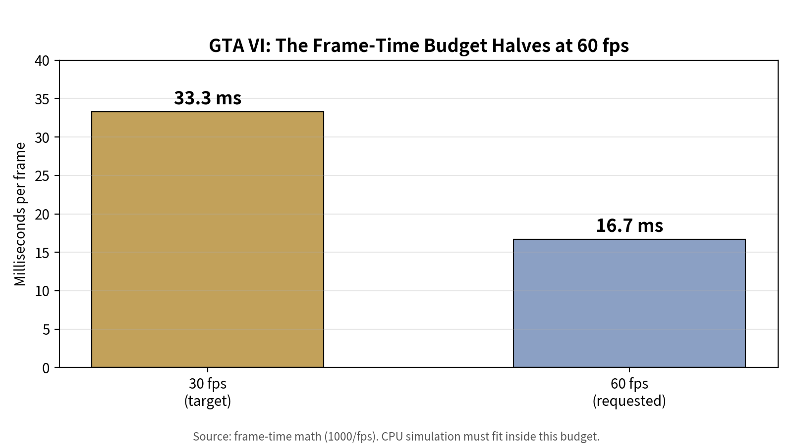
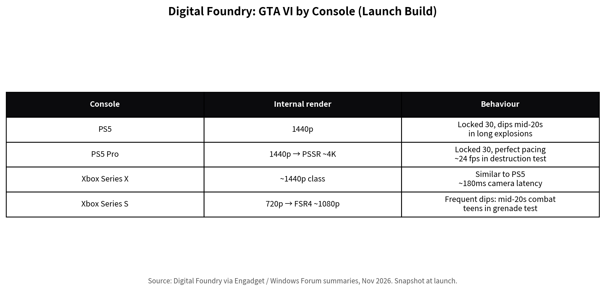

> [中文版 Chinese version](/life/gta-6-xbox-glitch-60fps-zh/)

*Official key art for Grand Theft Auto VI. Image: Rockstar Games.*

## Following launch week

This site has covered *Grand Theft Auto VI*'s launch week since the game arrived on November 19, 2026 — the release, the reviews and the first-weekend numbers. This post is not about any of that, and it deliberately does not re-cover sales. It is about one narrower, stranger story that broke on November 23: a workaround that appears to give Xbox players the 60 frames per second Rockstar has explicitly promised they will never get — and, in doing so, explains better than any press statement why they will never get it.

According to TLDR Daily News on November 23, 2026, a viral guide has been circulating that lets Xbox Series X users force roughly 60 fps by manipulating display settings in combination with Quick Resume. On a first watch, the clips look like vindication. The camera moves more fluidly. The long-standing complaint — that the biggest game of the generation shipped without a performance mode — seems to have been answered by players themselves, with settings menus instead of a patch.

Watch longer, and the illusion breaks in a very specific, very informative way. Removing the limiter does not simply draw the same world more often. It speeds up game time, physics and animations proportionally, while cutscenes stay normal. Characters move too fast. Vehicles cover ground too fast. The world is not smoother; it is running on fast-forward. That single detail changes the story completely. This is not a hidden 60 fps mode waiting to be unlocked. It is accidental, public proof that *GTA VI*'s simulation is tied to its frame rate — and that the 30 fps lock is not an arbitrary choice, a marketing deal, or simple laziness. It is the load-bearing wall of how the game works.

## What Rockstar already said — before the glitch

The glitch would matter less if Rockstar had left the door open. It did not.

*GTA VI* launched on November 19, 2026 locked and targeted at 30 fps on PlayStation 5, PS5 Pro and Xbox Series X|S. There is no performance mode, no 40 fps balanced mode of the kind several other big releases have used as a compromise on 120Hz displays, and — unusually — no promise that one is coming later.

Rockstar confirmed to Kotaku, in comments reported via Engadget and Polygon on November 18, that no 60 fps or 40 fps mode will arrive in any future patch, including on PS5 Pro. That is a stronger statement than developers normally make. The usual language is "we are looking at it" or "no plans at this time," phrases that preserve optionality. Rockstar closed the optionality itself.

Marc Chambers, Rockstar's technology production director, explained why in terms that point directly at the glitch. The PS5 Pro's GPU and its upscaling do add ray-traced shadows and clarity, he said, but the Pro's CPU is only slightly faster than the base PS5's, and that CPU cannot run the game's complex simulation at higher frame rates. Read that sentence carefully, because it is the whole argument in miniature. The bottleneck he names is not pixels. It is not shading, ray tracing or resolution — all the things a stronger GPU and a better upscaler improve. It is the simulation: the part of the game that decides what the world does, before anyone draws it.

When a developer says "the CPU cannot run the simulation faster," and a week later a glitch removes the frame-rate limiter and the simulation literally runs faster instead of finer, those are not two separate facts. They are the same fact, demonstrated twice — once in an interview, once by accident on thousands of Xboxes.

## The numbers: what Digital Foundry actually measured

If the cap were a GPU problem, the hardware ladder would look different. Stronger graphics hardware would buy frames. Digital Foundry's launch analysis, summarised via Engadget and Windows Forum coverage, shows almost the opposite pattern: resolution and image quality scale with GPU strength, while frame rate stays pinned at 30 everywhere that matters.

Both PS5 consoles render internally at 1440p. On PS5 Pro, PSSR upscaling lifts that 1440p image to a near-clean 4K presentation, and the game holds a locked 30 fps with perfect frame pacing in ordinary play. In a deliberate vehicle-destruction stress test, the Pro briefly dropped to around 24 fps. The base PS5 also mostly holds 30, but dips into the mid-20s during long, explosion-heavy sequences. Xbox Series X behaves similarly to the base PS5, with around 180 milliseconds of end-to-end camera latency measured — a number that itself hints at how much simulation and buffering sits between a stick movement and the world responding. Xbox Series S, the weakest machine in the family, renders at just 720p, upscaled to roughly 1080p with FSR 4, and still cannot hold the line: frequent dips, into the mid-20s in combat and into the teens in a grenade scenario, with reduced crowds and traffic expected as the compromise that keeps it playable at all.

*Frame-time math: author's chart. At 60 fps the total budget per frame — simulation included — halves.*

Pause on the Series S result, because it is the cleanest evidence in the set. Series S renders at 720p — a quarter of the pixel count of 1440p in each dimension's product terms, a drastically reduced GPU load — and it is the machine that struggles most. If *GTA VI* were GPU-bound, cutting resolution that aggressively should have bought stability. Instead, the lowest-resolution version has the worst frame rate and has to thin out its crowds and traffic besides. That is the signature of a CPU-bound game: turn down the drawing all you like, the thinking is still too expensive.

The frame-time arithmetic makes the same point without any benchmark at all. At 30 fps, each frame gets 33.3 milliseconds. At 60 fps, each frame gets 16.7 milliseconds. Everything — input, simulation, physics, animation, rendering, presentation — must fit inside that budget, and doubling the frame rate does not give the simulation a smaller job done more often; in a dense open world it gives it roughly the same job, done in half the time, twice as often. A CPU that is already dropping into the mid-20s under explosion-heavy load at 33.3 milliseconds is not hiding 16.7-millisecond headroom. It is telling you, in numbers, that it has none.

*Console comparison: author's chart, based on Digital Foundry data via Engadget and Windows Forum summaries, November 2026.*

## CPU-bound versus GPU-bound, in plain terms

Most arguments about this game go wrong at exactly this point, so it is worth being precise.

A GPU-bound game is limited by drawing: pixels, shadows, reflections, effects. Its frame rate responds predictably to the classic levers — lower the resolution, reduce effects, use a smarter upscaler, buy a stronger graphics chip — because the expensive work is the work those levers cheapen. Most linear games, racers and arena shooters live substantially in this world, which is why the performance mode became this generation's convention: drop from native 4K toward 1440p or lower, let upscaling paper over the difference, and spend the saved GPU time on doubling the frame rate. It works, often beautifully.

A CPU-bound game is limited by deciding. In an open world like Leonida, the CPU is continuously answering questions that have nothing to do with how pretty the answer looks: where every pedestrian is going and what they will do if a car mounts the pavement; how traffic flows, yields and panics; how physics resolves a multi-car collision; how police, animals, weather, missions and ambient systems interact when they collide with each other and with a player who can go anywhere. Crowd density and traffic density are not visual settings in such a game, however they are labelled in a menu. They are simulation settings. Each additional pedestrian is not a more expensive drawing; it is another agent whose behaviour must be computed, every tick, whether or not it is on screen in high detail.

That is why upscaling cannot fix a CPU cap, and why the PS5 Pro result is so instructive. PSSR is, by Digital Foundry's account, doing its job superbly: a 1440p render becomes a near-clean 4K image, with better ray-traced shadows besides. The Pro is the better-looking version by a clear margin. It is not, and on its hardware cannot be, the faster-simulating version, because its CPU is only slightly faster than the base machine's. Upscaling saves GPU time. *GTA VI* is not short of GPU time in the way that matters. It is short of CPU time, and there is no upscaler for thinking.

This also explains Rockstar's otherwise puzzling refusal to offer even a 40 fps mode. Forty frames per second — 25 milliseconds a frame — has become the connoisseur's compromise elsewhere precisely because it asks much less of a game than 60. If the constraint were marginal, 40 would be the obvious concession. Rockstar ruled it out too, in advance, permanently. The reasonable inference is that the simulation's cost is not marginal. A studio does not foreclose the cheap goodwill of a balanced mode unless it believes the headroom genuinely is not there.

## Why the glitch speeds the world up instead of smoothing it out

Now the glitch itself, which is the best teaching tool this controversy has produced.

In a game whose simulation advances in fixed steps tied to its frame rate — one simulation tick per rendered frame, at the cadence the game was built for — frame rate and game speed are the same dial. At the intended 30 fps, the world advances thirty steps a second, and a second of game time takes a second of real time. Remove the limiter and let the machine present frames at roughly twice the rate, and if the simulation still advances one full step per frame, the world now advances sixty steps a second. Physics integrates twice as often with the same step size. Animations advance twice as many frames. Game time runs at double speed. Nothing about this requires malice or incompetence; it is what "simulation tied to frame rate" mechanically means, and older players will recognise it instantly — it is how a great many classic games behaved when run on faster hardware than they were designed for, and why emulator and remaster communities treat frame-rate unlocking as a per-game engineering project rather than a switch.

The detail that cutscenes stay normal is equally telling. Cutscenes are substantially authored and timed — performances played back against a clock — rather than emergent simulations advanced tick by tick. So the workaround produces a world in which the authored layer runs at real speed and the simulated layer runs fast, side by side in the same game. That split is a fingerprint. It shows you exactly which parts of *GTA VI* are clock-driven and which parts are tick-driven, without Rockstar publishing a single line of engine documentation.

It also shows why "just unlock it and let players choose" was never a real option. An unlocked *GTA VI* on current consoles would not be a smoother *GTA VI*. It would be a broken one: missions timed against a double-speed world, physics tuned for one step rate resolving at another, animation and audio drifting apart, and — in the stress scenes where even 30 fps already fails — no guarantee the machine could sustain the higher rate anyway, producing not 60 but a lurching, variable speed-up. The viral clips are fun precisely because they are a glitch. As a shipped mode, they would be a scandal.

A fair counterpoint deserves space here. Frame-coupled simulation is a design choice, not a law of nature. Other engines decouple simulation from rendering — running physics and AI on a fixed timestep while rendering as fast as hardware allows, interpolating between simulation states — and some open-world games do offer 60 fps modes on these same consoles. Rockstar plainly chose density and determinism at 30 over the engineering cost and the simulation compromises that decoupling or a scaled-back 60 fps mode would have required. Players who argue that a different choice should have been made — fewer pedestrians, thinner traffic, a performance mode with a visibly emptier Leonida — are making a legitimate values argument, not a technical error. The glitch does not prove Rockstar chose correctly. It proves the choice was real: this simulation, at this density, on this CPU, costs what it costs. Argue about whether the density was worth it. Do not argue that the frames were being withheld.

## The expectation Rockstar is defying — and why only GTA can

Step back, and the controversy is really about a norm. This console generation trained players to expect a choice: fidelity at 30 or performance at 60, with the performance mode increasingly treated not as a bonus but as a baseline entitlement — the thing a competent, respectful release simply includes. Against that norm, the best-selling entertainment product on Earth shipped with no choice at all, said none is coming, and sold anyway. That is the part of the story that will outlast the glitch.

Only *GTA* could do this, for a structural reason: the norm is enforced by fear. Studios offer performance modes because they fear the review, the forum thread and the refund window more than they fear the engineering cost. Rockstar, uniquely, does not have to. Demand for *GTA VI* was never contingent on a frame-rate menu, and everyone in the industry knows it — which makes this launch a natural experiment in what the 60 fps expectation actually is. Is it a genuine player preference, strong enough to punish a game that defies it? Or is it a convention that holds only where players have leverage? Launch week answered that: where the game is big enough, the convention simply bends around it. Smaller studios watching this should draw the correct, uncomfortable lesson — not "30 fps is fine now," because for them it will not be, but "the rule was about bargaining power all along."

There is a second, quieter implication for the rest of the generation. If the defining game of these consoles is CPU-bound at 30 fps, then the mid-generation hardware story — stronger GPUs, better upscalers, premium-priced Pro models — has a ceiling that marketing does not mention. The Pro bought *GTA VI* players ray-traced shadows and a cleaner 4K image. It could not buy them the one thing many of them actually asked for, because the scarce resource in modern open worlds is increasingly not pixels but simulated life, and console CPUs have improved far more slowly than console GPUs. Expect more of this pattern, not less, as worlds get denser.

## What this means for PC and for next generation

Two forward-looking consequences follow, and they should be labelled with different levels of confidence.

For a future PC version — rumoured for early 2027, and to be clear, a rumour, not an announcement — the CPU story is actually good news of a specific kind. PC players with recent high-end processors have exactly the resource current consoles lack: single-thread and multi-core CPU performance well beyond a slightly-clocked console chip, plus the option to brute-force what cannot be optimised. A PC port is therefore the one place a genuine 60 fps — and beyond — *GTA VI* plausibly exists, not because PC GPUs are faster, though they are, but because PC CPUs can be. The open questions are engineering ones: how much work Rockstar must do to decouple or re-timestep a simulation that, as the Xbox glitch demonstrates, is currently frame-coupled, and how low the PC floor can go before the Series S problem reappears in minimum-spec form. If the port ships with steep CPU requirements, nobody who understood this week should be surprised.

For next-generation consoles, the implication is a design brief. If publishers want the performance mode to survive as a norm into denser worlds, the next machines need CPU leaps at least as large as their GPU leaps — a reversal of this generation's priorities. Otherwise the choice Rockstar made unilaterally in 2026 becomes the industry default by necessity: 30 fps simulations of very dense worlds, with GPU power spent on making those 30 frames ever more beautiful, and upscaling asked to perform a rescue it is architecturally incapable of performing.

## Judgment

The viral Xbox workaround was shared as a jailbreak — proof that 60 fps was there all along, locked away. It is the opposite. It is the most persuasive evidence yet published that *GTA VI*'s 30 fps cap is a simulation constraint: remove the limiter and you do not get a smoother game, you get a faster one, cutscenes and all their authored timing left behind at real speed while the simulated world races. Rockstar told players, through Kotaku before launch and through Marc Chambers' plain description of a CPU that cannot run this simulation faster, exactly what the constraint was. Digital Foundry's numbers — 1440p on both PS5s, a Pro that looks better but runs no faster, a 720p Series S that struggles most of all — corroborate it from three directions. The glitch corroborated it from a fourth, accidentally, on camera.

So keep the argument, but have the right one. The honest debate is not "Rockstar could not" versus "Rockstar would not." It is whether a world this dense was worth a generation-defining game running at 30 fps with no alternative — and whether an industry that made 60 fps a promise should be more troubled that its biggest product could break that promise, permanently and in advance, and be rewarded for it. The frames were never in a menu waiting to be found. They were spent, deliberately, on the crowd on the pavement and the traffic at the light — and on November 23, a settings glitch let everyone watch the bill come due, at double speed.

*Performance figures are Digital Foundry's launch-build measurements as summarised by Engadget and Windows Forum coverage; Rockstar's statements are as reported by Kotaku via Engadget and Polygon on November 18, 2026; the Xbox workaround is as reported by TLDR Daily News on November 23, 2026. The rumoured early-2027 PC version is unconfirmed. This post is written from an external perspective, based solely on published reporting.*
