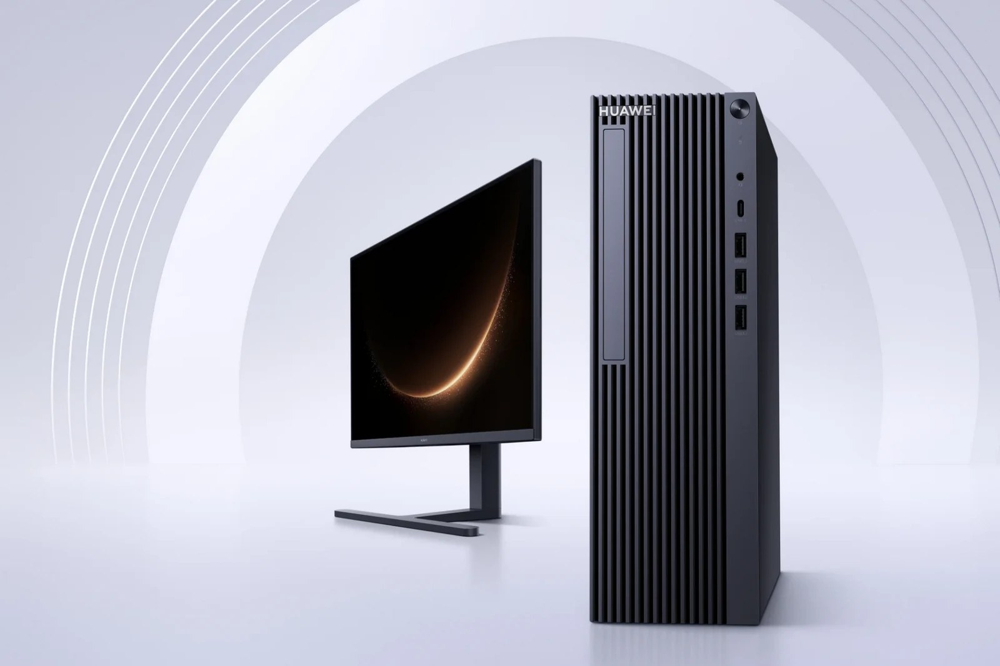
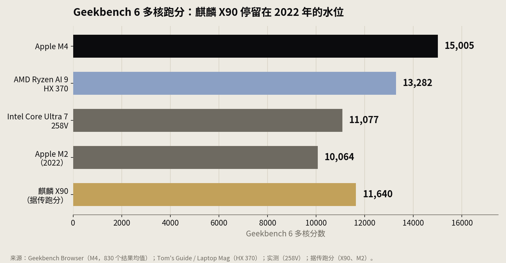
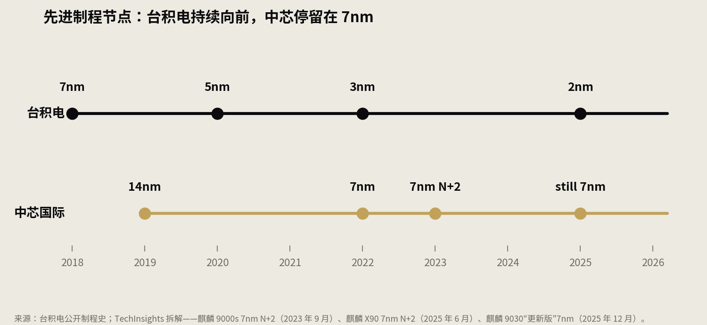
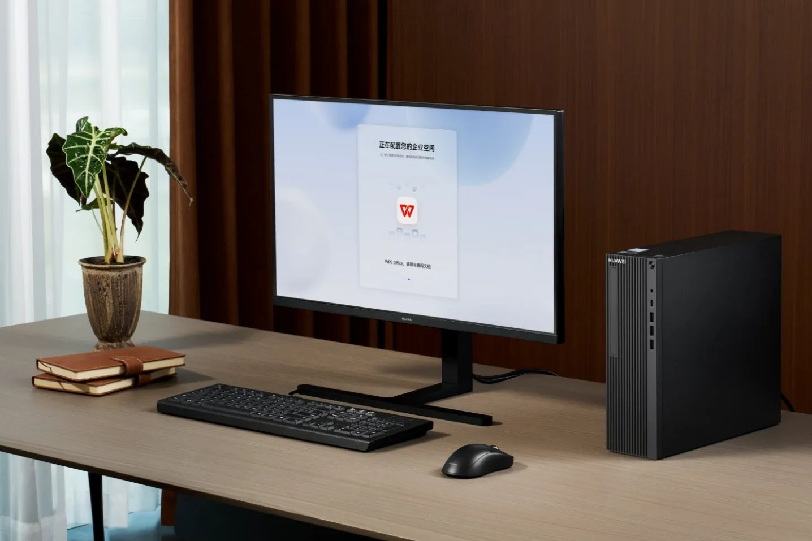

> [English version](/life/huawei-kirin-x90-why-so-weak-so-expensive/)

*清韵 HM650，华为首款鸿蒙台式机。机器是新闻钩子，里面的芯片才是故事。图片：华为，经 Notebookcheck 转引。*

11 月 5 日在武汉发布的华为清韵 HM650，搭载 10 核麒麟 X90 处理器，16GB 内存 + 512GB 固态硬盘的店铺标价是 7199 元（约 1080 美元）。同一市场里，苹果 Mac mini M4——按所有公开跑分都更快的一台机器——只卖 4499 元。HM650 在最影响日常响应速度的单核指标上，甚至慢于三年前的 MacBook Air。

所以真正的问题不是芯片弱不弱，而是这么弱的东西为什么这么贵。答案不是一个事实，而是一条链，而且链上的每一个环节都是同一个故事讲了两遍：制裁让芯片变慢，制裁也让芯片变贵。

## 到底有多慢

先看数字，也先说清数字的限度。华为从不公布麒麟 X90 的跑分。现有的分数来自 MateBook Fold（首款搭载 X90 的机器）上流出的 Geekbench 6 测试，但结论是一致的。

*Geekbench 6 多核跑分。X90 的分数来自据传的流出测试，未经独立实验室验证；其余为 Geekbench Browser 均值或实测结果。图表：本站自制，数据来源见注。*

多核是 X90 最好看的一项：据传分数约 11640，与 2022 年的苹果 M2（约 10064）和英特尔 Core Ultra 7 258V（约 11077）处于同一档，比苹果 M4（15005，Geekbench Browser 上 830 个 MacBook Air 结果的均值）低约 30%。多核是 X90 的主场，因为它有 10 核 20 线程可以堆上去。

单核才是差距真正拉开的地方。据传跑分显示，X90 的单核比苹果 2020 年的 M1 还低约 11%。而 M4 在同一项单核测试中是 3204 分，比 X90 据传的水平高出约 50%。单核速度是你打开应用、加载文档、切换任务时感受到的东西，是 X90 落后最多的指标，也是华为从不提的指标。华为自己对这颗芯片的说法经过精心挑选：多核性能超越 M2。这个说法看起来是真的，同时也是关于这颗芯片最没有信息量的真话。

再看功耗。X90 在 MateBook Fold 里需要约 30 瓦才能跑出这个多核分数；M2 在无风扇的 MacBook Air 里约 20 瓦就能跑出相近分数。HM650 里这颗芯片的 TDP 是 40 瓦。同样的活要花更多电，是老制程的签名——而拆解证实了这一点。

显卡的故事更薄。Maleoon 910 是华为自研的 GPU，因为制裁拿不到 ARM 的 Mali 设计。华为不公布它的任何显卡跑分，也没有被广泛引用的独立实验室数据。一颗芯片的厂商不肯给你看显卡数字，这本身就是一种表态。

## 为什么慢：代工厂的天花板

麒麟 X90 是 10 核三丛集设计——4 颗高性能泰山核、4 颗中核、2 颗能效核——由中芯国际以 7nm 级"N+2"工艺制造。这一点由 TechInsights 在 2025 年 6 月对 MateBook Fold 的拆解证实。架构确实是华为自己的东西，泰山核也是合格的设计。问题不在设计，在工厂。

*制程代差，按年份。台积电 2022 年量产 3nm、正在推进 2nm；中芯自 2023 年以来一直是同一代 7nm 级工艺。图表：本站自制，数据来源见注。*

中芯的 7nm 是在没有 EUV 光刻机的情况下做出来的。EUV（极紫外光刻）是能一次曝光就印出最精细线条的技术，全世界只有一家公司能造 EUV 光刻机——荷兰 ASML，而且它不卖给中国。中芯用的是老一代 DUV（深紫外）设备加多重曝光——同一层硅片用不同掩模曝光好几次，刻出单次 DUV 曝光刻不出的精细结构。这条路走得通，但更慢、缺陷更多、每片晶圆的成本高得多。

结果是一道硬天花板。台积电 2022 年量产 3nm、现在推进 2nm；中芯落后整整两代，而且差距没有缩小。TechInsights 的拆解按时间顺序讲了这个故事：2023 年 9 月麒麟 9000s 是 7nm N+2，2025 年 6 月麒麟 X90 还是同一代 7nm N+2，2025 年 12 月 Mate 80 Pro Max 的麒麟 9030 是 TechInsights 所说的"更新版"7nm——仍然是 7nm。三年，三颗旗舰芯片，一个制程节点。

架构修不好这个问题。更好的核心能在给定的晶体管预算里挤出更多性能，但预算本身是制程定的：能塞多少晶体管、开关多快、漏电多少。X90 的设计师在糟糕的约束里做了合格的工作，约束本身才是故事。

## 为什么慢还贵：良率的数学

这里是回答价格的部分。用 DUV 多重曝光、在不成熟的工艺上做芯片，良率——一片晶圆上能用的芯片比例——会很低。2023 年的报道称中芯 N+2 的良率约为 30–40%，而台积电同等工艺在 80% 以上。这个数字没有经过验证的公开更新，唯一具名的评估仍然是 2022 年《金融时报》引用的半导体学者 Douglas Fuller 的说法——他称中芯的良率"糟糕"。请把 30–40% 理解为据传数字，而非定论。但方向是没有疑问的：多重曝光意味着更多工艺步骤，更多步骤意味着更多机会让一个缺陷杀死一颗芯片，报废的晶圆更多。

低良率直接乘在成本上。如果一片晶圆上三分之二的芯片是坏的，每颗好芯片就要背三颗芯片的成本。业界对 N+2 工艺的分析估计，每颗合格芯片的成本约为台积电同等生产的 2–3 倍——这是估算，但它是从良率算术推导出来的，而非与之矛盾。代工厂自己也被挤压：中芯 2024 年毛利率跌至 18.6%，九年最低，尽管 2025 年营收创下 93.3 亿美元新高。据报道，华为正在深圳自建芯片生产线，以补充中芯给不了的产能——这又是一笔要摊进价格里的成本。

再加上量小。X90 只装在华为自己的机器上——几款笔记本、一款平板，现在一台台式机。没有公开市场、没有规模效应、没有第二个客户来分摊工艺研发的投入。DUV  workaround 的每一分钱，都摊在很少的出货量上。

所以这颗芯片在华为加一分钱利润之前，制造成本就已经很高。这是价格的前一半。

## 为什么有人买单：被锁定的市场

后一半在于买家是谁。HM650 不走电商、不走消费门店，它是面向政府部门与国企的采购产品，通过华为的销售渠道销售。而在这个市场里，HM650 有英特尔或 AMD 机器永远给不了的东西：一张"100% 国产化"认证。

这张认证就是产品。中国的"信创"政策——信息技术应用创新——要求国家机构用国产技术替代外国技术；而据《华尔街日报》报道，2022 年 9 月的"79 号文"要求国企在 2027 年前淘汰外国软件。中国《政府采购法》本来就规定优先采购国产品，2024 年财政部的征求意见稿更提出给国产品 20% 的价格优势。在 HM650 服务的细分市场里，英特尔和 AMD 不是输在性能上的竞争对手，它们是被政策取消资格的。

所以 HM650 在一个只有一个选手的市场里竞争。没有第二台通过认证的 100% 国产台式机——国产芯片、国产操作系统、国产软件栈全套。买家不是在 7199 元的华为台式机和 4499 元的 Mac mini 之间选，因为 Mac mini 根本不能采购到那张办公桌上。买家是在"有认证的机器"和"没有机器"之间选，而在一个有 2027 年截止期限的采购体系里，这根本不算选择。

这就是为什么这个价格在它的市场里合理、在市场外荒谬。7199 元买的不是速度，是合规、是主权、是外国政府关不掉的供应链。华为不是在为一颗慢芯片漫天要价，它是在向一个只能买它的买家收垄断供应商的价格。

## 软件税

芯片只是机器的一半。HM650 跑鸿蒙，而软件缺口是买家要交的第二笔性能税。

*HM650 的企业工作空间，屏幕上是 WPS Office——应用生态，一图以蔽之。图片：华为，经 Notebookcheck 转引。*

华为称鸿蒙已有 21000 多个应用兼容，消费者业务负责人何刚则称鸿蒙电脑应用已超过 19000 个。但何刚也在公开场合承认，鸿蒙电脑上的专业软件仍然很少。鸿蒙 NEXT 独立于安卓与 Linux，这意味着它不能原生运行 Windows 或安卓应用。变通办法是 OSEasy 虚拟机，在沙箱里跑 Windows 11——x86 与 ARM 之间的指令翻译会带来开销，什么都比原生慢。华为的 Windows 授权已在 2025 年 3 月到期，所以连原生 Windows 的退路都没有。

这台机器日常实际跑的，是 WPS Office、企业微信、浏览器和华为自己的 AI 工具。对政府办公室来说够用，对其他场景来说还在建设中。装机量是真实的——鸿蒙电脑出货已过 100 万台，华为称已为生态投入超过 100 亿元——但应用数量不等于软件目录，金融、设计、工程领域的专业工具永远是最后一个迁移到新平台的。

## 结论

把整条链拼起来，悖论就消失了：

- **慢**，因为中芯没有 EUV，X90 只能用 7nm DUV 多重曝光做出来——比台积电落后两代，功耗与单核的代价随之而来。
- **制造成本贵**，因为低良率与多重曝光把每颗合格芯片的成本乘了 2–3 倍，又摊在没有公开市场的小批量上。
- **售价贵**，因为唯一重要的客户是别无选择的政府买家，在一个认证即产品、竞争对手被政策取消资格的市场里。

这些都不是对华为工程能力的评判。在制裁之下做出可用的 7nm 工艺、自研 CPU 核、自研 GPU 和一整套操作系统，是真实的工业成就。同时，根据现有证据，它也是一台比 7199 元在世界其他地方能买到的东西更贵、更慢的机器。

这个差距不是靠"更努力"就能追上的。它要等 EUV 光刻机，或者等国产替代，而没有任何公开证据——没有拆解、没有出货、没有发布——显示其中任何一个正在到来。值得盯住的两个数字是：中芯是否真的量产 5nm 级产品（TechInsights 在 2025 年 12 月拆到的仍然是 7nm），以及鸿蒙的应用数量会不会变成人们真正用的专业软件。在其中一个变化之前，HM650 就是它现在的样子：一张附带电脑的证书，卖给必须要有这张证书的买家。

*来源：TechInsights 拆解（经路透社与行业报道转引：麒麟 X90 为中芯 7nm N+2，2025 年 6 月；麒麟 9030 为"更新版"7nm，2025 年 12 月）；Geekbench Browser（Apple M4 MacBook Air 均值，830 个结果）；Tom's Guide 与 Laptop Mag（Ryzen AI 9 HX 370）；实测（Core Ultra 7 258V）；据传的流出跑分（麒麟 X90、Apple M2）；《金融时报》经行业报道转引（中芯良率，2022 年）；中芯 2025 财年业绩（营收 93.3 亿美元；2024 年毛利率 18.6%）；《华尔街日报》经行业报道转引（79 号文，2022 年 9 月）；Notebookcheck（HM650 配置与 7199 元店铺标价，2026 年 11 月 8 日）；EveryMac（Mac mini M4 中国售价 4499 元）；华为经《中国日报》与行业报道（鸿蒙应用 21000+；鸿蒙电脑 100 万台；生态投入 100 亿元以上）；何刚经 HarmonyOSHub（鸿蒙电脑应用 19000+；专业软件仍然较少）。价格为 2026 年 11 月 8 日查询的店铺标价或官方标价，随时可能变动。良率与单颗芯片成本为据传的估算数字，未经证实。*
