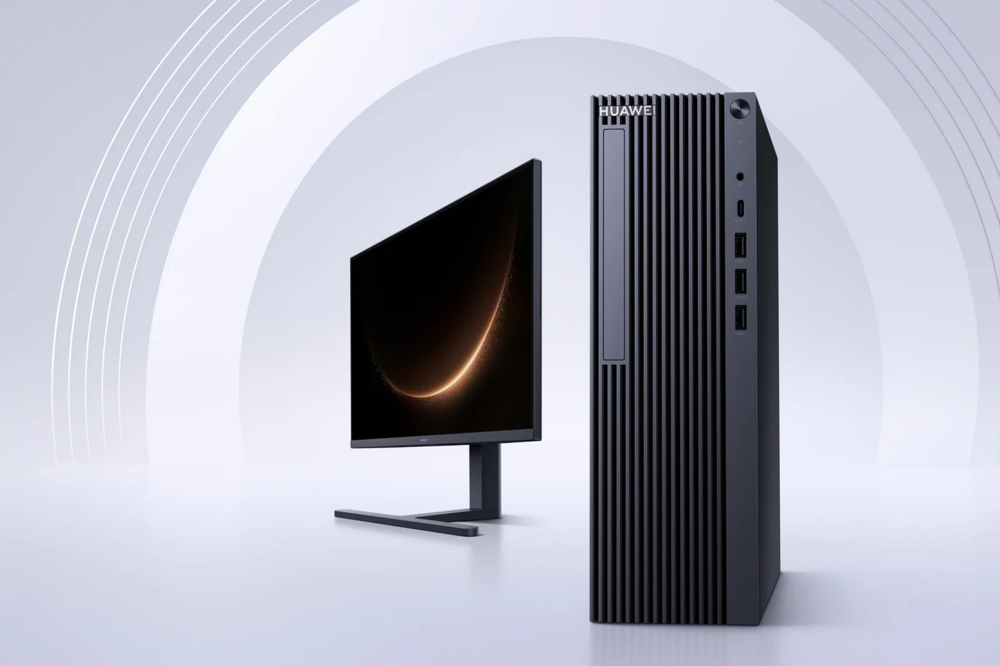
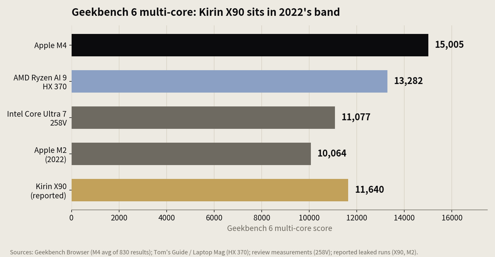
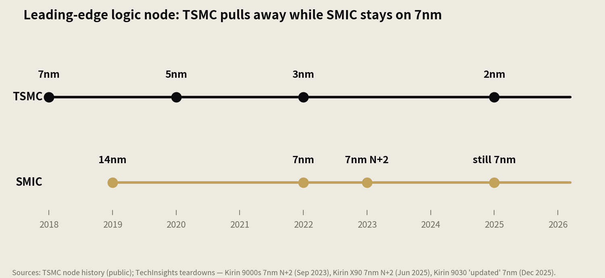
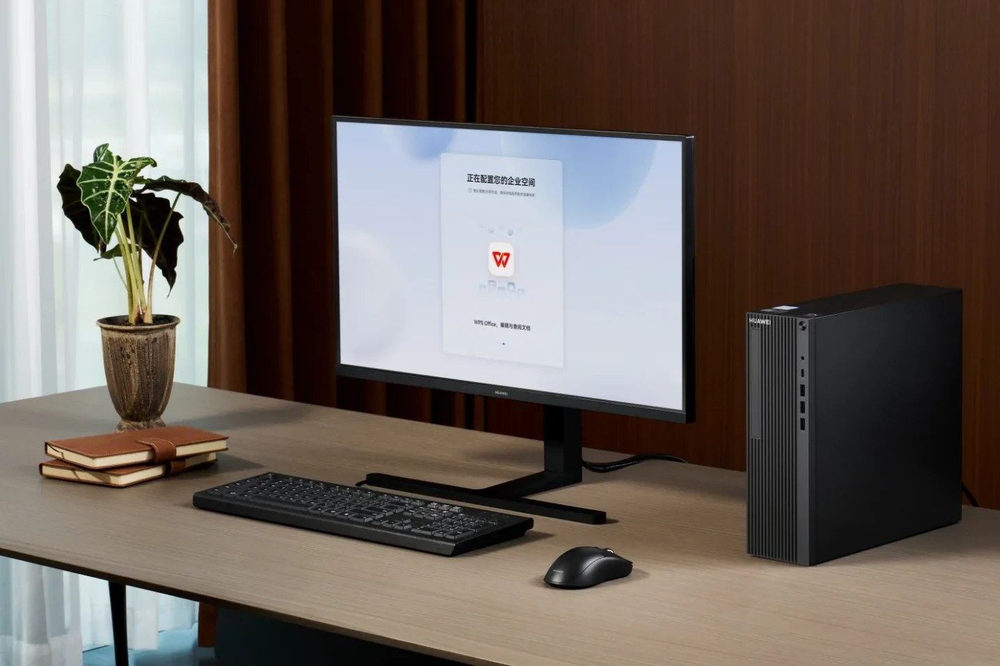

> [中文版 Chinese version](/life/huawei-kirin-x90-why-so-weak-so-expensive-zh/)

*The Qingyun HM650, Huawei's first HarmonyOS desktop. The machine is the news hook; the chip inside it is the story. Photo: Huawei, via Notebookcheck.*

Huawei's Qingyun HM650, unveiled November 5 in Wuhan, is a desktop with a 10-core Kirin X90 processor and a store-listed price of 7,199 yuan (about $1,080) for 16GB of RAM and a 512GB SSD. In the same market, Apple sells the Mac mini M4 — a faster machine by every public benchmark — for 4,499 yuan. The HM650 is also slower than a three-year-old MacBook Air in the metric that matters most for everyday responsiveness.

So the obvious question is not whether the chip is weak. It is why something this weak costs this much. The answer is not one fact but a chain, and every link in it is the same story told twice: sanctions made the chip slow, and sanctions made it expensive.

## The sanctions timeline

None of this happened by accident, and the chain starts earlier than the chip. In May 2019, the U.S. Commerce Department added Huawei and 68 affiliates to the Entity List, cutting off access to American technology. In August 2020, the Foreign Direct Product Rule extended the ban to any chip made with U.S. technology anywhere in the world — which meant TSMC, the foundry that had made every Kirin chip to date, could no longer ship to Huawei. In October 2022, Washington imposed sweeping export controls on advanced semiconductors and the equipment to make them, expanded them in 2023, and got Japan and the Netherlands to align their own equipment controls the same year. In 2024, the U.S. revoked the licenses that had allowed Intel and Qualcomm to sell processors to Huawei at all.

The commercial damage was immediate and measurable. Huawei's revenue fell from 891.4 billion yuan in 2020 to 636.8 billion in 2021 — a drop of nearly 30% in a single year — and its smartphone business, once the world's second-largest, collapsed to a domestic rump. The recovery since then is real but partial: revenue reached 880.9 billion yuan in 2025, roughly back to 2020 levels, but the composition has changed completely. The company that used to sell phones to the world now sells telecom equipment, enterprise hardware, and cars in China, and its chip division exists to serve a domestic market that Washington cannot reach. The Kirin X90 is a product of that second Huawei, not the first.

## The Mate 60 moment

The chip that proved the second Huawei could still make chips arrived without a press conference. On August 29, 2023, the Mate 60 Pro simply appeared on Huawei's website and in stores, and sold out within hours. When TechInsights took one apart the following month, it found a Kirin 9000s fabricated by SMIC on a 7nm process — a capability U.S. government analysts had assessed China would not achieve until at least 2027. The Financial Times, cautioning that DUV lithography meant the result was "progress" rather than a "breakthrough," captured the ambiguity exactly: it was a genuine engineering achievement that did not change the underlying constraint.

What happened next is the pattern the X90 now extends. TechInsights ran the same analysis on the next Mate phone in December 2024 and found the identical 7nm process, not the 5nm chip some had rumored — a stall, not an advance. In June 2025 it found the same chip in Huawei's MateBook Fold laptop. In December 2025 it found an "updated" 7nm process in the Mate 80 Pro Max's Kirin 9030. The Mate 60 was a demonstration that 7nm was possible without EUV. The three years since have been a demonstration that 7nm is also, so far, the ceiling.

## How slow is it, really

Start with the numbers, and with their limits. Huawei publishes no benchmark for the Kirin X90. What exists are reported Geekbench 6 runs from the MateBook Fold, the first machine to carry the chip, and they tell a consistent story.

*Geekbench 6 multi-core. The X90's score is from reported leaked runs, not an independently verified lab test; the others are Geekbench Browser averages or measured review results. Chart: this site, data as cited.*

In multi-core work, the X90's reported score of about 11,640 lands in the same band as Apple's M2 from 2022 (about 10,064) and Intel's Core Ultra 7 258V (about 11,077) — respectable, unremarkable, and roughly 30% behind Apple's M4 (15,005, the Geekbench Browser average across 830 MacBook Air results). Multi-core is the X90's best case, because it has ten cores and twenty threads to throw at the problem.

Single-core is where the gap opens up. Reported runs put the X90 about 11% *behind* Apple's M1 — a chip from 2020. Apple's M4 scores 3,204 in the same single-core test, roughly 50% ahead of where the X90's reported numbers land. Single-core speed is what you feel when you open an app, load a document, or switch tasks; it is the metric in which the X90 is furthest behind, and the one Huawei never talks about. Huawei's own claim for the chip is carefully chosen: multi-core performance surpassing the M2. That claim appears to be true, and it is also the least informative true thing you can say about this chip.

Then there is power. The X90 needed roughly 30 watts in the MateBook Fold to reach that multi-core score; the M2 reaches its comparable score at around 20 watts in a fanless MacBook Air. The HM650 runs the chip at a 40W TDP. More power for the same work is the signature of an older process node — which is exactly what the teardown shows.

The graphics story is thinner still. The Maleoon 910 is Huawei's in-house GPU, built because sanctions cut off ARM's Mali designs. Huawei publishes no GPU benchmark for it, and no independent lab has produced one that is widely cited. A chip whose maker will not show you its graphics numbers is telling you something without saying it.

## Why it is slow: the fab ceiling

The Kirin X90 is a 10-core chip in a tri-cluster layout — four high-performance Taishan cores, four mid cores, two efficiency cores — built by SMIC on its 7nm-class "N+2" process. That was confirmed by TechInsights' teardown of the MateBook Fold in June 2025. The architecture is genuinely Huawei's own work, and the Taishan cores are competent designs. The problem is not the design. It is the factory.

*The node gap, year by year. TSMC shipped 3nm in 2022 and is ramping 2nm; SMIC has shipped the same 7nm-class process since 2023. Chart: this site, data as cited.*

SMIC's 7nm is made without EUV lithography. EUV — extreme ultraviolet — is the technology that prints the finest features on a modern chip in a single exposure, and there is exactly one company in the world that makes EUV machines: ASML of the Netherlands, which does not sell them to China. SMIC instead uses older DUV (deep ultraviolet) tools with multi-patterning — exposing the same layer of silicon several times with different masks to carve features finer than one DUV exposure can manage. It works. It is also slower, more defect-prone, and far more expensive per wafer than EUV.

The result is a hard ceiling. TSMC shipped 3nm in 2022 and is ramping 2nm now; SMIC is two full generations behind, and the gap is not closing. TechInsights' teardowns tell the story in sequence: Kirin 9000s on 7nm N+2 in September 2023, Kirin X90 on the same 7nm N+2 in June 2025, and the Mate 80 Pro Max's Kirin 9030 in December 2025 on what the firm called an "updated" 7nm process — still 7nm. Three years, three flagship chips, one node.

Architecture cannot fix this. Better cores can squeeze more performance out of a given transistor budget, but the node sets the budget: how many transistors fit, how fast they can switch, how much power they leak. The X90's designers did competent work inside a bad constraint. The constraint is the story.

## How DUV multi-patterning actually works

The mechanism deserves a closer look, because "no EUV" is doing a lot of work in this story and it is easy to treat it as a slogan rather than a process. Photolithography prints circuit patterns onto silicon with light, and the resolution is set by the wavelength: the shorter the light, the finer the features. DUV (deep ultraviolet) uses 193 nm light, passed through water in immersion systems to squeeze out more resolution. EUV (extreme ultraviolet) uses 13.5 nm light — roughly one-thirteenth the wavelength — which prints the finest features in a single exposure. ASML is the only company in the world that builds EUV scanners; it shipped 44 low-NA EUV systems in 2025 and expects about 65 in 2026, and its next generation, high-NA EUV, raises the numerical aperture of the optics from 0.33 to 0.55 to print finer features still.

Below about 40 nm half-pitch, a single DUV exposure cannot resolve the pattern, so SMIC splits each layer into multiple exposures: litho-etch-litho-etch (LELE) uses two masks for one layer, and self-aligned double and quadruple patterning (SADP and SAQP) use deposited spacers to halve or quarter the printed pitch. EUV replaced three or four DUV exposures on the tightest layers at 7nm and 5nm, which is why foundries paid for it. Every extra exposure adds masks, process steps, machine time, and opportunities for error — above all overlay error, the misalignment between successive exposures, which is the defect mode multi-patterning is most vulnerable to. The result is not just lower yield but longer cycle time: a wafer spends more time in the fab, on more tools, with more chances to fail. That is the tax, measured in weeks and in wafers, that the X90 pays on every die.

## Why slow is expensive: the yield math

Here is the part that answers the price. A chip made with DUV multi-patterning on an immature process has low yield — the fraction of chips on a wafer that actually work. Reporting from 2023 put SMIC's N+2 yield at roughly 30–40%, against 80% or better at TSMC on equivalent processes. No verified public update to that figure has appeared since, and the one on-the-record assessment — a 2022 Financial Times quote from semiconductor scholar Douglas Fuller calling SMIC's yield "terrible" — is still the only named estimate in circulation. Treat the 30–40% figure as reported, not confirmed. But the direction is not in doubt: multi-patterning means more process steps, more chances for a defect to kill a die, and more wafers thrown away.

Low yield is a direct multiplier on cost. If two-thirds of the chips on a wafer are defective, each working chip carries the cost of three. Industry analysis of the N+2 process has put the cost per working die at roughly two to three times what equivalent TSMC production would cost — an estimate, but one that follows from the yield arithmetic rather than contradicting it. The foundry itself is squeezed: SMIC's gross margin hit a nine-year low of 18.6% in 2024, even as revenue reached a record $9.33 billion in 2025. Huawei is reportedly building its own chip-production lines in Shenzhen to add capacity SMIC cannot spare, which is another cost that has to be recovered somewhere.

Add small volumes. The X90 ships in Huawei's own machines only — a few laptop models, a tablet, now a desktop. There is no merchant market, no scale, no second customer to amortize the process development across. Every yuan of that DUV workaround is spread over a small number of units.

So the chip is expensive to make before Huawei adds a cent of margin. That is the first half of the price.

## The domestic lithography race

If EUV is the constraint, the obvious question is whether China can build its own. The answer, so far, is: the DUV part, maybe; the EUV part, not yet. SMEE, China's leading lithography company, has moved its 28nm immersion DUV system into verification, with a target of entering SMIC production in late 2026. A state-backed consolidation, Shanghai Aishengna Electronic Technology Group — drawing on teams from Huawei-linked Yuliangsheng and SMEE — began limited production of home-grown immersion DUV machines in July 2026, reportedly around five machines in 2026 with a target of 20 in 2027, for customers including SMIC, Hua Hong, and CXMT. These are not established equivalents to ASML's production scanners, but a domestically serviceable scanner protects mature and moderately advanced production even before it is suitable for flagship processors. China has also stockpiled the tools it can still buy: an estimated 343 DUV machines were acquired by Chinese-owned fabs in 2024–25.

EUV is a different order of problem. Reuters reported in December 2025 that a secretive team in Shenzhen had completed a prototype capable of generating EUV light — a machine that reportedly occupied much of a factory floor and had not yet produced working chips. Chinese officials were said to be targeting 2028 for working chips, while people familiar with the program regarded 2030 as more plausible. The optics are the main obstacle: only Carl Zeiss makes EUV mirrors, and the light source, the vacuum system, and the defect-free masks are each a separate frontier. Until one of these programs produces a working chip, the node ceiling the X90 lives under is not a policy choice. It is a physics problem with a procurement problem wrapped around it.

## The Ascend side of the story

The X90 is not the only chip living under this ceiling, and the other one matters more to the AI race. Huawei's Ascend 910B, its AI training chip, is made on the same SMIC N+2 process. A 2023 Bernstein Research analysis estimated it delivers approximately 60% of an NVIDIA H100's performance at roughly twice the power draw — inferior, but not useless, and good enough that Chinese cloud providers and AI labs buy it when they cannot buy H100s. The same yield math, the same power penalty, and the same node ceiling apply; the only difference is that in AI training, you can compensate for a weaker chip with more chips, more interconnect, and more power — parallelism as a substitute for process technology.

That compensation strategy is visible across China's semiconductor effort: where the lithography cannot improve, the packaging, the interconnect, and the full-stack optimization are asked to carry the load. It works up to a point — a cluster of Ascend chips can train a model, just as a 10-core X90 can run a desktop — but the cost is paid in power and in scale, and it does not close the gap. The X90's story and the Ascend's story are the same story told at two scales: competent engineering inside a fab ceiling that does not move.

## Why anyone pays: the captive market

The second half is who the buyer is. The HM650 is not sold through e-commerce or consumer stores. It is a procurement product for government departments and state-owned enterprises, sold through Huawei's sales channels. And in that market, the HM650 has something no Intel or AMD machine can offer: a certificate saying it is 100% domestically made.

That certificate is the product. China's "Xinchuang" policy — IT application innovation — directs state institutions to replace foreign technology with domestic alternatives, and the reported "Document 79" directive of September 2022, first reported by the Wall Street Journal, instructed state-owned enterprises to eliminate foreign software by 2027. China's Government Procurement Law already mandates a preference for domestic products, and a 2024 Ministry of Finance draft would give locally produced goods a 20% price advantage in tenders. In the segment the HM650 serves, Intel and AMD are not competitors that lost on performance. They are disqualified by policy.

So the HM650 competes in a market of one. There is no other certified 100%-domestic desktop with a domestic chip, a domestic operating system, and a domestic software stack. The buyer is not choosing between a ¥7,199 Huawei desktop and a ¥4,499 Mac mini, because the Mac mini cannot be procured for that desk. The buyer is choosing between a certified machine and no machine — and in a procurement system with a 2027 deadline, that is not a choice at all.

This is why the price is rational inside its market and absurd outside it. The ¥7,199 does not buy speed. It buys compliance, sovereignty, and a supply chain no foreign government can switch off. Huawei is not overcharging for a slow chip. It is charging what a monopoly supplier charges a captive buyer for the only product that satisfies a political requirement.

## The software tax

The chip is only half the machine. The HM650 runs HarmonyOS, and the software gap is the second performance tax the buyer pays.

*The HM650's enterprise workspace, with WPS Office on screen — the app ecosystem, in one image. Photo: Huawei, via Notebookcheck.*

Huawei says more than 21,000 applications are now compatible with HarmonyOS, and its consumer chief He Gang has put the HarmonyOS computer app count above 19,000. But He Gang has also admitted, in public, that professional software on HarmonyOS PCs is still thin. HarmonyOS NEXT is independent of Android and Linux, which means it cannot run Windows or Android apps natively. The workaround is OSEasy VM, a virtual machine that runs Windows 11 in a sandbox — with the translation overhead between x86 and ARM that makes everything slower than native software. Huawei's Windows license expired in March 2025, so there is no native-Windows fallback at all.

What the machine actually runs, day to day, is WPS Office, WeChat Work, a browser, and Huawei's own AI tools. For a government office, that is enough. For anything else, it is a work in progress. The installed base is real — HarmonyOS computers have passed one million units shipped, and Huawei says it has invested more than ¥10 billion in the ecosystem — but an app count is not a software catalog, and professional tools in finance, design, and engineering are the last to migrate to any new platform.

## What the HM650 actually ships with

The machine around the chip deserves its own paragraph, because Huawei is selling a system, not a processor. The HM650 runs HarmonyOS V1.0, the newly launched version of the operating system built for this class of machine, and Huawei claims that pairing its own hardware with its own software lifts overall system performance by 15% — Huawei's own claim, and independent testing will show how it holds up under real office workloads. The launch also brought an upgraded HarmonyOS Enterprise Edition and the second version of the Qingyun Hongtu partner program, under which Huawei will provide hardware and operating system support to other PC makers through a "HarmonyOS Inside" model. The ecosystem now spans 13 industries, and Huawei says the desktop supports professional applications including ZWSOFT CAD, GstarCAD, and ZW3D — the kind of named professional tools whose absence was the platform's most cited weakness.

The installed base behind those claims is also worth stating plainly. HarmonyOS computers have shipped more than one million units since their launch in 2025, and more than 11,000 of Huawei's own employees already use HarmonyOS computers at work; executive He Gang has said most of the company's staff should switch by 2027. That is a real deployment, and it is also a controlled one: the first large-scale user of HarmonyOS PCs is Huawei itself, and the first large-scale buyer is the Chinese state. Whether the ecosystem grows beyond those two customers is the question the next two years will answer.

## The verdict

Put the chain together and the paradox disappears:

- **Slow**, because SMIC has no EUV, so the X90 is built on 7nm DUV multi-patterning — two generations behind TSMC, with the power and single-core penalties that follow.
- **Expensive to make**, because low yields and multi-patterning multiply the cost per working chip, spread over small volumes with no merchant market.
- **Expensive to buy**, because the only customer that matters is a government buyer who cannot choose anything else, in a market where the certificate is the product and the competition is disqualified by policy.

None of this is a judgment on Huawei's engineering. Building a working 7nm process without EUV, a custom CPU core, an in-house GPU, and a full operating system under sanctions is a genuine industrial achievement. It is also, on the evidence, a machine that costs more and does less than what ¥7,199 buys anywhere else in the world.

The gap does not close by trying harder. It closes with EUV lithography or a domestic equivalent, and no public evidence — no teardown, no shipment, no announcement — shows either one arriving. The two numbers to watch are whether SMIC ever ships a real 5nm-class part (TechInsights was still finding 7nm in December 2025) and whether HarmonyOS's app count turns into professional software people actually use. Until one of those changes, the HM650 is what it is: a certificate with a computer attached, priced for the buyer who has to have the certificate.

There is a final point worth making, because it cuts against the grain of this article. Everything above is an argument that the HM650 is a bad computer and a rational purchase — and both halves depend on the procurement system staying as it is. If the 2027 deadline slips, or the certification standard loosens, or a domestic 5nm part actually ships, the HM650's market of one becomes a market of two, and the price has to survive contact with a competitor. Until then, the machine is best understood not as a computer that happens to be certified, but as a certificate that happens to compute — and the certificate, unlike the computer, is not getting slower.

*Sources: TechInsights teardowns via Reuters and industry reporting (Kirin X90 on SMIC 7nm N+2, June 2025; Kirin 9030 "updated" 7nm, December 2025); Geekbench Browser (Apple M4 MacBook Air average, 830 results); Tom's Guide and Laptop Mag (Ryzen AI 9 HX 370); review measurements (Core Ultra 7 258V); reported leaked Geekbench runs (Kirin X90, Apple M2); Financial Times via industry reporting (SMIC yield, 2022); SMIC FY2025 results (revenue $9.33B; 2024 gross margin 18.6%); Wall Street Journal via industry reporting (Document 79, September 2022); Notebookcheck (HM650 specifications and 7,199 yuan store listing, November 8, 2026); EveryMac (Mac mini M4 China price, RMB 4,499); Huawei via China Daily and industry reporting (21,000+ HarmonyOS apps; one million HarmonyOS computers; ¥10B+ ecosystem investment); He Gang via HarmonyOSHub (19,000+ HarmonyOS PC apps; professional software still thin). Additional sources for the expanded sections: U.S. Commerce Department / Congressional Research Service (Entity List May 2019, Foreign Direct Product Rule August 2020, October 2022 controls, 2024 Intel/Qualcomm license revocations); Huawei annual reports (revenue CNY 891.4B in 2020, CNY 636.8B in 2021, CNY 880.9B in 2025); TechInsights via industry reporting (Mate 60 Pro Kirin 9000s September 2023, identical 7nm in December 2024 Mate phone, MateBook Fold June 2025); Financial Times (DUV result as "progress" not "breakthrough"); SemiconductorX / ASML (EUV 13.5 nm, 44 EUV systems shipped in 2025, ~65 expected in 2026, high-NA 0.33 to 0.55, LELE/SADP/SAQP multi-patterning); TheCodeW / Reuters (SMEE 28nm immersion DUV verification, Aishengna five machines in 2026 and 20 in 2027, 343 DUV machines acquired 2024–25, Shenzhen EUV prototype December 2025, 2028 target vs. 2030 more plausible); Bernstein Research 2023 (Ascend 910B ~60% of H100 at ~2x power); ChinaScope / CryptoBriefing (HM650 HarmonyOS V1.0, 15% system performance claim, HarmonyOS Enterprise Edition, Qingyun Hongtu Partner Program 2.0, 13 industries, ZWSOFT CAD / GstarCAD / ZW3D, 11,000 Huawei employees on HarmonyOS PCs, most staff by 2027). Prices are store listings or list prices queried November 8, 2026, subject to change. Yield and cost-per-die figures are reported estimates, not confirmed.*
