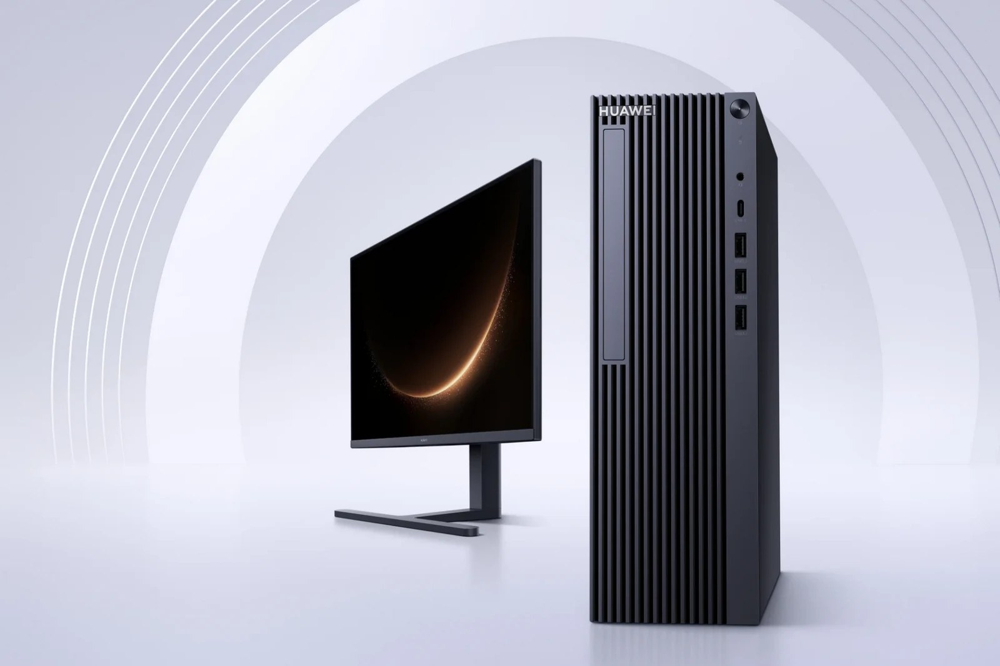
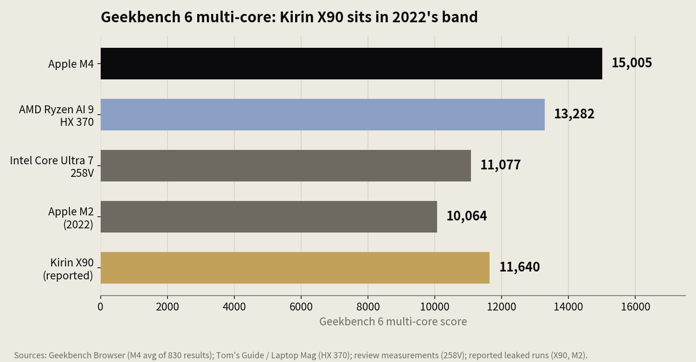
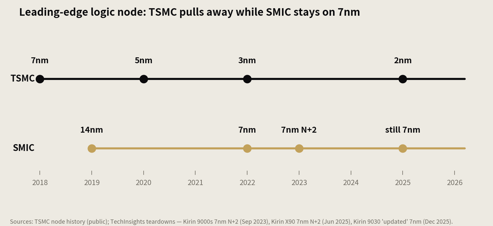
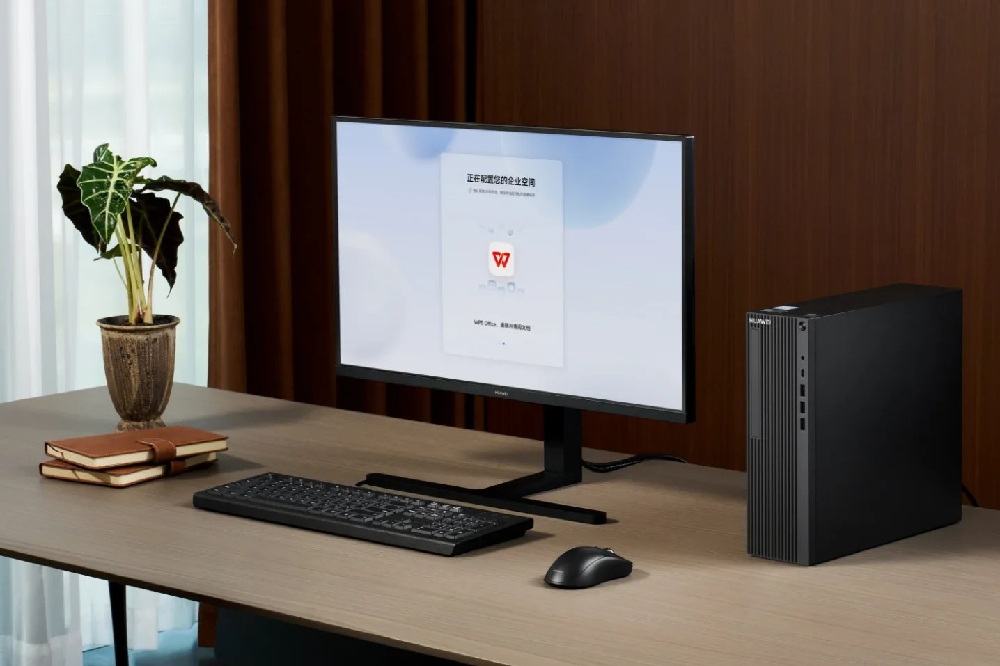

> [中文版 Chinese version](/life/huawei-kirin-x90-why-so-weak-so-expensive-zh/)

*The Qingyun HM650, Huawei's first HarmonyOS desktop. The machine is the news hook; the chip inside it is the story. Photo: Huawei, via Notebookcheck.*

Huawei's Qingyun HM650, unveiled November 5 in Wuhan, is a desktop with a 10-core Kirin X90 processor and a store-listed price of 7,199 yuan (about $1,080) for 16GB of RAM and a 512GB SSD. In the same market, Apple sells the Mac mini M4 — a faster machine by every public benchmark — for 4,499 yuan. The HM650 is also slower than a three-year-old MacBook Air in the metric that matters most for everyday responsiveness.

So the obvious question is not whether the chip is weak. It is why something this weak costs this much. The answer is not one fact but a chain, and every link in it is the same story told twice: sanctions made the chip slow, and sanctions made it expensive.

## How slow is it, really

Start with the numbers, and with their limits. Huawei publishes no benchmark for the Kirin X90. What exists are reported Geekbench 6 runs from the MateBook Fold, the first machine to carry the chip, and they tell a consistent story.

*Geekbench 6 multi-core. The X90's score is from reported leaked runs, not an independently verified lab test; the others are Geekbench Browser averages or measured review results. Chart: this site, data as cited.*

In multi-core work, the X90's reported score of about 11,640 lands in the same band as Apple's M2 from 2022 (about 10,064) and Intel's Core Ultra 7 258V (about 11,077) — respectable, unremarkable, and roughly 30% behind Apple's M4 (15,005, the Geekbench Browser average across 830 MacBook Air results). Multi-core is the X90's best case, because it has ten cores and twenty threads to throw at the problem.

Single-core is where the gap opens up. Reported runs put the X90 about 11% *behind* Apple's M1 — a chip from 2020. Apple's M4 scores 3,204 in the same single-core test, roughly 50% ahead of where the X90's reported numbers land. Single-core speed is what you feel when you open an app, load a document, or switch tasks; it is the metric in which the X90 is furthest behind, and the one Huawei never talks about. Huawei's own claim for the chip is carefully chosen: multi-core performance surpassing the M2. That claim appears to be true, and it is also the least informative true thing you can say about this chip.

Then there is power. The X90 needed roughly 30 watts in the MateBook Fold to reach that multi-core score; the M2 reaches its comparable score at around 20 watts in a fanless MacBook Air. The HM650 runs the chip at a 40W TDP. More power for the same work is the signature of an older process node — which is exactly what the teardown shows.

The graphics story is thinner still. The Maleoon 910 is Huawei's in-house GPU, built because sanctions cut off ARM's Mali designs. Huawei publishes no GPU benchmark for it, and no independent lab has produced one that is widely cited. A chip whose maker will not show you its graphics numbers is telling you something without saying it.

## Why it is slow: the fab ceiling

The Kirin X90 is a 10-core chip in a tri-cluster layout — four high-performance Taishan cores, four mid cores, two efficiency cores — built by SMIC on its 7nm-class "N+2" process. That was confirmed by TechInsights' teardown of the MateBook Fold in June 2025. The architecture is genuinely Huawei's own work, and the Taishan cores are competent designs. The problem is not the design. It is the factory.

*The node gap, year by year. TSMC shipped 3nm in 2022 and is ramping 2nm; SMIC has shipped the same 7nm-class process since 2023. Chart: this site, data as cited.*

SMIC's 7nm is made without EUV lithography. EUV — extreme ultraviolet — is the technology that prints the finest features on a modern chip in a single exposure, and there is exactly one company in the world that makes EUV machines: ASML of the Netherlands, which does not sell them to China. SMIC instead uses older DUV (deep ultraviolet) tools with multi-patterning — exposing the same layer of silicon several times with different masks to carve features finer than one DUV exposure can manage. It works. It is also slower, more defect-prone, and far more expensive per wafer than EUV.

The result is a hard ceiling. TSMC shipped 3nm in 2022 and is ramping 2nm now; SMIC is two full generations behind, and the gap is not closing. TechInsights' teardowns tell the story in sequence: Kirin 9000s on 7nm N+2 in September 2023, Kirin X90 on the same 7nm N+2 in June 2025, and the Mate 80 Pro Max's Kirin 9030 in December 2025 on what the firm called an "updated" 7nm process — still 7nm. Three years, three flagship chips, one node.

Architecture cannot fix this. Better cores can squeeze more performance out of a given transistor budget, but the node sets the budget: how many transistors fit, how fast they can switch, how much power they leak. The X90's designers did competent work inside a bad constraint. The constraint is the story.

## Why slow is expensive: the yield math

Here is the part that answers the price. A chip made with DUV multi-patterning on an immature process has low yield — the fraction of chips on a wafer that actually work. Reporting from 2023 put SMIC's N+2 yield at roughly 30–40%, against 80% or better at TSMC on equivalent processes. No verified public update to that figure has appeared since, and the one on-the-record assessment — a 2022 Financial Times quote from semiconductor scholar Douglas Fuller calling SMIC's yield "terrible" — is still the only named estimate in circulation. Treat the 30–40% figure as reported, not confirmed. But the direction is not in doubt: multi-patterning means more process steps, more chances for a defect to kill a die, and more wafers thrown away.

Low yield is a direct multiplier on cost. If two-thirds of the chips on a wafer are defective, each working chip carries the cost of three. Industry analysis of the N+2 process has put the cost per working die at roughly two to three times what equivalent TSMC production would cost — an estimate, but one that follows from the yield arithmetic rather than contradicting it. The foundry itself is squeezed: SMIC's gross margin hit a nine-year low of 18.6% in 2024, even as revenue reached a record $9.33 billion in 2025. Huawei is reportedly building its own chip-production lines in Shenzhen to add capacity SMIC cannot spare, which is another cost that has to be recovered somewhere.

Add small volumes. The X90 ships in Huawei's own machines only — a few laptop models, a tablet, now a desktop. There is no merchant market, no scale, no second customer to amortize the process development across. Every yuan of that DUV workaround is spread over a small number of units.

So the chip is expensive to make before Huawei adds a cent of margin. That is the first half of the price.

## Why anyone pays: the captive market

The second half is who the buyer is. The HM650 is not sold through e-commerce or consumer stores. It is a procurement product for government departments and state-owned enterprises, sold through Huawei's sales channels. And in that market, the HM650 has something no Intel or AMD machine can offer: a certificate saying it is 100% domestically made.

That certificate is the product. China's "Xinchuang" policy — IT application innovation — directs state institutions to replace foreign technology with domestic alternatives, and the reported "Document 79" directive of September 2022, first reported by the Wall Street Journal, instructed state-owned enterprises to eliminate foreign software by 2027. China's Government Procurement Law already mandates a preference for domestic products, and a 2024 Ministry of Finance draft would give locally produced goods a 20% price advantage in tenders. In the segment the HM650 serves, Intel and AMD are not competitors that lost on performance. They are disqualified by policy.

So the HM650 competes in a market of one. There is no other certified 100%-domestic desktop with a domestic chip, a domestic operating system, and a domestic software stack. The buyer is not choosing between a ¥7,199 Huawei desktop and a ¥4,499 Mac mini, because the Mac mini cannot be procured for that desk. The buyer is choosing between a certified machine and no machine — and in a procurement system with a 2027 deadline, that is not a choice at all.

This is why the price is rational inside its market and absurd outside it. The ¥7,199 does not buy speed. It buys compliance, sovereignty, and a supply chain no foreign government can switch off. Huawei is not overcharging for a slow chip. It is charging what a monopoly supplier charges a captive buyer for the only product that satisfies a political requirement.

## The software tax

The chip is only half the machine. The HM650 runs HarmonyOS, and the software gap is the second performance tax the buyer pays.

*The HM650's enterprise workspace, with WPS Office on screen — the app ecosystem, in one image. Photo: Huawei, via Notebookcheck.*

Huawei says more than 21,000 applications are now compatible with HarmonyOS, and its consumer chief He Gang has put the HarmonyOS computer app count above 19,000. But He Gang has also admitted, in public, that professional software on HarmonyOS PCs is still thin. HarmonyOS NEXT is independent of Android and Linux, which means it cannot run Windows or Android apps natively. The workaround is OSEasy VM, a virtual machine that runs Windows 11 in a sandbox — with the translation overhead between x86 and ARM that makes everything slower than native software. Huawei's Windows license expired in March 2025, so there is no native-Windows fallback at all.

What the machine actually runs, day to day, is WPS Office, WeChat Work, a browser, and Huawei's own AI tools. For a government office, that is enough. For anything else, it is a work in progress. The installed base is real — HarmonyOS computers have passed one million units shipped, and Huawei says it has invested more than ¥10 billion in the ecosystem — but an app count is not a software catalog, and professional tools in finance, design, and engineering are the last to migrate to any new platform.

## The verdict

Put the chain together and the paradox disappears:

- **Slow**, because SMIC has no EUV, so the X90 is built on 7nm DUV multi-patterning — two generations behind TSMC, with the power and single-core penalties that follow.
- **Expensive to make**, because low yields and multi-patterning multiply the cost per working chip, spread over small volumes with no merchant market.
- **Expensive to buy**, because the only customer that matters is a government buyer who cannot choose anything else, in a market where the certificate is the product and the competition is disqualified by policy.

None of this is a judgment on Huawei's engineering. Building a working 7nm process without EUV, a custom CPU core, an in-house GPU, and a full operating system under sanctions is a genuine industrial achievement. It is also, on the evidence, a machine that costs more and does less than what ¥7,199 buys anywhere else in the world.

The gap does not close by trying harder. It closes with EUV lithography or a domestic equivalent, and no public evidence — no teardown, no shipment, no announcement — shows either one arriving. The two numbers to watch are whether SMIC ever ships a real 5nm-class part (TechInsights was still finding 7nm in December 2025) and whether HarmonyOS's app count turns into professional software people actually use. Until one of those changes, the HM650 is what it is: a certificate with a computer attached, priced for the buyer who has to have the certificate.

*Sources: TechInsights teardowns via Reuters and industry reporting (Kirin X90 on SMIC 7nm N+2, June 2025; Kirin 9030 "updated" 7nm, December 2025); Geekbench Browser (Apple M4 MacBook Air average, 830 results); Tom's Guide and Laptop Mag (Ryzen AI 9 HX 370); review measurements (Core Ultra 7 258V); reported leaked Geekbench runs (Kirin X90, Apple M2); Financial Times via industry reporting (SMIC yield, 2022); SMIC FY2025 results (revenue $9.33B; 2024 gross margin 18.6%); Wall Street Journal via industry reporting (Document 79, September 2022); Notebookcheck (HM650 specifications and 7,199 yuan store listing, November 8, 2026); EveryMac (Mac mini M4 China price, RMB 4,499); Huawei via China Daily and industry reporting (21,000+ HarmonyOS apps; one million HarmonyOS computers; ¥10B+ ecosystem investment); He Gang via HarmonyOSHub (19,000+ HarmonyOS PC apps; professional software still thin). Prices are store listings or list prices queried November 8, 2026, subject to change. Yield and cost-per-die figures are reported estimates, not confirmed.*
