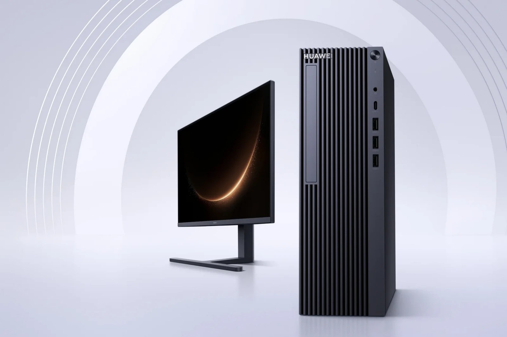
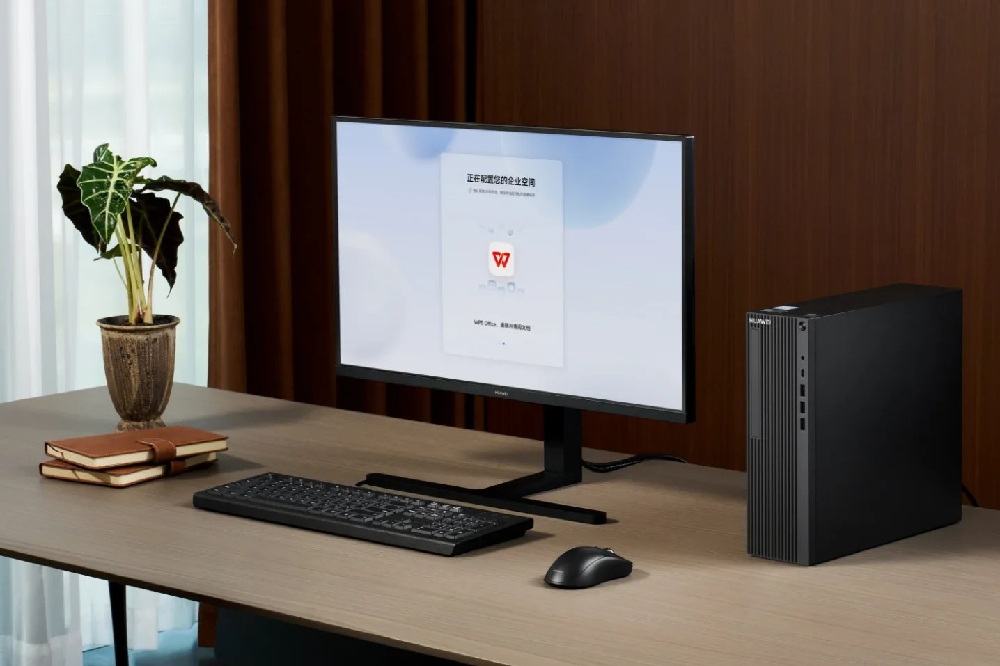

> [English version](/life/huawei-qingyun-hm650-harmonyos-desktop/)

*清韵 HM650 主机与显示器。图片：华为，经 Notebookcheck 转引。*

## 华为发布了什么

11 月 5 日，在武汉举行的鸿蒙办公行业峰会上，华为发布了清韵 HM650 系列——首款搭载鸿蒙的台式机，据称也是中国首款获 100% 国产化认证的台式机。该认证由浙江科正电子信息产品检验机构出具。注意认证的含义：零部件均为国内生产，并不等于每一个部件都是华为自己研发的。

该机搭载 10 核 20 线程麒麟 X90 处理器，集成 Maleoon 910 显卡，TDP 40W，配 16GB 内存与 512GB 固态硬盘。华为称通过软硬件协同，整机性能提升 15%——这是华为自己的说法，没有公布独立跑分。它预装鸿蒙电脑企业版，包括小艺 AI 助手（起草文档、会议转写、深度研究）、内外网隔离的双工作空间，以及星盾 2.0 安全架构与硬盘硬件加密。部分 AI 功能需要联网与额外订阅。

华为常务董事余承东还公布了一个对生态更重要的数字：鸿蒙电脑累计出货量已突破 100 万台。

## 官方不存在的价格

华为自己的产品页面没有标价，店铺标价有：10 核 HM650（16GB + 512GB）标价 7199 元（约 1080 美元），8 核 HM650g 为 6899 元，标注 12 月 1 日开售。请把这些数字理解为 2026 年 11 月 8 日查询到的店铺标价——当日快照、随时可能变动，不是官方定价。另有报道称价格区间可达 10499 元，而华为自己的购买指南在渠道和时间上与店铺标价自相矛盾：它要求政企客户联系当地销售代表，并列出 10 月 15 日的正式开售日期。

*HM650 正在配置鸿蒙企业空间，屏幕上是 WPS Office——应用生态，一图以蔽之。图片：华为，经 Notebookcheck 转引。*

这种混乱本身就是答案。HM650 不通过电商或消费门店销售，华为也没有宣布任何海外上市。它是一款采购型产品：政府部门与企业通过华为的销售渠道购买，而"100% 国产化"认证正是能赢得招标的资质。

## 判断

把 HM650 理解为一张附带电脑的证书。技术故事——麒麟 X90 台式机、鸿蒙登陆新形态——是真实的，但增量有限：这颗芯片早已出现在华为笔记本与平板上，性能说法也未经验证。战略故事在于认证本身。美国制裁五年后，华为如今能卖出一台处理器、内存、固态硬盘、电源全部国产、运行自主操作系统的台式机，卖给最在意这一点的买家：中国政府机构。

华为在台上没有回答的问题才是关键。台式机的生死取决于软件目录，而企业版目前给出的答案是 WPS Office 与华为自己的 AI 工具——对政府办公室够用，对其他场景尚未证明。而"100% 国产化"只说明零件产自哪里，没有说明机器有多快。值得盯住的数字是鸿蒙电脑累计出货 100 万台：如果装机量继续增长，应用缺口会自己补上；如果停滞，HM650 就是一台认证非常齐全、市场却非常小的机器。

*来源：Notebookcheck，2026-11-08（配置、7199 元店铺标价、12 月 1 日开售）；IT Home（经 ChainCatcher/KuCoin 转引），2026-11-05（武汉峰会、100% 国产化认证、15% 性能说法、鸿蒙电脑 100 万台）；Tech Prolonged，2026-11-08（价格未定、6899–10499 元区间）；Magica，2026-11-07（渠道与时间细节存在冲突）。价格为 2026 年 11 月 8 日查询的店铺标价，随时可能变动。*
