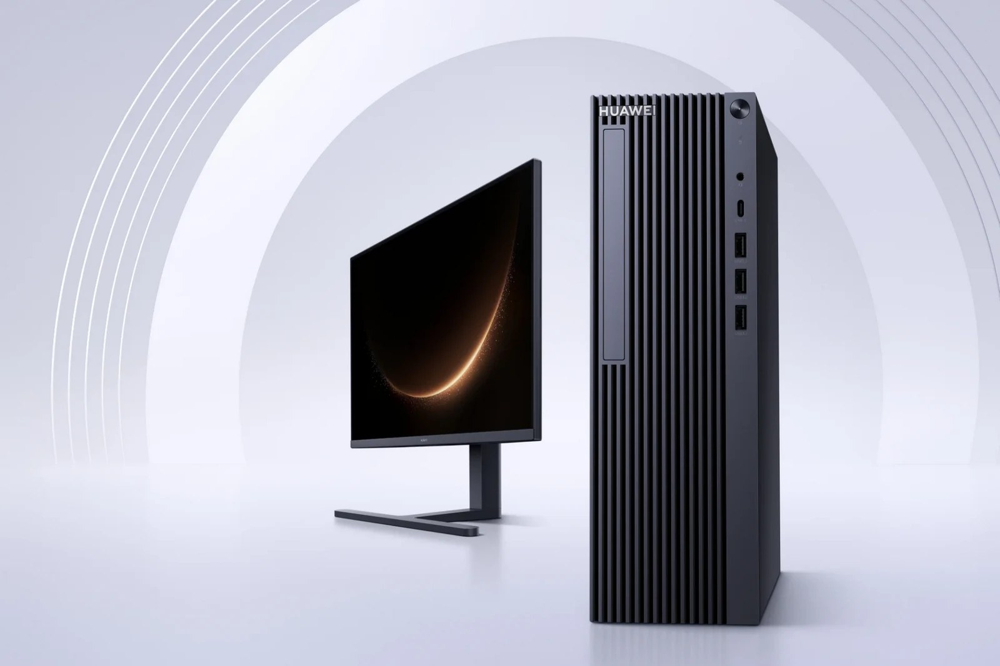
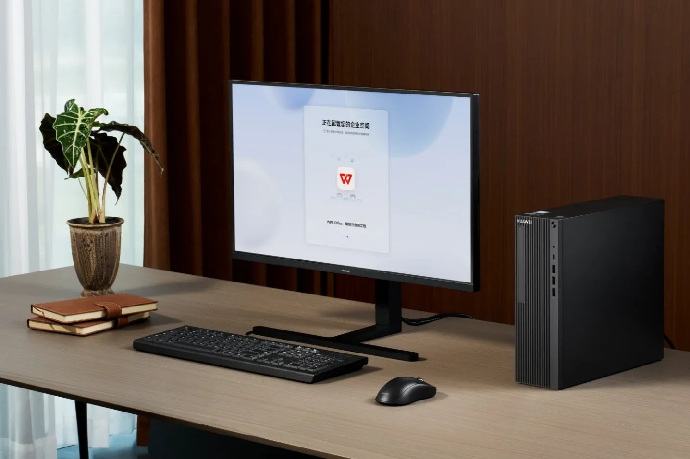

> [中文版 Chinese version](/life/huawei-qingyun-hm650-harmonyos-desktop-zh/)

*The Qingyun HM650 tower and monitor. Photo: Huawei, via Notebookcheck.*

## What Huawei announced

At the HarmonyOS Office Industry Summit in Wuhan on November 5, Huawei unveiled the Qingyun HM650 series — its first desktop computer running HarmonyOS, and, the company says, the first desktop in China certified as 100% domestically made. The claim was verified by Zhejiang Kezheng Electronic Information Product Inspection, a Chinese testing body. Note what the certification covers: the components are domestically produced, not necessarily that Huawei developed every one of them itself.

The machine runs a 10-core, 20-thread Kirin X90 processor with Maleoon 910 integrated graphics at a 40W TDP, paired with 16GB of RAM and a 512GB SSD. Huawei claims a 15% improvement in overall system performance through hardware-software coordination — its own claim, with no independent benchmark published. It ships with HarmonyOS Computer Enterprise Edition, including the Xiaoyi AI assistant (document drafting, meeting transcription, deep research), two isolated workspaces for switching between internal and external networks, and Star Shield 2.0 security with hardware encryption for the SSD. Some AI features require an internet connection and an additional subscription.

Huawei executive director Yu Chengdong added the number that matters for the ecosystem bet: cumulative shipments of HarmonyOS computers have now passed one million units.

## The price that officially does not exist

Huawei's own product page lists no price. Store listings do: the 10-core HM650 with 16GB and 512GB is listed at 7,199 yuan (about $1,080), and an 8-core HM650g at 6,899 yuan, with sales listed from December 1. Treat those as store-listed prices as queried November 8, 2026 — a snapshot subject to change, not an official price. Other reports put the range as high as 10,499 yuan, and Huawei's own buying guide contradicts the store listings on channels and timing, directing government and enterprise buyers to local sales representatives and listing an October 15 formal sale date.

*The HM650 setting up its HarmonyOS enterprise space, with WPS Office on screen — the app ecosystem, in one image. Photo: Huawei, via Notebookcheck.*

The confusion is the point. The HM650 is not sold through e-commerce or consumer stores, and Huawei has announced no launch outside China. It is a procurement product: government departments and enterprises buy it through Huawei's sales channels, where the "100% domestic" certification is a credential that wins tenders.

## The judgment

Read the HM650 as a certificate with a computer attached. The technical story — a Kirin X90 desktop, HarmonyOS on a new form factor — is real but incremental: the chip already appeared in Huawei laptops and tablets, and the performance claim is unverified. The strategic story is the certification itself. Five years into US sanctions, Huawei can now sell a desktop whose processor, memory, SSD, and power supply are all Chinese-made, running an operating system it controls, to the buyers who care most about exactly that: Chinese government agencies.

The open questions are the ones Huawei did not answer on stage. A desktop lives or dies on its software catalog, and the enterprise edition's answer so far is WPS Office and Huawei's own AI tools — enough for a government office, unproven for anything else. And "100% domestic" says nothing about how fast the machine is, only about where its parts were made. The one-million HarmonyOS computers shipped is the number to watch: if that installed base keeps growing, the app gap closes by itself. If it stalls, the HM650 is a very well-certified machine for a very small market.

*Sources: Notebookcheck, November 8, 2026 (specifications, 7,199 yuan store listing, December 1 sales); IT Home via ChainCatcher/KuCoin, November 5, 2026 (Wuhan summit, 100% localization certification, 15% performance claim, one million HarmonyOS computers); Tech Prolonged, November 8, 2026 (price not settled, range 6,899–10,499 yuan); Magica, November 7, 2026 (conflicting channel and timing details). Prices are store listings queried November 8, 2026, subject to change.*
