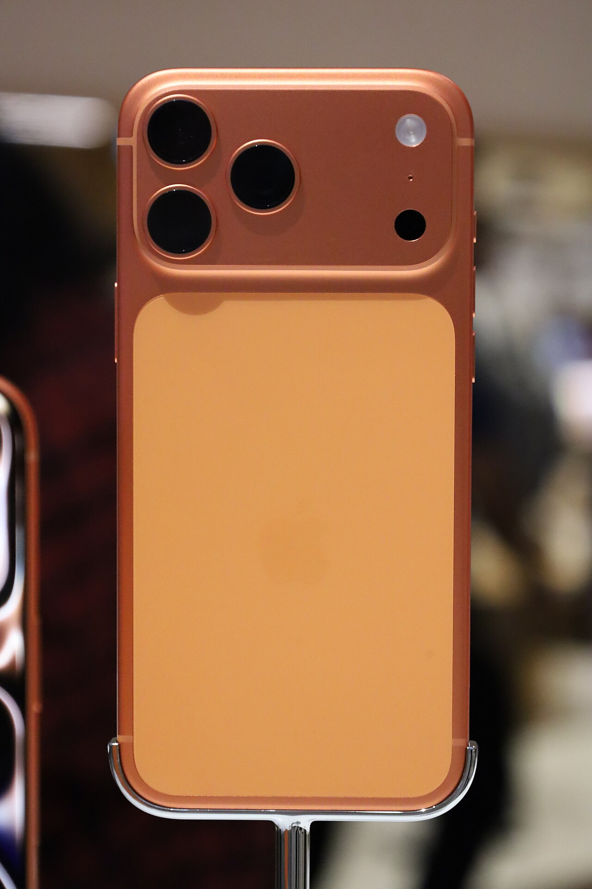
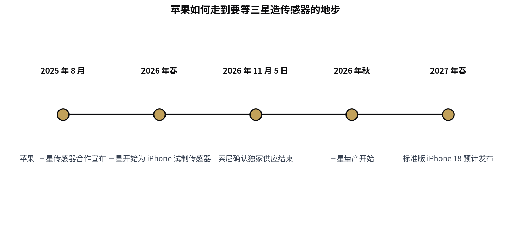

> [English version](/life/iphone-18-delay-samsung-sensors/)

*iPhone 17 Pro Max（橙色），当前在售型号。iPhone 18 尚无官方图片，故以现款示意。照片：EmpAhmadK，来自 Wikimedia Commons（CC0）。*

## 报道说了什么

苹果 9 月发布了 iPhone 18 Pro 系列和首款折叠屏 iPhone Duo，标准版 iPhone 18 却被留下了。此前已知标准版会晚到 2027 年春季，但不知道为什么。

日本行业刊物 **Semiconportal** 的新报道（11 月 12–13 日经 PhoneArena、Notebookcheck、AndroidHeadlines、Gizmochina 等多家媒体转载）给出了具体原因：**三星的摄像头传感器**。据报道，苹果推迟标准版 iPhone 18，是为了给三星更多时间生产足够数量的摄像头传感器。试制从 2026 年春季开始，量产排在秋季——按这个时间表，苹果选择错开发布、等到 2027 年春季，以便备足货。

这是一则**报道，而非官方说法**——苹果并未确认三星传感器就是迟到的原因，传感器的具体规格也尚不清楚。此前报道曾把迟到归因于内存涨价与供应链瓶颈，新报道也指出内存短缺是促成因素之一。应把三星的解释视为目前最主流的说法，而非已确认的事实。

*供应商切换时间线。来源：Semiconportal（经 PhoneArena 与 Notebookcheck）；索尼 2026 年 11 月 5 日财报电话会；苹果–三星 2025 年 8 月公告。*

## 更大的变化：索尼时代结束了

迟到是症状，换供应商才是故事。索尼多年来一直是苹果的图像传感器供应商，实际上是独家。这个时代现在结束了：索尼 CFO 在 11 月 5 日的财报电话会上确认，公司**将不再是苹果图像传感器的独家供应商**。

苹果与三星的合作去年就已敲定——2025 年 8 月在苹果"美国制造计划"（American Manufacturing Program）框架下宣布，双方共同开发新的芯片制造技术。未来 iPhone 的摄像头传感器将在三星位于**得州奥斯汀**的半导体工厂生产。有报道称这些传感器为 4800 万或 2 亿像素规格，但该说法未经证实。

换句话说，iPhone 里战略上最敏感的零部件——摄像头传感器，也就是苹果营销时最用力宣传的功能的核心——正在换手，从一家拥有这个位置十年的日本供应商，交给一家在得州制造的韩国对手。

## 摄像头传感器到底是干什么的——为什么换供应商能让手机晚半年

要理解换一个摄像头传感器供应商为什么能让手机晚半年，得先知道这个零件是干什么的。CMOS 图像传感器是把光变成数码照片的芯片：数百万个微小的感光像素收集光子，下面的电路把电荷转换成图像。在现代手机里，传感器不只是采光的工具：自动对焦在这里完成，高动态范围照片的多张曝光合成在这里完成，计算摄影的第一步也在这里运行——正是这些处理让手机照片看起来像手机照片，而不是原始传感器数据。

索尼十年积累的优势，是一种叫"堆叠"的制造工艺。在堆叠式传感器——索尼的 Exmor RS 系列——中，像素阵列叠在一层独立的信号处理电路之上，键合为一颗芯片。这让传感器能在芯片内做更多工作、更快：2014 年发布的 IMX230 是业内首款带片上相位检测自动对焦的堆叠式手机传感器，可解析 192 个对焦点、几乎瞬间追踪移动物体。苹果在 iPhone 6 上把这项技术称为"Focus Pixels"。堆叠还能缩小传感器体积，这就是手机能在纤薄机身里装下大传感器的原因。

三星据报道给出的答案还要再进一步：三层堆叠传感器，采用 PD-TR-Logic 结构，把更多处理电路直接贴在传感器上，理论上信号处理速度更快、噪点更低，优于索尼现有的 Exmor RS。报道称三星正在专门为苹果开发这种传感器，而且它可能是主摄的候选，而不只是一颗副摄。但问题在于，一种新的传感器架构不是货架上能买到的零件：它必须针对手机的光学系统设计、针对苹果的图像处理管线调校，并且以足够高的良率量产，才能供应数千万部手机。据 Semiconportal 报道，试制从 2026 年春季开始，量产排在秋季——一颗秋天良率不达标的传感器，靠冬天加班是修不好的，只能靠时间。而苹果把发布推到 2027 年春季，买的正是时间。

## 索尼的十年

索尼从 iPhone 4S 开始就一直在 iPhone 里，这段关系成了消费电子领域最持久的合作之一。到了 iPhone 6 时代，按当时行业报道的说法，索尼是苹果"唯一的供应商"。苹果 CEO 蒂姆·库克曾公开参观索尼熊本工厂，承认两家公司"十多年来一直合作，为 iPhone 打造世界领先的摄像头传感器"。索尼也为此投入重金：2015 年初向长崎与山形工厂投资 8.05 亿美元，同年晚些时候以约 1.55 亿美元收购东芝的图像传感器业务，还多次购置工厂，因为需求超过了供给。苹果成了索尼 CMOS 图像传感器最大的客户，索尼把大部分产能集中在苹果、华为与 OPPO 身上。

这种集中是双刃剑。对索尼来说，苹果量级的单一客户是一门极好的生意，也是一个战略软肋：丢掉苹果，图像传感器业务的一大块收入就没了。对苹果来说，最重要的营销卖点所依赖的唯一供应商，是反向的同一种风险。iPhone 的相机不是众多功能中的一个，它是苹果每年拍照、拍片、打广告时最用力的功能。每一支"Shot on iPhone"广告，间接都是在给一颗索尼传感器打广告。打破这种依赖注定要付出代价。令人意外的不是它要付出代价，而是代价以"出货量最大的手机晚半年"的形式出现，而不是以一次没人注意到的悄悄双供应商安排出现。

## 三星打进 iPhone 的漫长道路

讽刺的是，三星对 iPhone 来说并不陌生。作为显示屏与内存的供应商，它多年来一直在苹果产品里——一边是三星的元器件部门向苹果供货，一边是三星的手机部门与苹果竞争。新的只是摄像头传感器，这是三星从未攻克的一块。分析师郭明錤去年就提出，这一变化将随 iPhone 18 到来；2025 年 1 月的报道描述三星组建了专门团队以满足苹果的要求，首款预计出货的是一颗 1/2.6 英寸 4800 万像素超广角传感器。Semiconportal 的报道是第一份把这项工作与发布延迟直接联系起来的报道。

得州工厂是故事的另一半，而且它比 iPhone 本身还要老。三星于 1996 年 2 月抵达奥斯汀，1997 年 7 月开设了第一家晶圆厂——它在美国的第一家半导体工厂，也是它在韩国以外的第一家晶圆厂——1998 年 1 月开始生产 DRAM 内存芯片。这座工厂如今已发展为拥有 4,500 多名员工的多厂区园区；2021 年三星宣布在约 30 英里外的泰勒市建设第二座得州工厂，预计投资 170 亿美元；2024 年 12 月，美国商务部向三星提供了最高 47.45 亿美元的《芯片法案》资金，用于泰勒工厂与奥斯汀工厂的现代化改造。iPhone 的摄像头传感器将在奥斯汀工厂生产。一座为内存芯片而建、有三十年历史的晶圆厂，如今被要求生产苹果有史以来要求最高的图像传感器——而爬坡就是这次延迟。

## 延迟背后的内存挤压

传感器是延迟的主要解释，但不是 iPhone 18 时间表上唯一的压力，另一个压力比任何单一供应商都大。2026 年的内存市场正处于一场由 AI 数据中心驱动的历史性短缺之中。全球 DRAM 的三大制造商——三星、SK 海力士与美光——已把产能转向高带宽内存（HBM），即 AI 加速器需要的专用内存；同样的容量下，HBM3E 占用的晶圆面积约为 DDR5 的三倍，所以每一片送往 AI 的晶圆，都意味着手机与笔记本电脑少分到一些芯片。TrendForce 把 2026 年第一季度传统 DRAM 合约价涨幅预期上调到环比 90%–95%，创下纪录；Gartner 在 2 月估计，到 2026 年底，DRAM 与 SSD 的合计价格将比 2025 年高出约 130%，使个人电脑平均价格上涨约 17%、智能手机价格上涨约 13%。IDC 预计，2027 年底之前不会有实质性缓解。

对苹果来说，这有两层影响。第一，内存占手机物料成本的大头——约占旗舰机元器件成本的 10%–15%——内存价格翻倍，对出货量最大的手机的利润挤压最大。第二，三星既是新的摄像头传感器供应商，又是三大 DRAM 供应商之一：苹果在最敏感的零部件上依赖的公司，正是同一家通过内存分配决策影响苹果每部手机价格的公司。Semiconportal 的报道指出内存短缺是延迟的促成因素，两种解释相互印证。春季发布既给了三星更多传感器时间，也给了苹果更多时间以能够接受的价格锁定内存。

## 错开发布不是新鲜事——但这次不一样

苹果以前也错开发布过 iPhone，历史能说明"迟到"到底要付出什么代价。iPhone X 与 iPhone 8 在 2017 年 9 月一同发布，但直到 11 月 3 日才开售——晚了将近六周。iPhone XR 在 2018 年比 iPhone XS 晚了一个月。2020 年的 iPhone 12 发布因新冠疫情而错开，12 与 12 Pro 于 10 月 23 日上市，mini 与 Pro Max 于 11 月 13 日跟进。iPhone 14 Plus 于 2022 年 10 月 7 日发售，比同系列其他机型晚三周。在所有这些案例中，延迟以周计算，而且迟到的都是高端机型或小众机型——从来不是标准版、从来不是出货量最大的手机，更从来没有晚过六个月。

这正是 iPhone 18 的不同之处，也是分析师的报道重要的原因。郭明錤在 2025 年初报告称，苹果打算永久拆分发布周期：Pro 机型在秋季，标准机型在次年春季。iPhone 18 将是这一计划的首次完整执行，标准版与更便宜的 iPhone 18E 在 2027 年春季到来。如果这就是计划，那么三星的延迟就不是一次性的意外，而是结构性变化的第一笔可见成本——买家的问题也随之改变。秋季的 iPhone 正在变成 Pro 的 iPhone，而标准版 iPhone 正在变成春季产品，在下一个秋季的 Pro 到来之前，销售窗口更短。苹果花了十五年训练用户在九月买手机，现在它要求最大的一群用户等到春天，并且每年都等下去。

## 三星与苹果：竞合关系的三十年

三星与苹果的关系是科技行业最奇怪的竞合关系之一：两家公司在法庭上打过持续数年的专利大战，在手机市场上是死对头，同时三星又是苹果最大的元器件供应商之一。显示屏、内存、闪存——iPhone 里一直装着三星的零件。这种关系能成立，是因为三星内部有一道墙：元器件部门与手机部门分开运营，前者把苹果当作客户，后者把苹果当作对手。华尔街早就习惯了这种安排：三星电子的财报里，来自苹果的订单是实打实的收入，而 Galaxy 与 iPhone 的竞争是另一个部门的事。

摄像头传感器是这道墙上最后一块没被攻破的砖。显示屏与内存是标准化程度相对较高的零件，苹果可以同时向多家供应商采购、在它们之间切换；图像传感器不是。传感器的性能直接决定照片质量，而照片质量是 iPhone 最核心的卖点，苹果对传感器的调校深度——从硬件设计到图像信号处理器的算法——意味着换供应商不是换一张采购订单，而是换掉半条成像管线。这就是为什么三星要组建专门团队、为什么试制花了整整一年、为什么量产时间表一滑就是半年。攻破这块砖的回报也同样巨大：一旦三星成为 iPhone 传感器的合格供应商，它就进入了苹果供应链里最敏感、最赚钱的位置之一，而索尼则第一次在十年里有了真正的对手。

对索尼来说，失去独家地位的影响不只是少一个客户。索尼的图像传感器业务之所以能持续投入研发——长崎与山形的工厂、东芝业务的收购——正是因为苹果订单提供了稳定、大量的需求。一旦三星分走一部分，索尼的规模优势就会被削弱，而规模正是半导体行业最残酷的竞争维度：产量越大，单位成本越低，研发投入越能摊薄。索尼 CFO 在 11 月 5 日财报电话会上的表态很克制——只是确认"将不再是独家供应商"——但这句话背后的含义是，索尼与苹果之间长达十年的排他关系已经结束了。索尼不会消失，它仍然会供应 iPhone 的一部分传感器；但它不再是唯一的选择，而"唯一"正是它过去十年议价能力的来源。

## 对买家与对行业：春季 iPhone 意味着什么

对打算买标准版 iPhone 18 的人来说，实际影响比"晚半年"更微妙。首先是价格：内存涨价的压力不会在春季消失。Gartner 估计智能手机平均价格到 2026 年底将比 2025 年上涨约 13%，IDC 预计 2026 年智能手机平均售价将上涨 27.6% 至 581 美元——这些数字针对的是整个市场，但苹果不可能完全免疫。标准版 iPhone 18 在春季发布时，面对的是一个比 2026 年秋季更贵的元器件市场，定价压力只会更大。其次是选择：如果 Pro 机型已经上市半年，标准版的买家要做的比较不再是"今年的新 iPhone 有什么"，而是"半年前的 Pro 与今天的标准版，哪个更值"。Pro 机型到那时可能已经降价或进入渠道促销，标准版的性价比叙事会更难讲。

对行业来说，春季发布的影响更大。苹果的发布节奏是整个供应链的日历：富士康的招工、元器件厂商的排产、运营商的营销计划，全都围绕九月转。一旦标准版变成春季产品，这条日历就要改写——而改写日历的成本由所有人分担。竞争对手也会调整：三星的 Galaxy S 系列传统上在年初发布，过去它与秋季的 iPhone 错峰竞争；如果标准版 iPhone 也移到春季，两家最直接的竞争对手将在同一个季度正面相遇。对消费者来说，这可能是好事：春季将成为一年里手机竞争最激烈的季节，选择更多、价格战更激烈。但对苹果来说，这意味着它放弃了十五年来独占秋季的优势——每年九月，全世界的注意力都只属于 iPhone。从 2027 年起，九月属于 Pro，春天属于所有人。

## 如果三星再滑一次

最值得追踪的问题不是"为什么晚了"，而是"还会不会再晚"。传感器爬坡的风险在于它不是线性的：良率从 50% 爬到 80% 可能需要一个月，从 80% 爬到 95% 可能需要三个月，而苹果需要的量产良率——足以供应标准版 iPhone 首批数千万部出货的良率——是后者。Semiconportal 报道的时间表是试制从 2026 年春季开始、量产排在秋季，苹果选择等到 2027 年春季，说明它对秋季量产的信心不足。如果春季到来时良率仍然不够，苹果面临的选择会更难：再推迟一次，还是接受首批供货紧张、让标准版 iPhone 18 像当年的 iPhone X 一样抢不到？

苹果有一个后备选项：让索尼继续供应一部分传感器。索尼的独家地位结束了，但索尼的产能还在，Exmor RS 仍然是经过验证的零件。双供应商采购——三星供一部分、索尼供一部分——是苹果在显示屏与内存上用了多年的标准操作，也是最可能的结果。但这会带来一个苹果不愿面对的问题：同一款手机装两种传感器，拍照表现必须一致，否则用户会发现"抽奖"。苹果过去处理过类似问题——不同供应商的芯片、不同批次的屏幕——但摄像头传感器是最敏感的零件，两种传感器的成像差异最容易被用户察觉。苹果宁可推迟发布，也不愿让标准版 iPhone 18 变成一场"抽传感器"的彩票，这个选择本身就说明了它对成像一致性的重视程度。

## 谁赢了，谁输了

短期看，输家是索尼与等手机的用户。索尼失去了十年的独家地位，而标准版 iPhone 18 的买家要多等半年，面对的还是一个更贵的内存市场。赢家是三星：它打进了苹果供应链最难进的位置，还顺带让奥斯汀工厂——一座为内存而建的三十年老厂——拿到了苹果最尖端的订单。苹果自己既赢又输：赢在供应链终于多元化，输在多元化的第一笔账单就是自家出货量最大的手机晚了半年。

长期看，真正的赢家可能是整个行业。一家供应商独占一个关键零件十年，从来不是健康的状态——它让创新变慢、让价格失去制衡、让一次故障就能拖垮一款产品。三星的进入意味着图像传感器第一次有了真正的竞争，而竞争的历史经验是，它会让零件变得更好、更便宜。只是这一次，竞争的入场费由标准版 iPhone 18 的买家来付：他们等的不是一部手机，而是一个供应链重新洗牌的六个月。等到 2027 年春季，当标准版 iPhone 18 终于上市时，值得看的不是它晚了多久，而是它拍照是不是真的更好了——如果三星的三层堆叠传感器兑现了承诺，这六个月就是值得的；如果没有，它就只是一次昂贵的拖延。而判断的时刻并不遥远：2027 年春季，当第一批标准版 iPhone 18 的拍照样张流出时，答案会比任何财报电话会都更直接。

## 判断：苹果主动选择的迟到，是要付出代价的

这次迟到有两种读法，而且可能都对。第一种是操作层面：三星的传感器爬坡就是没准备好，苹果宁可让标准版 iPhone 18 晚发，也不愿发不出货。第二种是战略层面：苹果在为多元化买单。十年来在摄像头传感器上只依赖索尼一家，本就是集中度风险，打破它注定要付出代价——这次付出的就是出货量最大的那款手机的发布时间。

得州这个角度让这件事不只是一条供应链花絮。苹果与三星在奥斯汀生产 iPhone 摄像头传感器、打着"美国制造计划"的旗号，正是两家公司都想讲的故事。而迟到是这个故事里尴尬的部分：工厂是新的，工艺是新的，爬坡速度跟不上 iPhone 的日历。

对买家来说，实际影响很简单。iPhone 18 Pro 系列和 Duo 已经开售，标准版 iPhone 18 现在是 2027 年春季的手机，错开发布看起来正成为苹果的常态，而非一次性例外。苹果的风险在日历上：春季发布压缩了标准版在下一个 iPhone 周期开始前的销售窗口，而标准版正是撑起其他一切的出货量。如果三星的爬坡再滑一次，这个窗口还会更短——到那时问题就不再是 iPhone 18 为什么迟到，而是苹果还能不能按时发布它最重要的手机。

*本文基于 Semiconportal 报道（2026 年 11 月 12–13 日转载）与索尼确认独家供应结束的表态。苹果尚未确认迟到原因；随着 2027 年春季发布临近，细节可能变化。*
