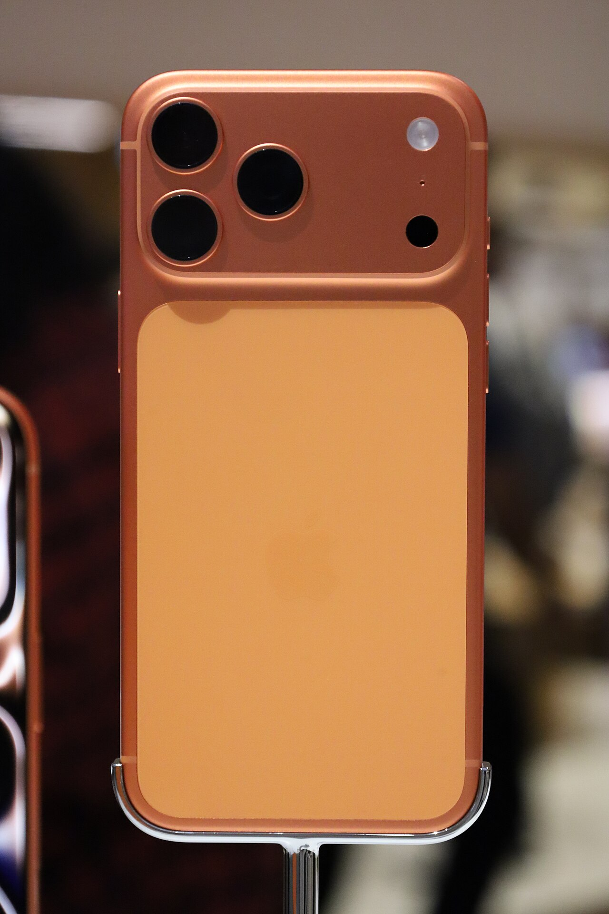
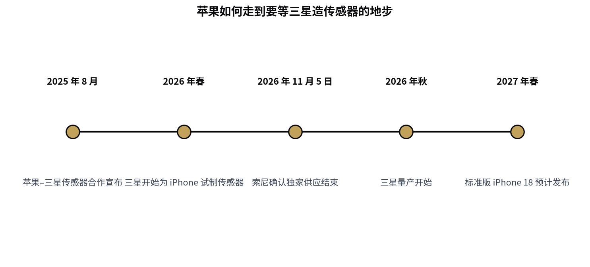

> [English version](/life/iphone-18-delay-samsung-sensors/)

*iPhone 17 Pro Max（橙色），当前在售型号。iPhone 18 尚无官方图片，故以现款示意。照片：EmpAhmadK，来自 Wikimedia Commons（CC0）。*

## 报道说了什么

苹果 9 月发布了 iPhone 18 Pro 系列和首款折叠屏 iPhone Duo，标准版 iPhone 18 却被留下了。此前已知标准版会晚到 2027 年春季，但不知道为什么。

日本行业刊物 **Semiconportal** 的新报道（11 月 12–13 日经 PhoneArena、Notebookcheck、AndroidHeadlines、Gizmochina 等多家媒体转载）给出了具体原因：**三星的摄像头传感器**。据报道，苹果推迟标准版 iPhone 18，是为了给三星更多时间生产足够数量的摄像头传感器。试制从 2026 年春季开始，量产排在秋季——按这个时间表，苹果选择错开发布、等到 2027 年春季，以便备足货。

这是一则**报道，而非官方说法**——苹果并未确认三星传感器就是迟到的原因，传感器的具体规格也尚不清楚。此前报道曾把迟到归因于内存涨价与供应链瓶颈，新报道也指出内存短缺是促成因素之一。应把三星的解释视为目前最主流的说法，而非已确认的事实。

*供应商切换时间线。来源：Semiconportal（经 PhoneArena 与 Notebookcheck）；索尼 2026 年 11 月 5 日财报电话会；苹果–三星 2025 年 8 月公告。*

## 更大的变化：索尼时代结束了

迟到是症状，换供应商才是故事。索尼多年来一直是苹果的图像传感器供应商，实际上是独家。这个时代现在结束了：索尼 CFO 在 11 月 5 日的财报电话会上确认，公司**将不再是苹果图像传感器的独家供应商**。

苹果与三星的合作去年就已敲定——2025 年 8 月在苹果"美国制造计划"（American Manufacturing Program）框架下宣布，双方共同开发新的芯片制造技术。未来 iPhone 的摄像头传感器将在三星位于**得州奥斯汀**的半导体工厂生产。有报道称这些传感器为 4800 万或 2 亿像素规格，但该说法未经证实。

换句话说，iPhone 里战略上最敏感的零部件——摄像头传感器，也就是苹果营销时最用力宣传的功能的核心——正在换手，从一家拥有这个位置十年的日本供应商，交给一家在得州制造的韩国对手。

## 判断：苹果主动选择的迟到，是要付出代价的

这次迟到有两种读法，而且可能都对。第一种是操作层面：三星的传感器爬坡就是没准备好，苹果宁可让标准版 iPhone 18 晚发，也不愿发不出货。第二种是战略层面：苹果在为多元化买单。十年来在摄像头传感器上只依赖索尼一家，本就是集中度风险，打破它注定要付出代价——这次付出的就是出货量最大的那款手机的发布时间。

得州这个角度让这件事不只是一条供应链花絮。苹果与三星在奥斯汀生产 iPhone 摄像头传感器、打着"美国制造计划"的旗号，正是两家公司都想讲的故事。而迟到是这个故事里尴尬的部分：工厂是新的，工艺是新的，爬坡速度跟不上 iPhone 的日历。

对买家来说，实际影响很简单。iPhone 18 Pro 系列和 Duo 已经开售，标准版 iPhone 18 现在是 2027 年春季的手机，错开发布看起来正成为苹果的常态，而非一次性例外。苹果的风险在日历上：春季发布压缩了标准版在下一个 iPhone 周期开始前的销售窗口，而标准版正是撑起其他一切的出货量。如果三星的爬坡再滑一次，这个窗口还会更短——到那时问题就不再是 iPhone 18 为什么迟到，而是苹果还能不能按时发布它最重要的手机。

*本文基于 Semiconportal 报道（2026 年 11 月 12–13 日转载）与索尼确认独家供应结束的表态。苹果尚未确认迟到原因；随着 2027 年春季发布临近，细节可能变化。*
