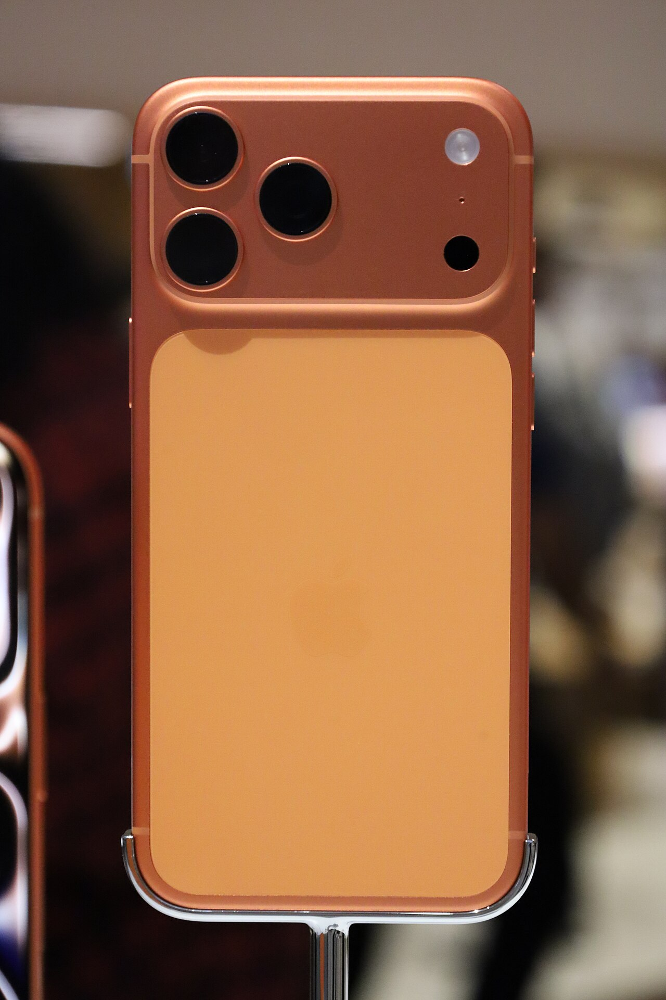
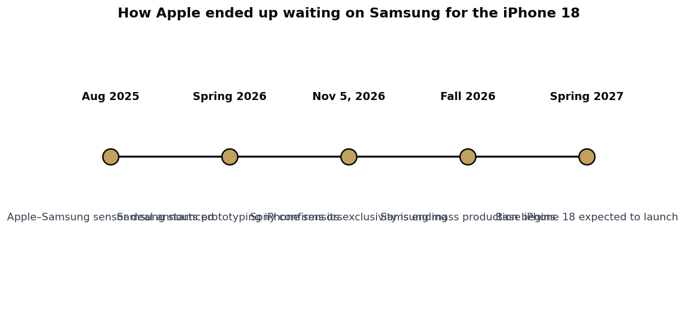

> [中文版 Chinese version](/life/iphone-18-delay-samsung-sensors-zh/)

*The iPhone 17 Pro Max in Cosmic Orange — the current model. The iPhone 18 itself has no official imagery yet, so the current generation is pictured. Photo: EmpAhmadK, via Wikimedia Commons (CC0).*

## What the report says

Apple launched the iPhone 18 Pro models and its first foldable, the iPhone Duo, in September — but held back the standard iPhone 18. It was already known that the base model would arrive later, in spring 2027. What was not known was why.

A new report from the Japanese trade publication **Semiconportal**, covered on November 12–13 by PhoneArena, Notebookcheck, AndroidHeadlines, Gizmochina, and others, points to a specific cause: **Samsung's camera sensors**. According to the report, Apple delayed the base iPhone 18 to give Samsung more time to manufacture enough camera sensors for the device. Prototyping began in spring 2026, with mass production scheduled for the fall — and with that timeline, Apple chose to stagger the launch and wait until spring 2027 so it could build up sufficient supply.

This is a **report, not an official statement** — Apple has not confirmed that Samsung's sensors are the reason for the delay, and the exact sensor specifications remain unclear. Earlier reporting had blamed the delay on rising memory prices and supply-chain bottlenecks, and the new coverage notes that memory shortages were also a contributing factor. Treat the Samsung explanation as the leading account, not the confirmed one.

*Timeline of the supplier switch. Sources: Semiconportal via PhoneArena and Notebookcheck; Sony earnings briefing, November 5, 2026; Apple–Samsung announcement, August 2025.*

## The bigger shift: the Sony era is ending

The delay is the symptom; the supplier switch is the story. Sony has been Apple's image sensor supplier for years — effectively the exclusive one. That era is now ending: at its earnings briefing on November 5, Sony's CFO confirmed that the company **will no longer be Apple's exclusive image sensor supplier**.

Apple struck its deal with Samsung last year — announced in August 2025 under Apple's American Manufacturing Program — to develop new chip manufacturing technology together. The camera sensors for future iPhones are to be produced at Samsung's semiconductor plant in **Austin, Texas**. Reports describe the sensors as 48MP or 200MP parts, but that specification is unconfirmed.

In other words, the most strategically sensitive component in the iPhone — the camera sensor, the heart of the feature Apple markets hardest — is changing hands, from a Japanese supplier that has owned the slot for a decade to a Korean rival manufacturing in Texas.

## The verdict: a delay Apple chose, at a price

There are two ways to read this delay, and both are probably true. The first is operational: Samsung's sensor ramp is simply not ready, and Apple would rather ship the base iPhone 18 late than ship it short. The second is strategic: Apple is paying for diversification. A decade of single-supplier dependence on Sony for camera sensors was a concentration risk, and breaking it was always going to cost something — in this case, the launch timing of the company's highest-volume phone.

The Texas angle is what makes this more than a supply-chain footnote. Apple and Samsung building iPhone camera sensors in Austin, under the American Manufacturing Program banner, is exactly the kind of domestic-manufacturing story both companies want told. The delay is the awkward part of that story: the fab is new, the process is new, and the ramp is slower than the iPhone calendar allows.

For buyers, the practical effect is simple. The iPhone 18 Pro models and the Duo are already on sale; the standard iPhone 18 is now a spring 2027 phone, and a staggered launch looks like it is becoming Apple's pattern rather than a one-off. The risk for Apple is the calendar: a spring launch compresses the base model's selling window before the next iPhone cycle begins, and the base model is the volume that pays for everything else. If Samsung's ramp slips again, that window gets shorter still — and the question will stop being why the iPhone 18 is late, and start being whether Apple can still launch its most important phone on time at all.

*This post is based on the Semiconportal report as covered on November 12–13, 2026, and on Sony's confirmed statement that its exclusivity is ending. Apple has not confirmed the reason for the delay; details may change as the spring 2027 launch approaches.*
