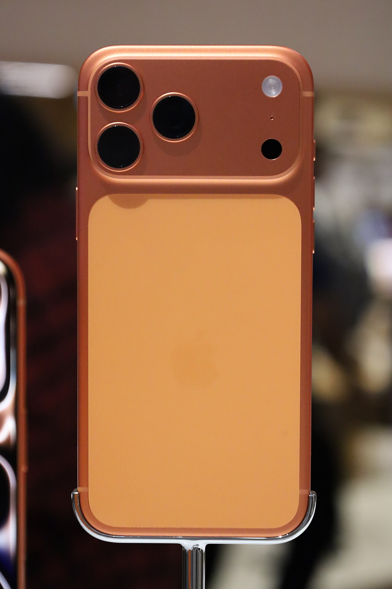
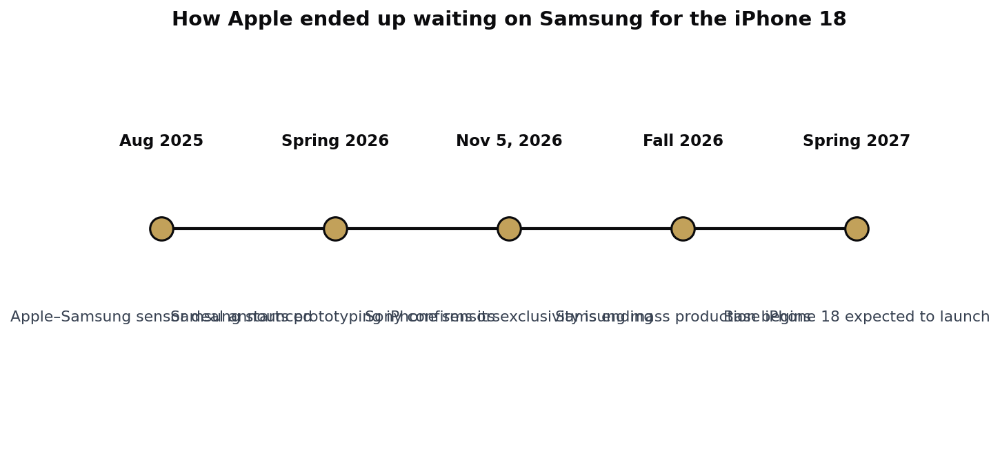

> [中文版 Chinese version](/life/iphone-18-delay-samsung-sensors-zh/)

*The iPhone 17 Pro Max in Cosmic Orange — the current model. The iPhone 18 itself has no official imagery yet, so the current generation is pictured. Photo: EmpAhmadK, via Wikimedia Commons (CC0).*

## What the report says

Apple launched the iPhone 18 Pro models and its first foldable, the iPhone Duo, in September — but held back the standard iPhone 18. It was already known that the base model would arrive later, in spring 2027. What was not known was why.

A new report from the Japanese trade publication **Semiconportal**, covered on November 12–13 by PhoneArena, Notebookcheck, AndroidHeadlines, Gizmochina, and others, points to a specific cause: **Samsung's camera sensors**. According to the report, Apple delayed the base iPhone 18 to give Samsung more time to manufacture enough camera sensors for the device. Prototyping began in spring 2026, with mass production scheduled for the fall — and with that timeline, Apple chose to stagger the launch and wait until spring 2027 so it could build up sufficient supply.

This is a **report, not an official statement** — Apple has not confirmed that Samsung's sensors are the reason for the delay, and the exact sensor specifications remain unclear. Earlier reporting had blamed the delay on rising memory prices and supply-chain bottlenecks, and the new coverage notes that memory shortages were also a contributing factor. Treat the Samsung explanation as the leading account, not the confirmed one.

*Timeline of the supplier switch. Sources: Semiconportal via PhoneArena and Notebookcheck; Sony earnings briefing, November 5, 2026; Apple–Samsung announcement, August 2025.*

## The bigger shift: the Sony era is ending

The delay is the symptom; the supplier switch is the story. Sony has been Apple's image sensor supplier for years — effectively the exclusive one. That era is now ending: at its earnings briefing on November 5, Sony's CFO confirmed that the company **will no longer be Apple's exclusive image sensor supplier**.

Apple struck its deal with Samsung last year — announced in August 2025 under Apple's American Manufacturing Program — to develop new chip manufacturing technology together. The camera sensors for future iPhones are to be produced at Samsung's semiconductor plant in **Austin, Texas**. Reports describe the sensors as 48MP or 200MP parts, but that specification is unconfirmed.

In other words, the most strategically sensitive component in the iPhone — the camera sensor, the heart of the feature Apple markets hardest — is changing hands, from a Japanese supplier that has owned the slot for a decade to a Korean rival manufacturing in Texas.

## How a camera sensor actually works — and why it is the hardest part to switch

To understand why changing a camera sensor supplier can delay a phone by six months, it helps to know what the part does. A CMOS image sensor is the chip that turns light into a digital photograph: millions of microscopic light-sensitive pixels collect photons, and the circuitry underneath converts that charge into an image. In a modern phone the sensor is not just a light collector. It is where autofocus happens, where high-dynamic-range images are assembled from multiple exposures, and where the first stages of computational photography run — the processing that makes a phone photo look like a phone photo rather than raw sensor data.

Sony's advantage, built over a decade, is a manufacturing trick called stacking. In a stacked sensor — Sony's Exmor RS line — the pixel array sits on top of a separate layer of signal-processing circuitry, bonded together into one chip. That lets the sensor do more work on-chip, faster: the IMX230, announced in 2014, was the industry's first stacked smartphone sensor with on-board phase-detection autofocus, parsing 192 autofocus points to track moving subjects almost instantly. Apple branded that technology "Focus Pixels" when it arrived in the iPhone 6. Stacking also shrinks the sensor, which is why a phone can carry a large sensor in a thin body.

Samsung's reported answer is a step further: a three-layer stacked sensor in a PD-TR-Logic configuration, with even more of the processing circuitry attached directly to the sensor, which should mean faster signal processing and less noise than Sony's current Exmor RS parts. The reports say Samsung is developing it specifically for Apple, and that it may be a candidate for the main sensor, not just a secondary one. The catch is that a new sensor architecture is not a component you buy off a shelf. It has to be designed for the phone's optics, tuned to Apple's image-processing pipeline, and manufactured at yields high enough to supply tens of millions of phones. Prototyping began in spring 2026, according to the Semiconportal report, with mass production scheduled for the fall — and a sensor that misses its yield targets in the fall cannot be fixed by working harder in the winter. It can only be fixed by time, which is what Apple bought by moving the launch to spring 2027.

## A decade of Sony

Sony has been inside the iPhone since the 4S, and the relationship became one of the most durable in consumer electronics. Apple has used Sony sensors in its smartphone lineup since the iPhone 4S, and by the iPhone 6 era Sony was, in the words of trade coverage at the time, "the only vendor partner of Apple" for the part. Apple CEO Tim Cook underlined the point publicly with a visit to Sony's Kumamoto facility, acknowledging that the two companies had been partnering for over a decade "to create the world's leading camera sensors for iPhone." Sony, for its part, invested heavily to keep up: an $805 million investment in its Nagasaki and Yamagata plants in early 2015, the acquisition of Toshiba's image-sensor business for about $155 million later that year, and repeated fab purchases as demand outpaced supply. Apple became Sony's largest customer for CMOS image sensors, and Sony focused its output on Apple, Huawei, and Oppo for the vast majority of its supply.

That concentration cut both ways. For Sony, a single customer at Apple volumes is a magnificent business and a strategic vulnerability. For Apple, a single supplier for the component at the heart of its most-marketed feature is the same risk in reverse: every "Shot on iPhone" campaign is, indirectly, an advertisement for a Sony sensor. Breaking that dependence was always going to be expensive. The surprise is not that it costs something, but that the cost arrived as a six-month delay to the highest-volume phone Apple makes, rather than as a quiet dual-sourcing arrangement that nobody noticed.

## Samsung's long road into the iPhone

The irony is that Samsung is not a stranger to the iPhone. It has been inside Apple products for years as a supplier of displays and memory — the frenemy arrangement in which Samsung's component divisions sell to Apple while its phone division competes with it. What is new is the camera sensor, the one component Samsung had never cracked. Analyst Ming-Chi Kuo suggested last year that the change would come with the iPhone 18, and the January 2025 reporting described Samsung assembling a dedicated team to meet Apple's requirements, with a 1/2.6-inch 48MP ultra-wide sensor as the first part expected to ship. The Semiconportal report is the first account to connect that work directly to a launch delay.

The Texas factory is the other half of the story, and it is older than the iPhone itself. Samsung arrived in Austin in February 1996 and opened its first fabrication plant there in July 1997 — its first semiconductor plant in the United States, and its first fab outside South Korea — beginning production on DRAM memory chips in January 1998. The site has grown into a multi-fab campus employing more than 4,500 people, and in 2021 Samsung announced a second Texas site in Taylor, about 30 miles away, with an estimated $17 billion investment; in December 2024 the US Department of Commerce awarded Samsung up to $4.745 billion in CHIPS Act funding for the Taylor facility and the modernisation of the Austin site. The iPhone camera sensors are to be produced at the Austin plant. A thirty-year-old fab, built for memory chips, is being asked to make the most demanding image sensor Apple has ever shipped — and the ramp is the delay.

## The memory squeeze behind the delay

The sensor is the leading explanation, but it is not the only pressure on the schedule. The memory market in 2026 is in a historic shortage driven by AI data centres: the three companies that make most of the world's DRAM — Samsung, SK hynix, and Micron — have steered production toward high-bandwidth memory, which uses roughly three times the wafer area of DDR5 for the same capacity, so every wafer sent to AI leaves fewer chips for phones. TrendForce raised its first-quarter 2026 forecast for conventional DRAM contract prices to a rise of 90 to 95 percent quarter over quarter, a record, and Gartner estimated in February that combined DRAM and SSD prices would be about 130 percent higher by the end of 2026 than in 2025. Memory is roughly 10 to 15 percent of a flagship phone's component cost, so the squeeze lands hardest on the highest-volume model — and Samsung is both the new sensor supplier and one of the three DRAM suppliers. The Semiconportal coverage notes memory shortages as a contributing factor, and a spring launch gives Apple more time on both fronts.

## Staggered launches are not new — but this one is different

Apple has staggered iPhone launches before, and the history is instructive about what "late" actually costs. The iPhone X, announced alongside the iPhone 8 in September 2017, did not go on sale until November 3 — nearly six weeks later. The iPhone XR arrived a month after the iPhone XS in 2018. The iPhone 12 launch in 2020 was staggered by COVID-19, with the 12 and 12 Pro arriving October 23 and the Mini and Pro Max following on November 13. The iPhone 14 Plus shipped on October 7, 2022, three weeks after the rest of the line. In every one of those cases, the delay was measured in weeks, and the delayed phone was the premium model or the niche one — never the standard, highest-volume phone, and never by six months.

That is what makes the iPhone 18 different. Ming-Chi Kuo reported at the beginning of 2025 that Apple intended to split the cycle permanently: Pro models in the autumn, standard models the following spring, with the standard model and a cheaper iPhone 18E arriving in spring 2027. If that is the plan, the Samsung delay is not a one-off accident but the first visible cost of a structural change: the autumn iPhone is becoming the Pro iPhone, and the standard iPhone is becoming a spring product. Apple has spent fifteen years training its customers to buy a phone in September. It is now asking its largest group of customers to wait until spring, and to keep waiting, every year.

## The verdict: a delay Apple chose, at a price

There are two ways to read this delay, and both are probably true. The first is operational: Samsung's sensor ramp is simply not ready, and Apple would rather ship the base iPhone 18 late than ship it short. The second is strategic: Apple is paying for diversification. A decade of single-supplier dependence on Sony for camera sensors was a concentration risk, and breaking it was always going to cost something — in this case, the launch timing of the company's highest-volume phone.

The Texas angle is what makes this more than a supply-chain footnote. Apple and Samsung building iPhone camera sensors in Austin, under the American Manufacturing Program banner, is exactly the kind of domestic-manufacturing story both companies want told. The delay is the awkward part of that story: the fab is new, the process is new, and the ramp is slower than the iPhone calendar allows.

For buyers, the practical effect is simple. The iPhone 18 Pro models and the Duo are already on sale; the standard iPhone 18 is now a spring 2027 phone, and a staggered launch looks like it is becoming Apple's pattern rather than a one-off. The risk for Apple is the calendar: a spring launch compresses the base model's selling window before the next iPhone cycle begins, and the base model is the volume that pays for everything else. If Samsung's ramp slips again, that window gets shorter still — and the question will stop being why the iPhone 18 is late, and start being whether Apple can still launch its most important phone on time at all.

*This post is based on the Semiconportal report as covered on November 12–13, 2026, and on Sony's confirmed statement that its exclusivity is ending. Apple has not confirmed the reason for the delay; details may change as the spring 2027 launch approaches.*

<!-- rebuild trigger 2026-11-14 -->
