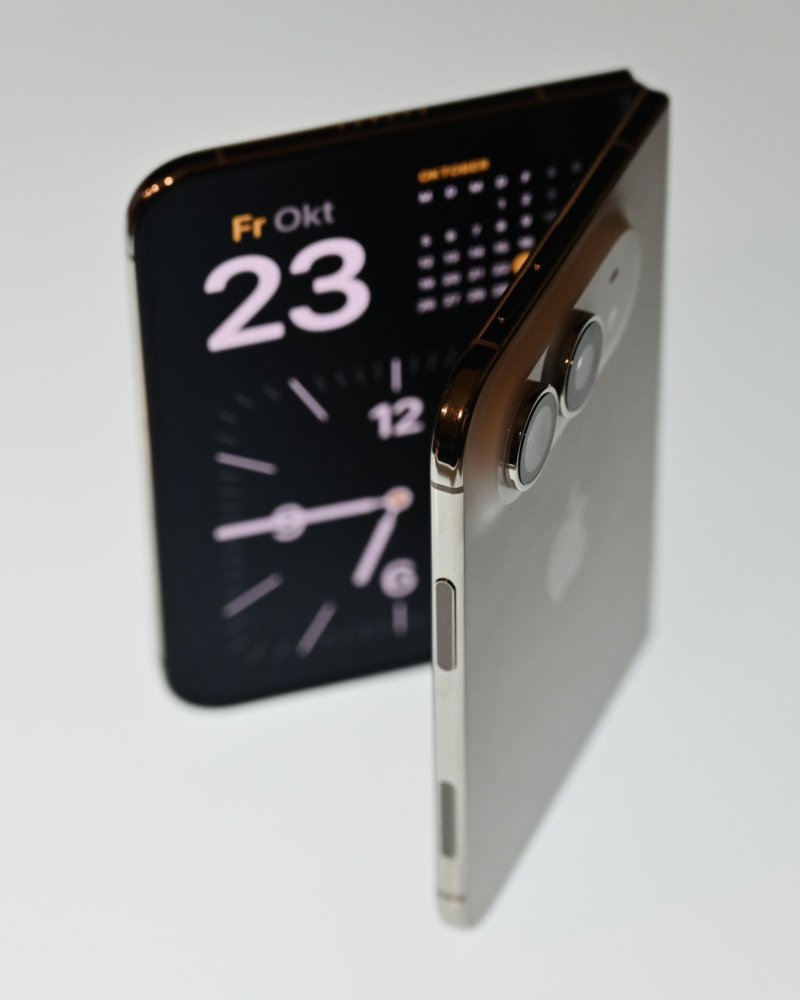
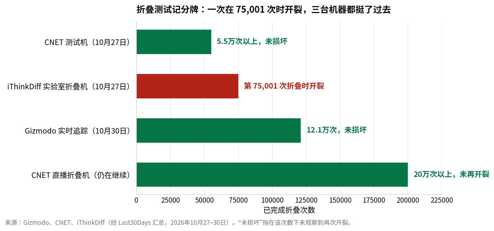

> [English version](/life/iphone-duo-cracking-november-update/)

*iPhone Duo 在 2026 年 10 月 23 日发售当天半折叠状态。照片：Simon Waldherr，来自 Wikimedia Commons。*

*本文是 10 月 27 日报道《[三天、不到 20 次开合](/life/iphone-duo-screen-cracking-hinge-zh/)》的更新篇。价格为 2026 年 11 月 11 日查询的美国售价快照，后续可能变化。下文供应商材料一说属于爆料，已明确标注；苹果尚未证实。*

## 10 月 27 日以来有什么新进展

裂屏的事没有过去——它多了一个嫌疑对象、一份调查和第二次拆解。简言之：两周前我们提出的"批次缺陷"判断看起来更有依据了，但真正拆过铰链的人，现在彼此的结论互相打架。

**爆料。** 11 月 7 日，中国科技分析师康（Kang）在微博发文，当天被 PhoneArena 转载，称铰链问题"基本已经查明"：毛病出在两家铰链供应商之一提供的**材料**上，而不是铰链设计。还附带两个说法：苹果可以通过序列号定位受影响的批次；设计本身没问题。爆料没有点名是哪家供应商，也没有提供零件照片。苹果什么也没证实。

据日本与台湾媒体报道，铰链供应链是这样的：两家铰链总成供应商——美国 **Amphenol** 与台湾**新日兴（Shin Zu Shing）**，液态金属铰链轴来自**亿铖科技（Yian Technology）**。其中一家韩国供应商 **Fine M-Tec** 在 10 月 26 日发表声明，否认其供应的零部件存在导致此次问题的质量缺陷——这份否认读起来像是在把责任推给另一家，只是不点名。

**拆解。** 11 月 10 日，YouTuber CuriousHagi 拆解了一台 Duo，发现一根很细的铰链环正好断在裂纹起点处，屏幕下方还有撞击痕迹（IBTimes 报道）。如果某个零件是因为材料缺陷而断裂，这个发现与康的爆料是吻合的。但没有任何来源把两者联系起来，一台手机也解释不了其他手机。

**反方分析。** iFixit 的拆解分析——目前最完整的一份——指向相反方向。它的结论是：裂纹**不是**集中在显示排线穿过铰链的常规应力点，而是稍低一点的位置，即排线间隙过渡到中央铰链支撑件的区域。iFixit 认为这是设计与制造层面的特征，而不是某个零件的材料问题。康的材料论与 iFixit 的设计论，不可能同时是全部真相。

## 七年折叠屏史，同一课上了七年

苹果不是第一家发现铰链是手机上最难做的部件的公司。事实上，它是最后一家在公开场合学到这一课的大厂。三星在 2019 年推出全球首款主流折叠屏手机 Galaxy Fold，发售几天之内，送测媒体的机器就接连出问题：灰尘和碎屑从铰链周围的缝隙进入，屏幕下方出现气泡和折痕，评测机在文章发表之前就坏了。三星召回了首发，把上市时间从 2019 年 4 月推迟到 9 月，重新设计了铰链，在屏幕边缘加上了防护帽。随后推出的 Z Fold 2 按多数人的评价是一台真正能用的手机——但教训留下来了：折叠屏手机的铰链不是一个零件，而是产品本身，它的失效模式只有在成千上万只真实的手、在真实的灰尘、真实的口袋、真实的跌落中折叠它时才会显现。

七年过去，整个行业进步巨大，但问题仍然没有被彻底解决。现代铰链采用了多层屏蔽、防水涂层和更严格的公差；三星的超薄玻璃（UTG）显示层配合重新设计的铰链结构，能通过 2019 年那台机器会被摧毁的实验室测试。三星显示（Samsung Display）的折叠面板在室温下测试可达 50 万次，高温低温下还有额外测试——这是一项受控的面板测试，不是保证每台手机都能折 50 万次的承诺，但它衡量了工程进步的幅度。然而用户报告依然存在：Z Fold 6 用户反映使用六到十二个月后铰链异响、屏幕分层、折痕明显；Z Fold 7 的早期评测也提到铰链噪音与屏幕磨损。三星最新折叠屏的防护等级是 IP48——能防住 1 毫米以上的固体物，但不是防尘等级——而 iFixit 在测试中发现，细小的荧光粉末进入了铰链，随后铰链开始发涩、无法正常开合。七年的规律是一致的：每一代都修好了上一代的毛病，而下一个毛病出现在实验室没有看过的地方。

这段历史对苹果的意义有两层。第一，苹果有七年时间在旁边看着三星公开失败——它可以绕开每一个已知的失效模式，雇佣那些已经吃过亏的供应商，对着一座自己不用付费的错误图书馆做测试。它仍然造出了一台发售头几天就裂屏的手机，这说明故障根本不在那座已知的图书馆里：要么是某个特定批次的制造缺陷，如康的爆料所说；要么是一种三星七年经验也没有覆盖的新失效模式。第二，这段历史设定了"修好了"应该是什么样子。三星修复 Fold 靠的不是一份声明，而是一次召回、五个月的延期和一个重新设计的铰链。苹果到目前为止提供的是一次免费换机和一句"少数"。按它的前辈自己立下的标准，这只是一个回应的开始，而不是结束。

## 折叠测试记分牌

与此同时，各路耐久测试机一直在努力复现这个问题——但规模上复现不了，而这本身就是关于缺陷性质的证据：

*折叠测试记分牌：一次在 75,001 次时开裂，三台机器都挺了过去。数据：Gizmodo、CNET、iThinkDiff，经 Last30Days 汇总，2026 年 10 月 27–30 日。"未损坏"指在该次数下未观察到再次开裂。*

路易斯维尔一台实验室折叠机正好在**第 75,001 次**折叠时开裂——这个数字成了 r/mildlyinfuriating 上的梗（85,589 个赞，最高赞评论是"工厂只测到 75,000 次吧："）。但 CNET 直播的折叠机此后已经超过 **200,000 次**且未再次开裂，Gizmodo 的追踪到 10 月 30 日已达 **121,000 次**，CNET 第一台测试机也通过了 **55,000 次**。一种只在最初几小时内弄坏少数机器、之后就不再出现的缺陷，是批次缺陷的特征，不是磨损特征——测试机的数据也支持这个判断。

## "批次缺陷"在实际中意味着什么——以及苹果欠用户什么

如果康是对的，这个故事就从工程故事变成制造故事，而这两种故事的结局截然不同。设计缺陷意味着每台机器都有风险，修复需要重新设计，诚实的回应是召回或停售。批次缺陷意味着某个供应商的某一批某个零件超出了规格，修复办法是清除那批货、收紧检验，诚实的回应是找出受影响的机器、在它们出故障之前就换掉。批次论对还没收到手机的人来说是好消息，但对苹果来说是另一种坏消息：如果公司真的能像康所说的那样按序列号定位受影响的批次，那么它每一天不发布查询工具，都是在选择沉默，而不是拿出它已经拥有的修复办法。

这种事以往的剧本并不让人安心。面对批次缺陷的厂商，几乎总是选择安静的路线：坏了就换，不提那些还没坏的，让坏批次在装机量里慢慢老化。逻辑是商业上的——一份公开的受影响序列号清单就是一份公开承认的规模，而规模会把一个售后问题变成新闻。但安静的路线有一个迟到的代价：那些从未听说过缺陷的用户会继续用着一台可能在换机计划结束之后才出故障的手机，而那 999 美元的保外维修价就会变成他们的问题，而不是苹果的问题。免费换机计划做到哪一步都算慷慨，问题是它做到哪一步、持续多久。苹果没有说过计划何时结束、覆盖哪些序列号、也不说一台在第 13 个月裂开的手机会怎样。这些数字能把一次善意姿态变成一项政策，而苹果一个也没给。

供应商的否认也符合这幅图景。Fine M-Tec 在 10 月 26 日发表的声明——否认其零部件的质量缺陷导致了这些问题——正是那种供应商在感觉到手指即将指向自己、或者知道手指正指向对手而想先在记录里留下一笔时发表的声明。无论是哪种，它都说明供应链现在已经变成了一张互相指责的网络，而不是一个团队：两家铰链总成商、一家液态金属铰链轴供应商，和一台最重要的部件由这些公司制造的手机——而这些公司现在正通过新闻稿互相推卸责任。这就是批次缺陷从内部看起来的样子：不是一个坏掉的零件，而是一串供应商在公开场合发现，他们对"谁的零件坏了"达不成一致。

75,001 这个数字之所以变成梗，是因为它恰好卡在一个让人起疑的位置上：75,000 是一个整数、一个看起来像测试标准的数字，而裂纹偏偏发生在它之后的一次。网友的调侃——"工厂只测到 75,000 次吧"——当然不是事实陈述，而是一种直觉：当一个产品在某个整数关口之后立刻出问题，人们会本能地怀疑测试标准本身就是按那个整数设的。但这个直觉需要被认真对待的地方在于，它揭示了折叠测试的一个根本局限：实验室里的折叠机是在恒温、无尘、无冲击的条件下，以均匀的力度、均匀的速度开合，而真实用户是在冬天戴着手套、地铁上单手、手机从口袋里掏出来还带着沙粒的情况下开合。一台在实验室里通过 200,000 次的手机，和一台在用户手里第三天就裂开的手机，描述的根本不是同一种耐用性。前者回答的是"铰链会不会磨损"，后者回答的是"铰链会不会在制造缺陷下早期失效"——而这两个问题需要两种完全不同的测试。CNET 与 Gizmodo 的测试机没有复现裂纹，这本身就是有价值的信息：它说明裂纹不是磨损问题；但它不能证明裂纹不存在，只能证明裂纹不是均匀分布在所有机器上的。理解了这一点，记分牌的读法就变了：它不是"一台坏了、三台没坏，所以问题不大"，而是"一台坏了、三台没坏，所以问题不在磨损，而在批次"——而这正是两周前初报的判断，也是这次更新进一步确认的方向。

## 买家在用脚投票——至少在一份调查里是这样

Android Authority 在发售后调查了 **2,093 名**读者，11 月 5 日报道称 **39.7%** 的人因为屏幕损坏与耐久性问题放弃了购买计划。这个数字要打个折：调查对象只是该媒体自己的读者，不是全体买家的代表性样本。但方向对一台 1,999 美元、卖点就是铰链的手机来说是坏消息——哪怕是非代表性的四成流失，也足以让运营商与零售商紧张；而据 TrendForce，交货日期已经推迟到 2027 年 1 月。

换机方面的情况略有好转：iDrop News 报道称，即使没有 AppleCare+ 也可以换内屏；苹果的立场仍是受影响的机器免费换新。但那 999 美元的保外内屏维修价依然摆在那里——一旦超出换机计划范围、之后再坏，代价就是它。

## 什么才能真正定论

10 月 27 日的初报里列了三件事可以定论：苹果发布序列号查询工具、第二次拆解发现同样的断环、或者一个数字。两周过去，三件一件也没来——但这次更新让每一件的证明力更清楚了，也更清楚了苹果为什么一件也没给。

序列号查询工具能一天之内证明批次论、终结争论：用户可以查自己的手机，苹果可以主动更换受影响的机器，设计与材料的争论会变成学术问题。它同时也会证明规模，而这正是它没有出现的原因。第二次拆解发现同样的断环，能证明失效模式是可重复的、而不是个例，并让独立分析师把断掉的零件与供应商的规格做对比——这种证据能把一则爆料变成一个结论。而一个数字——受影响比例、故障率，哪怕只是一个范围——能让其他所有人自己算账：这是千分之一，还是百分之一？这两个数字之间的差别，就是一条脚注与一次召回之间的差别，苹果很清楚这一点。

在三件都没来的情况下，实用建议不变，值得用最直白的话再说一遍。如果你已经买了 Duo，这周正常、频繁地折叠它：坏铰链会在早期现形，而在换机窗口内出故障，是苹果的问题，不是你的问题。留好包装盒、留好收据、现在就给屏幕拍张照，这样以后出现的裂纹才能确定日期。如果你还在等 1 月交货，批次论可以说是个好消息——但前提是苹果真的清除了坏批次，而这一点从外部是无法验证的。如果你还在犹豫要不要买，诚实的表述是这样的：你买的不是一台缺陷率已知的手机，而是一台缺陷率未知、厂商选择不告诉你的手机。这是一次不同的购买，值得一个不同的价格——或者，值得等一等。

## 苹果为什么不说话

整个故事里最值得琢磨的可能不是爆料、不是拆解、也不是调查，而是苹果的沉默。两周时间里，苹果除了"少数"之外什么也没说。这不是疏忽，而是一种策略，而且是一套苹果用过很多次的策略：不确认、不否认、不给数字，让时间与换机计划把问题消化掉。这套策略在大多数产品问题上是有效的——大多数用户不会追着一家公司要一个故障率，他们只想自己的手机别坏。但它在这次事件里遇到了一个对手：拆解者与分析师。iFixit、CuriousHagi、供应链爆料者构成了一条苹果控制不了的信息渠道，每一次拆解、每一篇分析都在填补苹果留下的空白。沉默在没有替代信息源的时候是有效的，在有替代信息源的时候，沉默本身就成了一种信息——它告诉市场，苹果要么还不知道答案，要么知道答案但不想说出来。两种解读都不好看，而市场正在按更坏的那一种定价：39.7% 的读者说他们已经放弃购买，哪怕这个样本并不代表全体买家，方向本身就足够让运营商与零售商紧张。

还有一个更实际的考虑：苹果正在为 1 月的交货备货。如果它现在承认批次缺陷，就必须同时回答"1 月发货的机器里还有没有坏批次"这个问题，而这个问题它可能还没有答案——清除一条供应链里的坏批次需要时间，需要供应商的配合，需要检验流程的改变。在答案出来之前，沉默是最便宜的姿态。但便宜是有代价的：每多沉默一周，相信"批次论"的人就会多问一句"既然你知道是哪个批次，为什么不告诉我我的手机在不在里面"。这个问题没有好的沉默式答案，它只能由一个查询工具来回答。

## 折叠屏的下一道坎：不只是铰链

退后一步看，Duo 的裂屏事件暴露的是整个折叠屏品类的一个结构性问题：这个品类已经七岁了，但它仍然没有通过"普通人每天用、不用小心翼翼"这一关。直板手机的耐用性是被默认的——你不需要知道它能折多少次，因为它根本不折；你不需要担心灰尘进入铰链，因为它没有铰链。折叠屏把一个机械结构放进了口袋里最恶劣的环境：灰尘、汗水、钥匙、跌落、每天几十次的开合，每一个都是实验室里可以控制、现实里无法控制的变量。三星七年修好的每一代毛病，都只是把失效点从一个地方推到了另一个地方——从进灰到折痕，从折痕到异响，从异响到分层。苹果的 Duo 现在遇到的，很可能就是这个链条上的下一环。

这对苹果的意义比对三星更大。三星进入折叠屏市场时，人们对它的期待是"做出一个能用的折叠屏"；苹果进入时，人们对它的期待是"做出一个不会坏的折叠屏"。迟到七年的代价不是市场份额，而是期待值——当你看着别人摔了七年跤才入场，市场默认你已经学会了走路。Duo 裂屏之所以成为头条，不只是因为它坏了，而是因为它本不该坏。苹果的品牌承诺从来不是"第一个做出来"，而是"做出来的时候就是对的"。这次事件动摇的正是这个承诺，而修复承诺需要的不是一次换机，而是一次让人信服的解释：到底是什么坏了、为什么坏、有多少台会坏。苹果至今没有给出这三点中的任何一点，而每拖一周，期待值与现实之间的裂缝就会大一分，直到某一天，裂缝本身成了比裂屏更大的新闻。

从更长的时间线看，折叠屏的真正考验还在后面。第一代 Duo 的用户是尝鲜者，他们对新品类的容忍度最高；第二代、第三代的用户将是普通消费者，他们的容忍度要低得多。如果 Duo 的裂屏最终被证明是批次问题，苹果还有机会用一次干净的清理挽回局面；如果它被证明是设计问题——如 iFixit 的分析所暗示的那样——那么修复它的将不是一次换机，而是一次重新设计，而那将意味着 Duo 这一代产品的口碑已经被写进了历史。两种结局的分界线，就是那三个至今没有到来的东西：查询工具、第二次拆解、一个数字。

## 结论

两周前我们说过，现有模式像批次缺陷，缺的是一个分母——苹果从未公布的受影响比例。这个判断依然成立，但更新让它在两个方向上都更尖锐了：

- **支持批次论：** 一则点名爆料、一份读起来像甩锅的供应商否认、一个断在裂纹起点的铰链环，三者指向同一方向。如果康是对的，苹果确切知道哪些序列号受影响——而它至今没有发布查询工具，这成了整个故事里最值得注意的沉默。
- **反对简单答案：** iFixit 的分析说是设计问题，不是材料；爆料是单一来源、没有点名、没有照片；拆解只是一台手机。苹果除了"少数"之外什么也没说。

两周过去，故事没有变简单，反而变复杂了——但复杂本身也是一种信息：当三种说法互相矛盾、当测试机无法复现、当厂商选择沉默，真相往往不在其中任何一种说法里，而在它们之间的缝隙里。找到那个缝隙，需要的不是更多的爆料，而是苹果给出的一个数字。所以 10 月 27 日的实用建议依然有效，再加一条。如果你已经买了 Duo，这周正常、频繁地折叠它——坏铰链还是会在早期现形。如果你还在等 1 月交货，批次论可以说是个好消息：等你的手机发货时，苹果已经有了两个月时间来清除坏批次——*如果*真是批次问题的话。要彻底定论，需要三件事中的一件：苹果发布序列号查询工具、第二次拆解发现同样的断环、或者一个数字。苹果三件都没给，而时间正在替它做决定。

## 来源

- PhoneArena / 康（微博），2026 年 11 月 7 日（供应商材料爆料；苹果可按序列号追踪；未点名供应商、无照片）。
- en.kocpc.com.tw，2026 年 11 月 10 日（爆料细节；Amphenol 与新日兴为铰链供应商；亿铖科技液态金属铰链轴；Fine M-Tec 10 月 26 日否认声明；iFixit 过渡区分析）。
- IBTimes，经 pasqualepillitteri.it，2026 年 11 月 10 日（CuriousHagi 拆解：铰链环断在裂纹起点；无 AppleCare+ 也可换内屏，见 iDrop News）。
- Android Authority 调查，经 en.sedaily.com，2026 年 11 月 5 日（2,093 名读者中 39.7% 放弃购买计划；调查仅限该媒体自身读者）。
- Last30Days，2026 年 11 月 3 日（75,001 次开裂；CNET 超 200,000 次；Gizmodo 121,000 次；TrendForce 交货推迟至 2027 年 1 月）。
- 我们 10 月 27 日的报道《三天、不到 20 次开合》（发售周案例；苹果声明；iFixit 支撑杆理论；999 美元保外维修价）。
