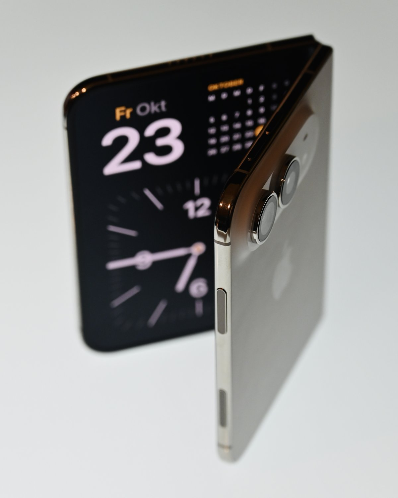
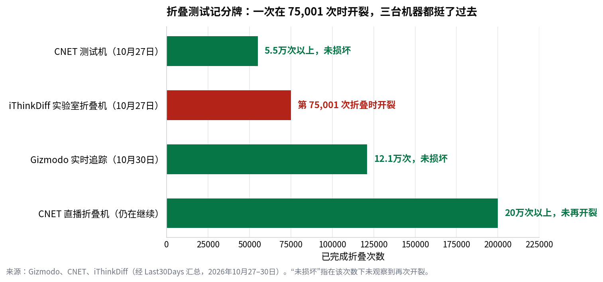

> [English version](/life/iphone-duo-cracking-november-update/)

*iPhone Duo 在 2026 年 10 月 23 日发售当天半折叠状态。照片：Simon Waldherr，来自 Wikimedia Commons。*

*本文是 10 月 27 日报道《[三天、不到 20 次开合](/life/iphone-duo-screen-cracking-hinge-zh/)》的更新篇。价格为 2026 年 11 月 11 日查询的美国售价快照，后续可能变化。下文供应商材料一说属于爆料，已明确标注；苹果尚未证实。*

## 10 月 27 日以来有什么新进展

裂屏的事没有过去——它多了一个嫌疑对象、一份调查和第二次拆解。简言之：两周前我们提出的"批次缺陷"判断看起来更有依据了，但真正拆过铰链的人，现在彼此的结论互相打架。

**爆料。** 11 月 7 日，中国科技分析师康（Kang）在微博发文，当天被 PhoneArena 转载，称铰链问题"基本已经查明"：毛病出在两家铰链供应商之一提供的**材料**上，而不是铰链设计。还附带两个说法：苹果可以通过序列号定位受影响的批次；设计本身没问题。爆料没有点名是哪家供应商，也没有提供零件照片。苹果什么也没证实。

据日本与台湾媒体报道，铰链供应链是这样的：两家铰链总成供应商——美国 **Amphenol** 与台湾**新日兴（Shin Zu Shing）**，液态金属铰链轴来自**亿铖科技（Yian Technology）**。其中一家韩国供应商 **Fine M-Tec** 在 10 月 26 日发表声明，否认其供应的零部件存在导致此次问题的质量缺陷——这份否认读起来像是在把责任推给另一家，只是不点名。

**拆解。** 11 月 10 日，YouTuber CuriousHagi 拆解了一台 Duo，发现一根很细的铰链环正好断在裂纹起点处，屏幕下方还有撞击痕迹（IBTimes 报道）。如果某个零件是因为材料缺陷而断裂，这个发现与康的爆料是吻合的。但没有任何来源把两者联系起来，一台手机也解释不了其他手机。

**反方分析。** iFixit 的拆解分析——目前最完整的一份——指向相反方向。它的结论是：裂纹**不是**集中在显示排线穿过铰链的常规应力点，而是稍低一点的位置，即排线间隙过渡到中央铰链支撑件的区域。iFixit 认为这是设计与制造层面的特征，而不是某个零件的材料问题。康的材料论与 iFixit 的设计论，不可能同时是全部真相。

## 折叠测试记分牌

与此同时，各路耐久测试机一直在努力复现这个问题——但规模上复现不了，而这本身就是关于缺陷性质的证据：

*折叠测试记分牌：一次在 75,001 次时开裂，三台机器都挺了过去。数据：Gizmodo、CNET、iThinkDiff，经 Last30Days 汇总，2026 年 10 月 27–30 日。"未损坏"指在该次数下未观察到再次开裂。*

路易斯维尔一台实验室折叠机正好在**第 75,001 次**折叠时开裂——这个数字成了 r/mildlyinfuriating 上的梗（85,589 个赞，最高赞评论是"工厂只测到 75,000 次吧："）。但 CNET 直播的折叠机此后已经超过 **200,000 次**且未再次开裂，Gizmodo 的追踪到 10 月 30 日已达 **121,000 次**，CNET 第一台测试机也通过了 **55,000 次**。一种只在最初几小时内弄坏少数机器、之后就不再出现的缺陷，是批次缺陷的特征，不是磨损特征——测试机的数据也支持这个判断。

## 买家在用脚投票——至少在一份调查里是这样

Android Authority 在发售后调查了 **2,093 名**读者，11 月 5 日报道称 **39.7%** 的人因为屏幕损坏与耐久性问题放弃了购买计划。这个数字要打个折：调查对象只是该媒体自己的读者，不是全体买家的代表性样本。但方向对一台 1,999 美元、卖点就是铰链的手机来说是坏消息——哪怕是非代表性的四成流失，也足以让运营商与零售商紧张；而据 TrendForce，交货日期已经推迟到 2027 年 1 月。

换机方面的情况略有好转：iDrop News 报道称，即使没有 AppleCare+ 也可以换内屏；苹果的立场仍是受影响的机器免费换新。但那 999 美元的保外内屏维修价依然摆在那里——一旦超出换机计划范围、之后再坏，代价就是它。

## 结论

两周前我们说过，现有模式像批次缺陷，缺的是一个分母——苹果从未公布的受影响比例。这个判断依然成立，但更新让它在两个方向上都更尖锐了：

- **支持批次论：** 一则点名爆料、一份读起来像甩锅的供应商否认、一个断在裂纹起点的铰链环，三者指向同一方向。如果康是对的，苹果确切知道哪些序列号受影响——而它至今没有发布查询工具，这成了整个故事里最值得注意的沉默。
- **反对简单答案：** iFixit 的分析说是设计问题，不是材料；爆料是单一来源、没有点名、没有照片；拆解只是一台手机。苹果除了"少数"之外什么也没说。

所以 10 月 27 日的实用建议依然有效，再加一条。如果你已经买了 Duo，这周正常、频繁地折叠它——坏铰链还是会在早期现形。如果你还在等 1 月交货，批次论可以说是个好消息：等你的手机发货时，苹果已经有了两个月时间来清除坏批次——*如果*真是批次问题的话。要彻底定论，需要三件事中的一件：苹果发布序列号查询工具、第二次拆解发现同样的断环、或者一个数字。苹果三件都没给。

## 来源

- PhoneArena / 康（微博），2026 年 11 月 7 日（供应商材料爆料；苹果可按序列号追踪；未点名供应商、无照片）。
- en.kocpc.com.tw，2026 年 11 月 10 日（爆料细节；Amphenol 与新日兴为铰链供应商；亿铖科技液态金属铰链轴；Fine M-Tec 10 月 26 日否认声明；iFixit 过渡区分析）。
- IBTimes，经 pasqualepillitteri.it，2026 年 11 月 10 日（CuriousHagi 拆解：铰链环断在裂纹起点；无 AppleCare+ 也可换内屏，见 iDrop News）。
- Android Authority 调查，经 en.sedaily.com，2026 年 11 月 5 日（2,093 名读者中 39.7% 放弃购买计划；调查仅限该媒体自身读者）。
- Last30Days，2026 年 11 月 3 日（75,001 次开裂；CNET 超 200,000 次；Gizmodo 121,000 次；TrendForce 交货推迟至 2027 年 1 月）。
- 我们 10 月 27 日的报道《三天、不到 20 次开合》（发售周案例；苹果声明；iFixit 支撑杆理论；999 美元保外维修价）。
