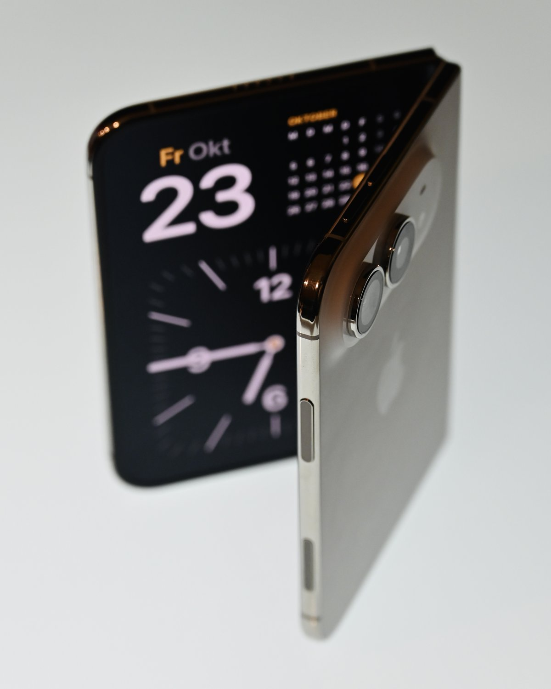
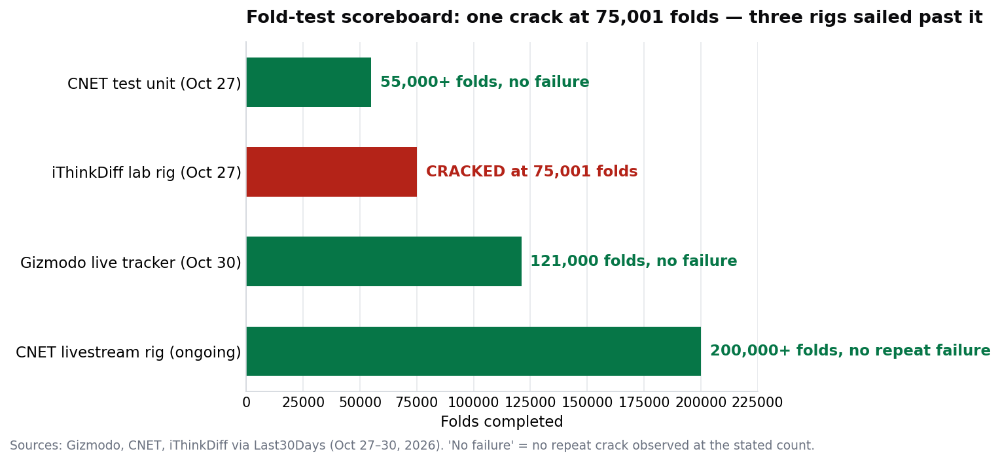

> [中文版 Chinese version](/life/iphone-duo-cracking-november-update-zh/)

*An iPhone Duo half-folded on launch day, October 23, 2026. Photo: Simon Waldherr, via Wikimedia Commons.*

*This is an update to our [October 27 report](/life/iphone-duo-screen-cracking-hinge/) on the Duo's cracking inner screens. Prices are US prices as of November 11, 2026 — a snapshot, subject to change. The supplier-material claim below is a leak, labelled as such; Apple has not confirmed it.*

## What has changed since October 27

The cracking story has not gone away — it has acquired a suspect, a survey, and a second teardown. The short version: the batch-defect theory we outlined two weeks ago looks stronger, but the people who have actually taken the hinge apart now disagree with each other about *why* it fails.

**The leak.** On November 7, Chinese tech analyst Kang posted on Weibo — picked up the same day by PhoneArena — claiming the hinge problem "has basically been identified": the fault is in the *material* from one of Apple's two hinge suppliers, not in the hinge design. Two further claims came with it: Apple can identify the affected batch by serial number, and the design itself is sound. Kang named no supplier and offered no photos of the parts. Apple has confirmed nothing.

The hinge supply chain, as reported by Japanese and Taiwanese outlets: two main hinge-assembly suppliers, **Amphenol** (US) and **Shin Zu Shing** (Taiwan), with the liquid-metal hinge shaft from **Yian Technology**. One of the two assemblers, South Korea's **Fine M-Tec**, issued a statement on October 26 denying that quality defects in its components caused the reported problems — a denial that, read carefully, points the finger at the other supplier without naming it.

**The teardown.** On November 10, YouTuber CuriousHagi tore down a Duo and found a thin hinge ring snapped at the exact point where the crack starts, with impact marks under the display (reported by IBTimes). If a part gave way because of defective material, that account fits Kang's leak. But no source links the two, and a single phone does not explain the others.

**The counter-analysis.** iFixit's teardown analysis — the most complete so far — points the other way. Its finding is that the cracks are *not* concentrated at the usual stress point where the display cable passes through the hinge, but slightly lower, in the transition zone where the gap between the crossing cables leads into the central hinge support. That is a design-and-manufacturing signature, iFixit argues, not a single bad part. Kang's material theory and iFixit's design theory cannot both be the whole story.

## The fold-test scoreboard

The durability rigs, meanwhile, keep failing to reproduce the problem at scale — which is itself evidence about what kind of defect this is:

*Fold-test scoreboard: one crack at 75,001 folds, three rigs that sailed past it. Data: Gizmodo, CNET, iThinkDiff via Last30Days, October 27–30, 2026. "No failure" means no repeat crack observed at the stated count.*

One lab rig in Louisville cracked at exactly **75,001 folds** — a number that became a meme on r/mildlyinfuriating (85,589 upvotes, top reply: "When the factory only tests to 75,000 folds"). But CNET's livestreamed rig has since passed **200,000 folds** without a repeat failure, Gizmodo's tracker passed **121,000** by October 30, and CNET's first test unit cleared **55,000**. A defect that breaks a minority of units in their first hours and then stops appearing is a batch signature, not a wear-out signature — and the rigs agree with that reading.

## Buyers are voting with their feet — in a survey, at least

Android Authority surveyed **2,093** of its readers after the launch and reported on November 5 that **39.7%** had dropped plans to buy a Duo because screen damage and durability issues had eroded their confidence. The caveat matters: that is a survey of Android Authority's own readers, not a representative sample of buyers. But the direction is bad news for a $1,999 phone whose whole pitch is a hinge: even an unrepresentative 40% walk-away rate is the kind of number that makes carriers and retailers nervous, and delivery dates are already slipping into January 2027, according to TrendForce.

The replacement picture has improved slightly: iDrop News reports the inner-screen replacement is available even to people without AppleCare+, and Apple's position remains that affected units get a free replacement. The $999 out-of-warranty inner-screen repair figure still stands behind that programme for anything that fails later, outside it.

## The verdict

Two weeks ago we said the pattern looked like a batch defect and the missing piece was a denominator — the affected share Apple has never given. That still holds, but the update sharpens it in both directions:

- **For the batch theory:** a named leak, a supplier denial that reads like blame-shifting, and a snapped ring at the crack point all point the same way. If Kang is right, Apple knows exactly which serial numbers are affected — and the fact that it has not published a lookup tool is now the most interesting silence in the story.
- **Against a clean answer:** iFixit's analysis says design, not material; the leak is single-source, unnamed, and photo-free; and the teardown is one phone. Apple has still said nothing beyond "a small number."

So the practical advice from October 27 stands, with one addition. If you own a Duo, fold it normally and often this week — a bad hinge still shows itself early. If you are still waiting for a January delivery, the batch theory is arguably good news: by the time your phone ships, Apple will have had two months to purge the bad batch, *if* it is a batch. What would settle it is one of three things: a serial-number lookup from Apple, a second teardown finding the same snapped ring, or a number. Apple has given none of the three.

## Sources

- PhoneArena / Kang (Weibo), November 7, 2026 (supplier-material leak; Apple can trace by serial number; no supplier named, no photos).
- en.kocpc.com.tw, November 10, 2026 (Kang leak detail; Amphenol and Shin Zu Shing as hinge suppliers; Yian Technology liquid-metal shaft; Fine M-Tec October 26 denial; iFixit transition-zone analysis).
- IBTimes via pasqualepillitteri.it, November 10, 2026 (CuriousHagi teardown: snapped hinge ring at the crack point; iDrop News on replacement without AppleCare+).
- Android Authority survey via en.sedaily.com, November 5, 2026 (39.7% of 2,093 readers dropped purchase plans; survey limited to the outlet's own readers).
- Last30Days, November 3, 2026 (75,001-fold crack; CNET 200,000+ folds; Gizmodo 121,000 folds; TrendForce delivery dates slipping to January 2027).
- Our October 27 report, "Three Days, Fewer Than 20 Folds" (launch-week cases; Apple statement; iFixit support-bar theory; $999 out-of-warranty repair).
