> [English version](/life/jordan-11-cool-grey-ebay-steal-180/)

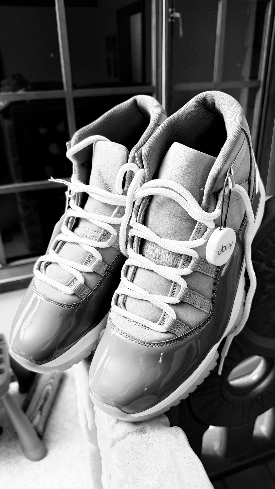
*到货当晚拍的这双，白色 eBay Authenticity Guarantee 防伪标还挂在右脚鞋上。照片拍成了黑白，倒也合适：这个配色的全部意义就是灰得安静。照片：本人实拍。*

## 这次淘到了什么

从 10 月下旬开始，我一直在找 US 11.5/12 的轻度使用 Jordan 11。DMP、Win Like 82、Legend Blue 我已经有了——那是人人都在追的三双 12 月 11 代。还缺的最后一块是 Cool Grey，史上最好的非 OG 11 代之一，而且价格一直下不来，因为有它的人一般不卖。

这周 eBay 上出现了一双：2021 年复刻，US 12，轻度使用，$180 全包。我买了。到货时防伪标还挂在鞋上，而且——最关键的一点——漆皮上没有折痕。

## 为什么是 Cool Grey

Cool Grey 不是 90 年代的元年配色，但地位上跟元年没差。它 2001 年首发，2010 年复刻，第三次也是最好的一次是 2021 年 12 月 11 日，零售价 $225（货号 CT8012-005）。2021 年这版是按 2001 年原版 remaster 的：鞋型更高，漆皮泥挡也更高——2010 年那版的泥挡偏低，老玩家都看得出来。

它特别的地方是克制。鞋面是中灰色麂皮加网布，漆皮泥挡是灰色不是黑色，Jumpman 和鞋跟的"23"都是白色。整个 Jordan 11 家族里，这是最百搭、最不吵的一双，也正因为这样，它从 2001 年到现在一直排在历史最佳 11 代的前列。Concord 是 icon，Bred 是季后赛战靴，Cool Grey 是你真正会天天穿的那双。

## 验鞋况：无折痕

买二手 Jordan 11，价格上最决定性的一点就是漆皮。泥挡一旦穿狠了就会出折痕，而且漆皮不像网布或麂皮，折痕是永久的。所以验一双二手 11 就看三点：

- **漆皮折痕。** 在好光线下顺着泥挡看有没有折痕线。这双：干净，没有折痕。
- **大底发黄。** 冰蓝透明大底会随时间和穿着变黄，对照白色中底就能看出来。
- **鞋垫和鞋盒。** 原装鞋垫 Jumpman 完整、双色灰鞋盒齐全，是"轻度使用"和"别人穿烂的"之间的区别。

这双三点都过了。不是全新死库——穿过，轻度——但漆皮无折痕，这在 11 代上就是全部。同样一双鞋，有折痕和没折痕，差价就是 $180 和 $250 的区别。

## 为什么我要在 eBay 上买 11 代：Authenticity Guarantee

在美国 eBay 上，$100 以上的球鞋在寄到买家手里之前，都要先过 eBay 的 Authenticity Guarantee。卖家把鞋寄到和 Sneaker Con 合作的鉴定中心，鉴定师做多点实物检查——颜色、走线、胶水、图案、logo、材质、鞋带、配件、鞋盒——还要核对实物和 listing 的标题、描述、照片是否一致。通过后会挂上一个带 NFC 的 eBay 防伪标，再寄给你。鉴定不通过、或者实物和描述严重不符，就退款。买家不用额外付费，eBay 承担这笔成本。

我信任它，是因为它已经帮我拦过一次。之前有一笔购买，eBay Authenticity 因为鞋子有 listing 里没提到的烟味，直接拦下来了。这是任何平台自带的"已验证"标签都查不出来的问题，也是我坚持用这种方式买二手 11 代的原因：上面照片里挂在鞋上的那个标不是装饰，它是我敢在没看到实物前就付款的理由。

## 价格账

| | |
|---|---|
| **入手价** | $180，eBay，Authenticity Guarantee |
| **2021 年原价（2021 年 12 月 11 日）** | $225 |
| **全新同码（US 12）现在市价** | 约 $400 |
| **全新 US 12 最低价（2026 年 11 月 5 日核查）** | $350 |

$180 比 2021 年原价还低 $45，是现在全新同码市价的 45%，不到一半。交叉印证一下：2026 年 11 月 5 日的市场核查显示，全新 US 12 最低价是 $350；eBay 上 US 12 的二手挂牌价（11 月 8–10 日抓取）大致在 $150–$260 之间，"Lightly Used" 挂 $199.95，"Pre-owned Excellent" 挂 $249.90。诚实说明一点：这些是挂牌价，不是成交价——eBay 的已成交列表要登录才能看，我这边拿不到已确认的成交区间，所以用挂牌价做交叉印证。但不管按哪种口径算，无折痕的 $180 都处在二手价区间的低端，不到全新同码的一半。这按我的标准就是捡漏。

## 下一步：大灌篮 30 周年三双

Cool Grey 不是 11 代狩猎的终点，是热身。Jordan Brand 正在为《Space Jam》（1996）30 周年出三双 Air Jordan 11，我打算买其中两双：

| 配色 | 货号 | 发售 | 零售价 | 备注 |
|---|---|---|---|---|
| **"Magic Ball"**（女款） | IZ1800-200 | 11 月 11 日周三 | $235 | 女款专属，但 extended sizing 做到女码 14.5（= 男码 13）；我穿男 12，对应女 13.5，在尺码范围内。SNKRS + 指定零售商。 |
| **"Green Screen"** | IQ5700-900 | 11 月 14 日周六，美东上午 10 点 | $255 | 男款 + 大童。SNKRS、Foot Locker。 |
| **"Space Jam" OG** | CT8012-900 | 12 月 12 日周六 | $235 | 全尺码。电影里 MJ 穿的那双；第四次公开发售，鞋跟缝线"23"，"Jumpman Jam" 鞋舌标回归。 |

这个系列的概念就是电影本身，分三个角度讲。Magic Ball 是电影里 Monstars 用来吸走 NBA 球员天赋的那颗发光篮球——鞋面是四向变色的虹彩材质，在绿、金、铜、棕之间变幻。Green Screen 是拍摄时演员穿的绿幕服——全绿麂皮鞋面，泥挡和鞋领是细麂皮，大底是乳白半透明加实心橙色，鞋垫上是 MJ 隔扣 Monstars 的宽幅扣篮。OG Space Jam 就是电影里那双鞋本身，2016 年之后第一次回归。

### "Magic Ball"——11 月 11 日，$235

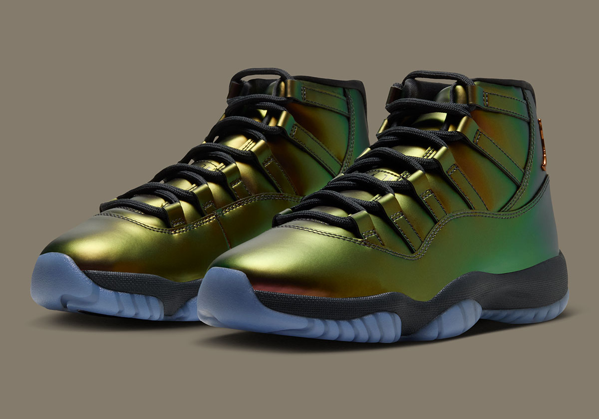
*"Magic Ball" 11 代——虹彩鞋面，在绿、金、铜、棕之间变幻。图片：Sneaker News。*

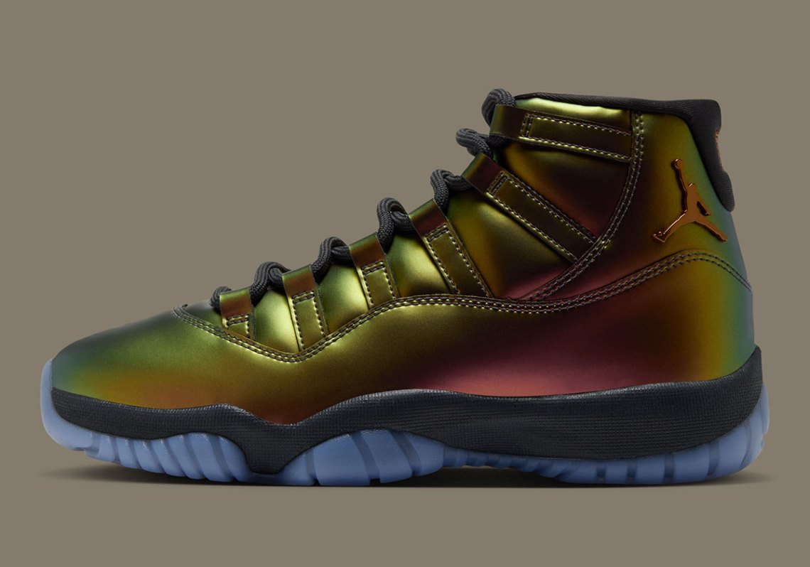
*侧面——颜色从绿过渡到铜，鞋跟是铜色 Jumpman。图片：Sneaker News。*

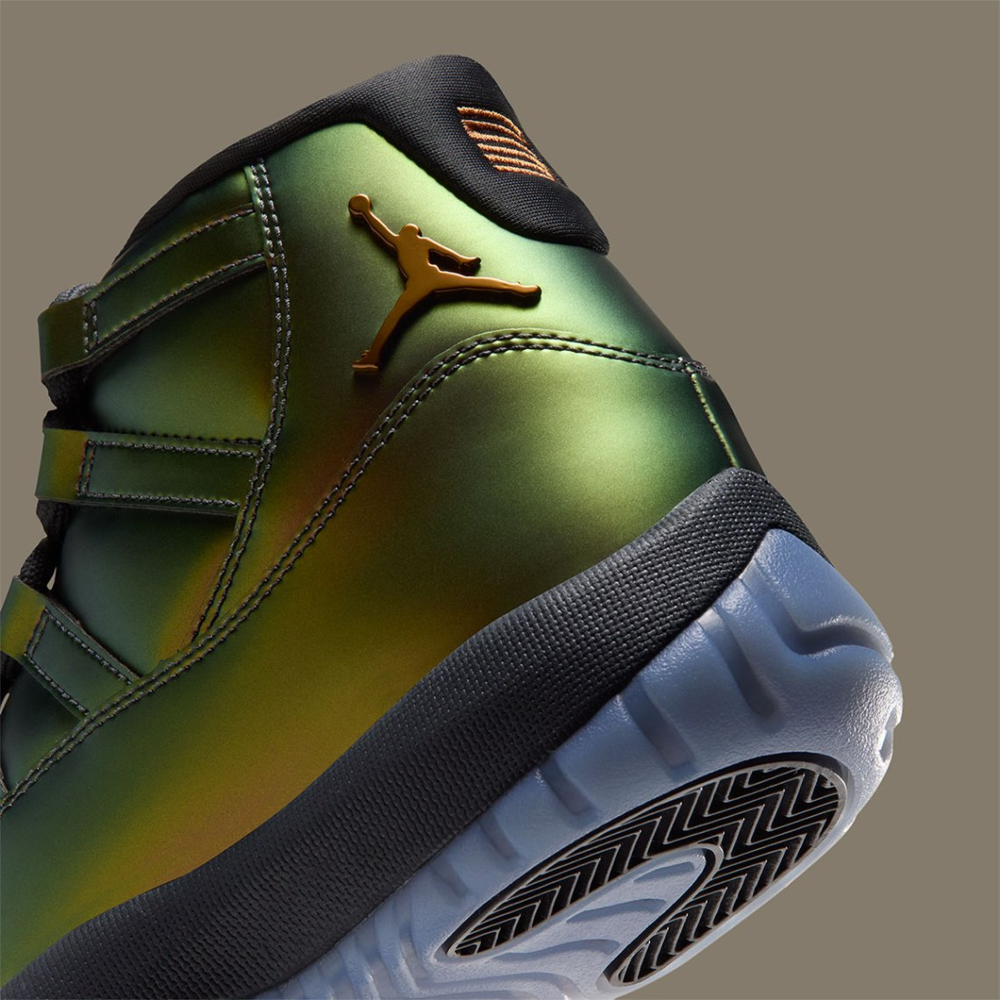
*后跟细节——金色 Jumpman，冰蓝半透明大底配人字纹。图片：Sneaker News。*

### "Green Screen"——11 月 14 日，$255

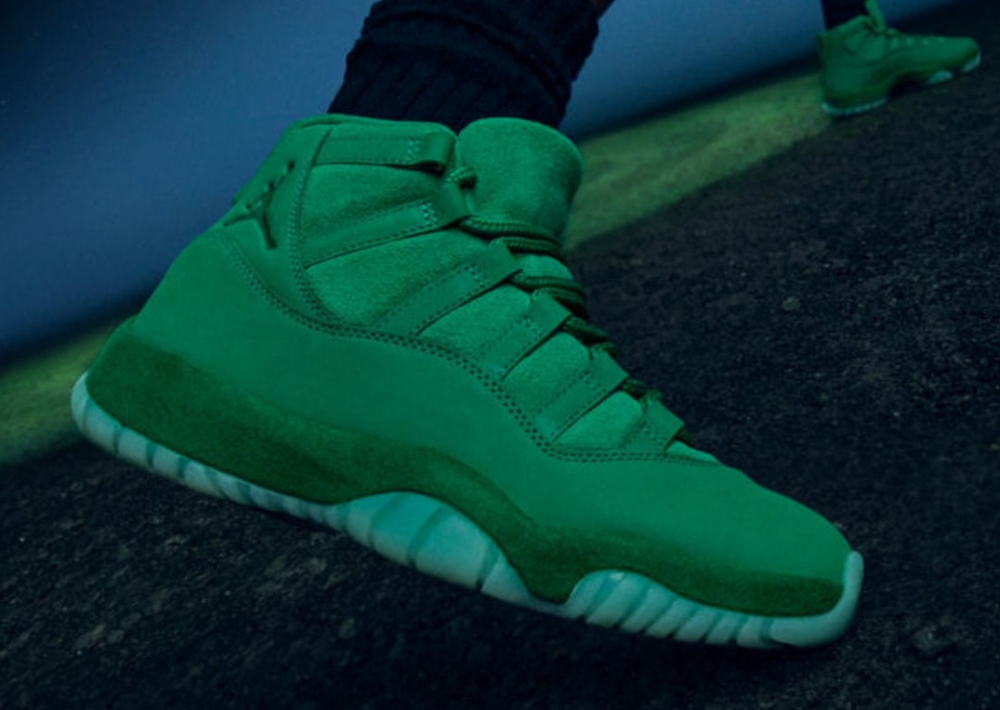
*"Green Screen" 11 代——全绿麂皮、橙色加乳白大底，11 月 14 日周六发售。图片：Sole Retriever。*

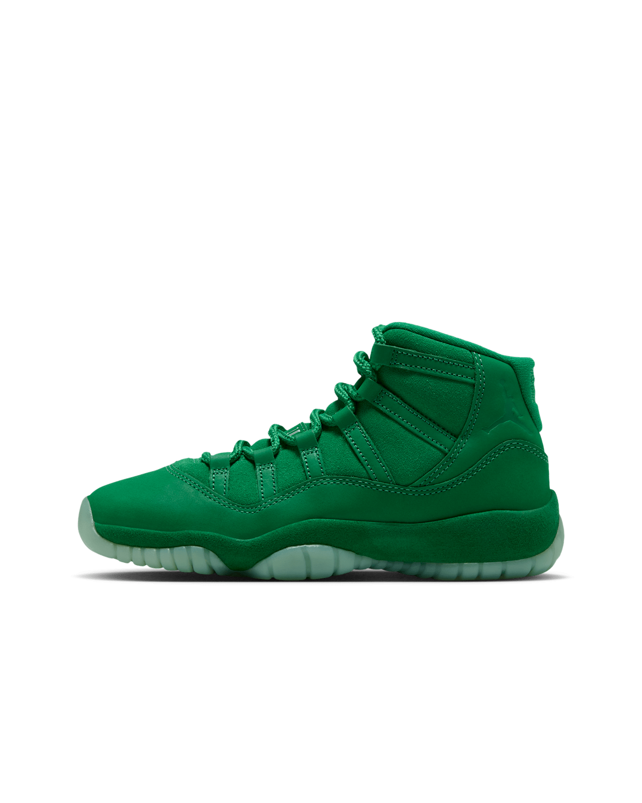
*Nike 官方侧面图——全绿麂皮鞋面，乳白半透明大底。图片：Nike。*

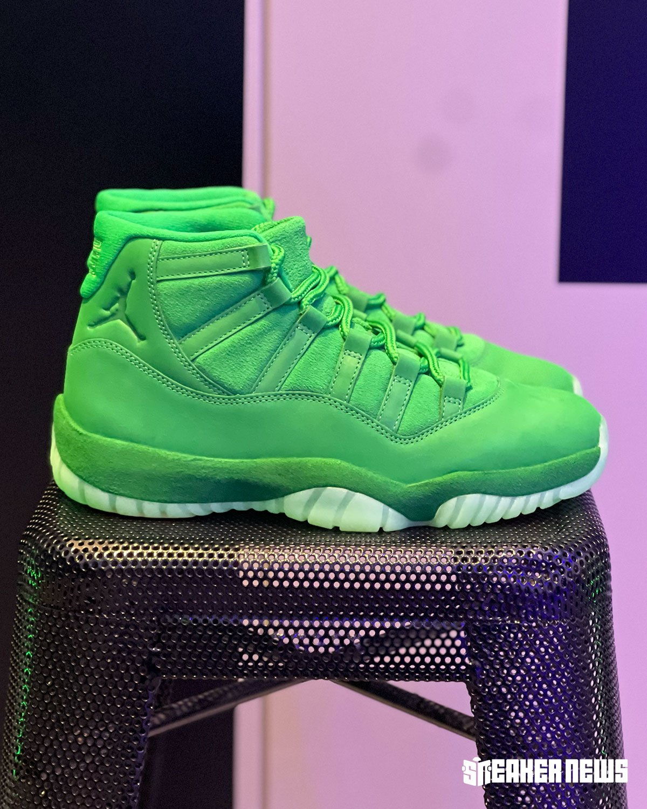
*实物上手——绿色比官图更亮。图片：Sneaker News。*

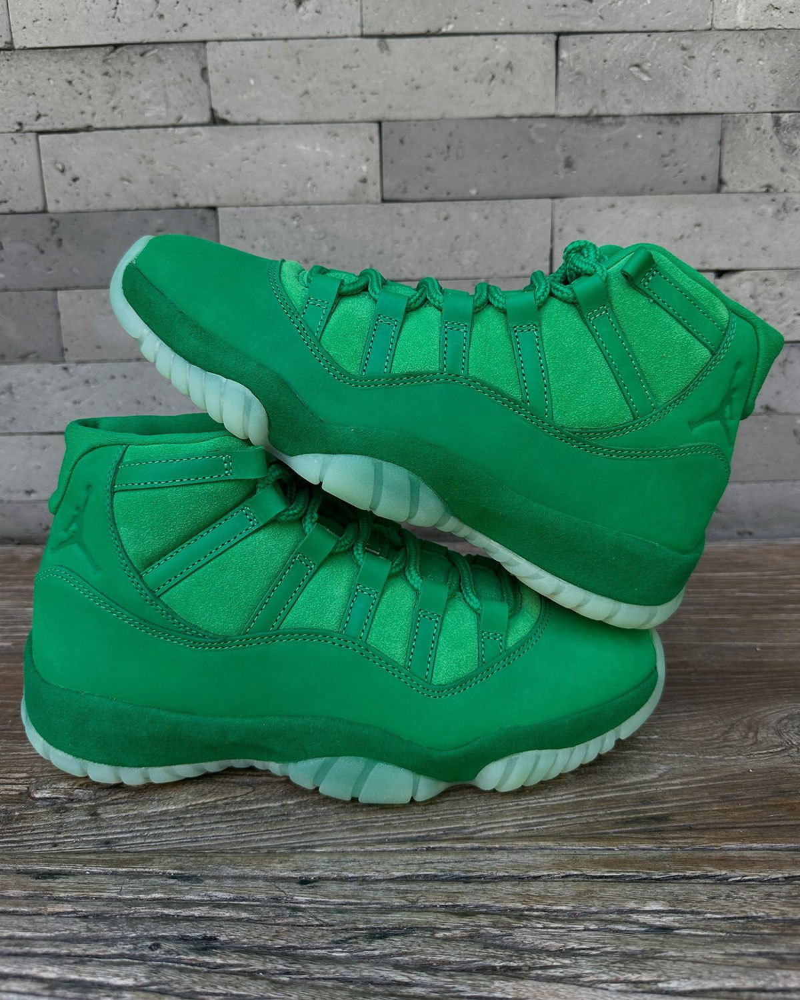
*叠放的一双——麂皮泥挡与鞋领，鞋跟同色 Jumpman。图片：Sneaker News。*

### "Space Jam" OG——12 月 12 日，$235

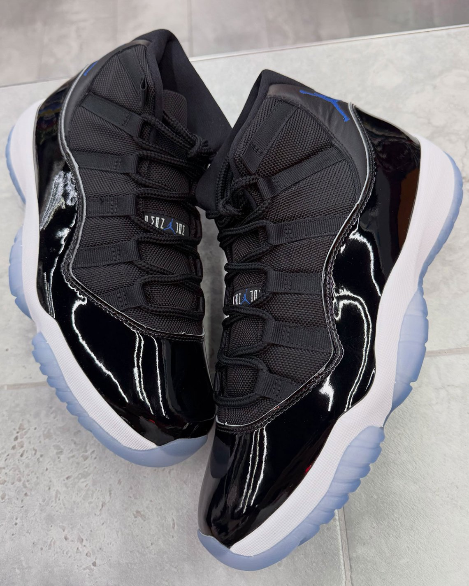
*OG "Space Jam"——黑漆皮、白中底、冰蓝大底，"Jumpman Jam" 鞋舌标。图片：Sneaker News。*

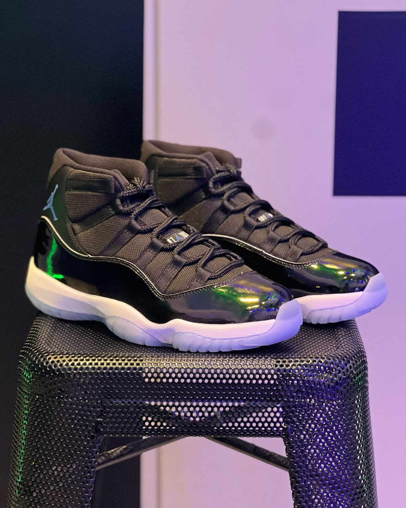
*实物上手——灯光下漆皮泛出绿蓝反光。图片：Sneaker News。*

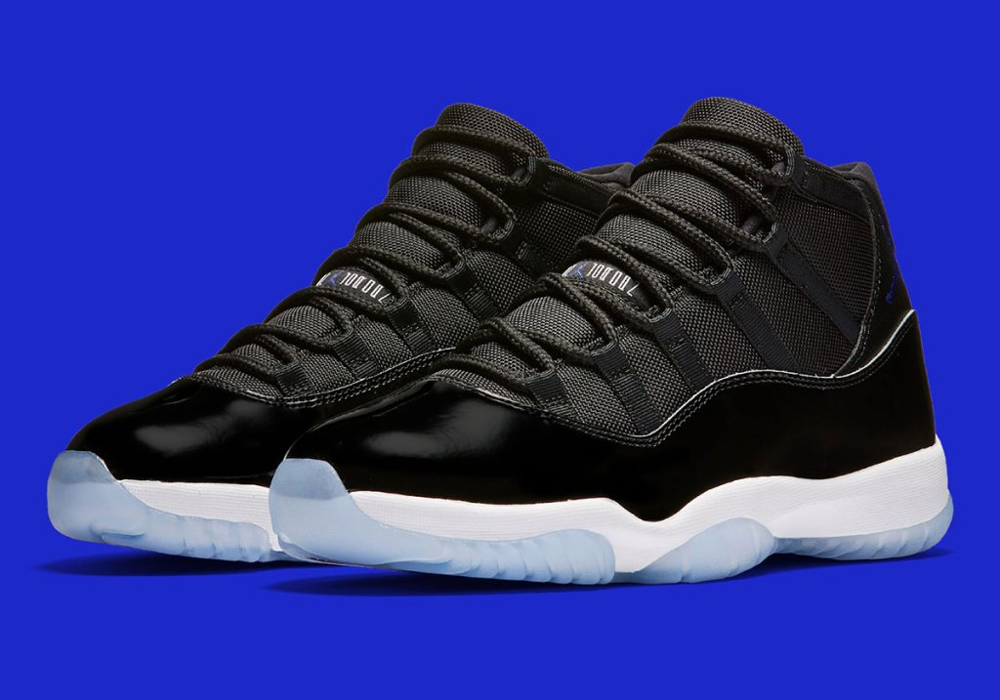
*官方双鞋图——黑网布配漆皮、蓝色 Jumpman、白色中底。图片：Sneaker News。*

Magic Ball 和 Green Screen 我都要。OG Space Jam 这次我 pass——今年 12 月真正想要的 11 代是 Cool Grey，它已经在我的鞋架上了。

## 结论

$180，无折痕，有鉴定，US 12。Cool Grey 是我缺的最后一双 11 代，我以不到全新一半的价格拿到了它。有时候狩猎的结局就是该有的样子。
