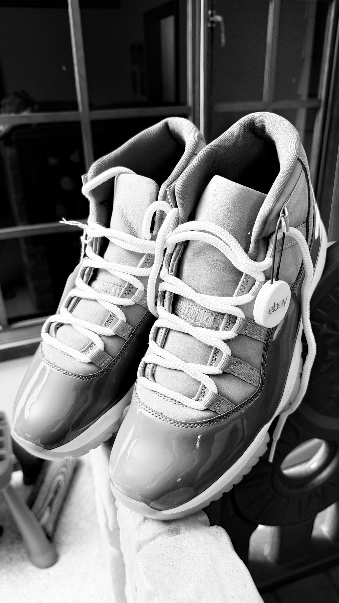
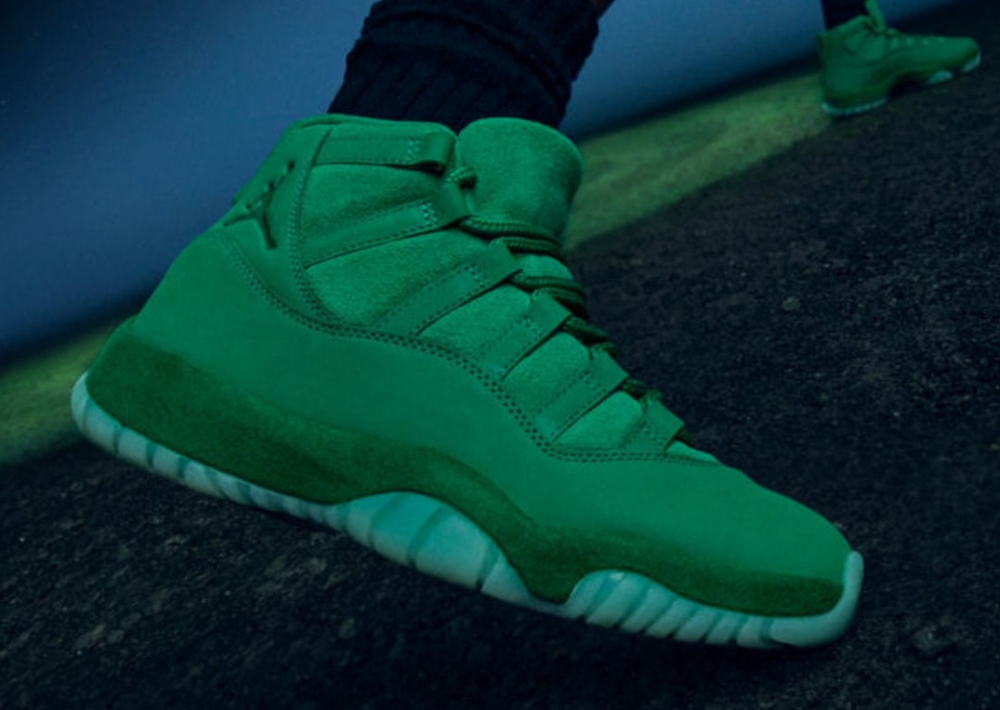

> [中文版 Chinese version](/life/jordan-11-cool-grey-ebay-steal-180-zh/)

*My pair, photographed the night it arrived — the white eBay Authenticity Guarantee tag still on the right shoe. The shot came out black and white, which feels about right: the whole point of this colorway is how quiet the grey is. Photo: mine.*

## The find

I have been hunting lightly used Air Jordan 11s in US 11.5/12 since late October. I already own the DMP, the Win Like 82, and the Legend Blue — the three December 11s that everybody chases. The one I was still missing was the Cool Grey, the best non-OG 11 ever made, and the one that never really comes down in price because people who own it tend to keep it.

This week one came up on eBay: a 2021 retro, US 12, listed as lightly used, $180 all-in. I bought it. It arrived with the Authenticity Guarantee tag still attached, and — the part that matters — no crease on the patent leather.

## Why Cool Grey

The Cool Grey is not an original 1990s colorway, but it might as well be one. It debuted in 2001, came back in 2010, and got its third and best retro on December 11, 2021, at $225 retail (style code CT8012-005). The 2021 pair was remastered to match the taller shape and the higher patent leather cut of the 2001 original — the 2010 version had a lower mudguard, and people noticed.

What makes it special is restraint. The upper is medium grey nubuck and mesh; the patent mudguard is grey, not black; the Jumpman and the "23" are white. It is the rare Jordan 11 that goes with everything and shouts about nothing, which is exactly why it has stayed near the top of every all-time 11 ranking since 2001. Concord is the icon, Bred is the playoff shoe, Cool Grey is the one you actually wear.

## The condition check: no crease

On a used Jordan 11, there is one thing that decides the price more than anything else, and it is the patent leather. The mudguard creases the moment the shoe is worn hard, and unlike mesh or suede, patent shows every line forever. So the checklist for a used pair is short:

- **Patent creasing.** Run your eye along the mudguard in good light. This pair: clean, no crease lines.
- **Outsole yellowing.** The icy translucent sole goes yellow with age and wear. Check it against the white midsole.
- **Insoles and box.** Original insoles with the Jumpman intact, and the two-tone grey box, are the difference between "lightly used" and "someone else's beater."

This pair passed all three. It is not deadstock — it has been worn, lightly — but the patent is uncreased, which is the whole ballgame on an 11. That is the difference between $180 and $250.

## Why I buy 11s on eBay: Authenticity Guarantee

Every sneaker over $100 sold on eBay in the US goes through eBay's Authenticity Guarantee before it reaches the buyer. The seller ships the pair to an authentication facility run with Sneaker Con, where an authenticator does a multi-point physical inspection — color, stitching, glue, patterns, logos, material, laces, accessories, box — and checks the physical pair against the listing's title, description, and photos. If it passes, an NFC-enabled eBay authenticity tag is attached and the pair is forwarded to you. If it fails authentication, or is significantly not as described, you get refunded. There is no extra fee for the buyer; eBay covers it.

I trust it because it has already saved me once. eBay Authenticity previously blocked a purchase of mine because the shoes had a smoke smell the listing never mentioned. That is a check no platform's own "verified" badge would have caught, and it is why I will keep buying used 11s this way: the tag on the shoe in the photo above is not decoration, it is the reason I was willing to pay before seeing the pair in hand.

## The price math

| | |
|---|---|
| **Paid** | $180, eBay, Authenticity Guarantee |
| **Original retail (Dec 11, 2021)** | $225 |
| **New pair, US 12, current market** | ~$400 |
| **Cheapest new pair, US 12 (Nov 5, 2026 check)** | $350 |

$180 is $45 under the 2021 retail price — and 45% of what a new pair in my size goes for right now, less than half. For a cross-check, a November 5, 2026 market check put the cheapest new pair in US 12 at $350, and eBay size-12 used listings (crawled November 8–10) run roughly $150–$260, with a "Lightly Used" pair at $199.95 and a "Pre-owned Excellent" pair at $249.90. One honest caveat: those are listing prices, not sold prices — eBay's sold listings sit behind a login, so there is no confirmed sold range to cite here. But on any reading, a no-crease pair at $180 sits at the cheap end of the used range and at less than half the price of a new one in US 12. That is a steal by any definition I care about.

## Next up: the Space Jam 30th anniversary trio

The Cool Grey is not the end of the 11 hunt — it is the warm-up. Jordan Brand is marking the 30th anniversary of *Space Jam* (1996) with three Air Jordan 11s, and I am buying two of them:

| Pair | Style code | Release | Retail | Notes |
|---|---|---|---|---|
| **"Magic Ball"** (women's) | IZ1800-200 | Wed, Nov 11, 2026 | $235 | Women's exclusive, but extended sizing runs to W14.5 (= M13); my US 12 is a W13.5, in range. SNKRS + select retailers. |
| **"Green Screen"** | IQ5700-900 | Sat, Nov 14, 2026, 10:00 AM ET | $255 | Men's + grade school. SNKRS, Foot Locker. |
| **"Space Jam" OG** | CT8012-900 | Sat, Dec 12, 2026 | $235 | Full family sizing. The shoe MJ wore in the film; fourth public release, stitched 23, "Jumpman Jam" tongue label returns. |

The concept is the film itself, told three ways. The Magic Ball is the glowing basketball the Monstars used to steal NBA talent — an iridescent upper that shifts between green, gold, copper, and bronze. The Green Screen is the green screen suits the actors wore while filming MJ playing against the Monstars — an all-green suede upper, mudguard and collar in fine nubuck, a milky translucent outsole with solid orange, and an insole of MJ's wide-stretched dunk over the Monstars. The OG Space Jam is the shoe itself, back for the first time since 2016.

*The "Green Screen" 11 — all-green suede, orange and milky outsole — landing Saturday, November 14. Image: Sole Retriever.*

I am in for the Magic Ball and the Green Screen. The OG Space Jam I am passing on this time — the December 11 I actually wanted this year was the Cool Grey, and it is already on my shelf.

## Verdict

$180, no crease, authenticated, US 12. The Cool Grey was the one 11 I was missing, and I got it for less than half of new. Sometimes the hunt ends exactly where it should.
