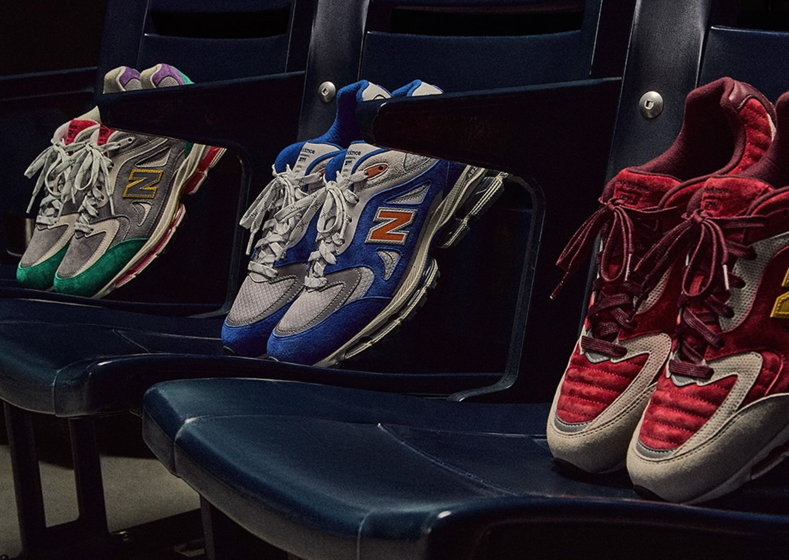
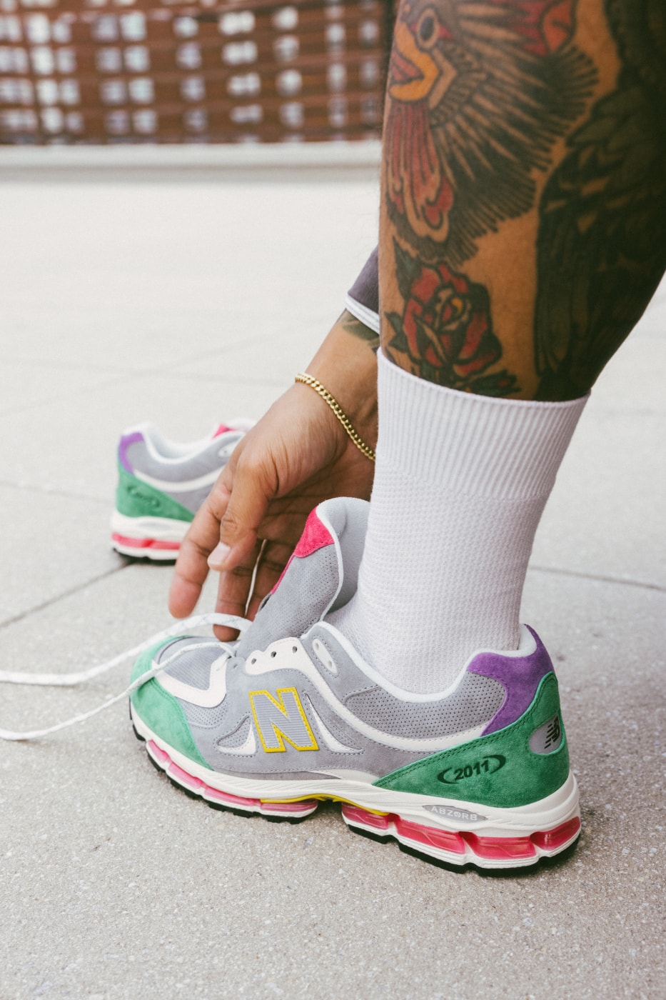
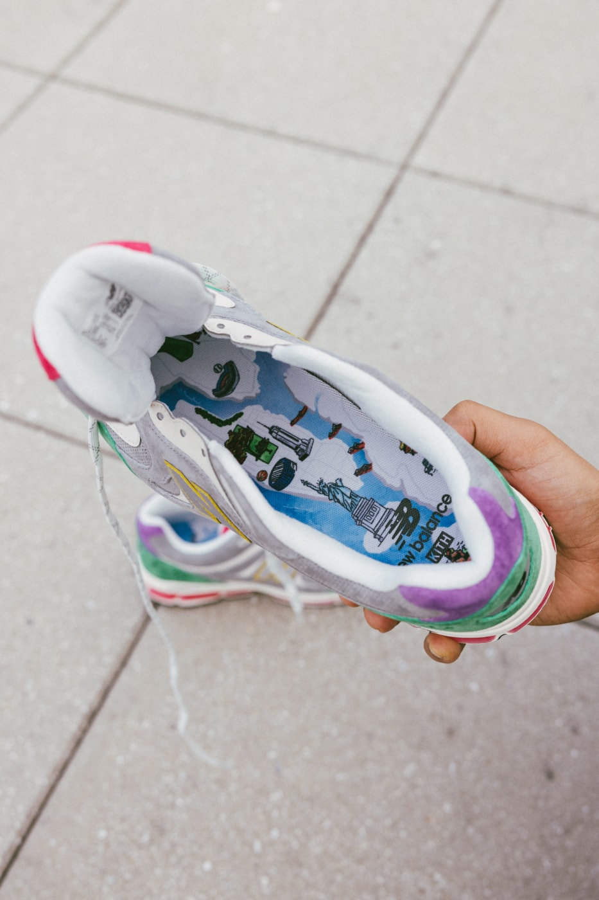
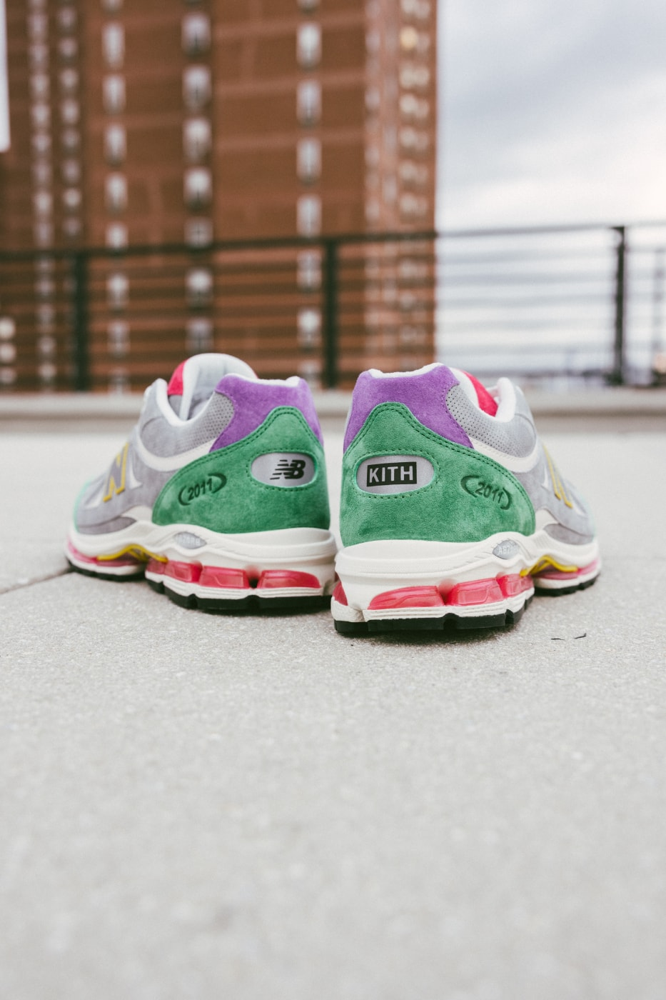
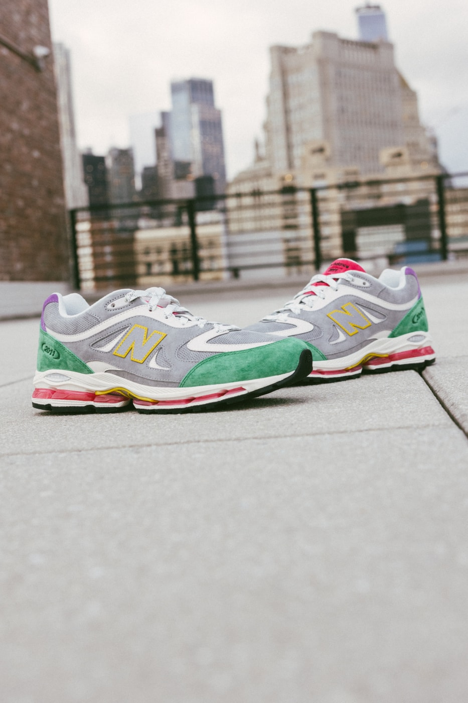
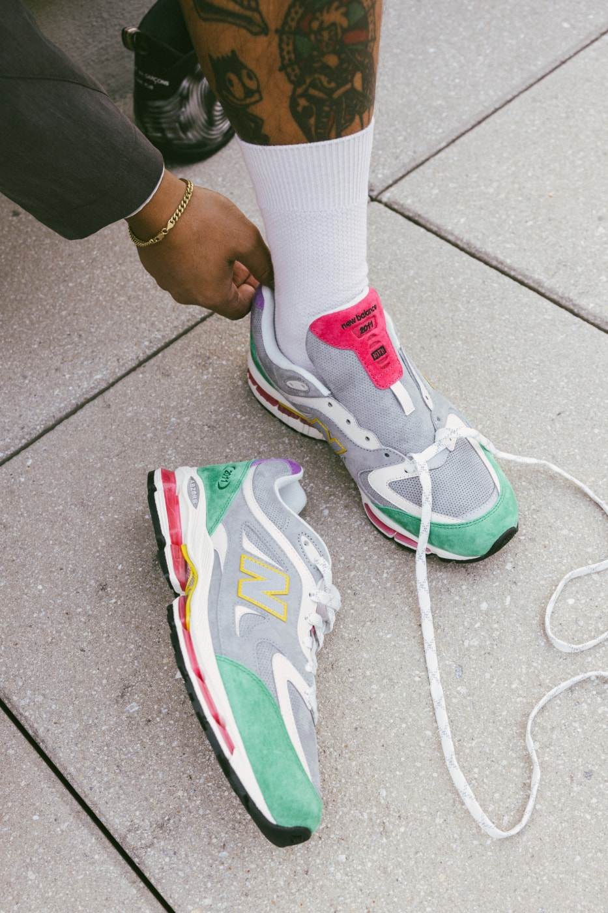

> [English version](/life/kith-new-balance-2011-monuments/)

2026 年 11 月 9 日星期一上午 11 点（美东时间），Kith 上架了 New Balance 2011 的三个新配色。到当天结束，Sole Retriever 上三个配色全部显示售罄。没有补货日期，没有第二波——就是三双鞋、一个早上，没了。

即便以 Kith 的标准，这也是很快的售罄，值得停下来想想为什么。2011 不是一双复刻。它不是 Jordan，不是什么圣杯复刻，也不是球星签名鞋。它是一双全新的鞋型，是一家零售商自己设计的鞋——Ronnie Fieg 与 New Balance 合作以来第一款原创鞋型——而 Monuments 系列只是它的第二章。第一章是六月的 15 周年发售，卖光了。第二章一天售罄。这里起作用的不只是稀缺：这三双鞋讲的故事，是纽约人、以及很多从没在纽约住过的人，都已经烂熟于心的故事。

先说一句实话：这不是一篇上脚评测。鞋今天早上才发售，还没有任何一家独立媒体对市售版做过有意义的长期实测。下面是一篇长篇初看：事实、设计、每个配色背后的历史，以及这次售罄意味着什么、不意味着什么——能核实的说法和不能核实的说法会分开写。

*Monuments 全家福，摄于球场座椅：Garden（左）、Banner（中）、Park（右）。广告片把每双鞋拍在它所致敬的地方——秋天的落叶、球场座椅、花坛。图片：Kith 官方广告图，经 Sole Retriever。*

## 事实

| | |
|---|---|
| **鞋款** | Kith x New Balance 2011“Monuments”系列 |
| **配色** | Park（Maroon/Atomic Yellow）、Banner（Princess Blue/Silver Metallic）、Garden（Amazon/Royal Lilac） |
| **货号** | Park U2011700 · Banner U201121Y · Garden U20114VF |
| **发售日期** | 2026 年 11 月 9 日星期一，美东时间上午 11:00，Kith.com 与 Kith App；当天门店同步发售 |
| **发售价** | $200（Sole Retriever 与 Footwear News 报道；Kith 自己的系列页面没有标价） |
| **渠道** | Park 与 Banner 在所有 Kith 门店发售；Garden 仅在西好莱坞的 New Balance at Kith 门店有售；三个配色均可在 Kith.com 与 Kith App 购买 |
| **尺码** | 男女同款 |
| **发售状态** | 发售当天 Sole Retriever 上三个配色全部显示售罄（2026 年 11 月 9 日 snapshot） |

发售机制是纯正的 Kith 套路。App 抽签 11 月 6 日星期五下午 1 点（美东时间）开启、周日晚上 11:59 截止；Voyage 忠诚会员与受邀顾客在发售日下午 1 点提前入场，然后才是上午 11 点的公开线上发售。抽签先行、会员其次、公开最后——这个漏斗很熟悉，而这一次漏斗空得很快。

## 这双鞋本身：一家零售商的第一款原创鞋型

要理解 Monuments 系列为什么重要，得先理解 2011 是什么。Kith 创立于 2011 年，鞋名指的就是那一年——也是这家店与 New Balance 长期合作的起点。今年六月，为庆祝 15 周年，New Balance 给了 Fieg 一件它从未给过任何零售商的东西：从零开始设计一款原创鞋型的自由，历时两年，与 New Balance 设计师 Sam Pearce 共同开发。

Fieg 这些年重做过三十多款 New Balance 档案鞋型——990v2、v3、v4、v6，991v2、992、993 等等。2011 和它们都不一样，因为它从一张白纸开始：一款全新的多片式鞋面，从零搭建，踩在借自元祖 New Balance 2002 的 ABZORB 中底上。Fieg 把这个项目形容为他与 New Balance 关系的寓言——始于 2011 年的一颗种子。六月的首发是四个以自然为灵感的配色——Leaf 与 Sakura Flower 大范围发售，Bark 与 Redwood 为西好莱坞限定——同样 $200，配定制印花鞋垫、三副备用鞋带和 15 周年特别包装。卖光了。

Monuments 系列保留了鞋身结构，换了故事。同样的多片式鞋面，同样的源自 2002 的 ABZORB 缓震，同样的 $200。新的是城市来讲故事：三个配色、三处纽约地标，广告片把每双鞋拍在它所唤起的地方。值得注意的是，Kith 自己的文案其实从没有点名是哪几处地标——照片在做这份工作，用球鞋网站 Because Sneakers 的话说：一双陷在秋天落叶堆里，一双排在球场座椅上、下面散着票根，一双站在花坛里。这种克制是故意的。Fieg 让鞋、让城市自己开口。

## Park：十二年的回响

最出彩的一双是 Park，也是承载历史最重的一双。它是 2014 年 Ronnie Fieg for New Balance 530——“Central Park”530，货号 M530KH——的演进版，直接把那双鞋的标志性细节搬了过来：鞋面与鞋领上带绗缝的罗纹衬垫，缝线排布让光线以不同于周围平整麂皮的角度反射。

配色是酒红与原子黄，搭米白：高级猪皮麂皮，配微穿孔牛巴革面板。N 字标志以原子黄勾边；后跟整片压印 2011 图案；鞋带带银色闪粉。纸面上看，2026 年做这件事很奇怪：在一款才五个月大的鞋型上，复活一个十二年前的设计细节。但实际效果是这个系列里最 Kith 的一招——一个只有跟了 Fieg 的 New Balance 十年的人才懂的回响，是给这些人的奖励。

灵感是秋天的中央公园，广告照片——一双鞋半埋在落叶里——做的正是 2014 年那双鞋做过的事：把一次公园散步变成一个配色。酒红是秋叶，米白是透过树叶的光。这是系列里最暖的一双，而且耐人寻味的是，每家媒体开篇用的都是它。

## Banner：蓝色、橙色与花园球馆

中间那双是 Banner——Sole Retriever 的产品页上叫它“Arena”（U201121Y），但“Banner”是 Kith 自己的名字，而名字就是线索。公主蓝配银色与橙色点缀，透气网面鞋面搭猪皮麂皮覆层，橙色 N 字标志：这是纽约尼克斯的颜色，也是麦迪逊广场花园的颜色——那座球馆穹顶下悬挂着冠军旗帜。Kith 的文案只说它“植根于纽约传统”，剩下的不用明说。

时间点不是巧合。Kith Night——这家店一年一度在花园球馆的活动——就在发售第二天，11 月 10 日星期二，尼克斯主场迎战芝加哥公牛。Fieg 在预热期间已经穿着一双尼克斯配色的 2011 坐在场边，那是另外一双、Sneaker Bar Detroit 报道称尚无发售日期的鞋。Banner 是那个时刻的市售版：你真正能买到的那双，在比赛前一个早上。

这里有一个值得纠正的小事实，因为有两家媒体写错了。Sole Retriever 的文章说这双鞋致敬“世界冠军纽约尼克斯”，Sneaker Bar Detroit 则提到“他们最近的 NBA 总冠军”。尼克斯上一次拿 NBA 总冠军是 1973 年。Banner 是对球队和球馆的致意，不是对最近一次夺冠的致意——而名字本身，唤起的是悬挂在球馆椽子上的旗帜，这才是诚实的版本。这双鞋不需要那种夸张。

## Garden：野牌

第三双是 Garden，也是三双里最古怪的一双——可能也正因如此最有意思。Kith 说它的灵感是“花卉花园”：浅灰打底，配亚马逊绿、淡紫、原子黄与品红点缀，微穿孔猪皮麂皮鞋面，配实色麂皮覆层与皮革嵌件，反光 N 字标志在夜里会发光。Sole Retriever 把灵感源头指向布朗克斯的纽约植物园，并提到这个配色也呼应了 Fieg 在 Kith 自己的《Footwear Archive》书里看到的一双老款 New Balance 530 样品鞋。

它也是 Kith 刻意做得最难买的一双：Garden 是西好莱坞 New Balance at Kith 门店的独占款，是三个配色里唯一不在所有 Kith 门店上架的。这是熟悉的 Kith 套路——六月首发对 Bark 与 Redwood 也是这么做的——而且地理上是故意的：花卉配色住在洛杉矶这座花园之城，另外两双留在纽约。

*Garden 配色上脚：灰色微穿孔麂皮、亚马逊绿覆层、淡紫后跟，粉色 ABZORB 中底。图片：Kith 官方广告图，经 Hypebeast。*

## 真正起作用的细节

三个配色共享的细节，讲的故事比撞色更多。每双鞋的后跟药片上都是不对称的 Kith 与 New Balance 联名标志——一边一个 logo，而不是左右对称——一旦注意到，这个小小的不对称就成了一个签名。“2011”字样压印在外侧后跟。鞋盒印着纽约市地图与地标插画，鞋垫重复了同样的图案，每双鞋附赠两副备用鞋带。

*最能说明概念的细节：定制鞋垫上印着纽约市地图——自由女神像、帝国大厦与天际线，印着 New Balance 与 Kith 的联名标志。鞋盒是同样的图案。图片：Kith 官方广告图，经 Hypebeast。*

*不对称的后跟药片：一边是 NB 标志，一边是 KITH，左右两侧都有压印的 2011 字样，下方是粉色 ABZORB 缓震。图片：Kith 官方广告图，经 Hypebeast。*

材质是另一半论据。Park 是猪皮麂皮与微穿孔牛巴革；Garden 是猪皮麂皮、麂皮与皮革；Banner 是网面与猪皮麂皮。同一只鞋楦上三种不同的材质故事，而这正是 2011 设计之初就允许的事：鞋面是分层多片式结构，每个配色都可以在不改变鞋身的前提下玩质感与表面处理。Hypebeast 的报道说得很直白——“材质在挑大梁”——没错。这是一个需要上手摸、而不只是看的系列。

*Garden 配色在纽约屋顶上，身后是天际线。广告片就拍在鞋所讲述的那座城市里。图片：Kith 官方广告图，经 Hypebeast。*

## 这次售罄意味着什么、不意味着什么

关于这次售罄，有三件事要分清。第一，分销从一开始就是窄的：Kith 门店、Kith.com 与 Kith App，其中一个配色只在一家门店有售。一家零售商渠道内的售罄，和全球大范围发售的售罄不是一回事——集中的发售本来就容易售罄。第二，“售罄”状态来自 Sole Retriever 的产品页，追踪的是零售可得性；这是发售日（2026 年 11 月 9 日）的 snapshot，Kith 没有宣布是否会有尺码回归。第三，也是最重要的，2011 是 Kith 设计、只由 Kith 销售的鞋型——没有更广泛的 New Balance 大货发售可以兜底。错过了，二级市场就是唯一的路，而那个市场对 Kith 独占款的定价向来不客气。

话虽如此，这次售罄是真实需求，不是人为稀缺。六月首发同样 $200、同样卖光。Monuments 系列在发售日前三天就有了 Hypebeast、Sole Retriever、Sneaker Bar Detroit 与 Kith 自己渠道的报道，抽签在发售前一晚截止。而且鞋本身确实好看——尤其是 Park，那种罕见的回响：给一个十二年前的细节找了一个更好的鞋型安放。

有用的对照是三天前那一次。11 月 6 日星期五，New Balance 自家的 Made in USA 990v7 以同样的 $200 发售，一天内在官网售罄，近 3 万人排进虚拟队列。New Balance 四天内有了两次 $200 的售罄——一次是主线旗舰，一次是精品独占——而两者讲的是同一个品牌的不同故事。990v7 是 New Balance 把传承卖给所有人。2011 是 New Balance 让别人写一个新章节，卖给在乎作者的人。两次都成功了。

## 谁该买，谁该再想想

**该买，如果：**你错过了六月首发、想要 2011——这是这个鞋型的第二章，讲故事的水平比第一章更锋利。该买，如果 Park 打动了你；它是 Kith 血统最深的一双，十二年的回响不是常有的事。该买，如果你把 Fieg 的 New Balance 作品当作一个系列来收藏，因为 Monuments 系列是这个系列里最自觉“纽约”的一章，而包装本身——地图鞋盒、鞋垫——就是那种放在架子上会越放越有味道的东西。

**再想想，如果：**你纯粹为了转卖。$200 的发售价对于一款没有编号限量的非限量鞋型来说已经是溢价，Kith 独占款的转卖溢价真实存在，但波动很大——看配色、看尺码、看你愿意拿多久。再想想，如果你想要 Garden 而你不在洛杉矶；西好莱坞独占就是重点，二级市场也知道这一点。再想想，如果你从没穿过 2011：ABZORB 中底借自 2002，是一套有二十四年历史的缓震系统，经过验证、穿着舒服，但不是 New Balance 最软、最现代的泡棉。三天前同价发售的 990v7 是更软的那双。2011 是故事更好的那双。

**尺码方面：**这个系列没有发布针对 2011 的具体尺码建议，这个鞋型也没有长期实测报告。六月首发的报道普遍说尺码正常，把它当作起点，而不是保证——如果可以，先试穿，尤其是卡在两个尺码之间的时候。

*俯视上脚：联名鞋舌、穿孔鞋面与带银色闪粉的鞋带。图片：Kith 官方广告图，经 Hypebeast。*

## 结论：城市本身就是联名

Monuments 系列成立，是因为它理解 Kith 联名是用来做什么的。Fieg 没有借用别的品牌的符号；他告诉你他来自哪里，用三双鞋，赌这些参照——秋天的公园、比赛夜的球馆、布朗克斯的花园——具体到有意义，又普遍到能走出去。2011 本身已经是一个宣言：一家零售商设计自己的鞋型，而不是给别人的鞋换个颜色。Monuments 系列证明这个宣言有续集——至少，有一个值得读的第二章。

悬而未决的是每个 Kith 发售之后都会有的问题：2011 会成为一个系列，还是只是一件纪念品。六月首发与 Monuments 系列是五个月内的两次发售，都卖光了，都是 $200，都只在 Kith。如果 Fieg 保持这个节奏与讲故事的水平，2011 就不再是猎奇，而开始成为一个系列——一款因为一家零售商想要它存在而存在的 New Balance 鞋型。如果下一章弱了，Monuments 系列就成了高水位线。不管怎样，周一售罄的那三双是值得记住的：Kith 把它的城市穿在鞋上，一共三次，而城市在午饭之前就把它买了回去。

**事实汇总，截至 2026 年 11 月 9 日：**2026 年 11 月 9 日星期一上午 11:00（美东时间）发售，Kith.com、Kith App 与 Kith 门店（Park 与 Banner 在所有门店；Garden 仅在西好莱坞 New Balance at Kith 门店有售）；$200（Sole Retriever 与 Footwear News 报道；Kith 自己的页面没有标价）；货号 Park U2011700、Banner U201121Y、Garden U20114VF；男女同款尺码；发售当天 Sole Retriever 上三个配色全部显示售罄。价格与库存为 2026 年 11 月 9 日的 snapshot，subject to change。这不是一篇上脚评测：鞋于 11 月 9 日发售，尚无针对市售版的独立长期实测。还有第四个亲友限定配色，自由女神像青绿色，不会市售（Sole Retriever）。

**来源：**[Kith——Kith & New Balance Monuments Collection（官方）](https://kith.com/blogs/discover/kith-new-balance-monuments-collection) · [Hypebeast——Kith x New Balance 2011“Monuments” Collection Release Info](https://hypebeast.com/2026/11/kith-new-balance-2011-monuments-collection-release-info) · [Sole Retriever——Kith is Celebrating the Five Boroughs with the New Balance 2011 Monument Pack](https://www.soleretriever.com/news/articles/kith-new-balance-2011-monument-pack-release-date-november-2026) · [Sole Retriever——New Balance 2011 Kith Monument Park（产品页）](https://www.soleretriever.com/sneaker-release-dates/new-balance/2011/new-balance-2011-kith-monument-pack-park) · [Sole Retriever——New Balance 2011 Kith Monument Garden（产品页）](https://www.soleretriever.com/sneaker-release-dates/new-balance/2011/new-balance-2011-kith-monument-pack-garden) · [Sole Retriever——New Balance 2011 Kith Monument Arena（产品页）](https://www.soleretriever.com/sneaker-release-dates/new-balance/2011/new-balance-2011-kith-monument-pack-banner) · [Because Sneakers——Kith’s 2011 Park Brings Back the Quilted Vamp From a 2014 New Balance 530](https://becausesneakers.com/kith-new-balance-2011-park-monuments/) · [Sneaker Bar Detroit——KITH New Balance 2011“Monuments” Collection](https://sneakerbardetroit.com/kith-new-balance-2011-knicks/) · [Hypebae——New Balance and Kith Launch New 2011 Sneaker（2026 年 6 月）](https://hypebae.com/2026/6/new-balance-kith-2011-sneaker-anniversary-collab-redwood-bark-release-date-where-to-buy) · [DraftKings Network——Kith x New Balance 2011: Release Date, Price, Details（2026 年 6 月）](https://dknetwork.draftkings.com/2026/06/26/kith-new-balance-2011-release-date/)
