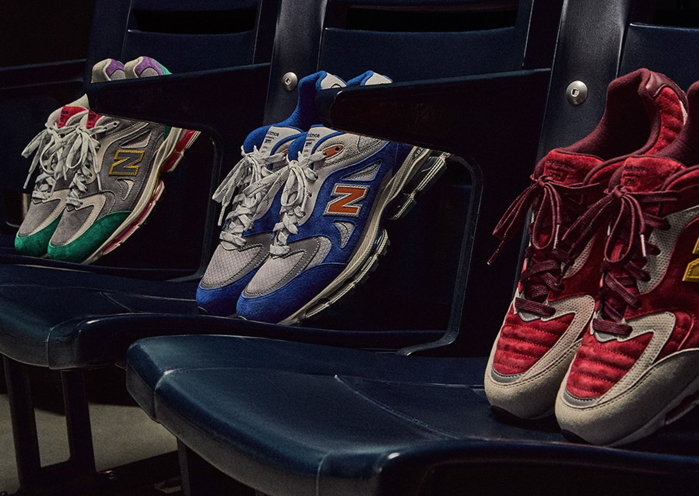
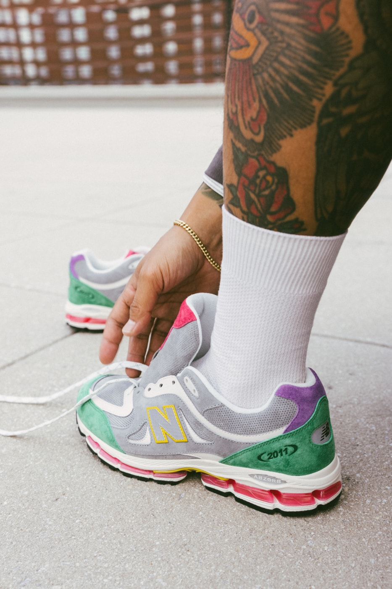
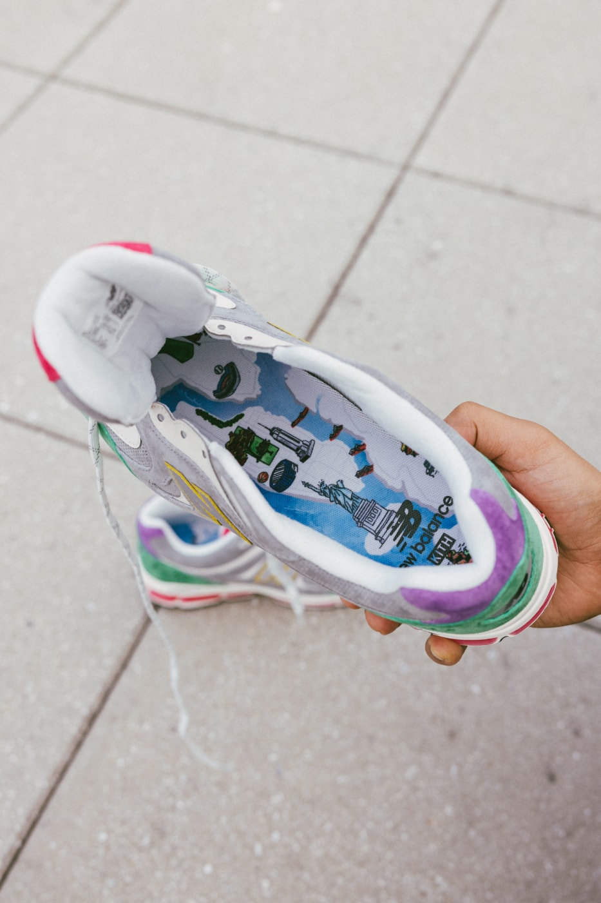
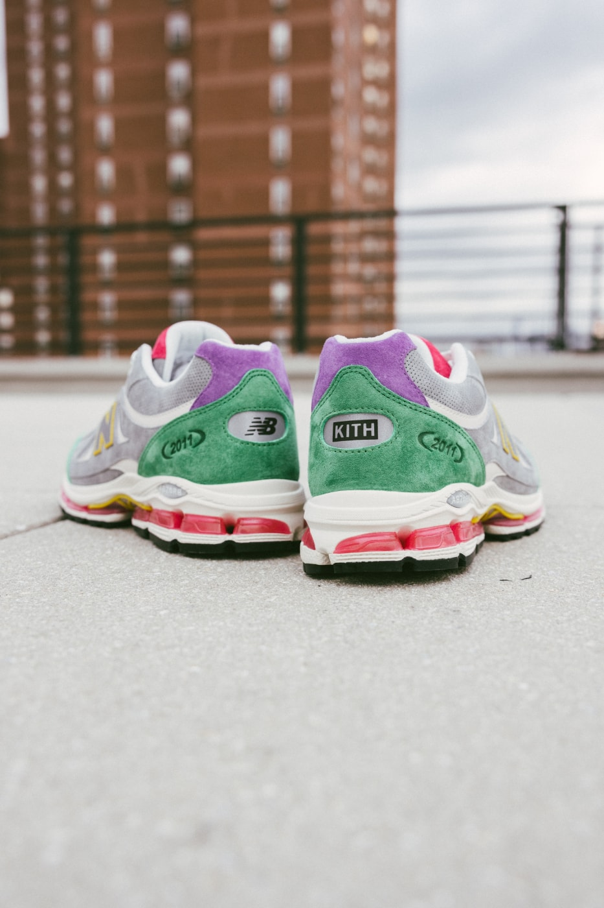
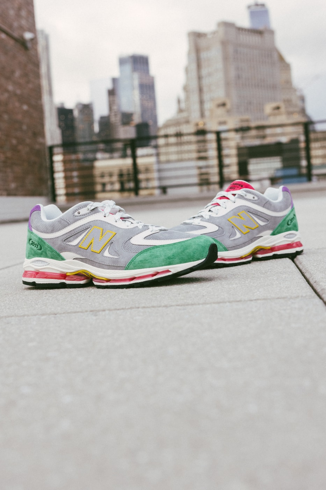
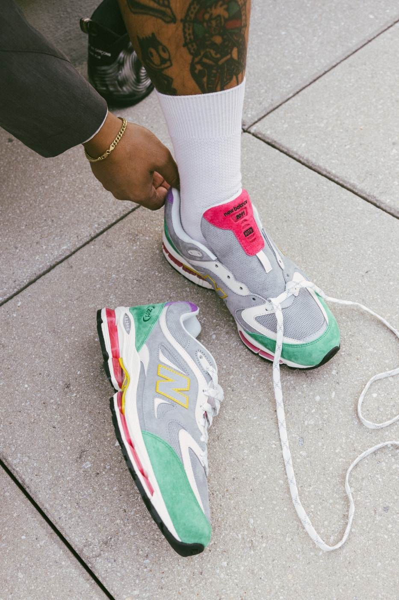

> [中文版 Chinese version](/life/kith-new-balance-2011-monuments-zh/)

At 11 a.m. Eastern on Monday, November 9, 2026, Kith put three new colorways of the New Balance 2011 on sale. By the end of the day, Sole Retriever listed all three as sold out. No restock date, no second wave announced — just three pairs, one morning, gone.

That is a fast sellout even by Kith standards, and it is worth pausing on why. The 2011 is not a retro. It is not a Jordan, not a grail reissue, not a celebrity signature. It is a brand-new silhouette that a retailer designed — the first original shoe Ronnie Fieg has ever built with New Balance — and the Monuments pack is only its second act. The first act, the 15th-anniversary launch in June, sold through too. The second act sold out in a day. Something is working here, and it is not scarcity alone: the shoes tell a story that New Yorkers, and plenty of people who have never lived there, already know by heart.

One honest note up front: this is not a wear-test review. The shoes went on sale this morning, and no independent publication has put meaningful miles on a retail pair yet. What follows is a long first look: the facts, the design, the history behind each colorway, and what the sellout does and doesn’t mean — with the claims that can be checked separated from the ones that cannot.

*The full Monuments pack, shot on arena seats: Garden (left), Banner (center) and Park (right). The campaign photographs the shoes in the places they salute — autumn leaves, arena seats, a flower bed. Image: Kith campaign imagery, via Sole Retriever.*

## The facts

| | |
|---|---|
| **Model** | Kith x New Balance 2011 “Monuments” Collection |
| **Colorways** | Park (Maroon/Atomic Yellow), Banner (Princess Blue/Silver Metallic), Garden (Amazon/Royal Lilac) |
| **Style codes** | Park U2011700 · Banner U201121Y · Garden U20114VF |
| **Release date** | Monday, November 9, 2026, 11:00 a.m. ET on Kith.com and the Kith App; in stores the same day |
| **Retail price** | $200 (reported by Sole Retriever and Footwear News; Kith’s own collection page does not list a price) |
| **Where** | Park and Banner at all Kith stores; Garden in-store exclusive to New Balance at Kith, West Hollywood; all three online at Kith.com and the Kith App |
| **Sizing** | Unisex |
| **Launch status** | All three colorways listed sold out on Sole Retriever on launch day (snapshot, November 9, 2026) |

The mechanics of the drop were pure Kith. App drawings opened Friday, November 6 at 1 p.m. ET and closed Sunday at 11:59 p.m.; Voyage loyalty members and select customers got early access at 1 p.m. on launch day, ahead of the 11 a.m. ET general online release. It is a familiar funnel — raffle first, loyalty second, open sale last — and on this occasion the funnel emptied fast.

## The shoe itself: a retailer’s first original silhouette

To understand why the Monuments pack matters, you have to understand what the 2011 is. Kith was founded in 2011, and the shoe’s name points at that year — and at the beginning of the boutique’s long partnership with New Balance. For its fifteenth anniversary this June, New Balance gave Fieg something it had never given a retailer before: free rein to design an original model from scratch, developed over two years alongside New Balance designer Sam Pearce.

Fieg has reworked more than thirty New Balance archive models over the years — the 990v2, v3, v4 and v6, the 991v2, 992, 993 and more. The 2011 is different from all of them because it starts from nothing: a brand-new, multi-panel upper built from the ground up, set on the ABZORB midsole tooling borrowed from the original New Balance 2002. Fieg has described the project as an allegory for his relationship with New Balance, one that began with a single seed in 2011. The June launch came in four nature-inspired colorways — Leaf and Sakura Flower widely, Bark and Redwood as West Hollywood exclusives — at the same $200 price, with custom-printed footbeds, three extra lace options and special anniversary packaging. It sold through.

The Monuments pack keeps the architecture and changes the story. Same multi-panel upper, same 2002-derived ABZORB cushioning, same $200. What is new is that the city does the storytelling: three colorways, three New York landmarks, and a campaign that photographs each pair in the place it is supposed to evoke. Notably, Kith’s own copy never actually names the monuments — the photographs do that work, as the sneaker site Because Sneakers pointed out: one pair in a drift of autumn leaves, one lined up on arena seats with ticket stubs underneath, one in a flower bed. The restraint is deliberate. Fieg is letting the shoes, and the city, speak.

## Park: the twelve-year callback

The standout pair is Park, and it is the one carrying the most history. It is an evolution of the Ronnie Fieg for New Balance 530 released in 2014 — the “Central Park” 530, style code M530KH — and it lifts that shoe’s signature detail straight across: the quilted, ribbed vamp panel, repeated on the collar, stitched so the rows catch light at a different angle than the flat suede around them.

The palette is maroon and atomic yellow on off-white, in premium pigskin suede with microperforated nubuck panels. The N logo is outlined in atomic yellow; a full-bleed debossed 2011 graphic covers the heel; the laces are flecked with silver. It is, on paper, a strange thing to do in 2026: revive a twelve-year-old design detail on a five-month-old silhouette. In practice it is the most Kith move in the pack — a callback that only makes sense if you have been following Fieg’s New Balance work for a decade, and a reward for the people who have.

Central Park in autumn is the reference, and the campaign photograph — the pair half-buried in fallen leaves — is doing exactly what the 2014 shoe did: turning a walk through the park into a colorway. The maroon is the foliage; the off-white is the light through it. It is the warmest pair in the pack, and, tellingly, the one every outlet led with.

## Banner: blue, orange, and the Garden

The middle pair is Banner — listed as “Arena” on Sole Retriever’s product pages (U201121Y), but “Banner” is Kith’s own name for it, and the name is the tell. Princess blue with silver and orange accents, on a breathable mesh vamp with pigskin suede overlays and an orange N logo: the colors of the New York Knicks, and of Madison Square Garden, the arena whose championship banners hang above the court. Kith’s copy calls it “rooted in New York heritage,” and leaves it there; the rest is understood.

The timing is not an accident. Kith Night — the retailer’s annual event at the Garden — falls the day after this release, on Tuesday, November 10, when the Knicks host the Chicago Bulls. Fieg has already been wearing a Knicks-colored 2011 courtside in the run-up, a separate pair that Sneaker Bar Detroit reports has no release date yet. The Banner is the retail version of that moment: the one you could actually buy, the morning before the game.

There is a small fact-check worth making here, because two outlets got it wrong. Sole Retriever’s article describes the pair as celebrating “the world champion New York Knicks,” and Sneaker Bar Detroit refers to “their recent NBA championship.” The Knicks’ last NBA title was in 1973. The Banner is a nod to the franchise and the arena, not to a recent championship — and the name itself, evoking the banners in the rafters, is the honest version of the story. The shoe does not need the exaggeration.

## Garden: the wild card

The third pair is Garden, and it is the strangest of the three — which is probably why it is the most interesting. Kith describes it as “inspired by floral gardens”: light grey with amazon green, lilac, atomic yellow and fuchsia accents, a microperforated pigskin suede vamp with solid suede overlays and leather inserts, and reflective N logos that catch light after dark. Sole Retriever traces the reference to the New York Botanical Garden in the Bronx, and notes that the colorway also echoes an old New Balance 530 sample Fieg spotted in Kith’s own Footwear Archive book.

It is also the pair Kith chose to make hardest to get: Garden is the in-store exclusive at New Balance at Kith in West Hollywood, the only colorway of the three not stocked at every Kith store. That is a familiar Kith pattern — the June launch did the same thing with Bark and Redwood — and it is a deliberate piece of geography: the floral pair lives in Los Angeles, the city of gardens, while the other two stay in New York.

*The Garden colorway on foot: grey microperforated suede, amazon green overlays, a lilac heel and the ABZORB midsole in pink. Image: Kith campaign imagery, via Hypebeast.*

## The details that do the work

Across all three colorways, the shared details are doing more storytelling than the color blocking. Every pair carries asymmetrical Kith and New Balance co-branding on the heel pills — one logo per side, rather than matched — a small, deliberate asymmetry that reads as a signature once you notice it. The “2011” mark is debossed at the lateral heel. The box is printed with an illustrated map of New York City and its monuments, the sockliner repeats that artwork, and each pair ships with two additional lace options.

*The detail that sells the concept: a custom sockliner printed with a map of New York City — the Statue of Liberty, the Empire State Building and the skyline, under the co-branded New Balance and Kith marks. The box carries the same artwork. Image: Kith campaign imagery, via Hypebeast.*

*The asymmetrical heel pills: the NB logo on one heel, KITH on the other, with the debossed 2011 mark on both sides and the pink ABZORB cushioning visible below. Image: Kith campaign imagery, via Hypebeast.*

The materials are the other half of the argument. Park is pigskin suede and microperforated nubuck; Garden is pigskin suede, suede and leather; Banner is mesh and pigskin suede. Three different material stories on one last, which is exactly what the 2011 was designed to allow: the upper is a layered, multi-piece pattern, so each colorway can play with texture and finish without changing the shoe underneath. Hypebeast’s write-up put it plainly — “the materials do the heavy lifting” — and it is right. This is a pack that rewards handling the shoes, not just looking at them.

*The Garden pair on a New York rooftop, skyline behind it. The campaign was shot in the city the shoes are about. Image: Kith campaign imagery, via Hypebeast.*

## What the sellout does and doesn’t mean

Three things to keep straight about the sellout. First, the distribution was narrow by design: Kith stores, Kith.com and the Kith App, with one colorway confined to a single store. A sellout through one retailer’s channels is not the same as a sellout through a global general release — it is a concentrated drop, and concentrated drops sell out. Second, the “sold out” status comes from Sole Retriever’s product pages, which track retail availability; it is a snapshot from launch day, November 9, 2026, and Kith has not announced whether any sizes will return. Third, and most importantly, the 2011 is a Kith-designed silhouette that only Kith sells — there is no wider New Balance general release to fall back on. If you missed it, the secondary market is the only route, and that market prices Kith exclusivity accordingly.

That said, the sellout is real demand, not manufactured scarcity. The June launch sold through at the same price. The Monuments pack had three days of coverage from Hypebeast, Sole Retriever, Sneaker Bar Detroit and Kith’s own channels before release day, plus a raffle that closed the night before. And the shoes themselves are genuinely good-looking objects — the Park especially, which is the rare callback that improves on its source material by giving a twelve-year-old detail a better silhouette to live on.

The useful comparison is the one from three days ago. On Friday, November 6, New Balance’s own Made in USA 990v7 launched at the same $200 and sold out on newbalance.com within a day, with nearly 30,000 people in a virtual queue. New Balance has now had two $200 sellouts in four days — one a mainline flagship, one a boutique exclusive — and the two tell different stories about the same brand. The 990v7 is New Balance selling heritage to everyone. The 2011 is New Balance letting someone else write a new chapter, and selling it to the people who care about the author. Both worked.

## Who should buy it — and who should pass

**Buy it if:** you missed the June launch and want the 2011 — this is the silhouette’s second chapter, and the storytelling is sharper than the first. Buy it if the Park speaks to you; it is the pair with the deepest Kith lineage, and twelve-year callbacks do not come around often. Buy it if you collect Fieg’s New Balance work as a series, because the Monuments pack is the most self-consciously “New York” entry in that series, and the packaging alone — the map box, the sockliner — is the kind of thing that ages well on a shelf.

**Think twice if:** you are buying purely to flip. The $200 retail is already a premium for a non-limited silhouette with no numbered allocation, and the resale premium on Kith exclusives is real but volatile — it depends on which colorway, which size, and how long you are willing to hold. Think twice if you wanted Garden and you are not in Los Angeles; the West Hollywood exclusivity was the whole point, and the secondary market knows it. And think twice if you have never worn a 2011: the ABZORB tooling is borrowed from the 2002, a twenty-four-year-old cushioning system, and while it is a proven, comfortable ride, it is not the softest or most modern foam New Balance makes. The 990v7, launched three days earlier at the same price, is the softer shoe. The 2011 is the better story.

**On sizing:** no 2011-specific fit guidance has been published for this pack, and there are no long-term wear reports on the silhouette yet. The June launch was reported as true to size in most coverage; treat that as a starting point, not a guarantee — try a pair on if you can, especially if you are between sizes.

*Top-down on foot: the co-branded tongue, the perforated vamp and the silver-flecked laces. Image: Kith campaign imagery, via Hypebeast.*

## Verdict: the city is the collaboration

The Monuments pack works because it understands what a Kith collaboration is for. Fieg is not borrowing another brand’s iconography; he is telling you where he is from, in three pairs of shoes, and trusting that the references — a park in autumn, an arena on game night, a garden in the Bronx — are specific enough to mean something and universal enough to travel. The 2011 was already a statement: a retailer designing its own silhouette, rather than recoloring someone else’s. The Monuments pack is the proof that the statement has legs — or at least, that it has a second chapter worth reading.

What is unresolved is the same question that follows every Kith drop: whether the 2011 becomes a line or remains a souvenir. The June launch and the Monuments pack are two releases in five months, both sold through, both at $200, both Kith-only. If Fieg keeps the cadence and the storytelling at this level, the 2011 stops being a curiosity and starts being a franchise — a New Balance model that exists because a retailer willed it into being. If the next chapter is a weaker one, the Monuments pack becomes the high-water mark instead. Either way, the three pairs that sold out on Monday are the ones to remember: the day Kith put its city on a shoe, three times over, and the city bought it back before lunch.

**The facts, as of November 9, 2026:** released Monday, November 9, 2026, 11:00 a.m. ET, at Kith.com, the Kith App and Kith stores (Park and Banner at all stores; Garden in-store exclusive to New Balance at Kith, West Hollywood); $200 (reported by Sole Retriever and Footwear News; Kith’s own page does not list a price); style codes Park U2011700, Banner U201121Y, Garden U20114VF; unisex sizing; all three colorways listed sold out on Sole Retriever on launch day. Prices and availability are a snapshot from November 9, 2026 and are subject to change. This is not a wear-test review: the shoes went on sale November 9 and no independent long-term wear test of a retail pair exists yet. A fourth, friends-and-family colorway in Statue of Liberty teal exists but will not be sold at retail (Sole Retriever).

**Sources:** [Kith — Kith & New Balance Monuments Collection (official)](https://kith.com/blogs/discover/kith-new-balance-monuments-collection) · [Hypebeast — Kith x New Balance 2011 “Monuments” Collection Release Info](https://hypebeast.com/2026/11/kith-new-balance-2011-monuments-collection-release-info) · [Sole Retriever — Kith is Celebrating the Five Boroughs with the New Balance 2011 Monument Pack](https://www.soleretriever.com/news/articles/kith-new-balance-2011-monument-pack-release-date-november-2026) · [Sole Retriever — New Balance 2011 Kith Monument Park (product page)](https://www.soleretriever.com/sneaker-release-dates/new-balance/2011/new-balance-2011-kith-monument-pack-park) · [Sole Retriever — New Balance 2011 Kith Monument Garden (product page)](https://www.soleretriever.com/sneaker-release-dates/new-balance/2011/new-balance-2011-kith-monument-pack-garden) · [Sole Retriever — New Balance 2011 Kith Monument Arena (product page)](https://www.soleretriever.com/sneaker-release-dates/new-balance/2011/new-balance-2011-kith-monument-pack-banner) · [Because Sneakers — Kith’s 2011 Park Brings Back the Quilted Vamp From a 2014 New Balance 530](https://becausesneakers.com/kith-new-balance-2011-park-monuments/) · [Sneaker Bar Detroit — KITH New Balance 2011 “Monuments” Collection](https://sneakerbardetroit.com/kith-new-balance-2011-knicks/) · [Hypebae — New Balance and Kith Launch New 2011 Sneaker (June 2026)](https://hypebae.com/2026/6/new-balance-kith-2011-sneaker-anniversary-collab-redwood-bark-release-date-where-to-buy) · [DraftKings Network — Kith x New Balance 2011: Release Date, Price, Details (June 2026)](https://dknetwork.draftkings.com/2026/06/26/kith-new-balance-2011-release-date/)
