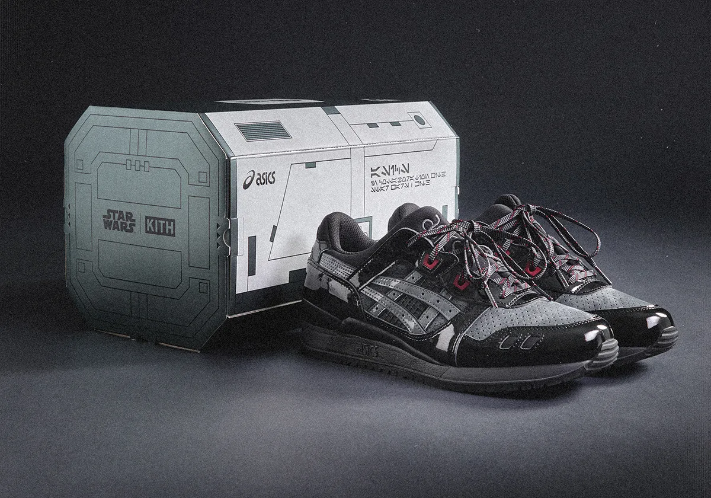
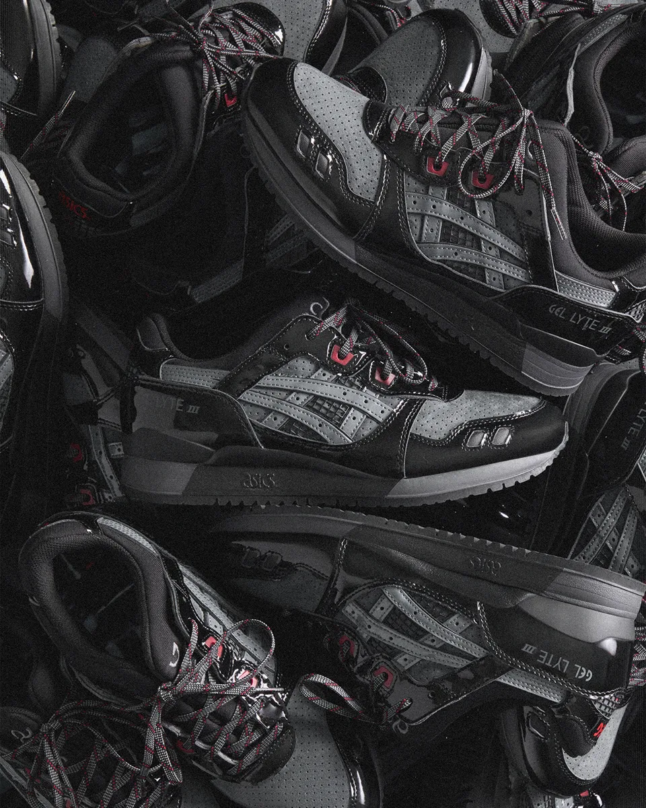
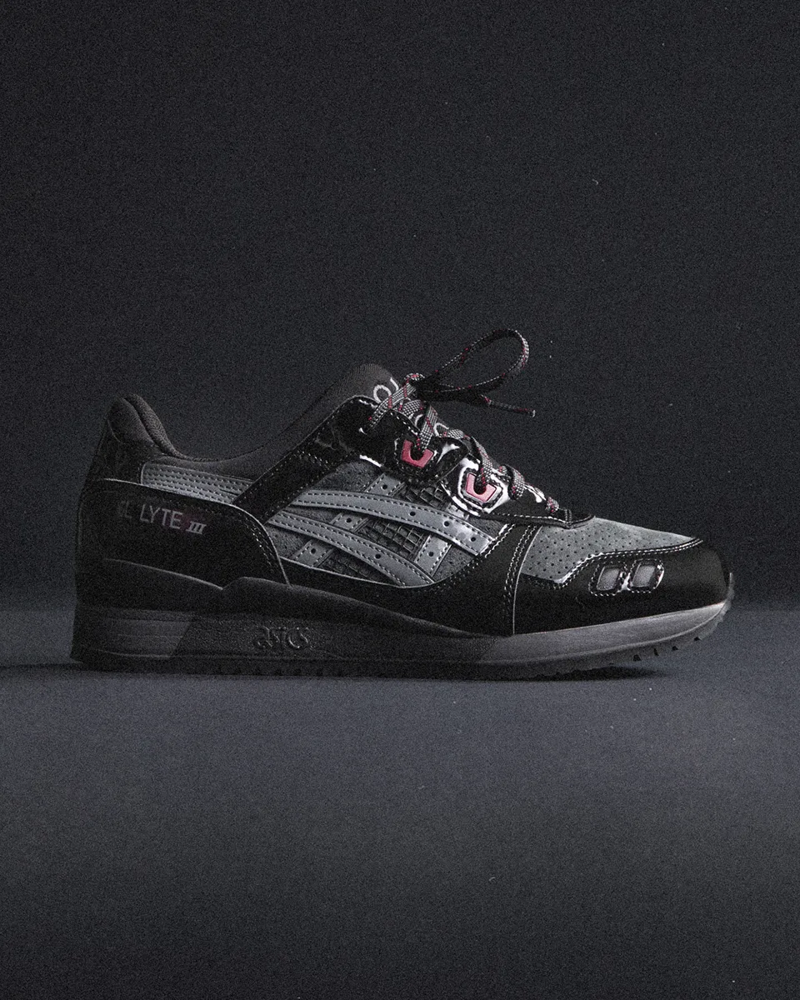
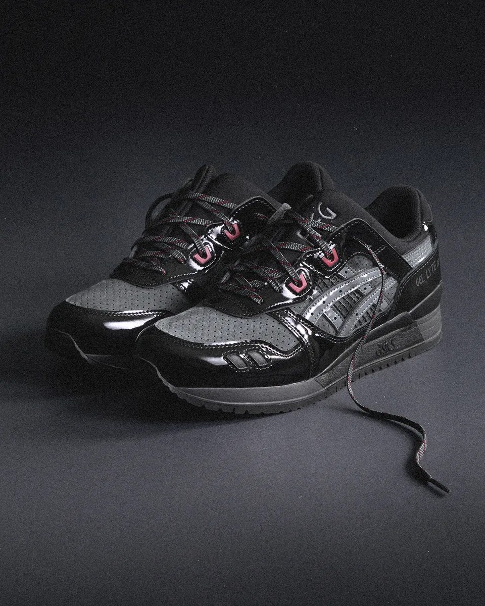
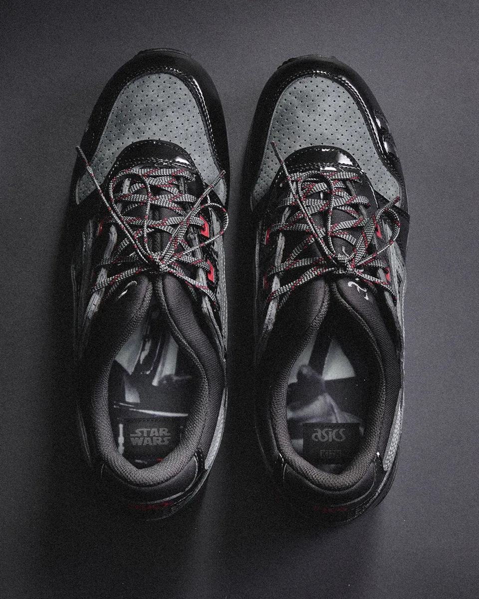
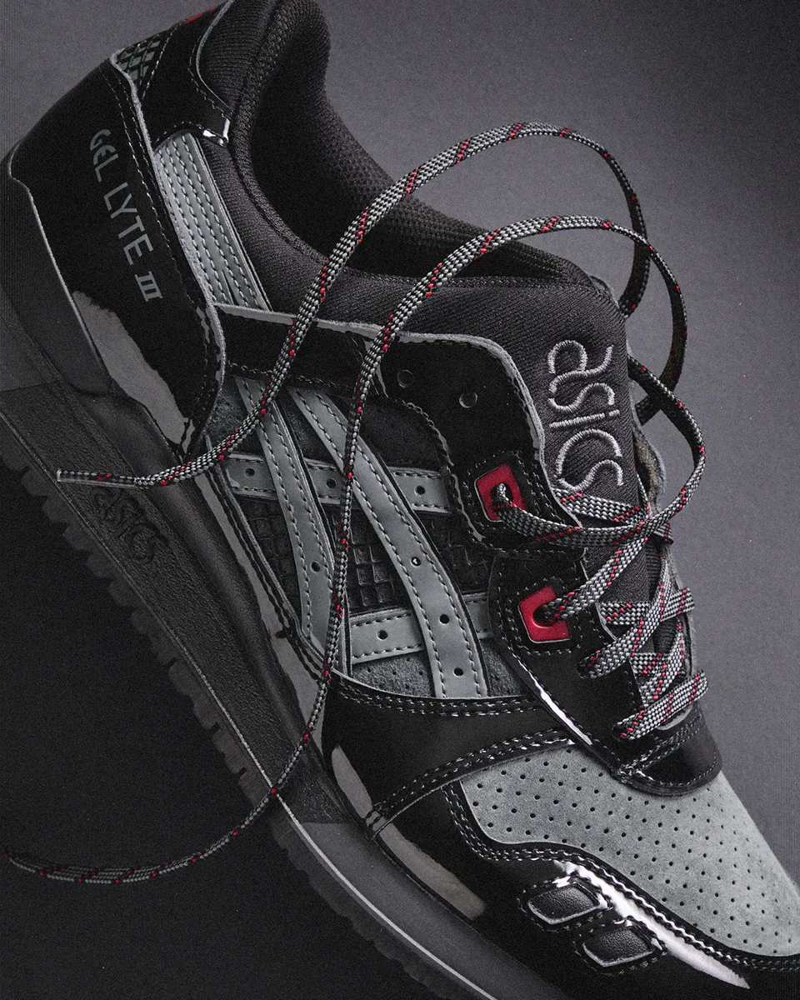
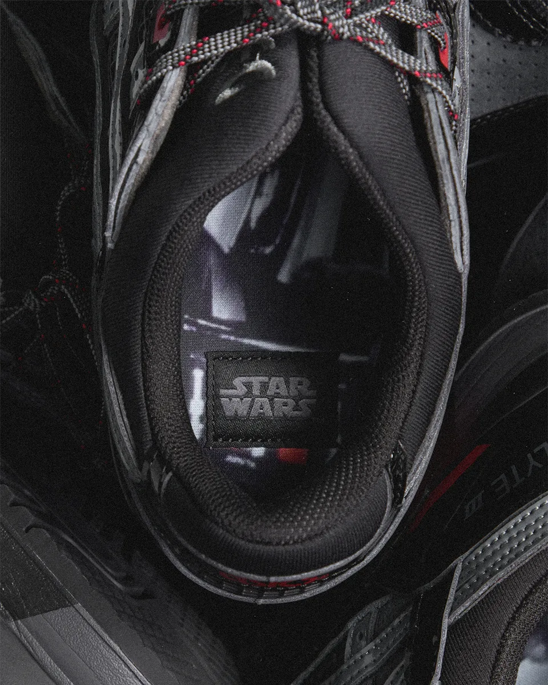

> [English version 英文版](/life/kith-star-wars-asics-gel-lyte-iii-darth-vader/)

大多数授权球鞋的诞生顺序是：先签合同，再出配色。片方点头，品牌挑一个角色，设计师把戏服翻译成皮革与网布，结果再好，也是一道命题作文。而 STAR WARS | Kith for ASICS GEL-LYTE III Remastered “Darth Vader” 把这道流程彻底倒了过来，而这个倒置，正是它全部的故事所在。配色在 2008 年就有了；外号紧随其后，来自收藏者，非官方，却无可避免；授权则在 18 年后姗姗来迟，排在最后，来追认文化早已做出的决定。

鞋子本身于昨天——2026 年 11 月 25 日星期三——经 Kith 门店、Kith.com 与 Kith App 全球发售，纽约、伦敦、巴黎、东京四地均为当地时间上午 11 点；此前 11 月 20 日已在 Kith London 提前发售，Kith App 抽签于 11 月 24 日美东时间晚 11:59 截止。它是 Kith “Sith Collection”（西斯系列）中唯一的鞋履——整个系列还包括服装、AVIREX 夹克、Hasbro 人偶与 Yellowpop 家居好物——也是这个系列里记忆最长的一件单品，距离为王。

热度有据可查，不是空口断言。Kith 于 11 月 23 日发布官方近赏；Sneaker News 同日更新报道，确认 11 月 25 日发售并放出全新宣传图；Hypebeast 于 11 月 24 日刊出发布信息，并另发整篇报道拆解 Sith 系列；Sole Retriever 收录了该鞋的发售页与设计解析；Men's Journal 把它排进“黑五周五大发售”的第二名——排在 Pharrell adidas Jellyfish 补货之前，仅次于周四的 Air Jordan 4 “Bred”——而这是全年竞争最激烈的一个发售周。一双 GEL-LYTE III 通常没有资格出现在这个名单里。这双能，是因为它卖的根本不是一双鞋，而是一个长达 18 年的闭环的合拢。

## 基本信息

| | |
|---|---|
| **名称** | STAR WARS \| Ronnie Fieg for ASICS GEL-LYTE III Remastered “Darth Vader” |
| **配色** | Castlerock |
| **货号** | 1203B520-020 |
| **价格** | $220 美元（Kith/Hypebeast 所列零售价，2026 年 11 月 25 日查询的 snapshot，subject to change） |
| **发售** | 2026 年 11 月 20 日 Kith London 提前发售；11 月 25 日经 Kith 门店、官网与 App 全球发售（纽约/伦敦/巴黎/东京当地时间 11:00）；Kith App 抽签 11 月 24 日 23:59 ET 截止；部分 Loyalty 会员享有提前购买权 |
| **鞋面** | 打孔牛巴革底布；高级皮革覆盖层与内外侧 Tiger Stripes 虎爪纹；黑色漆皮质感覆盖层沿用 2008 年设计 |
| **细节** | 鞋带孔与包边红色点缀；分体式鞋舌；后跟 Fieg 与 ASICS 双品牌交替呈现（不同于 2008 款）；侧后跟 GEL-LYTE 字样；达斯·维达插画鞋垫，带 Kith / ASICS / Star Wars 三方联名；鞋带与 2008 年原版完全一致；纪念收纳盒；据 Sneaker News，特殊鞋盒内附 Aurebesh（银河基本语字母）对照指南 |
| **血统** | 复刻 2008 年 “Black Patent” GEL-LYTE III——Ronnie Fieg 在 David Z. 任职期间与 ASICS 设计，因神似达斯·维达被收藏者非官方命名 |
| **背景** | Kith 星战 “Sith Collection” 中唯一的鞋履（同系列含服装、AVIREX、Hasbro 人偶、Yellowpop）；Kith London 于 11 月 20–29 日设暗黑面主题店中店 |

*鞋与盒：包装做成了帝国装备的模样——因为到了 2026 年，授权终于允许盒子把鞋子一直在暗示的东西说出口。图片：Kith / ASICS，经 Sneaker News。*

## 2008：一个买手、一双漆皮鞋，和一个无人拥有的外号

要理解这双鞋为何重要，先要理解 2008 年的 Ronnie Fieg 身在何处——也就是说，还不是今天业界口中的那个 Ronnie Fieg。那时他是纽约鞋履连锁 David Z. 的首席鞋类买手，按 Sneaker News 的叙述，他刚凭与 ASICS 的一系列高限量联名开始以设计师身份崭露头角。Kith 尚不存在。那家店、那间麦片吧、那些全球旗舰，全都是这双鞋下游的事。

2008 年的那双鞋，是一双黑漆皮配红色点缀的 GEL-LYTE III。David Z. 和 ASICS 没有任何人管它叫星战鞋，因为它不是：没有卢卡斯影业参与，没有角色图案，没有 Aurebesh。但人们的解读瞬间达成一致：漆皮覆盖层的光泽就是维达的头盔，红色就是光剑与胸前控制面板，而 GEL-LYTE III 深色、分段式的拼接结构补上了剩下的部分。用 Sneaker News 的话说，收藏者把这位反派的名字安在这套搭配上，是因为黑色漆皮的光泽与那抹不祥的红色让人别无选择。

这个外号是原版鞋最值钱的东西，值得说清为什么。非官方外号是一种任何市场部门都买不到的市场裁决：成千上万的人独立地看着同一个物件，在里面看到了同一个角色。它证明了这套设计翻译成立——维达，被漆皮与牛巴革呈现出来，零具象图案。但整整 18 年，这个裁决在商业上被搁浅了。ASICS 可以复刻这个配色，却不能说出那个名字。而名字恰恰是全部的意义所在，而名字属于卢卡斯影业。

Fieg 近期的 ASICS 动作，为修好这件事铺好了桌。Sneaker News 明确把这次发售框定为续集：继他那双具有开创意义的 Kith x ASICS GEL-LYTE III “Salmon Toe” 复刻之后，“又一双早期作品走上了台面”。换言之，Remastered 系列已经成为 Fieg 把自己 Kith 之前的目录逐双“领回”的机制，一次一个传奇。Salmon Toe 不需要任何人的许可，它从来就是他的。维达这双则需要娱乐业最大的授权方点头，承认 2008 年的那个玩笑是对的。本周，它点了。

## 鞋型：为什么 GEL-LYTE III 比大多数鞋更能承载一个角色

GEL-LYTE III 是 ASICS 1990 年的跑鞋，由 Shigeyuki Mitsui（三井茂之）设计，它的两个标志性特征恰好都特别适合这份工作。第一是分体式鞋舌——这款鞋的招牌结构，鞋舌从中间分开，包裹脚背而不是压在上面。放在普通配色上，它只是一个技术怪点；做成黑色、分段、发亮，它读起来就是装甲板：鞋的前端真的像由一片片面板拼装而成，如同一顶头盔。第二是拼接本身。GEL-LYTE III 是一双由很多部件组成的鞋——鞋头覆盖层、鞋带区、中段面板、交叉的 Tiger Stripes、独立的后跟护片——每一个部件都是一次更换材质的机会。角色鞋死于把角色印上去，活于把角色用拼接做出来。而维达的整个设计就是拼接：头盔、面具、胸前控制盒、斗篷——映射到这双鞋上，几乎是机械式的严丝合缝。

脚下是这款鞋当年的 GEL 缓震中底：按 2026 年的标准是生活方式脚感，后跟够软，前掌平平无奇，也不是任何人买这双鞋的理由。Remastered 系列的立意是忠于 2000 年代初联名款的鞋型与材质，而不是做性能现代化，这双鞋完整地兑现了这一立意。脚下没有任何东西被重新发明，本评测也不会假装有。

*堆叠图：批量看时，配方瞬间可读——灰色打底、黑色光泽、两枚如警示灯般的红色鞋带孔。图片：Kith / ASICS，经 Sneaker News。*

## 2026 年的做工：该忠实处忠实，不能合法处如今合法

Kith 自己的描述强调忠实，照片也支持这一点。与前作一样，2026 年复刻版采用打孔牛巴革底布——那片灰色的点阵面构成鞋身基底——覆盖层与内外侧 Tiger Stripes 采用高级皮革。黑色漆皮质感材料包裹鞋头、鞋带区与后跟，正是 2008 年那双鞋把光泽放的位置。红色点缀落在鞋带孔与包边上：每只鞋两枚红色鞋带环，在每一张照片里都看得见，以令人钦佩的克制完成着光剑的工作。鞋带据 Kith 所言与 2008 年原版完全一致——灰色带红色斑点，一个只有拥有或研究过原版的人才会在意的细节，而这正是这双鞋的目标人群。

改动集中在授权所及之处。先看后跟：2008 款两只鞋后跟都是 ASICS 标志，2026 款改为交替呈现——据 Sneaker News，一只印 Fieg，另一只印 ASICS——一个安静的“署名”动作，恰好呼应 Remastered 系列的本质：设计师的名字，事后补印在他自己的早期作品上。侧后跟保留 GEL-LYTE 字样。然后打开鞋子。鞋垫上是达斯·维达插画，带 Kith、ASICS、Star Wars 三方联名——这是角色唯一具象出现的地方，藏在鞋内，只有主人能看见。这份克制是全鞋最好的决定。把维达肖像印在中段面板上，会把一次设计翻译变成戏服；把同一幅肖像放在鞋垫上，则把它变成签名——授权，字面意义上，在你的脚下。

包装补完了论证。鞋款装在纪念收纳盒里，造型如同帝国装备——灰色面板、技术标记、Star Wars 与 Kith 标识——而 Sneaker News 指出，特殊鞋盒内附 Aurebesh 对照指南，Aurebesh 是星战银河的书写字母。2008 年，盒子什么都不能说。2026 年，盒子教你读帝国的字母。这中间的落差——鞋子当年只能暗示、如今可以明言的东西——就是产品本身。

*侧面：全部翻译都靠材质完成——光泽是头盔，打孔灰是战衣，红色只出现在维达自己的设计允许它出现的地方。图片：Kith / ASICS，经 Sneaker News。*

*斜前方：分体式鞋舌与漆皮鞋头就是那顶头盔的读法；其余一切都是克制的灰。图片：Kith / ASICS，经 Sneaker News。*

## 它身边的 Sith 系列

这双鞋不是独自到来的，它身边的阵容解释了 Kith 对这一周的野心。11 月 19 日公布的 Sith Collection 是一个完整的暗黑面系列：男装与童装、仿皮草 Lloyd 夹克、AVIREX 线的真羊皮达斯·维达摩托夹克、风暴兵灵感单品、复古海报图案、带联名包装的 Hasbro 维达与摩尔人偶、Yellowpop 的 LED 灯牌、树脂书挡、双凸透镜海报，以及 Kith Kids 系列。Kith London 于 11 月 20 日至 29 日设暗黑面店中店，Kith Treats 各店推出主题菜单。

在这片庞大的阵容之中，GEL-LYTE III 是唯一的鞋履——Sole Retriever 明确点出了这一点——也是唯一一件比这个系列早存在 18 年的单品。系列里的其他一切都是为此刻设计的。这双鞋设计于 2008 年，一直在等此刻。这个倒置正是鞋履——而不是那件羊皮夹克——成为系列重心的原因：它是整个系列中唯一一件由文化先于品牌创作出来的物件。

*俯视：鞋里唯一的具象维达住在鞋垫上，分跨一双——一块鞋垫印 Star Wars，另一块印 ASICS/Kith。图片：Kith / ASICS，经 Sneaker News。*

*细节：虎爪纹、网布、红色硬件与混色鞋带——2008 年的规格书，以 Remastered 的材质重刊。图片：Kith / ASICS，经 Sneaker News。*

*签名：维达的肖像，在鞋内，在主人的脚跟之下。授权是隐藏细节，而不是广告牌。图片：Kith / ASICS，经 Sneaker News。*

## 上脚：诚实的说明，以及发售周评测的边界

按本栏目的固定格式，先做必要声明：这是一篇发售周的设计与背景评测，不是长期上脚实测。全球发售就在昨天；这双鞋目前不存在任何权威的长期穿着测试，谁要是现在就给它的耐久性打分，谁就是在编数据。可以诚实评估的，是这款基础鞋型已知的性格，以及照片中的材质。

GEL-LYTE III 是其年代复古跑鞋中日常穿着较舒服的一款——分体式鞋舌确实有助于锁定、杜绝鞋舌跑偏，GEL 后跟脚感柔软，鞋型适合漫长平坦的日间步行，而不是真拿去跑步——2026 年也没人该买一双 1990 年的鞋型去跑步。Remastered 的材质则有两面性。打孔牛巴革基底应当透气、且越穿越有味道。漆皮质感覆盖层是风险所在，漆皮一向如此：折痕明显，刮花后失去的光泽不像普通皮革那样能擦回来，而它恰恰是这套设计的视觉中心，所以它的老化就是这双鞋的老化。轮换着穿的人，能把这份光泽保持很多年；天天穿着它过湿冷冬天的人，会看着头盔变哑。这不是这双鞋的缺陷——这是 2008 年原版指定的材质，忠于它正是要点——但它应该被计入购买决策。

尺码沿用 GEL-LYTE III 既有的版型：大多数人穿自己平时的 ASICS 复古鞋尺码即可，分体式鞋舌能适配多种脚背高度；偏窄、多拼接的鞋头则不建议买小。$220 的价格——2026 年 11 月 25–26 日查询的 snapshot，subject to change——明显高于普通 GEL-LYTE III，稳稳落在联名区间。这笔溢价买到的东西很具体：Remastered 的材质、纪念收纳盒，以及那份花了 18 年才附上来的授权。它买不到缓震科技，也不应以此为理由自我说服。

## 结论：复刻即追认

每一季都有复刻，其中大多数是穿着怀旧外衣的库存决策。这双不同，不同之处可以说得很精确：2008 年的 “Black Patent” 是一件完成的设计配一个未完成的名字；2026 年的发售几乎没有改变物件本身，却改变了这个物件被允许成为什么。鞋带是同一副鞋带。漆皮是同一块漆皮。红色在同两枚鞋带孔里。新增的是一块鞋垫、一个收纳盒、一本 Aurebesh 指南，以及卢卡斯影业的一个签字——那份迟到了 18 年的手续，为的是一个文化在一周之内就认证过的神似。

所以购买建议按人群干净地分开。如果你拥有过、想要过、甚至只是记得 2008 年那双 David Z. 的鞋，这是黑五周最容易的决定：这是你的鞋，补全了，$220，而 Fieg 早期 ASICS 作品的二级市场历史表明，犹豫不会得到奖励。如果你是星战收藏者，要清楚自己买的是什么——整个 Sith 系列中最克制、最设计先行的一件：唯一一件维达由材质而非图案构建的单品，也是唯一一件带有 Kith 之前出身的单品。如果你两者都不是——在你眼里这只是一双带红鞋带孔的黑灰复古跑鞋——那就按这个标准评判它：一双做工扎实的 GEL-LYTE III Remastered，配色克制，能配几乎一切深色衣服，价格是联名价。它在这种更冷的读法下同样成立，而这一点，大多数授权鞋做不到。

这正是这次发售通过的考验，也是它在一个拥挤的发售周里赢得位置的原因。把授权剥掉，这双鞋依然成立——它在 2008 年就成立过，没有许可，靠的是光泽、灰色和两枚红色鞋带孔。授权没有成就设计。授权让设计变得诚实。收藏者在 18 年前为这双鞋命名了一位西斯尊主；如今，这位尊主的主人同意了他们。外号，如今就是授权本身。

*来源：Kith（官方近赏与发售机制，2026 年 11 月 23 日）；Sneaker News（2026 年 11 月 23 日更新——宣传图、后跟品牌改动、Aurebesh 指南、Salmon Toe 脉络、2008 年 David Z. 历史）；Hypebeast（2026 年 11 月 24 日——货号 1203B520-020、$220 售价、材质；Sith 系列报道）；Sole Retriever（发售页与设计细节——漆皮覆盖层、灰色绒面/牛巴革、系列中唯一鞋履）；Men's Journal（黑五周五大发售排名）；JustFreshKicks（发售物流与后跟细节）。价格为 2026 年 11 月 25–26 日的零售 snapshot，subject to change。本文为发售周设计与背景评测，非上脚实测。*
