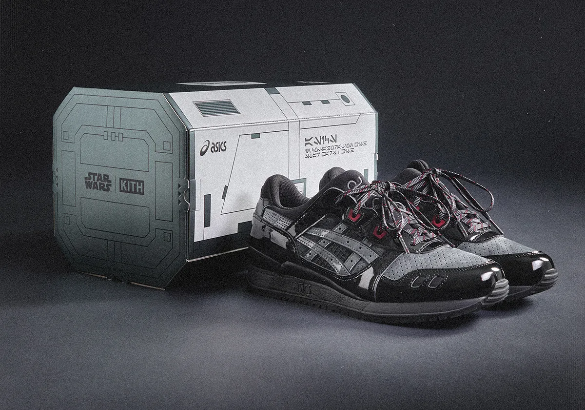
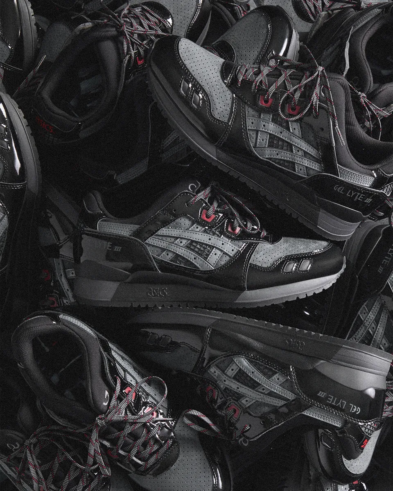
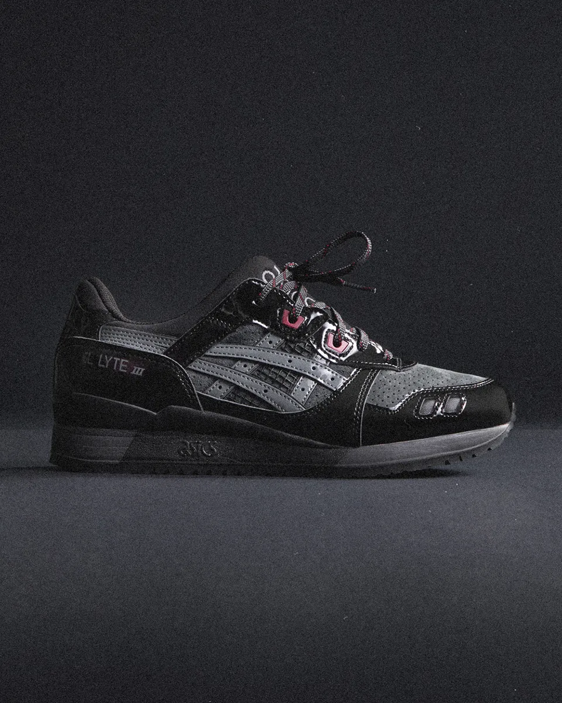
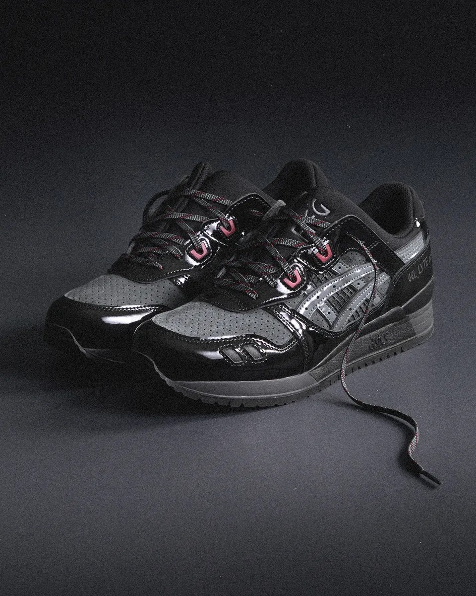
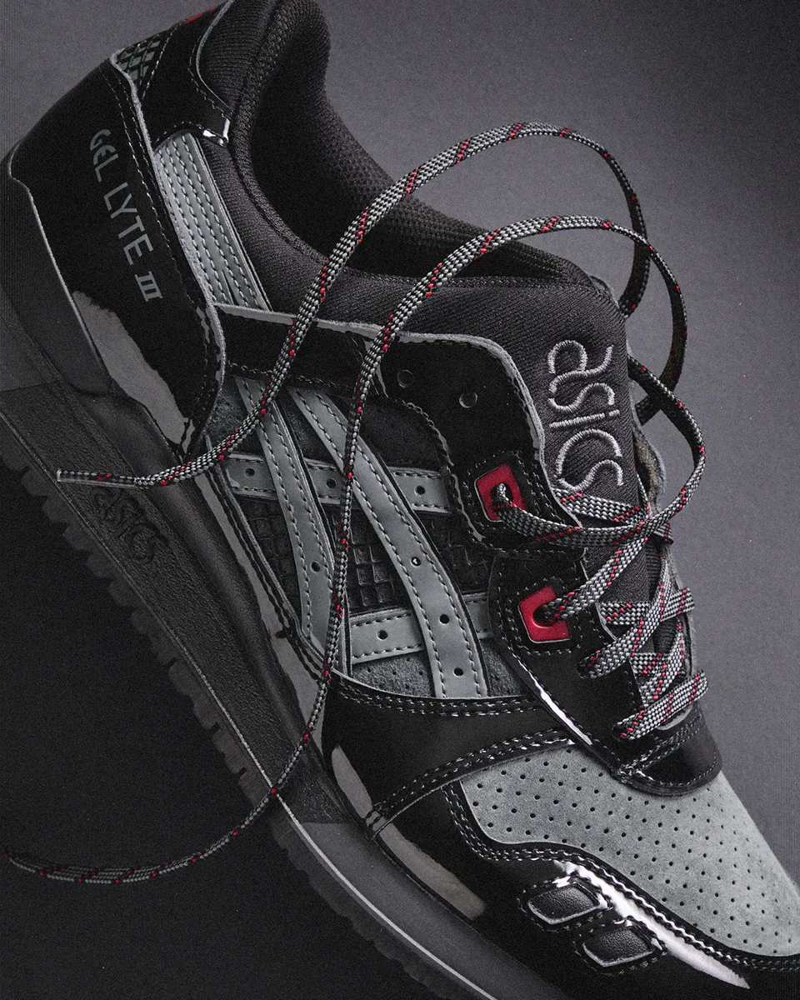
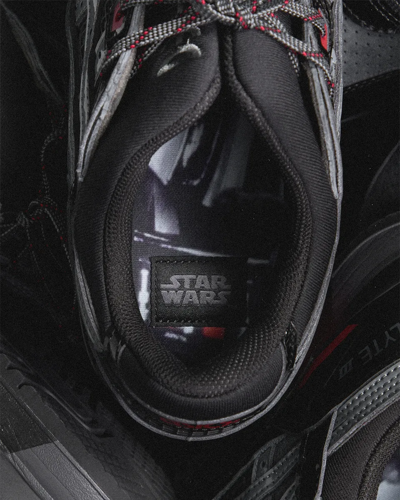

> [中文版 Chinese version](/life/kith-star-wars-asics-gel-lyte-iii-darth-vader-zh/)

Most licensed sneakers start with a contract and end with a colorway. A studio signs off, a brand picks a character, a designer translates a costume into leather and mesh, and the result — however good — is an assignment. The STAR WARS | Kith for ASICS GEL-LYTE III Remastered "Darth Vader" runs that process in reverse, and the reversal is the entire story. The colorway came first, in 2008. The nickname came second, from collectors, unofficially and unavoidably. The license arrived eighteen years later, last in line, to ratify what the culture had already decided.

The shoe itself released globally yesterday, Wednesday, November 25, 2026, through Kith stores, Kith.com and the Kith App at 11 a.m. local time across the New York, London, Paris and Tokyo time zones, following an early launch at Kith London on November 20 and a Kith App drawing that closed at 11:59 p.m. ET on November 24. It is the only footwear in Kith's Sith Collection, a full dark-side capsule of apparel, AVIREX jackets, Hasbro figures and Yellowpop home goods — and it is, by some distance, the item in that collection with the longest memory.

The heat is documented, not asserted. Kith published its official closer look on November 23. Sneaker News updated its coverage the same day with new campaign photography and the confirmed November 25 date. Hypebeast ran the release information on November 24 and a separate full-collection story on the Sith capsule. Sole Retriever carried the shoe's release page and design breakdown. Men's Journal placed it second in its five best Black Friday week releases — ahead of the Pharrell adidas Jellyfish restock and behind only Thursday's Air Jordan 4 "Bred" — in the most contested release week of the year. A GEL-LYTE III does not normally keep that company. This one does, because it is not really selling a shoe. It is selling the closing of an eighteen-year loop.

## The facts

| | |
|---|---|
| **Name** | STAR WARS \| Ronnie Fieg for ASICS GEL-LYTE III Remastered "Darth Vader" |
| **Colorway** | Castlerock |
| **Style code** | 1203B520-020 |
| **Price** | $220 USD (retail snapshot as listed by Kith/Hypebeast, November 25, 2026 — subject to change) |
| **Release** | November 20, 2026 early at Kith London; November 25, 2026 global via Kith stores, Kith.com and Kith App, 11 a.m. local (NY / London / Paris / Tokyo); Kith App drawing closed November 24, 11:59 p.m. ET; select Loyalty Members received early access |
| **Upper** | Perforated nubuck underlays; premium leather overlays and Tiger Stripes (lateral and medial); glossy black patent-look overlays carried over from the 2008 design |
| **Details** | Red accents at eyelets and trim; split tongue; Fieg and ASICS co-branding at the heels (alternating, unlike the 2008 pair); GEL-LYTE branding at side heel; Darth Vader illustrative footbed with Kith / ASICS / Star Wars tri-branding; laces identical to the 2008 release; commemorative case; special box includes an Aurebesh translation guide (per Sneaker News) |
| **Lineage** | Remake of the 2008 "Black Patent" GEL-LYTE III designed by Ronnie Fieg with ASICS during his David Z. tenure — unofficially nicknamed for Darth Vader by collectors |
| **Context** | The only footwear release in Kith's Star Wars "Sith Collection" (apparel, AVIREX, Hasbro figures, Yellowpop); Kith London shop-in-shop takeover November 20–29 |

*The pair and the case: the packaging is styled like Imperial hardware, because in 2026 the license allows the box to say what the shoe always implied. Image: Kith / ASICS, via Sneaker News.*

## 2008: a buyer, a patent shoe, and a nickname nobody owned

To understand why this release matters, you have to understand where Ronnie Fieg was in 2008 — which is to say, not yet Ronnie Fieg as the industry now uses the name. He was head footwear buyer at David Z., a New York footwear chain, and, as Sneaker News recounts, he had just begun gaining traction as a designer through a young partnership with ASICS on a run of highly limited collaborations. Kith did not exist. The store, the Treats cereal bar, the global flagships — all of that was downstream of shoes like this one.

The 2008 shoe was a GEL-LYTE III in black patent leather with red trim. Nobody at David Z. or ASICS called it a Star Wars shoe, because it wasn't one; there was no Lucasfilm involvement, no character art, no Aurebesh. But the reading was instant and it was unanimous: the gloss of the patent overlays was Vader's helmet, the red was the lightsaber and the chest panel, and the dark, segmented paneling of the GEL-LYTE III did the rest. Collectors attached the villain's name to the arrangement, in Sneaker News' phrasing, because the black patent gloss and the menacing red trim left them little choice.

That nickname is the most valuable thing about the original shoe, and it is worth being precise about why. An unofficial nickname is a market verdict that no marketing department can buy: thousands of people independently looked at an object and saw the same character in it. It proved the design translation worked — Vader, rendered in patent and nubuck, with zero literal imagery. For eighteen years, though, that verdict was commercially stranded. ASICS could reissue the colorway, but it could not say the name. The name was the whole point, and the name belonged to Lucasfilm.

Fieg's recent ASICS work set the table for fixing that. Sneaker News frames this release explicitly as a sequel: following the reissue of his seminal Kith x ASICS GEL-LYTE III "Salmon Toe" — another early-era Fieg arrangement revived through the Remastered line — "another early-era pair steps up to the dais." The Remastered program, in other words, has become Fieg's mechanism for repatriating his own pre-Kith catalog, one legend at a time. The Salmon Toe needed no one's permission; it was always his. The Vader needed the biggest licensor in entertainment to agree that a joke from 2008 was, in fact, correct. This week, it did.

## The silhouette: why the GEL-LYTE III carries a character better than most

The GEL-LYTE III is a 1990 ASICS runner, designed by Shigeyuki Mitsui, and its two defining features are both, coincidentally, perfect for this job. The first is the split tongue — the shoe's signature construction, a tongue divided down the middle that wraps the midfoot instead of sitting on top of it. On a normal colorway it reads as a technical quirk. In black, segmented and glossy, it reads as armor plating: the shoe's front end genuinely looks assembled from panels, like a helmet. The second is the paneling itself. The GEL-LYTE III is a shoe of many pieces — toe overlay, eyestay, quarter panels, the crossed Tiger Stripes, a separate heel counter — and each piece is an opportunity for a material change. Character shoes fail when the character is printed on; they work when the character is built out of the panel breaks. Vader, whose entire design is panel breaks — helmet, mask, chest box, cape — maps onto this shoe almost mechanically.

Underneath, the platform is the model's period GEL-cushioned midsole: a lifestyle ride by 2026 standards, soft enough at the heel, unremarkable at the forefoot, and not the reason anyone buys this shoe. The Remastered line's premise is fidelity to the early-2000s collaborative shape and materials rather than performance modernization, and this pair honors that premise completely. Nothing underfoot has been reinvented, and this review will not pretend otherwise.

*The pile: at volume, the formula reads instantly — grey field, black gloss, two red eyelets like warning lights. Image: Kith / ASICS, via Sneaker News.*

## The 2026 build: faithful where it counts, licensed where it couldn't be

Kith's own description stresses fidelity, and the photography backs it up. Like its predecessor, the 2026 remaster has perforated nubuck underlays — the grey, dotted field that forms the shoe's base — and premium leather at the overlays and at the Tiger Stripes on both the lateral and medial sides. The glossy black patent-look material wraps the toe, the eyestay and the heel, exactly where the 2008 shoe put its shine. Red accents sit at the eyelets and trim: two red lace loops per shoe, visible in every photograph, doing the lightsaber work with admirable economy. The laces are, per Kith, identical to the 2008 release — grey with a red fleck, a small detail that only matters if you owned or studied the original, which is precisely the audience this shoe is for.

The changes are concentrated where the license lives. Start at the heels: where the 2008 pair carried ASICS branding across both shoes, the 2026 pair alternates — Fieg on one heel, ASICS on the other, per Sneaker News — a quiet signature-of-authorship move that mirrors what the Remastered program is: the designer's name, retroactively, on his own early work. GEL-LYTE branding remains at the side heel. Then open the shoe. The footbed carries an illustrative Darth Vader graphic with Kith, ASICS and Star Wars tri-branding — the one place the character appears literally, hidden inside the shoe, where only the owner sees it. That restraint is the design's best decision. A Vader portrait printed on the quarter panel would have turned a design translation into a costume; the same portrait on the insole turns it into a signature — the license, literally, underfoot.

The packaging completes the argument. The pair arrives in a commemorative case styled like Imperial equipment — grey paneling, technical markings, Star Wars and Kith lockups — and Sneaker News notes the special box includes an Aurebesh translation guide, Aurebesh being the written alphabet of the Star Wars galaxy. In 2008 the box could say nothing. In 2026 the box teaches you to read the Empire's alphabet. That delta, between what the shoe could imply then and what it can state now, is the product.

*Lateral: the translation is all materials — gloss for the helmet, perforated grey for the suit, red only where Vader's own design allows it. Image: Kith / ASICS, via Sneaker News.*

*Three-quarter: the split tongue and patent toe are the helmet read; everything else is disciplined greys. Image: Kith / ASICS, via Sneaker News.*

## The Sith Collection around it

The shoe does not arrive alone, and the company it keeps explains Kith's ambitions for the week. The Sith Collection, announced November 19, is a full dark-side capsule: men's and kids' apparel, a faux-fur Lloyd Jacket, a genuine sheepskin Darth Vader Moto Jacket from the AVIREX side of the program, stormtrooper-inspired pieces, vintage-poster graphics, Hasbro action figures of Darth Vader and Darth Maul with co-branded packaging, a Yellowpop LED sign, resin bookends, lenticular posters and a Kith Kids assortment. Kith London hosted a dark-side shop-in-shop takeover from November 20 through November 29, and Kith Treats locations ran themed menus.

Within that sprawl, the GEL-LYTE III is the only footwear — Sole Retriever makes the point explicitly — and it is the only item whose existence predates the collection by eighteen years. Everything else in the capsule was designed for this moment. The shoe was designed in 2008 and has been waiting for this moment. That inversion is why the footwear, and not the sheepskin jacket, is the collection's center of gravity: it is the sole object in the range that the culture authored before the brands did.

*Top-down: the only literal Vader in the shoe lives on the footbeds, split across the pair — one insole carries the Star Wars mark, the other the ASICS/Kith lockup. Image: Kith / ASICS, via Sneaker News.*

*Detail: stripes, netting, red hardware and the flecked lace — the 2008 specification, reissued at Remastered materials. Image: Kith / ASICS, via Sneaker News.*

*The signature: Vader's portrait, inside the shoe, under the owner's heel. The license as a hidden detail rather than a billboard. Image: Kith / ASICS, via Sneaker News.*

## Wearing it: honest notes, and the limits of a release-week review

A necessary disclosure, in this column's standing format: this is a release-week design and context review, not a long-term wear test. The global release was yesterday; no authoritative extended wear test of this pair exists yet, and anyone rating its durability after a month is inventing data. What can be assessed honestly is the base model's known character and the materials in the photographs.

The GEL-LYTE III is one of the more comfortable retro runners of its era for daily wear — the split tongue genuinely helps lockdown and eliminates tongue drift, the GEL heel rides soft, and the shape suits long, flat days rather than actual running, for which nobody should buy a 1990 silhouette in 2026. The Remastered build's materials cut both ways. The perforated nubuck base should breathe and age gracefully. The patent-look overlays are the risk, as patent always is: they crease visibly, they scuff to a shine-loss that cannot be polished back the way smooth leather can, and they are the visual center of this design, so their aging is the shoe's aging. Buyers who rotate their pairs will keep the gloss for years; buyers who daily-drive them through a wet winter will watch the helmet dull. That is not a defect in this release — it is the material the 2008 original specified, and fidelity to it is the point — but it should be priced into the decision.

Sizing follows the GEL-LYTE III's established fit: most wearers take their normal ASICS retro size, with the split tongue accommodating a range of instep heights; the narrow, panel-heavy toe box argues against sizing down. The $220 price — a snapshot as of November 25–26, 2026, subject to change — sits well above a standard GEL-LYTE III and squarely in collaboration territory. What the premium buys is specific: the Remastered materials, the commemorative case, and the license that took eighteen years to attach. It does not buy cushioning technology, and it should not be justified as if it did.

## The verdict: the remake as ratification

Every season produces remakes, and most of them are inventory decisions wearing nostalgia's clothes. This one is different in a way that can be stated precisely: the 2008 "Black Patent" was a finished design with an unfinished name, and the 2026 release changes almost nothing about the object while changing everything about what the object is allowed to be. The laces are the same laces. The patent is the same patent. The red is in the same two eyelets. What is new is a footbed, a case, an Aurebesh guide, and a signature from Lucasfilm — the paperwork, arriving eighteen years late, for a resemblance the culture certified in a week.

So the buying advice splits cleanly by who you are. If you owned, wanted, or even remember the 2008 David Z. pair, this is the easiest decision of Black Friday week: it is your shoe, completed, at $220, and the aftermarket history of Fieg's early ASICS work suggests hesitation will not be rewarded. If you are a Star Wars collector, understand what you are getting — the most restrained, design-first object in the entire Sith Collection, the one item whose Vader is built from materials rather than printed from artwork, and the only one with a pre-Kith provenance. And if you are neither — if this is, to you, a black and grey retro runner with red eyelets — then judge it as that: a well-made GEL-LYTE III Remastered in a disciplined colorway that will wear with almost anything dark, at a collaboration price. It survives that colder reading too, which is more than most licensed shoes can say.

That, finally, is the test this release passes and the reason it earned its slot in a crowded week. Strip the license away and the shoe still works — it worked in 2008, without permission, on the strength of gloss and grey and two red eyelets. The license does not make the design. It makes the design honest. Eighteen years after collectors named this shoe for a Sith Lord, the Sith Lord's owners have agreed with them. The nickname is the license now.

*Sources: Kith (official closer look and release mechanics, November 23, 2026); Sneaker News (updated November 23, 2026 — campaign photography, heel-branding change, Aurebesh guide, Salmon Toe framing, 2008 David Z. history); Hypebeast (November 24, 2026 — style code 1203B520-020, $220 MSRP, materials; Sith Collection story); Sole Retriever (release page and design details — patent overlays, grey suede/nubuck, only footwear in the collection); Men's Journal (Black Friday week top-five ranking); JustFreshKicks (release logistics and heel details). Price is a retail snapshot as of November 25–26, 2026, subject to change. This is a release-week design and context review, not an on-foot wear test.*
