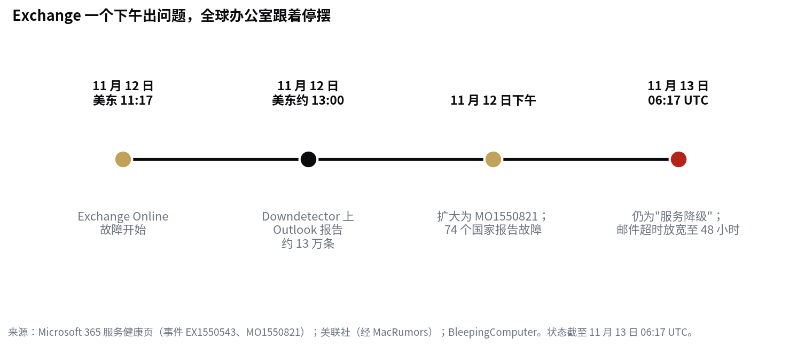

> [English version](/life/microsoft-365-outage-nov-12/)

*位于华盛顿州雷德蒙德的微软园区。照片：Atomic Taco，来自 Wikimedia Commons（CC BY-SA 2.0）。*

## 发生了什么

11 月 12 日周四，Microsoft 365 开始在全球范围内故障。问题始于 Exchange Online——大多数企业 Outlook 背后的邮件服务——根据微软服务健康页的记录，开始时间为美东时间 11:17（UTC 16:17）。约两小时内，微软开立了覆盖多个 Microsoft 365 服务的更广泛事件，并表示任何地区的用户都可能受影响。据美联社报道，Downdetector 在美东时间 13:00 过后不久记录了近 13 万条 Outlook 故障报告，最终报告来自 74 个国家。

故障波及网页版、桌面版和移动版 Outlook，邮件收发延迟，Teams 会议安排和日程条目出错，Microsoft 365 Copilot、依赖 Exchange 的 SharePoint 功能、Microsoft Graph、Planner、To Do、Intune、Purview、Power BI 和部分 Defender 服务也受到影响。直接存放在 SharePoint 里的文件仍可访问，大多数 Teams 通话、会议和聊天也还正常——如果你手头已有会议链接，一般还能用。但影响超出了微软自己的产品：通过 Apple Mail 等其他客户端访问的邮箱也受影响，因为故障出在微软底层基础设施上；连接微软账号的第三方 AI 服务也受到波及。日本确认政府 IT 系统受到显著影响，故障还波及企业、法院、航空公司和政府部门的运转。

截至 11 月 13 日周五 06:17 UTC——故障开始 14 个多小时后——微软仍将该事件列为"服务降级"，而非已解决。亚太部分地区的修复正在改善邮箱访问，微软称看到了"初步企稳迹象"，但容量尚未恢复正常，一些服务器恢复后又再次宕机。微软已将邮件超时窗口延长至 48 小时，以在清理积压邮件期间保护延迟的邮件。

*故障时间线。来源：Microsoft 365 服务健康页；美联社（经 MacRumors）；BleepingComputer。*

## 微软说了什么原因——以及没说什么

微软表示这不是网络攻击，也未发现任何恶意活动；一位微软高管已确认不涉及安全漏洞。目前的解释是，一些服务器"意外不可用"，剩余基础设施在额外流量下不堪重负。微软表示正在回滚一项与故障开始时间吻合的近期网络配置变更，但尚未确认根本原因，并承诺事件结束后发布完整的事后分析报告。微软没有给出完全恢复的时间表。

注意时间点：当天美东时间 9:45 至 10:53 还发生过一起单独的、较早的 Teams 事件，发生在 Exchange 故障开始之前。微软没有说明两者是否有关。

## 真正的问题：一个供应商，全部一起宕机

宕机总会发生；这次值得写，是因为它同时带走了什么。对大多数组织来说，微软不是众多供应商之一——它是邮件、日历、文档、聊天和身份认证，而且越来越多地还包括之上的 AI 助手（Copilot）和安防体系（Defender）。Exchange 一宕，Copilot 就无法检索工作邮件、日历和文件，部分 Defender 也停止了工作。本应在事故期间发现问题的安防工具，依赖的正是那个正在故障的服务。

这是集中风险最纯粹的形态，也是本周另外两个故事的同一模式：一家依赖一位创始人的公司，一个依赖少数几家 AI 供应商的行业，以及现在，一个把工作日托付给一家公司云服务的公众。缓解措施众所周知、却很少有人采用——第二条邮件通道、不用微软的聊天工具做事故协调、当天日程的本地副本——因为这些措施每天都要花钱花精力，而宕机只在发生的那天才花钱。48 小时邮件超时窗口的延长，是微软对积压规模的悄悄承认：它对一天内清理完积压没有信心。

对 IT 团队还有一个更具体的教训。故障不在任何人笔记本上的 Outlook 应用里，重装或重置密码都无济于事。判断方法是看范围：网页版、桌面版、移动版同时在所有地区一起故障，这是服务问题，不是设备问题。下次先查微软自己的状态页 status.cloud.microsoft，而不是先排队等 help desk。

微软会在事件结束后发布根本原因报告。它需要回答的有趣问题不只是"什么坏了"，而是为什么一个服务的容量损失会级联波及这么多其他服务——以及要改什么，才能让 Exchange 的下一个糟糕下午不再把全球办公室一起带走。

*本文反映截至 2026 年 11 月 13 日上午（美西时间）的状态。撰写时事件仍在进行中，细节可能随微软的更新而变化。*
