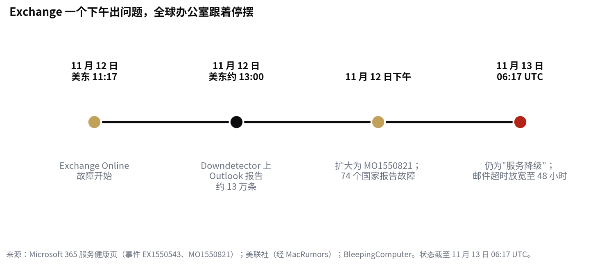

> [English version](/life/microsoft-365-outage-nov-12/)

*位于华盛顿州雷德蒙德的微软园区。照片：Atomic Taco，来自 Wikimedia Commons（CC BY-SA 2.0）。*

## 发生了什么

11 月 12 日周四，Microsoft 365 开始在全球范围内故障。问题始于 Exchange Online——大多数企业 Outlook 背后的邮件服务——根据微软服务健康页的记录，开始时间为美东时间 11:17（UTC 16:17）。约两小时内，微软开立了覆盖多个 Microsoft 365 服务的更广泛事件，并表示任何地区的用户都可能受影响。据美联社报道，Downdetector 在美东时间 13:00 过后不久记录了近 13 万条 Outlook 故障报告，最终报告来自 74 个国家。

故障波及网页版、桌面版和移动版 Outlook，邮件收发延迟，Teams 会议安排和日程条目出错，Microsoft 365 Copilot、依赖 Exchange 的 SharePoint 功能、Microsoft Graph、Planner、To Do、Intune、Purview、Power BI 和部分 Defender 服务也受到影响。直接存放在 SharePoint 里的文件仍可访问，大多数 Teams 通话、会议和聊天也还正常——如果你手头已有会议链接，一般还能用。但影响超出了微软自己的产品：通过 Apple Mail 等其他客户端访问的邮箱也受影响，因为故障出在微软底层基础设施上；连接微软账号的第三方 AI 服务也受到波及。日本确认政府 IT 系统受到显著影响，故障还波及企业、法院、航空公司和政府部门的运转。

截至 11 月 13 日周五 06:17 UTC——故障开始 14 个多小时后——微软仍将该事件列为"服务降级"，而非已解决。亚太部分地区的修复正在改善邮箱访问，微软称看到了"初步企稳迹象"，但容量尚未恢复正常，一些服务器恢复后又再次宕机。微软已将邮件超时窗口延长至 48 小时，以在清理积压邮件期间保护延迟的邮件。

*故障时间线。来源：Microsoft 365 服务健康页；美联社（经 MacRumors）；BleepingComputer。*

## 宕机的规模到底有多大

Downdetector 上的 13 万条报告只是冰山一角。微软在 2026 年 1 月表示，Microsoft 365 付费商业席位已超过 4.5 亿，此后每个季度仍保持 5% 至 6% 的增长。个人订阅是这之外的另一块——截至 2026 年 4 月财报电话会，接近 9,500 万。Teams 月活跃用户超过 3.2 亿，SharePoint Online 用户超过 2 亿，Exchange Online 每月处理超过 4,000 亿封邮件。截至 2026 年 6 月 30 日的财年，Microsoft 365 商业产品与云服务收入约为 1,020 亿美元。

这些数字之间有重叠——一个席位、一个订阅用户和一个 Teams 用户不是同一个人，不能直接相加——但它们框定了冲击半径。Exchange Online 出故障时，它不是某个地区或某个套餐出故障。微软自己的状态页说任何地区的用户都可能受影响，列出的也是企业与个人服务。Downdetector 数据里的 74 个国家，只是有人去上报的国家；实际覆盖面是整个付费用户群。这正是日本那条消息的意义所在：当一个国家的政府确认其 IT 系统受到显著影响，故障就不再是生产力层面的烦恼，而成了公共行政事件。

还有一个常被忽略的维度：这次故障打击的是"工作日"本身。对大多数组织来说，邮件不只是通信工具，它是工作流的触发器——审批、合同、客户回复、会议邀请，全都以邮件为载体。邮件延迟一天，意味着成千上万个决策被推迟一天，而这些决策的成本不会出现在任何一张账单上，只会出现在季末的业绩里。

## 为什么是 Exchange：邮件为何成了单点故障

一个值得追问的问题是：为什么偏偏是 Exchange？为什么一个邮件服务的故障能拖垮日历、会议、AI 助手与安防工具？答案藏在过去二十年的迁移史里。

在云计算之前，Exchange 是企业自己机房里的一台服务器，管邮件，也顺带管日历与通讯录。2000 年代末到 2010 年代，企业陆续把本地 Exchange 迁移到 Exchange Online——微软自己的统计显示，这是最常见的迁移路径，占全部 M365 迁移的近四成。迁移的逻辑很简单：不用自己维护服务器、打补丁、管备份。但迁移的副作用是，邮件从"机房里的一台服务器"变成了"云端的一个共享依赖"：你的日历、会议、审批流、Copilot 的检索入口、甚至部分合规与安防工具，全都默认 Exchange 在线。

更关键的是身份。现代 Microsoft 365 里，Exchange 不只是一个应用，它是组织身份图谱的一部分：谁是谁、谁向谁汇报、谁有权看什么，很多都以邮箱与日历数据为载体。Copilot 之所以能回答"帮我找上周和张总开会的纪要"，是因为它能读你的邮件与日历；而它能读的前提，是 Exchange 正常工作。于是出现了一个悖论：微软把越来越多的智能功能建在 Exchange 之上，却没有给这些功能准备 Exchange 宕机时的备用路径。11 月 12 日的故障把这个悖论摊在了所有人面前。

这也是为什么"文件还在 SharePoint 里能访问"这个细节值得注意。它说明故障的边界不是"微软全挂了"，而是"依赖 Exchange 的部分挂了"。对 IT 团队来说，这正是做连续性规划的线索：把关键流程拆开，看看哪些环节真的依赖 Exchange、哪些只是习惯性地经过它——前者需要备用方案，后者只需要换个入口。

## 微软说了什么原因——以及没说什么

微软表示这不是网络攻击，也未发现任何恶意活动；一位微软高管已确认不涉及安全漏洞。目前的解释是，一些服务器"意外不可用"，剩余基础设施在额外流量下不堪重负。微软表示正在回滚一项与故障开始时间吻合的近期网络配置变更，但尚未确认根本原因，并承诺事件结束后发布完整的事后分析报告。微软没有给出完全恢复的时间表。

注意时间点：当天美东时间 9:45 至 10:53 还发生过一起单独的、较早的 Teams 事件，发生在 Exchange 故障开始之前。微软没有说明两者是否有关。

"回滚网络配置变更"这句话值得多解读一层。它暗示故障的起点很可能是一次常规变更——某种路由调整、容量升级或配置推送——而不是硬件损坏或外部攻击。云服务商每天要做成千上万次这样的变更，绝大多数悄无声息；偶尔一次，变更触碰到了某个意想不到的依赖，于是整个系统开始连锁反应。微软没有确认根本原因，这在事件进行中是正常的——工程师的首要任务是恢复服务，而不是写报告——但"回滚"这个动作本身已经说明了调查的方向。

## 一次故障如何级联

这次故障的技术形态值得理解，因为它解释了为什么"邮件宕了"会变成"什么都宕了"。Exchange Online 不只是一个邮箱服务，它是一个依赖枢纽。Copilot 通过 Microsoft Graph 检索工作邮件、日历与文件，而 Graph 要读 Exchange——所以 Exchange 一出故障，Copilot 就失去了记忆。依赖 Exchange 的 SharePoint 功能、Planner、To Do 以及部分 Defender XDR 都挂在同一条依赖链上。本应在事故期间发现问题的安防工具，依赖的正是那个正在故障的服务。

微软目前描述的机制符合一个熟悉的模式：一些服务器意外不可用，剩余基础设施在额外流量下不堪重负——换句话说，一次容量损失演变成了过载级联。公司表示正在回滚一项与故障开始时间吻合的近期网络配置变更。该事件在 Microsoft 365 管理中心里的编号是 EX1550543（Exchange Online）与 MO1550821（更广泛的 Microsoft 365 事件）。一些服务器恢复后又再次宕机，这个细节很能说明问题：当系统运行在容量边缘时，恢复一台服务器会把负载推给下一个最薄弱的环节，故障不是结束了，而是转移了。

这也解释了为什么状态页在 14 个小时里写的是"服务降级"而不是"宕机"。降级是对"处处部分可用、而不是某处彻底中断"的系统的诚实描述：一些邮箱能访问、一些不能；一些地区在恢复、另一些没有。这种模糊性本身就是用户体验：用户得不到一个干净的"宕了"，得到的是一整天"邮件可能到、也可能不到"，会议"可能存在、也可能不存在"，以及一个说情况在改善、而收件箱却另有说法状态页。

## 坏日子的历史

这不是微软第一次遇到坏日子，而整个行业的历史模式才是值得研究、而非仅仅忍受的东西。2024 年 7 月 19 日，CrowdStrike 一次有问题的传感器更新导致全球约 850 万台 Windows 设备崩溃——按微软的估计不到全部 Windows 设备总数的 1%，但足以让航班停飞、医院冻结、银行停摆，随后几天约有 46,000 个航班延误或取消。那不是微软的故障，却是微软生态的故障，教训是一样的：一家供应商一个糟糕的下午，会变成所有人的糟糕一天。2023 年 1 月，一次计划中的 WAN 路由器 IP 地址更新导致 Azure、Azure AD（现在的 Entra ID）、Outlook 与 Teams 中断约五小时——提醒人们身份认证层本身就是一个单点故障。2021 年 10 月 4 日，Meta 的一次路由变更让 Facebook、Instagram、WhatsApp 与 Messenger 下线约六小时。2025 年 10 月，AWS 的 US-EAST-1 区域宕机；2025 年 6 月，谷歌共享的服务控制基础设施让故障蔓延到自家多个服务。

其中五个里有四个是自己造成的：一次路由变更、一次软件更新、一个 DNS 依赖、一次维护失误。这就是贯穿始终的线索。过去五年里最大的宕机事件，肇事者不是攻击者，而是这些公司自己——在规模庞大、相互交织的系统里做一次常规变更，而一次常规变更的冲击半径事先根本无法预知。11 月 12 日的故障完全符合这个模式：一次网络配置变更、一次容量损失、一次级联。

这个模式还有一个更深层的含义：云服务的可靠性工程已经从"防止故障"转向了"控制故障的蔓延"。没有人能保证不变更、不升级、不扩容——系统必须演进——所以真正的问题从来不是"会不会出事"，而是"出事时影响面有多大、恢复要多快"。从这个角度看，11 月 12 日的故障不是一次意外，而是一次压力测试，测的是微软在容量规划、依赖隔离与变更管理上的真实水平。对采购者来说，这也提出了一个两难：多供应商策略能分散风险，却要付出集成成本与管理复杂度；而单供应商策略便宜、顺滑，却把全部鸡蛋放在一个篮子里。过去十年里，绝大多数企业选了后者——而 11 月 12 日这一天，就是这张账单到期的一天。

## SLA 到底承诺了什么

Microsoft 365 服务承诺每月 99.9% 的可用性。已发布的服务等级协议（SLA）规定：可用性低于 99.9% 时返还当月费用 25%，低于 99% 时返还 50%，低于 95% 时返还 100%。一个 Exchange Online 中断了一整天的租户，11 月的可用性约为 96.7%，落在 50% 那一档。Exchange Online Plan 1 的标价是每用户每月 4 美元，所以 50% 的返还相当于每个席位 2 美元。就算 4.5 亿个席位全部按这个标准索赔，总额也只有约 9 亿美元。

这笔账本身就是重点。SLA 把微软的财务风险上限，定在了客户因宕机损失的工作时间的一小部分，而返还的是一项 4 美元服务的折扣，不是对"一天没有邮件"的赔偿。这不是单指微软——所有云服务的 SLA 都是这样运作的。合同承诺的是一笔返款，不是一个结果。真正能防范宕机的不是 SLA，而是第一条路断了之后还有第二条路可走。

对企业采购者来说，这里有一个常被忽视的谈判点：SLA 的返还比例与触发条件是可以谈的，大客户往往能在合同里争取到更严格的条款与更高的返还比例。但对绝大多数中小企业来说，标准 SLA 就是全部保障——而标准 SLA 的保障，恰恰是在你最需要它的时候最显单薄。

更值得追问的是，SLA 的设计本身就假设了一个前提：宕机是小概率事件，返还只是安抚性的补偿。可当一家供应商同时承载了邮件、日历、文档、聊天、身份与 AI 助手时，一次宕机的损失就不再是"某项服务不可用的几小时"，而是"整个工作日停摆"。SLA 的返还公式是按服务单价算的，客户的损失却是按停摆的业务算的——两者之间差着几个数量级。这个缺口不是微软独有的，而是整个云服务行业的共性：合同保护的是供应商的财务风险，而不是客户的业务连续性。真正的连续性，永远要靠客户自己的第二套方案。

## 真正的问题：一个供应商，全部一起宕机

宕机总会发生；这次值得写，是因为它同时带走了什么。对大多数组织来说，微软不是众多供应商之一——它是邮件、日历、文档、聊天和身份认证，而且越来越多地还包括之上的 AI 助手（Copilot）和安防体系（Defender）。Exchange 一宕，Copilot 就无法检索工作邮件、日历和文件，部分 Defender 也停止了工作。本应在事故期间发现问题的安防工具，依赖的正是那个正在故障的服务。

这是集中风险最纯粹的形态，也是本周另外两个故事的同一模式：一家依赖一位创始人的公司，一个依赖少数几家 AI 供应商的行业，以及现在，一个把工作日托付给一家公司云服务的公众。缓解措施众所周知、却很少有人采用——第二条邮件通道、不用微软的聊天工具做事故协调、当天日程的本地副本——因为这些措施每天都要花钱花精力，而宕机只在发生的那天才花钱。48 小时邮件超时窗口的延长，是微软对积压规模的悄悄承认：它对一天内清理完积压没有信心。

对 IT 团队还有一个更具体的教训。故障不在任何人笔记本上的 Outlook 应用里，重装或重置密码都无济于事。判断方法是看范围：网页版、桌面版、移动版同时在所有地区一起故障，这是服务问题，不是设备问题。下次先查微软自己的状态页 status.cloud.microsoft，而不是先排队等 help desk。

针对下一次而不是这一次，实用的应急手册其实很短。保留一条不依赖微软的沟通渠道——一个不走微软的群聊或电话树——让团队在工具宕掉时还能彼此联系。保留当天日程与关键联系电话的本地副本，这样一场错过的会议不会变成一个错过的客户。提前决定哪些工作可以转到个人邮箱、哪些不行，这样就不会有人在事故中途临时用敏感数据即兴发挥。等事件结束，读微软的根本原因报告——不是为了看道歉，而是为了找到那个出故障的具体依赖，因为那正是你自己的连续性计划必须绕开的依赖。最后还有一条容易被忽略的建议：把这次故障的经过写进团队的复盘文档，包括哪些流程中断了、哪些备用方案奏效了、哪些没有——因为下一次宕机来临时，唯一比备用方案更重要的，就是上一次的经验还在不在。而经验这东西，不写下来就等于没有。

微软会在事件结束后发布根本原因报告。它需要回答的有趣问题不只是"什么坏了"，而是为什么一个服务的容量损失会级联波及这么多其他服务——以及要改什么，才能让 Exchange 的下一个糟糕下午不再把全球办公室一起带走。还有一个问题值得报告回答：为什么一些服务器恢复后又再次宕机？这个细节指向的可能是容量规划本身的问题——系统长期运行在接近饱和的状态，以至于任何一次扰动都会引发连锁反应。如果真是这样，修复就不只是一次配置回滚，而是一次容量与架构的重新设计。而这，恰恰是用户最难从外部验证、却最能决定下一次宕机何时到来的部分。

*本文反映截至 2026 年 11 月 13 日上午（美西时间）的状态。撰写时事件仍在进行中，细节可能随微软的更新而变化。*

## 来源

- Microsoft 365 服务健康页 / 美联社经 MacRumors / BleepingComputer，2026年11月12–13日（Exchange Online 故障，美东时间 11:17；两小时内扩大为多服务事件；Downdetector 近 13 万条报告；74 个国家；受影响服务清单；48 小时邮件超时窗口延长；"初步企稳迹象"；未确认根本原因；非网络攻击）。
- AP7i / SQ Magazine / 微软 2026 财年 10-K 与财报电话会（付费商业席位超 4.5 亿，2026 年 1 月；个人订阅近 9,500 万，2026 年 4 月；Teams 月活跃用户 3.2 亿以上；SharePoint Online 用户 2 亿以上；Exchange Online 每月处理 4,000 亿封邮件；Microsoft 365 商业产品与云服务 2026 财年收入约 1,020 亿美元）。
- IsDown / StatusIsDown / 维基百科，2026年（CrowdStrike 2024 年 7 月 19 日：约 850 万台 Windows 设备，约 46,000 个航班延误或取消；Azure 2023 年 1 月 WAN 路由器更新，约五小时；Meta 2021 年 10 月 4 日，约六小时；AWS 2025 年 10 月 20 日 US-EAST-1；谷歌 2025 年 6 月共享服务控制基础设施）。
- 微软在线服务等级协议（每月 99.9% 可用性承诺；低于 99.9% 返还 25%、低于 99% 返还 50%、低于 95% 返还 100%）；微软公布价格（Exchange Online Plan 1，每用户每月 4 美元）。
- Medha Cloud，Microsoft 365 Statistics 2026（本地 Exchange 迁移至 Exchange Online 是最常见的 M365 迁移路径，约占 38%）。

[END EXTERNAL CONTENT: source=file file=~/workspace/stage/microsoft-365-outage-nov-12/article-zh.md tool_name=read]
