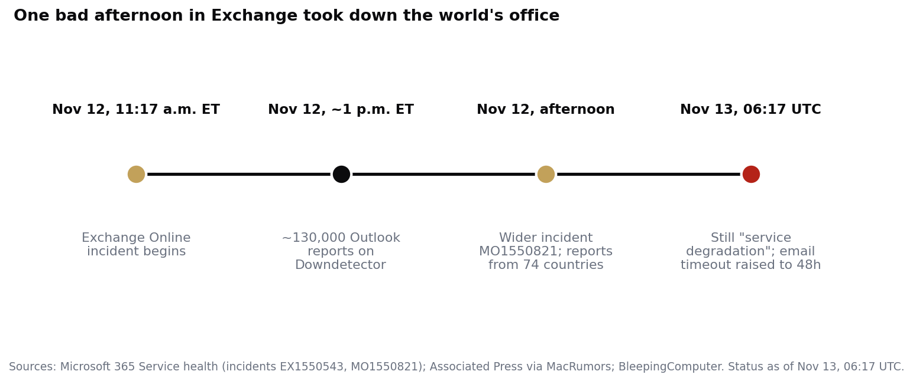

> [中文版 Chinese version](/life/microsoft-365-outage-nov-12-zh/)

*The Microsoft campus in Redmond, Washington. Photo: Atomic Taco, via Wikimedia Commons (CC BY-SA 2.0).*

## What happened

On Thursday, November 12, Microsoft 365 began failing worldwide. The trouble started with Exchange Online — the email service behind Outlook for most organizations — at 11:17 a.m. Eastern (16:17 UTC), according to Microsoft's service health record. Within about two hours, Microsoft opened a wider incident covering multiple Microsoft 365 services and said users in any region could be affected. Downdetector logged nearly 130,000 Outlook problem reports shortly after 1 p.m. Eastern, according to the Associated Press, with reports eventually coming in from 74 countries.

The outage hit Outlook on the web, desktop, and mobile, delayed mail delivery, broke Teams meeting scheduling and calendar entries, and knocked out Microsoft 365 Copilot, SharePoint features that depend on Exchange, Microsoft Graph, Planner, To Do, Intune, Purview, Power BI, and parts of Defender. Files stored directly in SharePoint remained accessible, and most Teams calls, meetings, and chats kept working — if you already had a meeting link, it generally still worked. But the disruption reached beyond Microsoft's own products: email accounts accessed through other clients such as Apple Mail were affected too, because the failure was in Microsoft's underlying infrastructure, and third-party AI services that connect to Microsoft accounts were disrupted as well. Japan confirmed a significant impact on government IT systems, and the disruption extended to businesses, courts, airlines, and government operations.

As of 06:17 UTC on Friday, November 13 — more than 14 hours in — Microsoft still listed the incident as "service degradation," not resolved. Repairs in parts of the Asia Pacific region were improving mailbox access, and Microsoft said it was seeing "early signs of stabilization," but capacity had not returned to normal and some servers went down again after being brought back. Microsoft extended the email timeout window to 48 hours to protect delayed messages while backlogs clear.

*Timeline of the outage. Sources: Microsoft 365 Service health; Associated Press via MacRumors; BleepingComputer.*

## The scale of what went down

The 130,000 Downdetector reports are the visible tip of a much larger number. Microsoft said in January 2026 that Microsoft 365 had more than 450 million paid commercial seats, and it has reported seat growth of 5 to 6 percent in each quarter since. Consumer subscriptions sit on top of that — nearly 95 million, by the April 2026 earnings call. Teams has more than 320 million monthly active users, SharePoint Online more than 200 million, and Exchange Online processes more than 400 billion emails a month. Microsoft 365 Commercial products and cloud services generated about $102 billion in revenue in the fiscal year ended June 30, 2026.

Those figures overlap — a seat, a subscriber, and a Teams user are not the same person, and they cannot simply be added — but they frame the blast radius. When Exchange Online fails, it does not fail for a region or a plan tier. Microsoft's own status page said users in any region could be affected, and listed business and consumer services alike. The 74 countries in the Downdetector data are the countries where people bothered to report; the actual footprint is the entire paid base. That is why the Japan story matters: when a government confirms its IT systems are significantly affected, the outage has stopped being a productivity annoyance and become a public-administration event.

## What Microsoft says caused it — and what it has not said

Microsoft says this was not a cyberattack and that it is not aware of any malicious activity; a senior Microsoft executive has confirmed no security breach was involved. Its explanation so far is that a number of its servers became unexpectedly unavailable, and the remaining infrastructure buckled under the extra traffic. The company says it is reverting a recent network configuration change that coincided with the start of the outage, but it has not confirmed a root cause and has promised a full root-cause report once the incident is closed. It has given no deadline for full restoration.

Note the timing: a separate, earlier Teams incident ran from 9:45 to 10:53 a.m. Eastern on November 12, before the Exchange failure began. Microsoft has not said the two are related.

## How one failure cascades

The technical shape of this outage is worth understanding, because it explains why "email is down" became "everything is down." Exchange Online is not just a mailbox service; it is a dependency hub. Copilot retrieves work emails, calendars, and files through Microsoft Graph, which reads from Exchange — so when Exchange fails, Copilot loses its memory. SharePoint features that depend on Exchange, Planner, To Do, and parts of Defender XDR sit on the same dependency chain. The security tooling that is supposed to catch problems during an incident depends on the same service that was failing.

The mechanism Microsoft has described so far fits a familiar pattern. A number of servers became unexpectedly unavailable, and the remaining infrastructure buckled under the extra traffic — in other words, a capacity loss that turned into an overload cascade. The company says it is reverting a recent network configuration change that coincided with the start of the outage. The incident is tracked in the Microsoft 365 admin center as EX1550543 (Exchange Online) and MO1550821 (the wider Microsoft 365 incident). The fact that some servers went down again after being brought back is the tell that this is not a simple fix: when a system is running at the edge of capacity, restoring a server can shift load onto the next weakest one, and the failure moves rather than ends.

That is also why the status page said "service degradation" for fourteen hours rather than "outage." Degradation is the honest word for a system that is partly working everywhere rather than fully broken somewhere: some mailboxes accessible, some not; some regions recovering, others not. The ambiguity is the experience. Users do not get a clean "down" — they get a day of messages that may or may not arrive, meetings that may or may not exist, and a status page that says things are improving while their inbox says otherwise.

## A history of bad days

This is not Microsoft's first bad day, and the pattern across the industry is what makes it worth studying rather than just enduring. On July 19, 2024, a faulty CrowdStrike sensor update crashed about 8.5 million Windows devices worldwide — less than 1% of all Windows machines, by Microsoft's estimate, but enough to ground flights, freeze hospitals, and halt banks, with around 46,000 flights delayed or cancelled in the days that followed. It was not a Microsoft failure, but it was a Microsoft-ecosystem failure, and it taught the same lesson: a single supplier's bad afternoon becomes everyone's bad day. In January 2023, a planned update to a WAN router IP address took down Azure, Azure AD (now Entra ID), Outlook, and Teams for about five hours — a reminder that the authentication layer is itself a single point of failure. In October 2021, Meta took Facebook, Instagram, WhatsApp, and Messenger offline for roughly six hours with a routing change. In October 2025, AWS's US-EAST-1 region went down, and in June 2025 Google's shared service-control infrastructure spread an outage across its own services.

Four of the five were self-inflicted: a routing change, a software update, a DNS dependency, a maintenance error. That is the consistent thread. The largest outages of the last five years were not caused by attackers. They were caused by the companies themselves, changing something in systems so large and so interconnected that the blast radius of a routine change is unknowable in advance. The November 12 outage fits the pattern exactly: a network configuration change, a capacity loss, a cascade.

## What the SLA actually promises

Microsoft 365 services carry a 99.9% monthly uptime commitment. The published service-level agreement promises credits of 25% of the monthly fee if uptime falls below 99.9%, 50% below 99%, and 100% below 95%. A tenant that lost Exchange Online for a full day would sit at about 96.7% uptime for November — inside the 50% band. Exchange Online Plan 1 lists at $4 per user per month, so a 50% credit is worth $2 a seat. Even if every one of 450 million seats claimed at that rate, the total would be about $0.9 billion.

The arithmetic is the point. The SLA caps Microsoft's financial exposure at a fraction of what the outage costs its customers in lost working time, and the credit is a discount on a $4 service, not compensation for a day without email. That is not a criticism of Microsoft specifically — it is how cloud SLAs work everywhere. The contract promises a rebate, not an outcome. The real protection against an outage is not the SLA; it is having a second way to work when the first one fails.

## The real story: one vendor, everything at once

Outages happen; this one is worth writing about because of what it took down together. For most organizations, Microsoft is not one supplier among many — it is email, calendar, documents, chat, and identity, and increasingly the AI assistant (Copilot) and the security stack (Defender) that sit on top of all of it. When Exchange went down, Copilot lost the ability to retrieve work emails, calendars, and files, and parts of Defender stopped doing their job. The security tooling that is supposed to catch problems during an incident depends on the same service that was failing.

That is the concentration risk in its purest form, and it is the same pattern as the other two stories this week: a company that depended on one founder, an industry that depends on a handful of AI vendors, and now a public being asked to trust one company's cloud with its working day. The mitigations are well known and rarely adopted — a second email path, a non-Microsoft chat channel for incident coordination, local copies of the day's calendar — because they cost money and attention every day, and the outage only costs money on the day it happens. The 48-hour email timeout extension is the quiet admission of scale here: Microsoft is not confident the backlog clears in a day.

There is also a narrower lesson for IT teams. The failure was not in the Outlook app on anyone's laptop, and reinstalling it or resetting a password would not have helped. The tell was the scope: web, desktop, and mobile failing together, in every region, at the same time, is a service problem, not a device problem. Microsoft's own status page — status.cloud.microsoft — is the place to check first next time, not the help desk queue.

The practical playbook, for the next time rather than this one, is short. Keep an out-of-band channel — a group chat or a phone tree that does not run on Microsoft — for incident coordination, so the team can talk while the tools are down. Keep a local copy of the day's calendar and the phone numbers that matter, so a missed meeting does not become a missed client. Decide in advance which work can move to a personal email address and which cannot, so nobody improvises with sensitive data in the middle of an outage. And when the incident closes, read Microsoft's root-cause report — not for the apology, but for the specific dependency that failed, because that is the dependency your own continuity plan has to route around.

Microsoft will publish a root-cause report when the incident closes. The interesting question it will have to answer is not just what broke, but why a capacity loss in one service cascaded across so many others — and what changes so that the next bad afternoon in Exchange does not take the world's office with it.

*This post reflects the status as of the morning of November 13, 2026 (PT). The incident was still ongoing at the time of writing; details may change as Microsoft publishes updates.*

## Sources

- Microsoft 365 Service health / Associated Press via MacRumors / BleepingComputer, November 12–13, 2026 (Exchange Online failure 11:17 a.m. Eastern; wider incident within two hours; nearly 130,000 Downdetector reports; 74 countries; services affected; 48-hour email timeout extension; "early signs of stabilization"; no confirmed root cause; not a cyberattack).
- AP7i / SQ Magazine / Microsoft FY2026 10-K and earnings calls (more than 450 million paid Microsoft 365 commercial seats, January 2026; nearly 95 million consumer subscribers, April 2026; Teams 320+ million monthly active users; SharePoint Online 200+ million users; Exchange Online 400+ billion emails a month; Microsoft 365 Commercial products and cloud services about $102 billion in fiscal 2026).
- IsDown / StatusIsDown / Wikipedia, 2026 (CrowdStrike July 19, 2024: about 8.5 million Windows devices, around 46,000 flights delayed or cancelled; Azure January 2023 WAN router update, about five hours; Meta October 4, 2021, roughly six hours; AWS October 20, 2025, US-EAST-1; Google June 2025, shared service-control infrastructure).
- Microsoft Service Level Agreement for Microsoft Online Services (99.9% monthly uptime commitment; credits of 25% below 99.9%, 50% below 99%, 100% below 95%); Microsoft published pricing (Exchange Online Plan 1, $4 per user per month).
