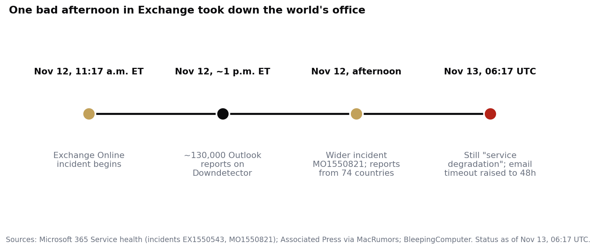

> [中文版 Chinese version](/life/microsoft-365-outage-nov-12-zh/)

*The Microsoft campus in Redmond, Washington. Photo: Atomic Taco, via Wikimedia Commons (CC BY-SA 2.0).*

## What happened

On Thursday, November 12, Microsoft 365 began failing worldwide. The trouble started with Exchange Online — the email service behind Outlook for most organizations — at 11:17 a.m. Eastern (16:17 UTC), according to Microsoft's service health record. Within about two hours, Microsoft opened a wider incident covering multiple Microsoft 365 services and said users in any region could be affected. Downdetector logged nearly 130,000 Outlook problem reports shortly after 1 p.m. Eastern, according to the Associated Press, with reports eventually coming in from 74 countries.

The outage hit Outlook on the web, desktop, and mobile, delayed mail delivery, broke Teams meeting scheduling and calendar entries, and knocked out Microsoft 365 Copilot, SharePoint features that depend on Exchange, Microsoft Graph, Planner, To Do, Intune, Purview, Power BI, and parts of Defender. Files stored directly in SharePoint remained accessible, and most Teams calls, meetings, and chats kept working — if you already had a meeting link, it generally still worked. But the disruption reached beyond Microsoft's own products: email accounts accessed through other clients such as Apple Mail were affected too, because the failure was in Microsoft's underlying infrastructure, and third-party AI services that connect to Microsoft accounts were disrupted as well. Japan confirmed a significant impact on government IT systems, and the disruption extended to businesses, courts, airlines, and government operations.

As of 06:17 UTC on Friday, November 13 — more than 14 hours in — Microsoft still listed the incident as "service degradation," not resolved. Repairs in parts of the Asia Pacific region were improving mailbox access, and Microsoft said it was seeing "early signs of stabilization," but capacity had not returned to normal and some servers went down again after being brought back. Microsoft extended the email timeout window to 48 hours to protect delayed messages while backlogs clear.

*Timeline of the outage. Sources: Microsoft 365 Service health; Associated Press via MacRumors; BleepingComputer.*

## What Microsoft says caused it — and what it has not said

Microsoft says this was not a cyberattack and that it is not aware of any malicious activity; a senior Microsoft executive has confirmed no security breach was involved. Its explanation so far is that a number of its servers became unexpectedly unavailable, and the remaining infrastructure buckled under the extra traffic. The company says it is reverting a recent network configuration change that coincided with the start of the outage, but it has not confirmed a root cause and has promised a full root-cause report once the incident is closed. It has given no deadline for full restoration.

Note the timing: a separate, earlier Teams incident ran from 9:45 to 10:53 a.m. Eastern on November 12, before the Exchange failure began. Microsoft has not said the two are related.

## The real story: one vendor, everything at once

Outages happen; this one is worth writing about because of what it took down together. For most organizations, Microsoft is not one supplier among many — it is email, calendar, documents, chat, and identity, and increasingly the AI assistant (Copilot) and the security stack (Defender) that sit on top of all of it. When Exchange went down, Copilot lost the ability to retrieve work emails, calendars, and files, and parts of Defender stopped doing their job. The security tooling that is supposed to catch problems during an incident depends on the same service that was failing.

That is the concentration risk in its purest form, and it is the same pattern as the other two stories this week: a company that depended on one founder, an industry that depends on a handful of AI vendors, and now a public being asked to trust one company's cloud with its working day. The mitigations are well known and rarely adopted — a second email path, a non-Microsoft chat channel for incident coordination, local copies of the day's calendar — because they cost money and attention every day, and the outage only costs money on the day it happens. The 48-hour email timeout extension is the quiet admission of scale here: Microsoft is not confident the backlog clears in a day.

There is also a narrower lesson for IT teams. The failure was not in the Outlook app on anyone's laptop, and reinstalling it or resetting a password would not have helped. The tell was the scope: web, desktop, and mobile failing together, in every region, at the same time, is a service problem, not a device problem. Microsoft's own status page — status.cloud.microsoft — is the place to check first next time, not the help desk queue.

Microsoft will publish a root-cause report when the incident closes. The interesting question it will have to answer is not just what broke, but why a capacity loss in one service cascaded across so many others — and what changes so that the next bad afternoon in Exchange does not take the world's office with it.

*This post reflects the status as of the morning of November 13, 2026 (PT). The incident was still ongoing at the time of writing; details may change as Microsoft publishes updates.*
