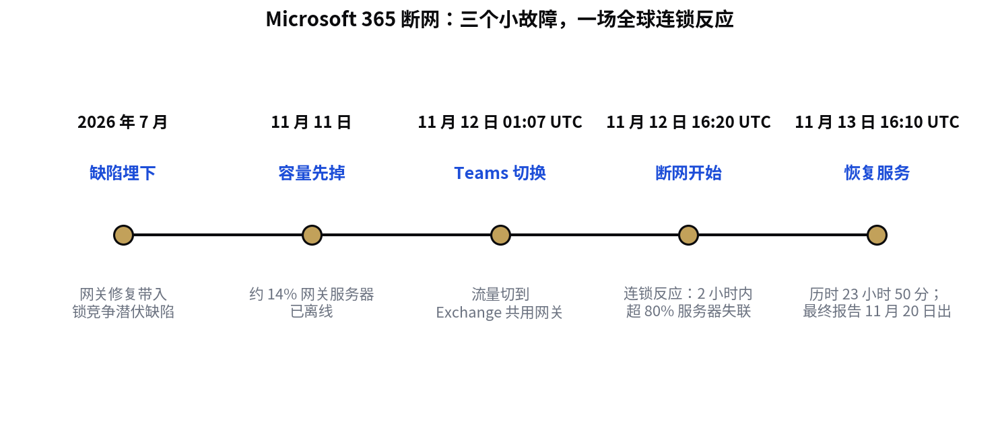

> [English version](/life/microsoft-365-outage-root-cause-update/)

*微软雷德蒙德园区。照片：Atomic Taco，来自 Wikimedia Commons（CC BY-SA 2.0）。*

**更新：**本文是我们 11 月 13 日报道 [《Microsoft 365 全球断网——而且断了很久》](/life/microsoft-365-outage-nov-12/)的后续，补充微软现已公布的根本原因。

## 发生了什么

微软发布了 11 月 12–13 日全球 Microsoft 365 断网事件的初步事后报告，解释比单一缺陷更令人不安。事件从 **11 月 12 日 16:20 UTC 持续到 11 月 13 日 16:10 UTC——23 小时 50 分钟**，Outlook、Exchange Online、Teams 与 Copilot 的邮箱访问中断、邮件大面积延迟。这份注明日期为 11 月 15 日、已分享给管理员的报告指出，**三个因素**“共同导致了面向众多 Microsoft 365 服务的网络网关的全球性中断”。附完整修复清单的最终报告将于 **11 月 20 日**发布。

三个因素分别是：

1. **一个自 7 月起潜伏的缺陷。**一份专为 Microsoft 365 网络网关服务器准备的修复带入了一个潜伏缺陷：内部 Windows 进程中的锁竞争，在特定负载条件下会耗尽 CPU 与内存。微软自 7 月起部署，三个多月未见异常。
2. **一次常规的 Teams 切换。**断网前约 15 小时，即 11 月 12 日 01:07 UTC，自动切换将 Teams 流量从备用网关移到同时承载 Exchange Online 的主网关。微软称这是正常操作的一部分，但它提高了受影响服务器的负载并改变了流量构成。
3. **容量事先已缩水。**由于前一天一个不相关的问题，网关近 **14%** 的服务器容量已离线。微软称单看这一点没有造成影响——仍有足够余量。

*连锁反应，一步一步。来源：微软初步事后报告（2026 年 11 月 15 日），经 Computer Weekly 与 BleepingComputer 报道。*

## 一个小缺陷如何变成全球断网

机制是最有意思的部分，也是微软自己的工程师在教科书里见过的每一次连锁故障的样子。本意是让用户留在健康服务器上的自动流量重定向，成了放大器。潜伏缺陷冻住一台服务器后，它的负载转移到幸存的邻居身上，邻居在更重的负载下撞上同一个缺陷、随之冻住。**不到两小时，受影响网关后超过 80% 的服务器失去响应。**本应阻止故障跨区域蔓延的隔离机制没有起到作用。

微软 Copilot、Agent 与平台执行副总裁 Charles Lamanna 在 X 上发帖道歉，确认了锁竞争缺陷与连锁反应。微软强调了两点：这是一次技术故障，**没有恶意活动的迹象**——不是网络攻击，也与 AI Agent 无关；缺陷仅限于 Microsoft 365 网关服务器，不涉及 Windows 整体或桌面 PC。

## 为什么这件事重要

三个因素单拎出来，每一个都站得住脚。一份平稳运行了四个月的修复；一次按标准流程进行的切换；一次仍有余量的 14% 容量损失。断网发生，是因为三者在同一天撞到一起——更因为系统自身的韧性机制（自动重定向）把局部故障变成了全舰故障。这是连锁故障的经典形态，也正是这份报告值得一读的原因，哪怕你从不碰 Exchange：同样的模式会出现在电网、航空与每一朵云里。

报告也留下了一个最大的问题没有回答：它没有解释本应遏制区域性故障的隔离系统为何失效——初步结论描述的是连锁反应本身，而非遏制机制的失效。这大概正是 11 月 20 日最终报告必须回答的问题，连同完整修复清单。据统计，这是今年**第四次**由微软自身变更与维护直接导致的大规模 Microsoft 365 断网——所以值得关注的不是道歉，而是修复清单。

*本文反映 2026 年 11 月 17 日上午（太平洋时间）的状况。来源：微软初步事后报告（2026 年 11 月 15 日）；Computer Weekly；BleepingComputer；Ars Technica；Windows Forum。*
