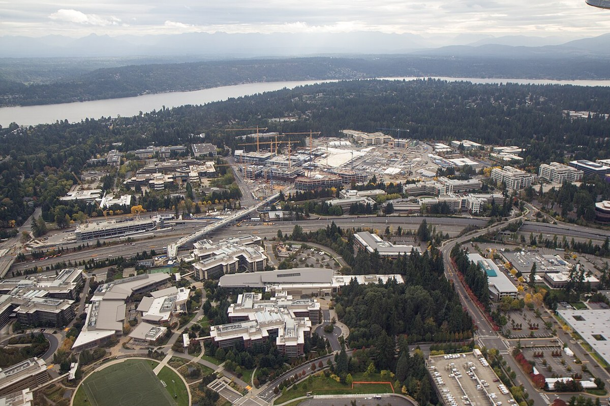

> [English version](/life/microsoft-365-outage-root-cause-update/)

*微软雷德蒙德园区。照片：Atomic Taco，来自 Wikimedia Commons（CC BY-SA 2.0）。*

**更新：**本文是我们 11 月 13 日报道 [《Microsoft 365 全球断网——而且断了很久》](/life/microsoft-365-outage-nov-12/)的后续，补充微软现已公布的根本原因。

## 发生了什么

微软发布了 11 月 12–13 日全球 Microsoft 365 断网事件的初步事后报告，解释比单一缺陷更令人不安。事件从 **11 月 12 日 16:20 UTC 持续到 11 月 13 日 16:10 UTC——23 小时 50 分钟**，Outlook、Exchange Online、Teams 与 Copilot 的邮箱访问中断、邮件大面积延迟。这份注明日期为 11 月 15 日、已分享给管理员的报告指出，**三个因素**"共同导致了面向众多 Microsoft 365 服务的网络网关的全球性中断"。附完整修复清单的最终报告将于 **11 月 20 日**发布。

三个因素分别是：

1. **一个自 7 月起潜伏的缺陷。**一份专为 Microsoft 365 网络网关服务器准备的修复带入了一个潜伏缺陷：内部 Windows 进程中的锁竞争，在特定负载条件下会耗尽 CPU 与内存。微软自 7 月起部署，三个多月未见异常。
2. **一次常规的 Teams 切换。**断网前约 15 小时，即 11 月 12 日 01:07 UTC，自动切换将 Teams 流量从备用网关移到同时承载 Exchange Online 的主网关。微软称这是正常操作的一部分，但它提高了受影响服务器的负载并改变了流量构成。
3. **容量事先已缩水。**由于前一天一个不相关的问题，网关近 **14%** 的服务器容量已离线。微软称单看这一点没有造成影响——仍有足够余量。

*连锁反应，一步一步。来源：微软初步事后报告（2026 年 11 月 15 日），经 Computer Weekly 与 BleepingComputer 报道。*

## 时间线：逐小时还原

报告的时间线显示，一场快速的连锁反应从外部看可以被识别得多么缓慢。Teams 切换发生在 **11 月 12 日 01:07 UTC**，比任何可见故障早约 15 小时——一次常规事件，记录下来就被遗忘了。影响始于 **16:20 UTC**，当时美国进入工作日的峰值时段，网关服务器开始冻结。第一起支持工单在 **16:33 UTC** 到达，仅晚了 13 分钟。此后故障开始自我喂养：自动流量重定向把负载从冻结的服务器转移到幸存的服务器上，后者在更重的负载下撞上同一个缺陷、随之冻结。**不到两小时，受影响网关后超过 80% 的服务器失去响应。**

Exchange Online 受创最重，依赖它的服务——部分 Teams 与 Copilot——也随之倒下。按微软事件更新的说法，大多数 Teams 通话、会议与群聊保持可用，但 Teams 日历、邀请与会议安排受到影响，Outlook 与 Exchange Online 的邮件延迟或无法访问。此次事件在微软内部的编号为 **EX1550543 与 MO1550821**。按报告的说法，服务于 **11 月 13 日 16:10 UTC** 恢复，距开始不到 24 小时；微软于 11 月 14 日 04:15 UTC 发布了最后一次客户更新，此后继续监测至当天。

## 四个月平安无事，为什么没能发现这个缺陷

报告中最重要的一点，或许正是解释了为什么 7 月、8 月、9 月、10 月都没有人发现这个缺陷。据相关报道，锁竞争问题在**核心数更多、硬件更新的机器上更严重**——而微软的实验室主要使用性能较弱、核心数较少的硬件，问题在那里不太容易出现。该修复通过了负载测试、部署后没有任何影响，因为测试环境与缺陷所在的真实生产环境并不一样。

这是一种熟悉的失效模式，值得直说：这个缺陷同时依赖负载与硬件。它需要特定的流量组合、特定的流量规模，再加上多核生产服务器，才会现身——而 11 月 12 日的切换提供了前两者，14% 的容量损失又把负载集中到更少的机器上，补上了第三者。三个多月里，这个缺陷存在于每一台网关服务器上，却一次都没有被触发。系统不是健康的，只是幸运的。这两种状态之间的差别，在运气耗尽的那一天之前是看不见的——这正是报告中关于测试硬件的那句低调承认，比随附的道歉更重要的原因。

这个"幸运而非健康"的 distinction 值得再往前推一步，因为它指向的是测试方法论本身的盲区，而不是某一次测试的疏忽。负载测试的逻辑是：在受控环境里模拟生产流量，观察系统是否稳定。但这个逻辑有一个隐含的前提——测试环境与生产环境在关键维度上足够相似。而 11 月的报告承认，微软的实验室主要使用性能较弱、核心数较少的硬件，问题在那里不太容易出现。换句话说，测试环境与生产环境在一个恰好决定缺陷是否现身的维度上并不相似：核心数。锁竞争在核心数更多、硬件更新的机器上更严重，因为更多的核心意味着更多的线程同时争抢同一把锁，争抢的概率随核心数上升。实验室的机器核心数少，争抢概率低，缺陷就藏住了；生产环境的机器核心数多，争抢概率高，缺陷一触发就是全局性的。这个盲区不是"测试做得不够多"，而是"测试测错了维度"：负载测试测了流量规模，却没有测硬件形态；而缺陷的触发条件恰恰是两者的组合。更值得警惕的是，这个缺陷从 7 月起就部署在每一台网关服务器上，三个多月里没有任何异常——这意味着，任何基于"过去三个月运行平稳"的信心，都是建立在一次从未发生的触发条件之上的。系统在三个月里没有出问题，不是因为它没有缺陷，而是因为触发缺陷的三个条件从未同时出现过。11 月 12 日，Teams 切换与 14% 的容量损失同时出现，三个条件第一次凑齐，缺陷第一次现身——而现身的时候，已经是全球断网。

## 恢复过程——以及微软改口的地方

工程师通过把连接处理代码回滚到此前已知的良好状态恢复了服务——当最近一次变更被证实是问题所在时，这是标准动作——随后清理了堆积的延迟邮件、扩充了服务器容量，并引入了防止连锁反应的保障措施。这些是初步报告中列出的已完成恢复措施；完整修复清单随 11 月 20 日的最终报告公布。

还有一个值得注意的出入：微软在断网期间的说法与报告现在的说法并不一致。微软 11 月 13 日的更新把断网归因于早前一次网络容量升级中的问题、被最近一次网络变更触发。而初步报告完全没有提到网络变更：它把断网归因于 7 月的 Windows 缺陷、Teams 切换与容量缩水。第一种解释是在事件仍在进行时给出的，断网期间的早期解释常常是错的——但这种转变提醒人们，客户在周五听到的故事，并不是工程师在周日得出的结论，而最终报告可能还会再次修正它。

## 一个小缺陷如何变成全球断网

机制是最有意思的部分，也是微软自己的工程师在教科书里见过的每一次连锁故障的样子。本意是让用户留在健康服务器上的自动流量重定向，成了放大器。潜伏缺陷冻住一台服务器后，它的负载转移到幸存的邻居身上，邻居在更重的负载下撞上同一个缺陷、随之冻住。**不到两小时，受影响网关后超过 80% 的服务器失去响应。**本应阻止故障跨区域蔓延的隔离机制没有起到作用。

微软 Copilot、Agent 与平台执行副总裁 Charles Lamanna 在 X 上发帖道歉，确认了锁竞争缺陷与连锁反应。微软强调了两点：这是一次技术故障，**没有恶意活动的迹象**——不是网络攻击，也与 AI Agent 无关；缺陷仅限于 Microsoft 365 网关服务器，不涉及 Windows 整体或桌面 PC。

值得把这个连锁反应的机制讲得更透一点，因为它解释了为什么一场"小缺陷"能在不到两小时内变成全球断网。锁竞争的本质是：内部 Windows 进程中的多个线程同时争抢同一把锁，互相等待、谁也前进不了，CPU 与内存被空转的等待耗尽，服务器随之冻结。这个缺陷有一个关键特性——它同时依赖负载与硬件：需要特定的流量组合、特定的流量规模，再加上多核生产服务器，才会现身。在负载较轻的时候，线程争抢锁的概率很低，缺陷几乎从不触发；在负载较重的时候，争抢的概率急剧上升，缺陷就会集中爆发。11 月 12 日的三个因素，恰好凑齐了触发它的全部条件：Teams 切换提高了受影响服务器的负载并改变了流量构成，14% 的容量损失又把负载集中到更少的机器上——每一台幸存的服务器都要扛比平时更重的负载，撞上缺陷的概率随之上升。而自动流量重定向把这个过程变成了正反馈：第一台服务器冻住之后，它的负载转移到幸存的邻居身上，邻居的负载更重、撞上缺陷的概率更高，于是邻居也冻住了；第二台冻住之后，负载又转移到剩下的服务器身上，概率进一步上升。不到两小时，受影响网关后超过 80% 的服务器失去响应——不是因为缺陷同时击中了所有服务器，而是因为每一台服务器的倒下，都让下一台服务器倒下的概率变得更高。这就是连锁故障的经典形态：一个局部故障，通过系统自身的保护机制（自动重定向）被放大成全局故障。

而这正是报告中最令人不安的部分：本应阻止故障跨区域蔓延的隔离机制没有起到作用。隔离系统的设计目标，是把区域性故障关在笼子里——一个区域的网关出问题，不应该拖垮另一个区域的网关。但初步报告没有解释隔离为何失效，只描述了连锁反应本身。按微软的说法，缺陷仅限于 Microsoft 365 网关服务器，不涉及 Windows 整体或桌面 PC——但这个限定并没有回答真正的问题：为什么一个网关的故障，能够跨过隔离的边界，蔓延到超过 80% 的服务器？11 月 20 日的最终报告必须回答这个问题，连同完整修复清单。如果隔离机制的设计本身有问题，那么修复就不只是修一个锁竞争缺陷，而是重新设计网关之间的隔离边界；如果隔离机制的设计没问题、只是这次没有生效，那么问题就出在运维与配置上——而这两种答案，指向的是完全不同的修复工作量。

## 是模式，不是意外

把 11 月的断网放在微软自 2023 年以来云服务中断的公开记录里看，它就不太像异常了。2023 年 1 月，一次广域网路由器变更导致 Microsoft 365 与 Azure 全球中断。2023 年 6 月，一系列 DDoS 攻击拖垮了 Outlook、OneDrive 与 Azure 门户。2024 年 7 月，第三方 CrowdStrike 的一次错误更新导致全球估计 850 万台 Windows 设备崩溃；同一个月另一起 Azure 故障被追溯到一次拒绝服务攻击，因微软防御响应中的错误而被放大。2024 年 11 月，一次后端系统变更导致 Outlook 与 Teams 中断超过一天。2025 年 7 月，Outlook 中断了大半天。2025 年 10 月，Azure Front Door——微软的全球流量分发服务——的一次配置变更导致 Microsoft 365、Copilot 与 Entra ID 中断约八个半小时，波及航空公司与零售商。2026 年 1 月，一次容量下降加一次有缺陷的负载均衡变更导致 Microsoft 365 恶化超过九小时。2026 年 7 月，美国的一次 Azure 断网被追溯到微软自动网络维护系统中的一个缺陷，该系统从比预期更多的设备上移除了网络路由。而在 2026 年 9 月底至 10 月初，多个地区的 Azure 客户经历了间歇性的连接与网络管理故障，影响 Azure 防火墙、VPN 网关与 ExpressRoute 网关。

每一次的原因都不同——路由器变更、配置变更、错误更新、负载均衡缺陷、自动化缺陷，形态却是一样的：供应商自己的变更与维护，作用在一个存在单点集中的系统上，连锁蔓延的范围超出了保障机制的设计。这正是 11 月报告关于隔离系统的承认之所以重要的原因：它描述的是连锁反应，而不是遏制机制的失效——而遏制机制如今已经不止一次失效了。

## 从 CrowdStrike 到 Front Door：微软的断网编年史

把 11 月的断网放进微软的断网编年史里看，它不太像异常。2024 年 7 月，CrowdStrike 的一次错误更新导致全球估计 850 万台 Windows 设备崩溃，据估计给财富 500 强企业造成约 54 亿美元损失；同一个月，另一起 Azure 故障被追溯到一次拒绝服务攻击，因微软防御响应中的错误而被放大。2025 年 10 月，Azure Front Door 的一次配置变更导致 Microsoft 365、Copilot 与 Entra ID 中断约八个半小时，波及航空公司与零售商。2026 年 1 月，一次容量下降加一次有缺陷的负载均衡变更导致 Microsoft 365 恶化超过九小时；2026 年 7 月，美国的一次 Azure 断网被追溯到微软自动网络维护系统中的一个缺陷，该系统从比预期更多的设备上移除了网络路由；9 月底至 10 月初，多个地区的 Azure 客户又经历了间歇性的连接故障。每一次的原因都不同，形态却是一样的：供应商自己的变更与维护，作用在一个存在单点集中的系统上，连锁蔓延的范围超出了保障机制的设计。11 月的报告没有解释遏制机制为何失效——而这正是它不止一次失效的部分。

## 断网时怎么办：给客户的应急手册

对客户来说，实际的教训与这份记录自 2023 年以来一直在讲的相同：承载邮件、日历与会议的平台出现数小时中断，是一种反复出现的运行状态，而不是罕见事件。缓解措施并不光鲜，但都是客户自己能做的：关键数据的离线备份、紧急沟通的第二通道（比如不依赖同一家云服务的即时通讯工具）、云服务中断那几个小时里的人工应急流程——谁负责通知客户、会议改到哪里、审批走什么线下流程。把这些写下来、演练一次，比等微软的最终报告更有用。11 月 20 日的最终报告将显示微软是否同意这一点，以及它打算改变什么——但客户的应急手册，不必等到那一天。

这个建议之所以值得认真对待，是因为数字本身已经说明了问题。按微软的服务等级协议，Microsoft 365 承诺 99.9% 的可用性，按月计算约相当于 43 分钟的停机额度；23 小时 50 分钟的中断远远超出这一额度——大约是月度额度的 33 倍。按协议客户可申请服务补偿，但实际补偿通常以服务抵扣的形式发放，且需要客户主动申请。换句话说，SLA 的补偿机制并不能弥补 24 小时断网造成的实际损失：它补偿的是服务费用，而不是停摆的工作时间、错过的会议、延迟的邮件与客户沟通。对企业客户来说，真正的成本不在账单上，而在业务中断本身——而这一点，任何 SLA 都补偿不了。这也是为什么应急手册的价值不在于"等微软修好"，而在于"微软修不好的那几个小时里，业务还能继续运转"。关键数据的离线备份意味着，即使邮箱打不开，核心文件仍然可以访问；不依赖同一家云服务的第二沟通通道意味着，即使 Teams 与 Outlook 同时倒下，团队仍然可以互相联系；写下来并演练过的人工应急流程意味着，断网的那几个小时里，每个人都知道该做什么，而不是等 IT 部门的通知。这些措施都不光鲜，没有一项涉及新技术，但它们共同回答了一个问题：当承载你全部协作的平台消失 24 小时的时候，你的业务是停摆，还是降级运行？11 月的断网已经是今年第四次由微软自身变更与维护直接导致的大规模 Microsoft 365 断网——这个频率本身就是答案：把业务连续性完全寄托在供应商的保障机制上，已经不再是一个合理的假设。

## 为什么是网关：Exchange Online 的单点

理解这次断网的关键，是理解"网关"这个词。Microsoft 365 的网络网关是众多服务的前门：邮件、日历、Teams、Copilot 的流量都要经过它。Exchange Online 是其中最重的服务，也是这次受创最重的服务——而 Teams 与 Copilot 的许多功能又依赖 Exchange Online，于是前门一堵，后面的房间跟着遭殃。这就是单点集中的代价：一个共享的入口，让几十项服务共用同一个故障域。微软设计了隔离系统，本意是把区域性故障关在笼子里，但初步报告没有解释隔离为何失效——它只描述了连锁反应本身。按微软的服务等级协议，Microsoft 365 承诺 99.9% 的可用性，按月计算约相当于 43 分钟的停机额度；23 小时 50 分钟的中断远远超出这一额度，按协议客户可申请服务补偿——但实际补偿通常以服务抵扣的形式发放，且需要客户主动申请。更值得注意的是 Downdetector 上的历史：2024 年 9 月 12 日的一次 Microsoft 365 中断，在美国就产生了超过 9 万份用户报告；2024 年 11 月 25 日的 Outlook 与 Teams 中断同样引发了数千份报告。用户报告的数量不是衡量中断的唯一标准，但它是衡量"多少人的工作停了"的最直接指标——而这个数字，在过去三年里一次比一次高。

## 为什么这件事重要

三个因素单拎出来，每一个都站得住脚。一份平稳运行了四个月的修复；一次按标准流程进行的切换；一次仍有余量的 14% 容量损失。断网发生，是因为三者在同一天撞到一起——更因为系统自身的韧性机制（自动重定向）把局部故障变成了全舰故障。这是连锁故障的经典形态，也正是这份报告值得一读的原因，哪怕你从不碰 Exchange：同样的模式会出现在电网、航空与每一朵云里。

报告也留下了一个最大的问题没有回答：它没有解释本应遏制区域性故障的隔离系统为何失效——初步结论描述的是连锁反应本身，而非遏制机制的失效。这大概正是 11 月 20 日最终报告必须回答的问题，连同完整修复清单。据统计，这是今年**第四次**由微软自身变更与维护直接导致的大规模 Microsoft 365 断网——所以值得关注的不是道歉，而是修复清单。

对客户来说，实际的教训与这份记录自 2023 年以来一直在讲的相同：承载你的邮件、日历与会议的平台出现数小时中断，是一种反复出现的运行状态，而不是罕见事件。缓解措施并不光鲜——关键数据的离线备份、紧急沟通的第二通道、云服务中断那几个小时里的人工应急流程——而这些要由客户自己来建，因为供应商自身的保障机制如今已经不止一次没能遏制住连锁反应。11 月 20 日的最终报告将显示微软是否同意这一点，以及它打算改变什么。

*本文反映 2026 年 11 月 17 日上午（太平洋时间）的状况。来源：微软初步事后报告（2026 年 11 月 15 日）；Computer Weekly；BleepingComputer；Ars Technica；Windows Forum；The Register；WCCFTech；DevOpsness。*

