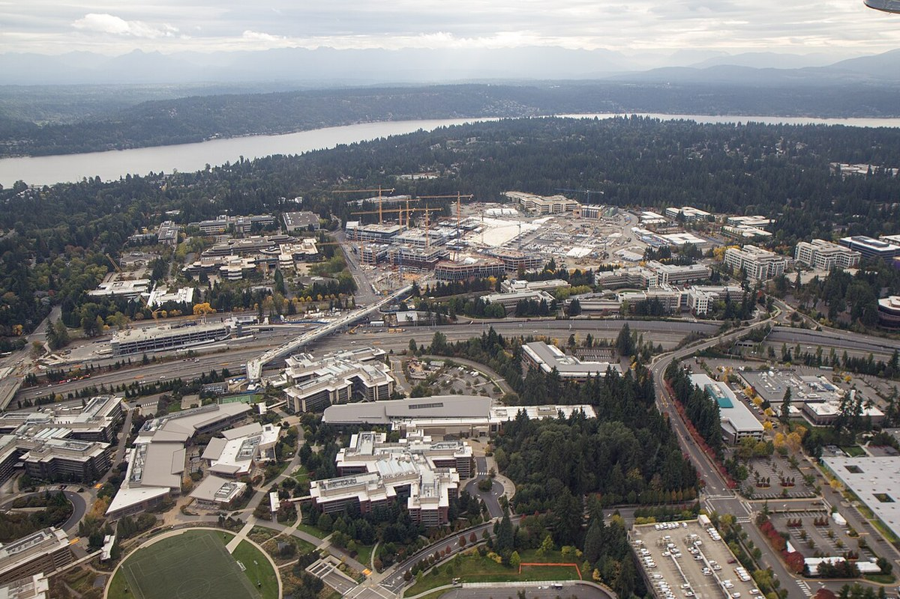
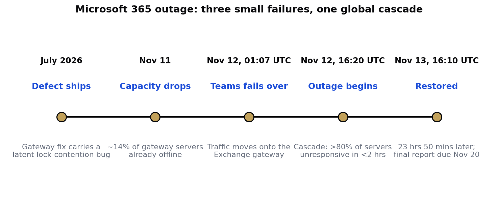

> [中文版 Chinese version](/life/microsoft-365-outage-root-cause-update-zh/)

*Microsoft's Redmond campus. Photo: Atomic Taco, via Wikimedia Commons (CC BY-SA 2.0).*

**Update:** this post follows up our November 13 coverage, [Microsoft 365 Went Down Worldwide — and Stayed Down](/life/microsoft-365-outage-nov-12/), with the root cause Microsoft has now published.

## What happened

Microsoft has published its preliminary post-incident report on the global Microsoft 365 outage of November 12–13, and the explanation is more unsettling than a single bug. The incident ran from **November 12 at 16:20 UTC to November 13 at 16:10 UTC — 23 hours and 50 minutes** — knocking out mailbox access and delaying email across Outlook, Exchange Online, Teams, and Copilot. The report, dated November 15 and shared with administrators, names **three factors** that "together caused a global outage for the networking gateway that fronts many Microsoft 365 services." A final report, with the full list of repairs, is due **November 20**.

The three factors:

1. **A defect dormant since July.** A fix prepared specifically for Microsoft 365's networking gateway servers carried a latent bug: lock contention inside an internal Windows process that could exhaust CPU and memory under certain load conditions. Microsoft deployed it starting in July and observed no issues for more than three months.
2. **A routine Teams failover.** About 15 hours before the outage, at 01:07 UTC on November 12, automated failover moved Teams traffic from an alternative gateway onto the primary gateway that also serves Exchange Online. Microsoft calls this part of normal operations. It raised load and changed the traffic mix on the affected servers.
3. **Capacity already missing.** Nearly **14%** of the gateway's server capacity was out of service from an unrelated issue the day before. Microsoft says that alone caused no impact — there was enough headroom.

*The cascade, step by step. Source: Microsoft preliminary post-incident report (November 15, 2026), via Computer Weekly and BleepingComputer.*

## The timeline, hour by hour

The report's timeline shows how slowly a fast cascade can be recognized from the outside. The Teams failover happened at **01:07 UTC on November 12**, about fifteen hours before anything visibly broke — a routine event, logged and forgotten. Impact began at **16:20 UTC**, as U.S. business hours hit their daily peak and gateway servers began freezing. The first support case came in at **16:33 UTC**, thirteen minutes later. From there the failure fed on itself: automatic traffic redirection moved load off frozen servers onto surviving ones, which hit the same defect under the heavier load and froze in turn. **In less than two hours, more than 80% of the servers behind the affected gateway were unresponsive.**

Exchange Online suffered most, and the services that depend on it — parts of Teams and Copilot — went with it. Most Teams calls, meetings, and group chats stayed available, according to Microsoft's incident updates, but Teams calendars, invitations, and meeting scheduling were affected, and email was delayed or unreachable across Outlook and Exchange Online. The incident is tracked under Microsoft's IDs **EX1550543 and MO1550821**. By the report's account, service was restored at **16:10 UTC on November 13**, just under 24 hours after it began; Microsoft issued its final customer update at 04:15 UTC on November 14, with additional monitoring in place through that day.

## Why four months of clean running hid the bug

The most important detail in the report may be the one that explains why nobody caught the defect in July, August, September, or October. According to reporting on the report, the lock-contention issue is **worse on machines with more cores and newer hardware** — and Microsoft's laboratories primarily used less powerful hardware with fewer CPU cores, where the issue was less likely to emerge. The fix passed load testing and was deployed without any impact, because the test environment did not look like the production environment where the bug lived.

That is a familiar failure mode, and it is worth naming plainly: the defect was load-dependent and hardware-dependent at the same time. It needed a particular traffic mix, a particular volume, and the many-core production servers to show itself — and the failover on November 12 supplied the first two, while the 14% capacity loss concentrated the load on fewer machines, supplying the third. For more than three months, the bug was present in every gateway server and triggered in none of them. The system was not healthy; it was lucky. The difference between those two states is invisible until the day the luck runs out, which is why the report's quiet admission about test hardware matters more than the apology attached to it.

## The recovery — and what Microsoft changed its story about

Engineers restored service by reverting the connection-handling code to its previously known good state — the standard move when a recent change turns out to be the problem — then cleared the delayed emails that had piled up, expanded server capacity, and introduced safeguards against cascading failures. Those are the completed recovery measures listed in the preliminary report; the full repair list comes with the final report on November 20.

There is also a discrepancy worth noting between what Microsoft said during the outage and what the report says now. Microsoft's updates on November 13 linked the outage to an issue during an earlier network capacity upgrade, surfaced by a more recent network change. The preliminary report does not cite a network change at all: it attributes the outage to the July Windows defect, the Teams failover, and reduced capacity. The first explanation was given while the incident was still running, and early explanations during an outage are often wrong — but the shift is a reminder that the story customers heard on Friday was not the story the engineers concluded on Sunday, and that the final report may refine it again.

## How a small bug became a global outage

The mechanism is the interesting part, and it is the part Microsoft's own engineers would recognize from every cascade failure in the textbooks. Automatic traffic redirection — the system designed to keep users on healthy servers — became the amplifier. When the latent defect froze a server, its load moved to surviving neighbors, which then hit the same defect under the heavier load, and froze in turn. **In less than two hours, more than 80% of the servers behind the affected gateway were unresponsive.** The safeguards meant to stop a failure spreading between regions did not contain it.

Charles Lamanna, Microsoft's executive vice-president for Copilot, agents and platform, apologized for the impact in a post on X, confirming the lock-contention defect and the cascade. Microsoft stressed two things: the incident was a technical failure with **no sign of malicious activity** — not a cyberattack, and not related to AI agents — and the defect was specific to its Microsoft 365 gateway servers, not to Windows in general or to desktop PCs.

## A pattern, not an accident

The November outage looks less like an anomaly when placed against the public record of Microsoft's cloud disruptions since 2023. In January 2023, a wide-area network router change disrupted Microsoft 365 and Azure globally. In June 2023, a series of DDoS attacks degraded Outlook, OneDrive, and the Azure portal. In July 2024, a faulty third-party CrowdStrike update crashed an estimated 8.5 million Windows devices worldwide, and a separate Azure failure the same month was traced to a denial-of-service attack amplified by an error in Microsoft's defensive response. In November 2024, a change to backend systems disrupted Outlook and Teams for more than a day. In July 2025, Outlook was disrupted for most of a day. In October 2025, a configuration change in Azure Front Door — Microsoft's global traffic delivery service — disrupted Microsoft 365, Copilot, and Entra ID for about eight and a half hours, hitting airlines and retailers. In January 2026, a capacity drop plus a flawed load-balancing change degraded Microsoft 365 for more than nine hours. In July 2026, an Azure outage in the U.S. was traced to a bug in Microsoft's automated network maintenance system, which removed network routes from more devices than intended. And in late September and early October 2026, Azure customers in multiple regions experienced intermittent connectivity and network management failures affecting Azure Firewall, VPN Gateway, and ExpressRoute.

The causes differ every time — a router change, a configuration change, a bad update, a load-balancing flaw, an automation bug. The shape is the same: the provider's own changes and maintenance, applied to a system with a single point of concentration, cascade further than the safeguards were designed to contain. That is why the November report's admission about the isolation systems matters: it describes the cascade, not the failure of the containment, and the containment is the part that has now failed more than once.

## Why this one matters

Each of the three factors, on its own, was defensible. A fix that ran clean for four months. A failover that is literally standard procedure. A 14% capacity loss with headroom to spare. The outage happened because all three lined up on the same day — and because the system's own resilience mechanism, automatic redirection, turned a local failure into a fleet-wide one. That is the classic shape of a cascade failure, and it is why the report is worth reading even if you never touch Exchange: the pattern shows up in power grids, airlines, and every cloud.

The report also leaves the biggest question open. It does not address why the isolation systems that were supposed to contain a regional failure did not work — the preliminary findings describe the cascade, not the failure of the containment. That is presumably what the final report on November 20 has to answer, along with the full repair list. This was, by one count, the **fourth major Microsoft 365 outage this year** tied directly to the company's own changes and maintenance — which makes the repair list, not the apology, the thing to watch.

For customers, the practical lesson is the same one the record has been teaching since 2023: a multi-hour outage of the platform your email, calendar, and meetings run on is a recurring operating condition, not a rare event. The mitigations are unglamorous — offline backups of critical data, a second channel for urgent communication, manual fallback procedures for the hours when the cloud is gone — and they are the customer's to build, because the provider's own safeguards have now failed to contain a cascade more than once. The final report on November 20 will show whether Microsoft agrees, and what it plans to change.

*This post reflects the status as of the morning of November 17, 2026 (PT). Sources: Microsoft preliminary post-incident report (November 15, 2026); Computer Weekly; BleepingComputer; Ars Technica; Windows Forum; The Register; WCCFTech; DevOpsness.*

