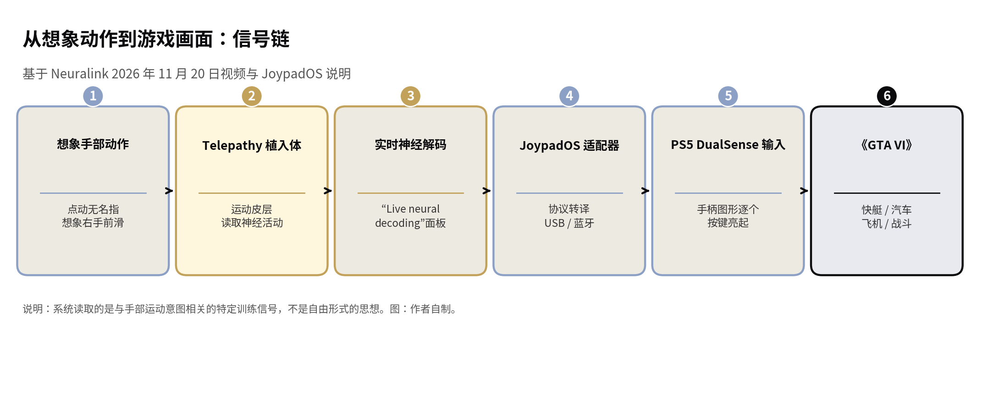

> [English version 英文版](/life/neuralink-plays-gta-6/)

*《GTA 6》官方主视觉，即 Neuralink 视频中出现的游戏。图片来源：Rockstar Games。*

## 一段两分钟的视频，时间点精确到天

2026 年 11 月 20 日——《侠盗猎车手 6》（Grand Theft Auto VI）在 PlayStation 5 与 Xbox Series X|S 上全球发售的第二天——Neuralink 在 X 上发布了一段两分钟的视频，配文只有一句：“Playing GTA VI with a Neuralink（用 Neuralink 玩 GTA VI）。”

视频中的人是 Neuralink 的一名临床试验参与者。Neuralink 没有公布他的姓名，本文也不会公布。真正值得看的，是他在镜头前做到了什么，因为这些内容的难度，是脑机接口公司通常发布的演示刻意回避的。

他驾驶一辆快艇从桥下穿过，驶入一条狭窄的、两岸都是树木的水道，执行屏幕上给出的“取一个包裹”的任务指令。他开汽车。他开飞机。他战斗、开枪。这四件事不是为了画面好看随便凑的。它们合在一起，几乎覆盖了现代开放世界游戏最难操控的部分：持续的方向控制、油门与镜头的同时管理、三维空间里的飞行，以及对迟缓和误差零容忍的战斗。光标演示要求系统把一个指针移到目标上再点击一下；《GTA 6》要求系统同时做好几件事、实时地做，而且游戏世界不会停下来等你。

视频发布后一天之内，Interesting Engineering、Inven Global、TeslaNorth、Men's Journal、VG Times 等媒体在 11 月 20 日至 21 日相继报道。这个传播范围本身就说明问题：视频达到了它选定这个时间点想要的效果——它冲出了医疗器械与神经科技的小圈子，进入了游戏媒体和大众科技媒体的版面。这正是一个发售周的《GTA 6》片段能抵达、而一项实验室光标研究永远抵达不了的受众。

所以第一个判断很简单：在公开演示的层面上，这是一次真实的难度跃升。第二个判断同样重要，也是本文接下来要论证的：演示更难，不等于证据更强。这段视频证明了，一名未具名的参与者，在由出售植入体的公司亲自挑选和制作的片段里，能够玩这款高难度游戏中看起来相当完整的段落。它没有公布任何能让 Neuralink 之外的人判断他玩得有多好、多稳定、多普遍的数字。这句话的两半，都应该在标题的喧嚣之后活下来。

## 为什么一款真正的游戏，比光标演示难得多

大多数公开的脑机接口演示，在设计上就是宽容的。把光标在屏幕上移动，可以容忍延迟；选一个字母，可以容忍偶尔的错误；即便是玩一款更简单的游戏，也可以把输入词汇量压得很小、把节奏交给参与者自己、让一次失误的代价不过是重开一局。

《GTA 6》把这些缓冲垫一个一个抽走了。

开车和开船是连续控制问题。船不是靠菜单选项移动的，它会漂移、会过冲，需要不断做小幅修正——尤其是在视频里那条狭窄的水道里，两边的树就是全部的容错空间。飞行又多了一条垂直轴，多了一种地面载具没有的失败方式：失速、俯冲、坠毁。战斗加上了时间压力和目标选择：正确的输入晚一秒，就是错误的输入。而贯穿始终的，是镜头管理——在第三人称开放世界游戏里，镜头本身就是一套与移动并行运行的连续控制系统。

这就是为什么游戏的选择在分析上有意义，而不只是在营销上有意义。如果解码出来的信号噪声大、延迟高，或者只能可靠地提供一两个指令，这种软件会在几秒钟之内把它暴露出来。当然，精选片段可以藏住很多东西——失败的尝试、被剪成成功片段的长时段游玩、难度设置、辅助选项——这些我们后面会专门谈。但有一件事是精选片段很难伪造的：在播出的段落里，一艘船确实穿过了一条狭窄水道，一架飞机的机头确实按指令抬了起来，一场枪战确实进行了下去。控制回路，至少在这些段落里，是闭合的。

奇观背后还有一个容易被忽略的无障碍要点。游戏不是辅助技术的“娱乐性”测试项目。游戏是普通生活中输入密度最高的活动之一，而且它本质上是社交的：发售周是一场共享的文化事件，人要么能以大致平等的条件加入，要么只能在外面看。一名参与者能加入发售周——玩的不是简化版的治疗游戏、不是演示用的应用，而是所有人排队买的同一款作品——他演示的是“参与”这件事本身，而不仅仅是信号解码的精度。Neuralink 显然非常清楚这一点。这也是把这场演示放到公众面前最站得住脚的理由。

## 它到底是怎么工作的——以及它不是什么

如果看的是画面上的叠加信息、而不是只看游戏画面，这段视频对自己的机制交代得异常清楚。

屏幕上，游戏画面旁运行着一个标着“Live neural decoding（实时神经解码）”的面板；同时，一张 PlayStation 5 DualSense 手柄的示意图，会随着每个输入被触发而逐个亮起。第二个元素，是整段演示最诚实的核心。植入体并没有把某种抽象的“意念”直接射进主机里。解码出的信号被变成了普通的手柄输入——就是这款游戏本来就懂的那套摇杆、扳机和按键的词汇——而观众能亲眼看着这些输入一个接一个地被触发。

映射方式由参与者自己解释。点动——或者说想象点动——无名指，可以触发动作。他原话是：“Right now I'm just like tapping my ring finger. Each ring finger. Bam.（我现在就是在点我的无名指。每个无名指。砰。）”想把飞机的机头拉起来，他就想象自己的右手向前滑。不同的想象动作，映射到不同的指令。

这正是 Neuralink 对 Telepathy 设备的官方描述方式：植入体读取大脑中与手部运动相关区域的神经活动，把有意做出的、或想象中的动作，翻译成指令。控制信号是具体的、经过训练的：这个想象动作，对应这个输入。换句话说，这套系统给参与者的，是一组新的“虚拟手指”，解码器学会了识别这些手指动作对应的神经模式。

正因如此，有一个澄清必须明明白白地说出来，因为几乎所有病毒式传播的转述都把这一点说错了：**这不是读心术，它解码的不是自由形式的思想。**参与者不是在脑子里用语言想着“向左转”，也不是在想象那艘船的样子、然后由系统去解读他的内心世界。他是在做——或者想象在做——特定的手部动作，而一个用这些动作的神经模式训练出来的解码器，把它们转换成手柄指令。这个区别不是咬文嚼字。它是一台运动假体与科幻意义上的心灵感应之间的区别：产品的名字很容易让人往后者想，而技术交付的是前者。运动意图本身就是一种真实的、信息量丰富的信号，把它解码好是一项很难的工程成就。这项成就不需要夸张来撑场面；恰恰相反，夸张会误导那些最需要准确图景的人——包括潜在的临床试验参与者。他们需要知道的是：报名参加意味着训练、校准，以及一套必须学习和维护的想象动作词汇，而不是一台“能听见思想”的机器。

*图：作者自制，基于 Neuralink 2026 年 11 月 20 日视频与 JoypadOS 说明。*

## JoypadOS：让这一切成为可能的那块“不性感”的拼图

这个故事里埋着一个系统工程师会最欣赏的组件，恰恰因为它一点也不性感：JoypadOS。

JoypadOS 是一套手柄适配器固件，作者是 Robert Dale Smith，他在 Neuralink 从事脑机接口应用方面的工作。它的任务，是在不同的手柄协议之间做转译，通过 USB 和蓝牙，让一台 PlayStation 5 把解码出的信号当作合法的手柄输入接受下来。换句话说，这场未来感十足的演示的最后一公里，是一层兼容层——正是那种让大多数真实系统能跑起来的、不起眼的管道工程。

这一点重要，有两个原因。

第一，它诚实地解释了这套系统的架构。这里所谓的“突破”，其实是被拆成两半的：一半是把运动意图从大脑里解码出来，另一半是把主机的语言说得足够流利，让游戏完全察觉不到区别。后一半，才是把实验室里的输出变成消费级产品体验的东西。没有它，你拥有的只是研究电脑上的一串信号；有了它，你拥有的是一艘在雷奥奈达水面上行驶的船。

第二，它指出了脑机接口游戏在近期最现实的形态。这里展示的路线，不是“为大脑重新设计游戏”，而是“把大脑通过适配器，接到已经存在的输入标准上”。这是一个可扩展得多的命题：原则上，每一款接受 DualSense 手柄的游戏都可以这样玩，开发者不需要写一行脑机接口代码。但这同时也意味着，性能的天花板有一部分是由这层转译决定的——由到底有多少个彼此独立、足够可靠的解码信号，能被映射到一只为两只手、十根手指和两根模拟摇杆设计的手柄上。手柄是一种输入带宽非常丰富的设备。用经过训练的想象动作去匹配它的哪怕一小部分带宽，才是这场技术竞赛真正的赛场——而恰恰是这场比赛，视频没有给出比分。

## 植入之前：一根口棒和一台 iPad

这段视频最重要的背景，不是技术性的，而是参与者以前用什么。

在植入之前，他用一根口棒和一台 iPad 来操作设备——用他自己的话说，“like a bird, just pecking at an iPad（像一只鸟，就那么啄着一台 iPad）”，而且这种方法让他的下巴发酸。与这个基线相对照，他把通过植入体操控电脑称为“Portal to the world（通往世界的门户）”。

这个对照，应该成为评估这项技术的锚点，包括那些批评性的评估。对一件辅助设备来说，相关的问题不是它能不能打赢一个健康人手里的 DualSense——它不需要打赢，而且就已公布的证据而言，没有人应该声称它打赢了。相关的问题是：它替代了什么。如果替代选项是叼着口棒啄平板、啄到下巴发酸，那么一套能让你在今年最大的游戏里开船、开车、开飞机、打枪——并由此以接近意图的速度去操作一台电脑——的系统，带来的就是性质上的改变，而不只是程度上的改良。“通往世界的门户”是参与者自己的说法，而他指的，是屏幕另一侧的一切：工作、交流、娱乐、隐私、无聊，全都在内。

把这个基线放在心里，也能让批评保持分寸。下一节要谈的 Neuralink 披露上的缺口，是真实的，而且重要。但这些缺口，出现在一项其目标用户可能把哪怕不完美的版本都体验为脱胎换骨的技术上。这两件事同时成立。任何丢掉其中一件的分析——忘记缺失数据的狂欢，或者忘记那根口棒的怀疑论——都对不起它所讨论的对象。

## Neuralink 没有披露的东西

下面这份清单，应该伴随这段视频的每一次转发出现，因为它里面的东西，一样都不在视频里。

Neuralink 没有公布这段演示中控制回路的**任何延迟数据**——从想象动作到屏幕响应的时间。在一款有驾驶和战斗的游戏里，延迟不是细节；在更高的难度下，它就是“能玩”和“不能玩”的分界线。Neuralink 没有公布**任何准确率或错误率数据**：解码出的输入有多大比例正是想要的那个，无名指信号有多大概率误触发或漏触发，两分钟精选片段之外的那次游玩到底是什么样。它没有公布**单次游玩时长或疲劳数据**，没有公布难度与辅助设置，也没有交代这段画面之前经过了多少训练和校准。它没有接受**任何独立验证**：画面由公司制作，参与者未具名，就随这段视频公开的记录而言，没有任何外部研究者复现或审计过这次游玩。

Neuralink 自己在后续声明中的免责措辞，值得被完整转述、而不是被跳过，因为公司自己把边界说得很清楚。这些设备是**研究性的（investigational），没有获得 FDA 或其他监管机构的批准**。视频内容展示的是自愿参加试验的参与者，他们的体验**不一定能代表所有参与者、或未来的结果**。而且，这类游戏与主机操控，**只对一部分参与者开放**，并不是其所有研究中的人人可得。

把这三句话连起来读，这段视频的性质就从“产品发布”变回了它在法律上和科学上的真实身份：一个正在进行的实验里，被挑选出来的一段体验。这不意味着它是假的，也不意味着它不重要。它意味着它是一段精选集锦——大概真实地记录了镜头前发生的事，同时系统性地不完整：它没有记录这项技术在不同人、不同时段、不同时长下到底是什么样。诚实的分析单位，不是“Neuralink 能玩《GTA 6》了”，而是“一名参与者，在一次被选定用于发布的场合，在总共两分钟的剪辑视频里，玩了《GTA 6》的若干段落，具体条件公司没有说明”。这句话不好传播。但它更准确。

还有一项披露值得单独点出，因为它把画面从游戏拉宽了。Neuralink 已经注册了一项新的美国研究，名为 PRIME2，其中包括一些在中风后留有持久功能障碍的人，它测试的是电脑操控能力——不是游戏表现。这是一个关于临床项目真正瞄准方向的有意义的信号：更广泛的人群，以及操控电脑这一项基础能力；游戏是这项能力一个高难度的展示橱窗，而不是终点。读者在判断这项技术的医学走向时，应该给 PRIME2 那个毫不性感的“电脑操控”终点，比那艘快艇更高的权重——哪怕他们记住的注定是那艘快艇。

## 时机问题：一个无障碍故事，一个营销时刻

不点破时机问题，是天真的。这段视频不是出现在二月某个普通的星期二。它出现在娱乐史上最大的一次游戏发售的第二天，绑在那个注定会统治公司想进入的每一个信息流的标题上。（这次发售的规模在这里只是背景，不是本文的主题，一句带过足矣——无论以什么尺度衡量，这款游戏都是这一周的文化事件。）

这是问题吗？不必然。辅助技术有一段漫长而体面的历史：在文化主舞台上展示自己，而且有充分的理由应该这么做——只在临床场景里展示的残障技术，只会在临床场景里被资助、被讨论。一名参与者在同一个周末、玩着同一款游戏，和数百万其他人一样，这个画面所表达的“融入”，是光标研究表达不了的。而这位参与者是自愿的，他在镜头前看起来为自己做到的事感到自豪。如果把他的展示仅仅当作营销，那是在抹掉公司策略的同时，也抹掉了他本人的能动性。

但时机确实抬高了公司应该被要求的标准。当你借用了娱乐史上最大首发的注意力，你面对的就不再只是临床圈子——那个圈子知道怎么读“研究性设备”的免责声明。你面对的是数以百万计的人，其中包括瘫痪患者和他们的家人，他们会把这段视频读成“这个东西现在有了”。而以那种意义来说，它现在并没有：它是研究性的、未获批准的，以这种游戏形态只对试验中的一部分参与者开放，性能数据没有公布。一段发售周病毒视频所暗示的东西，与小字声明所说的东西之间的落差，是这个故事的伦理中心。而这个落差，是公司在选择日期时自己选的。解药不是沉默，而是与演示同等音量的披露：延迟、准确率、错误率、训练时间、游玩时长。和续集视频一起把它们公布出来，营销时刻就会变成证据时刻。在那之前，每一位观众都不得不自己去补标题没有做的工作。

## 把这段演示放回脑机接口的演示阶梯上看

要准确估计这段视频的分量，最好把它放回这类技术过去公开演示的阶梯上，一级一级地比。

阶梯的最低一级，是光标。参与者在屏幕上把光标移到目标位置，完成点击或选择。这一步验证的是解码器最基本的能力：能不能从神经活动中稳定地提取出方向和确认两个信号。它的优点是可量化——速度和准确率都能写成数字；它的缺点是离真实生活太远，没有人的人生目标是把光标移得更快。

中间一级，是文字输入和网页浏览。参与者用解码信号打字、选词、打开应用。这一级开始触及真实效用：沟通的速度，直接决定了一个人能不能工作、能不能社交、能不能不依赖他人表达自己。但它的节奏依然由参与者主导，界面会等待，错误可以删除重来，整个过程没有外部时钟在催促。

再往上，是节奏由软件主导的实时任务：节奏游戏、竞速游戏、飞行模拟。到了这一级，系统第一次必须在别人定的时间窗口里给出正确答案。窗口错过就是错过，不能撤销，不能暂停思考。《GTA 6》的驾驶与战斗段落属于这一级，而且是这一级里输入维度最丰富的商业样本之一：它不是为演示定制的软件，没有为脑机接口放宽判定，它对所有玩家一视同仁地苛刻。

阶梯的最高一级——目前还没有任何公司公开、完整地展示过——是长时间、无剪辑、可复现的完整游玩：一整段任务从头到尾，包含失败、重试、疲劳和恢复，附带全部原始数据。Neuralink 这次的视频站在第三级，向第四级伸了下手，但没有站上去。承认它站到了第三级，是对工程进展的诚实；指出它还没有站上第四级，是对证据标准的诚实。这两种诚实并不矛盾，恰恰相反，只有同时说出这两句，评价才是完整的。

这条阶梯还解释了为什么“有没有辅助瞄准、有没有开自动驾驶类的游戏内辅助”这类问题如此关键。在第三级里，游戏自身的辅助系统可以承担相当一部分控制负担：自动居中、瞄准吸附、路线保持，每一项都会把演示的真实难度往下调。Neuralink 没有公布这些设置，所以外界无从知道参与者承担的到底是完整难度，还是被辅助系统削平之后的难度。这不是指控，只是再次说明：演示的级别可以从画面判断，演示的含金量却只能从披露判断。

## 对潜在参与者和家属来说，该怎么读这段视频

这段视频最重要的观众，不在游戏媒体的评论区里。他们是脊髓损伤、中风后遗症、渐冻症等疾病的患者和家属。对他们来说，这段视频传递的信息需要被非常小心地拆解，因为读错的代价不是“观点错误”，而是希望与决定的错位。

第一层，该读到的，是真实的希望。一名参与者此前靠口棒操作平板，如今能在主流游戏里完成复杂操控——这说明运动皮层解码这条技术路线，确实能把一部分失去的自主性还回来。这不是画饼，画面里发生的事就是证据本身。任何以“不过是营销”为由把这一层一笔抹掉的评论，都没有站在使用者的位置上想过问题。

第二层，必须同时读到的，是距离。这项技术仍处在临床试验阶段，设备未获监管批准，游戏操控只对部分参与者开放，公开数据里没有延迟、准确率和长期稳定性。试验参与意味着手术、训练、随访和不确定性，意味着成为证据的一部分，而不是购买一件成熟产品。把两分钟的视频读成“很快就能用上”，是把第三级演示误读成了货架上的商品。

第三层，是可以实际去追问的问题清单。如果一家机构或一家公司向你展示类似的演示，值得问的是：单次使用能持续多久？解码准确率是多少，误触发多不多？训练和校准需要多少时间、多久重做一次？植入之后，设备在数月尺度上稳定吗，还是信号会漂移？出现问题的参与者去哪儿、由谁负责？退出试验之后，设备怎么办？这些问题没有一个能在两分钟视频里得到回答，但每一个都有权被提出，而且提出它们不是泼冷水——它们正是把希望从营销里分离出来、放回医学里的唯一方法。

Neuralink 注册 PRIME2、把人群扩展到中风后遗症者、并把终点设为朴素的“电脑操控”，对家属读者的含义也在这里：这个领域的主线竞争，仍然在“能不能稳定地控制一台电脑”这件看起来不酷、却决定生活质量的事情上。快艇和飞机是橱窗，电脑操控才是货架。判断这项技术进展的最好方式，是盯着货架，而不是只看橱窗。

## 接下来该看什么：一份可验证的清单

与其争论这段视频“算不算突破”，不如把下一次值得认真对待的披露列成清单，等 Neuralink——或任何一家同行公司——下一次发布时逐项对照。

一，延迟数字。从想象动作到屏幕响应的端到端延迟，哪怕只给中位数和分布，也能让驾驶与战斗段落的难度第一次变得可比较。二，准确率与错误率。每个映射信号的命中率、误触发率，最好按任务类型拆开：巡航驾驶和近距离枪战，本来就不是同一种考验。三，时长与疲劳。一段连续游玩能维持多久，性能随时间如何衰减，休息后能否恢复——这决定了它是一次演示，还是一天的生活。四，训练成本。从植入到能玩到画面中的水平，中间隔着多少小时的校准和练习；这个数字决定了技术能不能走出少数明星参与者，抵达普通患者。五，设置的完整披露。游戏难度、辅助选项、剪辑比例——花了多长时间拍出这两分钟。六，独立验证。哪怕只是一次由外部团队在场、或原始会话数据向研究界开放，都会让下一次演示的证据等级整体上移一级。

这份清单的好处是，它对公司也是公平的：如果 Neuralink 公布其中哪怕两三项，它的下一次演示就会立刻比所有竞争对手的精选集锦更可信。披露在这里不是负担，而是最便宜的竞争优势。反过来，如果下一次发布仍然只有画面、没有数字，那么无论画面里的游戏换成哪一款，结论都只能停在原地：又一段很好的演示，又一次没有增加的证据。

## 判断

那么，11 月 20 日这一天，到底确立了什么？

它可信地确立了：完整的回路——想象手部动作、运动皮层解码、通过 JoypadOS 做协议转译、标准的 DualSense 输入、一款高难度的商业游戏——能够至少在精选段落里，工作得足够好，好到能驾驶一艘快艇穿过狭窄水道，能开车，能开飞机，能在《GTA 6》里战斗。对一名此前的人机界面是一根口棒和一个酸痛下巴的参与者来说，这不是杂耍。这是一次关于“接入”的演示，演示的舞台是当下能找到的最难的主流软件，演示的时机是这款软件最重要的那个时刻。

它没有确立的是：这个回路有多快、多准、能持续多久、需要多少训练、在其他参与者身上表现如何，以及监管机构是否终有一天会批准它。这一点 Neuralink 自己在免责声明里说了。任何省略了这份免责声明的报道，都是在亏待自己的读者——尤其是它那些残障读者。

所以，对待这段视频的正确姿态，不是互联网偏爱的那两种中的任何一种。不是惊叹：一段两分钟的公司精选集锦，不是一个问题已被解决的证据。也不是 dismiss、不是一句“不过如此”：这不是光标演示，从啄一台 iPad 到在雷奥奈达开一架飞机，这段距离是真实的、有人性分量的距离。正确的姿态，是用公司自己的演示所暗示的标准去要求公司：你把游戏给我们看了。现在，把数字给我们看。一项有底气在公众面前玩《GTA 6》的技术，应该也有底气公布自己的延迟。

*本文不涉及价格与供应问题；监管状态按 Neuralink 在 2026 年 11 月 20 日至 21 日自己的表述写明。本文为纯外部视角，仅基于 Neuralink 公开发布的视频与免责声明，以及随稿附带来源文件中列出的报道写成。*
