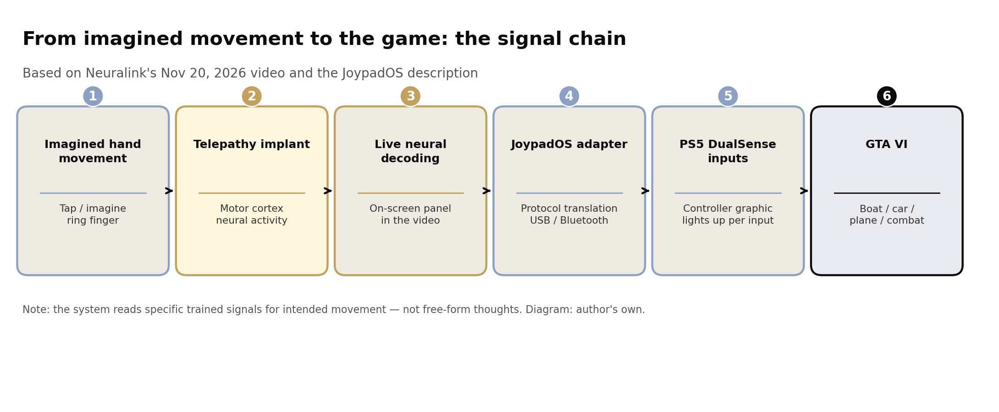

> [中文版 Chinese version](/life/neuralink-plays-gta-6-zh/)

*Official key art for Grand Theft Auto VI, the game shown in Neuralink's video. Image: Rockstar Games.*

## A two-minute video, timed to the day

On November 20, 2026 — one day after *Grand Theft Auto VI* launched worldwide on PlayStation 5 and Xbox Series X|S — Neuralink shared a two-minute video on X with a short caption: "Playing GTA VI with a Neuralink."

The participant in the video is a Neuralink clinical-trial participant. Neuralink did not name him, and this post will not name him either. What matters is what he does on camera, because it is deliberately more ambitious than the demonstrations brain-computer interface companies usually publish.

He steers a speedboat under a bridge and into a narrow, tree-lined channel, following an on-screen instruction to collect a package. He drives a car. He flies a plane. He fights and shoots. Those four activities are not decorative choices. Together they cover most of what makes a modern open-world game hard to control: continuous steering, throttle and camera management, three-dimensional flight, and combat that punishes slow or imprecise inputs. A cursor demo asks a system to move a pointer to a target and click. *GTA VI* asks it to keep doing several things at once, in real time, while the world refuses to wait.

Coverage followed within a day across Interesting Engineering, Inven Global, TeslaNorth, Men's Journal and VG Times, all on November 20–21. That spread tells you the video did what it was timed to do. It broke out beyond the medical-device and neurotechnology press into gaming and general technology coverage — which is precisely the audience a launch-week *GTA VI* clip reaches and a laboratory cursor study never does.

So the first judgment is simple: as a public demonstration, this is a genuine step up in difficulty. The second judgment, which the rest of this post will defend, is just as important: a harder demo is not the same thing as stronger evidence. The video shows that one unnamed participant, in footage selected and produced by the company selling the implant, could play substantial-looking segments of a demanding game. It does not publish the numbers that would let anyone outside Neuralink judge how well, how reliably, or how generally he played. Both halves of that sentence deserve to survive the headline.

## Why a real game is a harder test than a cursor

Most public BCI demonstrations are, by design, forgiving. Moving a cursor across a screen tolerates delay. Selecting a letter tolerates an occasional error. Even playing a simpler game can be arranged so that the input vocabulary is small, the pace is set by the participant, and a mistake costs nothing but a restart.

*GTA VI* removes those cushions one by one.

Driving and boating are continuous-control problems. A boat does not move in menu selections; it drifts, overshoots and needs constant small corrections, especially in the narrow channel shown in the video, where the margin is the trees on either side. Flying adds a vertical axis and a failure mode — stall, dive, crash — that ground vehicles do not have. Combat adds time pressure and target selection: the correct input a second late is the wrong input. And throughout, the player must manage a camera, which in a third-person open-world game is effectively a second continuous control running alongside movement itself.

That is why the choice of game matters analytically, not just promotionally. If the decoded signal were noisy, slow or limited to one or two reliable commands, this is the kind of software that would expose it within seconds. A highlight reel can hide many things — failed attempts, long sessions cut down to successes, difficulty settings, assists — and we will come back to that. But it cannot easily fake the basic visual fact that, in the segments shown, a boat threads a channel, a plane's nose comes up on command, and a firefight proceeds. The control loop, at least in those segments, closes.

There is also an accessibility point hidden inside the spectacle. Games are not a frivolous test case for assistive technology. They are one of the most input-dense activities in ordinary life, and they are social: launch week is a shared cultural event that people either get to join on something like equal terms or watch from outside. A participant who can join launch week — not a simplified therapeutic game, not a demonstration app, but the same release everyone else queued for — is demonstrating something about participation, not just about signal decoding. Neuralink clearly understands that. It is the strongest legitimate argument for doing this demo in public at all.

## How it actually works — and what it is not

The video is unusually helpful about its own mechanism, if you watch the overlays rather than the gameplay alone.

On screen, a panel labelled "Live neural decoding" runs alongside the game, and a graphic of a PlayStation 5 DualSense controller lights up as individual inputs fire. That second element is the honest core of the demonstration. The implant is not beaming intentions into the console in some abstract sense. Decoded signals are being turned into ordinary controller inputs — the same vocabulary of sticks, triggers and buttons the game already understands — and the viewer can watch those inputs trigger in sequence.

The participant explains the mapping himself. Tapping — or imagining tapping — his ring finger triggers actions: "Right now I'm just like tapping my ring finger. Each ring finger. Bam." To pull a plane's nose up, he imagines sliding his right hand forward. Different imagined movements, mapped to different commands.

That is exactly how Neuralink's Telepathy device is described as working. The implant reads neural activity in the region of the brain associated with hand movement, and translates intended or imagined movements into commands. The control signals are specific and trained: this imagined movement means this input. The system is, in effect, giving the participant a new set of virtual fingers, whose movements the decoder has learned to recognise.

Which is why one clarification must be stated plainly, because almost every viral summary of this video gets it wrong: **this is not mind reading, and it does not decode free-form thoughts.** The participant is not thinking "turn left" in words, or picturing the boat, and having the system interpret his inner life. He is performing — or imagining performing — particular hand movements, and a decoder trained on the neural patterns of those movements converts them into controller commands. The distinction is not pedantry. It is the difference between a motor prosthesis, which is what this is, and telepathy in the science-fiction sense, which the product's name invites people to imagine and the technology does not deliver. Motor intention is a real, information-rich signal, and decoding it well is a hard engineering achievement. It does not need the exaggeration, and the exaggeration actively misleads the people — including potential trial participants — who most need an accurate picture of what signing up involves: training, calibration, and a vocabulary of imagined movements that has to be learned and maintained, not a device that simply listens to thought.

*Diagram: author's own, based on Neuralink's Nov 20, 2026 video and JoypadOS description.*

## JoypadOS: the unglamorous piece that makes it possible

Buried in the story is the component that systems engineers will appreciate most, precisely because it is not glamorous: JoypadOS.

JoypadOS is controller-adapter firmware written by Robert Dale Smith, who works on BCI applications at Neuralink. Its job is translation between controller protocols, over USB and Bluetooth, so that a PlayStation 5 accepts the decoded signals as legitimate controller input. In other words, the last mile of this futuristic demonstration is a compatibility layer — the same species of unglamorous plumbing that makes most real systems work.

That matters for two reasons.

First, it explains the architecture honestly. The breakthrough, such as it is, is split in two: decoding intended movement from the brain, and then speaking the console's language fluently enough that the game never knows the difference. The second half is what turns a laboratory output into a consumer product experience. Without it, you have signals on a research computer. With it, you have a boat in Leonida.

Second, it points at the realistic near-term shape of BCI gaming. The path shown here is not "games redesigned for brains." It is "brains connected, through adapters, to the input standards that already exist." That is a far more scalable proposition: every game that accepts a DualSense becomes, in principle, playable, without its developer writing a line of BCI code. It also means the ceiling on performance is partly set by that translation — by how many distinct, reliable decoded signals can be mapped onto a controller designed for two hands, ten fingers and two analogue sticks. A controller is a rich input device. Matching even a fraction of its bandwidth with trained imagined movements is the real technical contest, and it is the contest the video does not score.

## Before the implant: a mouth stick and an iPad

The video's most important context is not technical at all. It is what the participant used before.

Before the implant, he controlled devices with a mouth stick and an iPad — in his description, "like a bird, just pecking at an iPad" — and the method made his jaw sore. Against that baseline, he describes computer control through the implant as a "Portal to the world."

That comparison should anchor every assessment of this technology, including the critical ones below. The relevant question for an assistive device is not whether it beats a healthy person's two hands on a DualSense — it does not need to, and on the evidence published, nobody should claim it does. The relevant question is what it replaces. If the alternative is pecking at a tablet with a mouth stick until your jaw aches, then a system that lets you steer, fly and fight in the year's biggest game — and, by extension, operate a computer at something closer to the speed of intention — is a change in kind, not in degree. "Portal to the world" is the participant's own phrase, and it is about access to everything on the other side of a screen: work, communication, entertainment, privacy, boredom, all of it.

Holding that baseline in mind also disciplines the criticism. The gaps in Neuralink's disclosure, taken up next, are real and they matter. But they are gaps in a demonstration of a technology whose intended users may experience even an imperfect version as transformative. Both things are true, and an analysis that loses either one — the hype that forgets the missing data, or the scepticism that forgets the mouth stick — has failed its subject.

## What Neuralink has not disclosed

Here is the list that should accompany every share of this video, because none of it is in the video.

Neuralink has published **no latency figures** for the control loop shown — the time from imagined movement to on-screen response, which in a driving and combat game is not a detail but the difference between playable and unplayable at higher difficulty. It has published **no accuracy or error-rate data**: how often a decoded input is the intended one, how often the ring-finger signal fires uninvited or fails to fire, how the participant's session went outside the two minutes selected. It has published **no session-length or fatigue data**, no difficulty or assist settings, and no account of how much training and calibration preceded the footage. There has been **no independent verification**: the footage is company-produced, the participant is unnamed, and no outside researcher has, on the public record accompanying this video, replicated or audited the session.

Neuralink's own follow-up disclaimer deserves to be quoted in substance rather than skipped, because the company itself states the limits clearly. The devices are **investigational and are not approved by the FDA or other regulators**. The content features voluntary trial participants whose experiences **may not reflect those of all participants or future outcomes**. And gaming and console control of this kind are available **only to some participants**, not to everyone in Neuralink's studies.

Read together, those three sentences convert the video from a product announcement into what it legally and scientifically is: a selected experience from an ongoing experiment. That does not make it fake, and it does not make it unimportant. It makes it a highlight reel — a true account, presumably, of what happened in front of the camera, and a systematically incomplete account of what the technology is like across people, sessions and time. The honest unit of analysis is not "Neuralink can play *GTA VI*." It is "one participant, on one occasion chosen for publication, played *GTA VI* in segments totalling two minutes of edited video, under conditions the company has not specified." Less shareable. More accurate.

There is one further disclosure worth noting because it widens the picture beyond gaming. Neuralink has registered a new US study called PRIME2, which includes some people with lasting impairments after stroke, and which tests computer control — not gaming performance. That is a meaningful signal about where the clinical programme is actually aimed: broader populations, and the foundational capability of controlling a computer, of which gaming is a demanding showcase rather than the endpoint. Readers should weight PRIME2's unglamorous computer-control endpoint more heavily than the speedboat when judging the technology's medical trajectory, even though the speedboat is what they will remember.

## The timing question: accessibility story, marketing moment

It would be naive not to name the timing. This video did not appear on a random Tuesday in February. It appeared the day after the biggest game launch in history, attached to the one title guaranteed to dominate every feed the company might want to be in. (The launch's scale is context here, not this post's subject; one sentence is enough — the game was, by any measure, the cultural event of the week.)

Is that a problem? Not automatically. Assistive technology has a long, honourable history of demonstrating itself on the cultural main stage, and there is a real argument that it should: disability technology shown only in clinical settings gets funded and discussed only in clinical settings. A participant playing the same game, on the same weekend, as millions of other people is a statement about inclusion that a cursor study cannot make, and the participant is a volunteer who appears, on camera, proud of what he is doing. Treating his showcase as mere marketing would erase his agency along with the company's strategy.

But the timing does raise the standard the company should be held to. When you borrow the attention of the biggest launch in entertainment history, you are no longer communicating only with the clinical community, which knows how to read an investigational-device disclaimer. You are communicating with millions of people — including people with paralysis and their families — who will read the video as "this exists now." It does not exist now, in that sense: it is investigational, unapproved, available in this gaming form to only some participants in a trial, with unpublished performance data. The gap between what a launch-week viral video implies and what the fine print says is the ethical centre of this story, and it is a gap the company chose, by choosing the date. The remedy is not silence; it is disclosure at the same volume as the demonstration. Latency, accuracy, error rates, training time, session length. Publish them alongside the sequel video, and the marketing moment becomes an evidence moment. Until then, every viewer has to do the work the caption did not.

## Judgment

So, what did November 20 actually establish?

It established, credibly, that the full loop — imagined hand movement, motor-cortex decoding, protocol translation through JoypadOS, standard DualSense input, and a demanding commercial game — can work well enough, at least in selected segments, to steer a boat through a narrow channel, drive, fly and fight in *GTA VI*. For a participant whose previous interface was a mouth stick and a sore jaw, that is not a stunt. It is a demonstration of access, on the hardest mainstream software available, at the moment that software mattered most.

It did not establish how fast the loop is, how accurate it is, how long it lasts, how much training it takes, how it performs for other participants, or whether regulators will ever approve it. Neuralink says so itself, in its own disclaimer, and any coverage that omits that disclaimer is doing its readers — especially its disabled readers — a disservice.

The right posture toward this video is therefore neither of the two the internet prefers. Not awe: a two-minute company highlight reel is not evidence of a solved problem. And not dismissal: a cursor demo this is not, and the distance travelled from pecking at an iPad to flying a plane in Leonida is real, humanly significant distance. The right posture is to hold the company to the standard its own demo implies. You showed us the game. Now show us the numbers. A technology confident enough to play *GTA VI* in public should be confident enough to publish its latency.

*Prices and availability are not at issue in this post; regulatory status is stated as Neuralink itself stated it on November 20–21, 2026. This post is written from an external perspective, based solely on Neuralink's published video and disclaimer and the coverage listed in the sources file accompanying the draft.*
