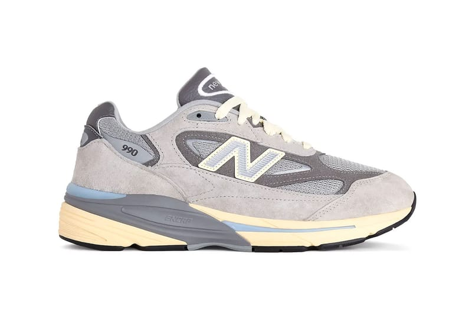
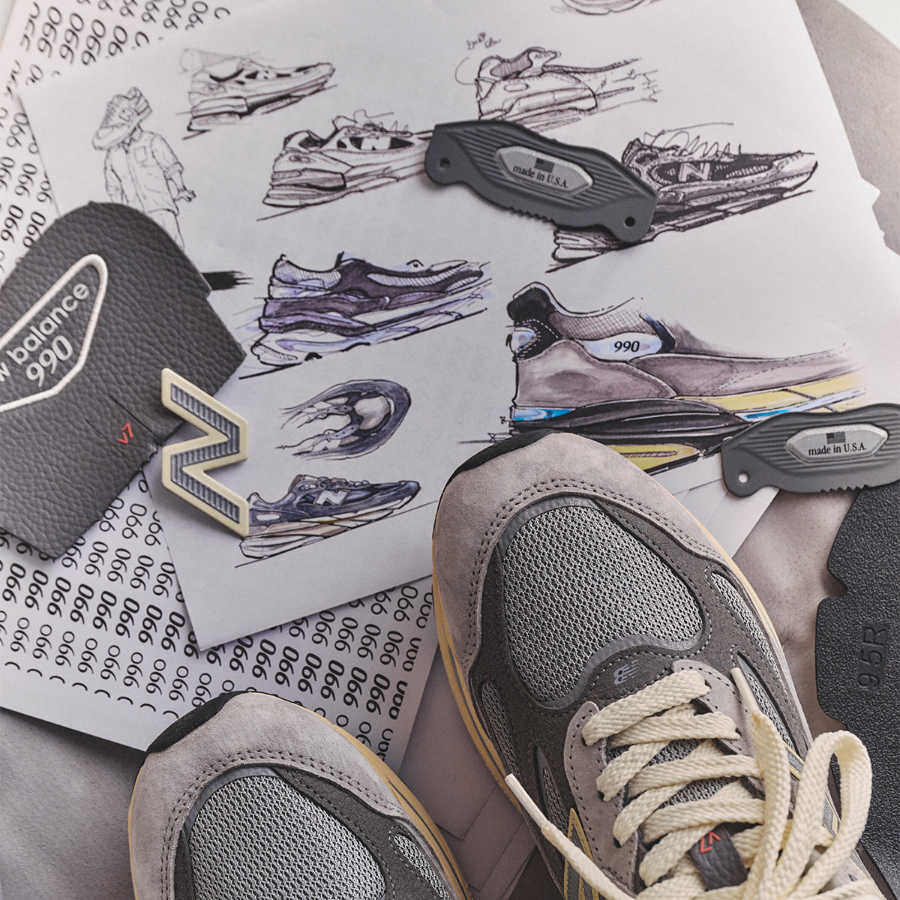
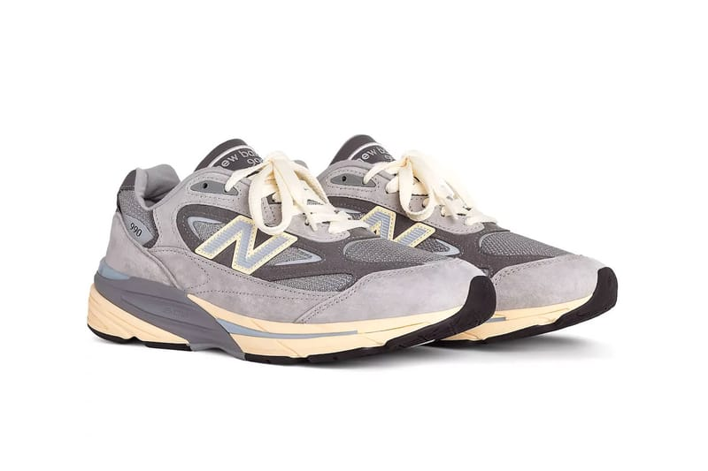
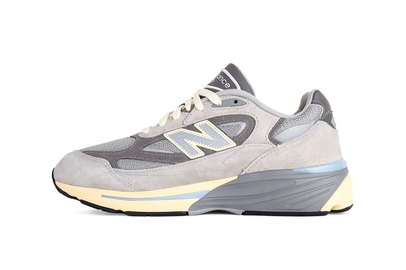
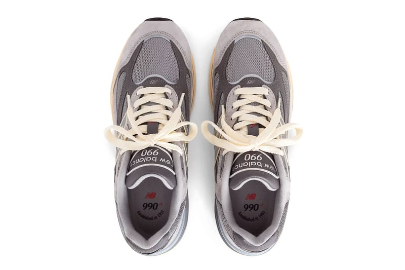
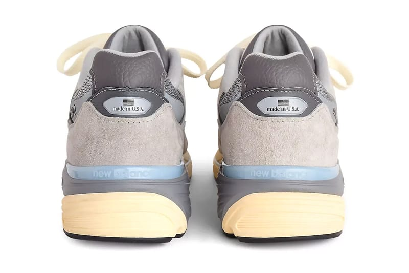
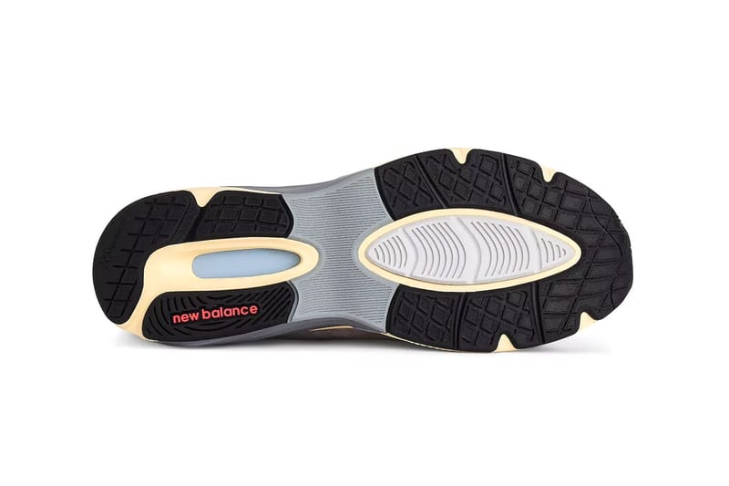
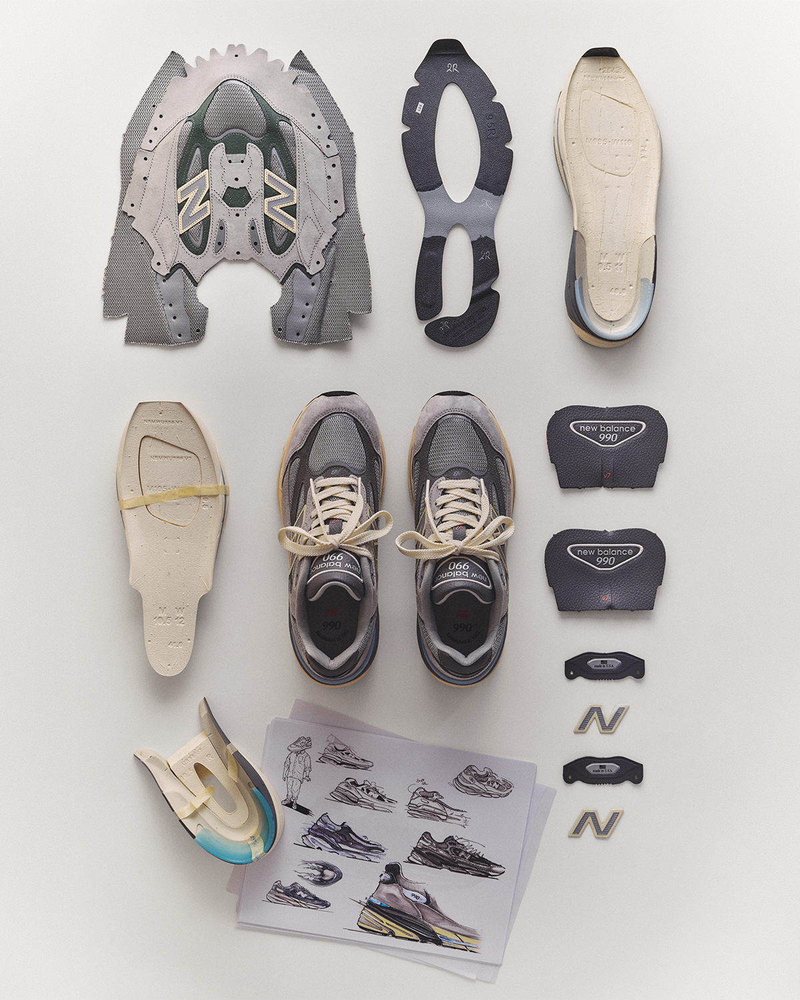
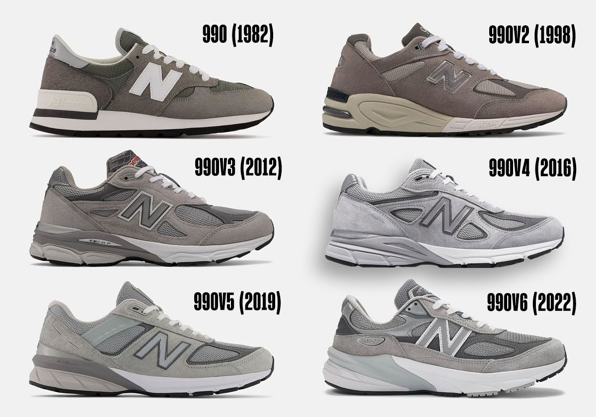

> [English version](/life/new-balance-990v7-kool-grey/)

2026 年 11 月 6 日星期五早上，近 3 万人排进一条虚拟队列，只为有机会买一双灰色跑鞋。到第二天，New Balance Made in USA 990v7 在官网大部分尺码已经售罄。一位消费者在 LinkedIn 上说，她早上 7 点 14 分加入队列时排在第 29,749 位，预计要等一个多小时——而且等到最后还不一定有鞋。

这双鞋的鞋盒上没有签约球星，没有联名，没有抽签抢限量配色。它是 1982 年诞生的一个系列的第七代，当年的目标是不计成本做出最好的跑鞋。它是灰色的，卖 $200。而在一个早上，它成了全世界最难买到的鞋。

这个矛盾就是 990v7 的全部故事。一半是产品故事：四年来的第一次 990 换代，鞋面重新设计，缓震系统重做，品牌说比这个系列以往任何一代都更软、回弹更好。另一半是文化故事：一双曾经被嘲笑为终极“爹鞋”的鞋，如今发售日售罄，全球广告还是以 Rosalía 为主角的芭蕾主题。两半同时成立，而有意思的问题是：一双刻意如此不张扬的鞋，是怎么做到的。

先说一句老实话，免得后面被误读：这不是一篇上脚评测。鞋两天前才开售，还没有任何一家独立媒体对市售版做过有意义的长期实测。已经有一支早期视频评测——Sean Go 在 10 月 25 日发布的上脚视频——但长期的舒适度结论还得等几周。下面是一篇长篇初看：讲历史、讲设计、讲相对 v6 到底改了什么、讲发售日售罄意味着什么和不意味着什么，能核实的和不能核实的会分开写。

*New Balance Made in USA 990v7 “Kool Grey”（U990GR7）：猪皮麂皮与网面分层灰色，N 标志与中底点缀淡蓝和柔和的黄色。图片：New Balance 官方图，经 Hypebeast。*

## 先看事实

| | |
|---|---|
| **鞋款** | New Balance Made in USA 990v7 |
| **货号** | U990GR7 |
| **配色** | Kool Grey / Calcium–Light Arctic Grey（美国官网拼作 “Kool Gray”） |
| **发售时间** | 2026 年 11 月 6 日（周五），美东时间上午 10:00 / 美西时间上午 7:00 |
| **发售价** | 美国 $200（官网标价 $199.99）· 英国 £210 · 新加坡 S$289 · 日本 ¥49,500 · 台湾 NT$8,880 |
| **发售渠道** | newbalance.com（仅限会员购买）及全球指定零售店 |
| **尺码** | 男女同款 |
| **发售状态** | 发售一天内官网大部分尺码售罄（2026 年 11 月 8 日 snapshot） |

990v7 是 990 自 2022 年 v6 以来的第一次换代——间隔四年，是这个系列自初代与 v2 之间长达十六年的等待以来最长的一次。

## 为什么这双鞋重要：1982 年、$100，以及一场关于品质的赌注

990 的起点是一句今天听来荒唐、当年听来也荒唐的简报：不计成本，做出最好的跑鞋。New Balance 花了四年研发，1982 年初代 990 上市时定价 $100——在当时是跑鞋里前所未有的高价，大约是竞品的两倍。这场赌注是：总有人愿意为最好的东西付钱。赌赢了：990 一举确立了这个系列的高端定位和标志性外观——灰色麂皮加网面。

接下来的四十年里，这个系列经历了六代，每一代都找到了品牌当初没计划过的受众。990v2 在 1998 年到来，后跟加入可见 ABZORB 缓震。990v3 在 2012 年为系列 30 周年推出，鞋面更厚实、N 标志更醒目，成了系列里最受推崇的鞋型之一。v4（2016 年）和 v5（2019 年）继续打磨，v5 在外侧加了一块 TPU 支撑件。v6（2022 年）是系列历史上最大的一次转向：首次引入 FuelCell 缓震，并取消了传统的中足鞍座，造型更简洁流畅——这个改动在老粉丝里引发了分歧。

与此同时，这双鞋本身悄悄变成了别的东西。乔布斯就以在苹果发布会上穿早期 990 而闻名。“爹鞋”这个标签本是嘲讽，后来成了徽章，再后来成了时尚宣言——灰色 990 从郊区的 sidewalk 走上了 T 台和街拍。New Balance 品牌总裁 Chris Davis 在 v7 的发售文案里说得很直白：990v7“多才多艺的卓越让它继续受到伦敦超模和俄亥俄州爸爸们的 alike 喜爱”。一句话就是全部营销策略。

*设计过程：草图、材料样片和“made in U.S.A.”五金件，环绕着成品鞋。New Balance 把 v7 的设计理念称为“memories from the future（来自未来的记忆）”。图片：New Balance 官方图，经 Sneaker News。*

## 设计，一块一块看

首发配色正是 990 首发配色该有的样子：灰色，但不是一种灰。Kool Grey 把浅灰色猪皮麂皮叠在深灰色麂皮覆层之上，鞋头和鞋身两侧是同色系灰色网面，再用两处安静的点缀打破单色——N 标志和中底上的淡蓝与柔和的黄色。它离初代那种平板的灰很远，但一眼就能认出是 990。

逐个细节看：

- **鞋面。**猪皮麂皮、透气网面、精致的皮革饰边和合成麂皮“sway bars”——沿鞋面勾勒出支撑路径的结构覆层。相对 v6 最大的变化是结构：v6 取消了中足鞍座、走简洁路线；v7 把分层鞋面和更多结构带了回来，更接近早期的世代。结果看起来不像一双现代跑鞋，更像一双经典 990——这就是目的。
- **N 标志。**两侧都更大、更醒目，比例让人想起 990v3 的标志。表面带纹理，淡蓝填充、柔黄色边框——这个配色组合直接呼应了中底，把鞋面和鞋底连成一体。
- **中底。**双色中底，刻意做了预做旧、微微泛黄的处理——复古感是出厂自带的，不用穿几年才养出来。外侧能看到 ENCAP 标志。
- **后跟。**后跟稳定片上有一枚“made in U.S.A.”徽章，下方是一条淡蓝色带，印着 New Balance 字标。Made in USA 系列按公司自己的定义意味着 70% 或以上的本土价值——而 v7 定价 $200，与 v6 持平，换了新模具却没涨价。
- **鞋舌与鞋领。**鞋舌印着 New Balance 990 标志和一枚红色小 v7 标记；鞋领和鞋舌用深色皮革感材质，与周围的灰色麂皮形成对比。
- **外底。**黑色 Ndurance 耐磨橡胶，中足开窗露出灰色稳定片，后跟印红色 New Balance 字标——为耐用和抓地而做，不是为作秀。

*双鞋：奶油色鞋带、深色皮革感鞋舌与鞋领、预做旧的中底，给首发配色带上一点 vintage 的味道。图片：New Balance 官方图，经 Hypebeast。*

## 相对 990v6，到底新在哪

如果你有 v6，v7 乍看很熟，看久了处处不同。变化分三组。

**第一，鞋面回归结构。**v6 简洁、无鞍座的鞋面是它最具争议的一点——有人喜欢现代的极简，有人觉得它丢了 990 的身份。v7 把这个决定翻了过来：分层麂皮、更传统的覆层与网面排布、更大的 N。Sneaker News 在鞋还没发售时就把 v7 排进了整个 990 系列的第二名——按它自己的说法，这是一次“leap of faith（信念一跃）”——并形容这个鞋型是“v2 与 v6 的交汇点，取了两代各自最好的部分”。

**第二，缓震更软、也更复杂。**v6 把 FuelCell 引入这个系列；v7 保留它，但重做成全掌双密度结构——后跟受力区更软、前掌底部更软，负责缓震与回弹；前掌上层框架更密，负责支撑。ENCAP 留下，轻质泡棉加耐用聚氨酯边框的组合继续提供结构。真正的新东西是一块 TPU 中足稳定片，负责动作控制与稳定性。系列多年来用的 CR 后跟稳定装置也还在。

**第三，成品刻意做旧。**预泛黄的中底和略带磨损感的标志，让一双新鞋自带穿了几年的旧物感。这个设计选择的目标受众很明确：买 990 的人，就是因为它看起来像一直都在那里。

*内侧：同样的分层麂皮与网面结构，加大的 N 标志和灰色 ENCAP 中底楔形。图片：New Balance 官方图，经 Hypebeast。*

## 技术，老实评估

直接说 v7 是什么、不是什么。990 早就不是性能跑鞋了——初代是公路跑鞋，但 2026 年没人会买一双 $200 的灰色麂皮鞋去刷个人最好成绩。FuelCell、ENCAP、CR 装置和 TPU 稳定片都是真实的技术，双密度中底相对 v6 的单密度结构也是真正的工程进步。但评价这双鞋的诚实方式，是把它当一双日常鞋：走路的舒适度、脚下的稳定性、材质能不能经得起天天穿。

按这个标准，v7 的卖点是自洽的。更软的 FuelCell 应该让第一步比 v6 更柔软——v6 有人嫌偏硬；更密的前掌框架和 TPU 稳定片是为了不让变软的泡棉显得松垮；ENCAP 加 CR 装置保留了 990 出名的稳定性。猪皮麂皮加网面的鞋面，是这个系列几十年来赖以成名的 premium 做工——也是这双鞋需要一点打理的原因：麂皮怕水、怕磨，浅灰色不像黑色配色那样耐脏。

现在还说不了的是：更软的泡棉几个月后表现如何，新的稳定片会不会改变走路的步态。New Balance 的说法是品牌的说法，不是实测结论。Sean Go 的早期视频评测（10 月 25 日）已经有了，但一双才发售两天的鞋，不存在任何人的长期结论。买 v7，应该为它第一天的样子买——一双做工漂亮、看起来非常舒适的日常鞋——而不是为一个还没被验证过的舒适承诺买。

*俯视：鞋舌印着“new balance 990”标志和红色 v7 标记，鞋垫上写着“990——established in 1982”。图片：New Balance 官方图，经 Hypebeast。*

## 广告战役：芭蕾、Rosalía，和“Dad’s Back”

这次的发售广告叫“Dad’s Back（爹回来了）”，是 New Balance 多年来对 990 最有自知之明的一次操作。核心是西班牙歌手、品牌大使 Rosalía 出演的芭蕾主题拍摄——足尖鞋、relevé、柔和的粉色、灰色 990 出现在舞蹈教室里。这个玩笑成立，是因为它是真的：990 从来就是给整天站着的人穿的鞋，不管那个人是爸爸、舞者，还是超模。

全球推广阵容刻意拉得很开：Rosalía、K-pop 明星 IU、杜克大学篮球新星 Cooper Flagg、布法罗比尔队四分卫 Josh Allen。跨度本身就是信息——同一双鞋，四个完全不同的世界。发售前还有一段缓慢的预热：纽约唐人街的广告牌、东京的节日展陈、Joe Freshgoods 在 Instagram 上提前晒鞋、Rosalía 在发售几周前就穿着未发售的鞋在曼哈顿慢跑。等 10 月 21 日官方图正式公布时，这双鞋已经在足够多的名人脚上出现过，显得很熟悉了。

这种缓慢揭晓值得注意，因为它和大多数热门鞋的发售方式正好相反。没有突袭发售，没有倒计时，没有抽签。New Balance 提前几周展示了鞋，公布了日期和价格，早上 10 点开店——然后还是售罄了。这波需求不是人为制造的稀缺，是四十四年积累的好感，一次性兑现。

*后跟：“made in U.S.A.”徽章、淡蓝色 New Balance 字标带、预做旧的中底。New Balance 对 Made in USA 鞋款的定义是本土价值 70% 或以上。图片：New Balance 官方图，经 Hypebeast。*

## 市场反应：队列、售罄，和一盆冷水

发售数字通常属于 Jordan 复刻，不属于一双灰色 New Balance。Inc.com 报道，发售当天早上近 3 万人排进虚拟队列，鞋在一天内官网大部分尺码售罄，产品页面在过去 24 小时内被浏览了 26,172 次。Inc. 还算了一笔粗账：如果排队的 3 万人每人都买一双，那就是大约 $600 万收入——这是粗略估算，但能让人感受到规模。New Balance 自身也在上升期：去年销售额 $92 亿，同比增长 19%，目标是 2026 年底达到 $100 亿。

关于售罄，有三件事要分清。第一，990v7 在官网是仅限会员的产品——必须登录或注册会员才能买——这会把需求集中到一个渠道，让售罄比大面积铺货更容易发生。第二，全球指定零售店也同步有货，所以“官网售罄”不等于“ everywhere 售罄”——发售那个周末，一些零售店仍有尺码。第三，这是 2026 年 11 月 8 日的 snapshot，补货是迟早的事，不是会不会的问题：990 是主线系列，不是限量联名，New Balance 有充分的理由让 v7 长期有货。

有用的参照是 v6 的遭遇。SneakerPulse 在 11 月 3 日发布的转售追踪发现，过去 90 天里 990v6 的转售中位数比发售价低 34%——一双灰色 v6 卖 $134，对应 $200 的发售价——26 个被追踪的 990v6 款式里只有 2 个达到或超过发售价。这是主线 990 的正常命运：人们买它是来穿的，不是来炒的，转售市场也按这个逻辑定价。v7 发售日的队列是真实需求，但那是穿鞋者的需求，而穿鞋者不会长期付溢价。如果你想要 Kool Grey，明智的做法是等：等补货、按 $200 买，让发售周的加价自己烧完。

*外底：黑色 Ndurance 橡胶，中足灰色 TPU 稳定片开窗，后跟红色 New Balance 字标。图片：New Balance 官方图，经 Hypebeast。*

## 谁该买，谁该等等

**该买，如果：**你一直在等 990 的新世代——这是四年来的第一次，光是分层鞋面的回归就让它成为自 v5 以来最“990”的 990。该买，如果你觉得 v6 太硬或太素；更软的 FuelCell 和恢复的结构正是针对这两点投诉的回答。该买，如果你想要一双 definitive 的灰色日常鞋，并且愿意等补货而不是付发售周的溢价。

**再想想，如果：**你已经有一双状态不错的 v6——v7 是改良，不是再造，离几英尺远看，两双鞋是表亲，不是陌生人。再想想，如果你要一双真正跑步的鞋；990 现在是生活方式鞋，New Balance 有更轻、更快的鞋干这个活。再想想，如果你是当投资买：v6 的转售历史就是警告标签，而 v7 是会补货的主线鞋。

**尺码方面：**New Balance 尚未发布针对 v7 的合脚指南，也还没有长期穿着报告。990 系列历来按正常尺码、并以宽松的宽度选择著称，但 v7 的鞋面和中底都重做过，你的 v6 尺码只是起点，不是保证——如果能试穿，尽量先试，尤其是在两个尺码之间犹豫的时候。

*拆解：鞋面、FuelCell 中底、TPU 稳定片、后跟五金件和草图——v7 的每一层都摊开来。图片：New Balance 官方图，经 Sneaker News。*

## 结论：这双鞋配得上这条队列

按它自己的标准，New Balance 990v7 是成功的——而且发售已经在任何评测者开口之前证明了这一点。一双没有联名、鞋盒上没有运动员代言、没有人为稀缺的灰色麂皮鞋，吸引了 3 万人的队列、一天内售罄，靠的是一句坚持了 44 年的承诺：做出 New Balance 会做的最好的日常鞋。v7 守住了这个承诺，还改进了需要改进的部分——更软的中底、更稳的平台、重新像 990 的鞋面。

悬而未决的不是鞋，而是它自己成功的代价。$200 是主线 990 名义上最贵的价格——虽然与 v6 持平，这本身已经是不声不响的成就。问题是 New Balance 能不能以匹配这波需求的速度持续供货，还是 Kool Grey 会变成一双需要到处找的鞋。如果答案是“很快补货、按发售价卖”，那 v7 就是多年来最好的 990，任何想要的人都能买到。这是这双鞋应得的结局——也是买家应该要求 New Balance 兑现的结局。

*四十四年的灰：990（1982）、v2（1998）、v3（2012）、v4（2016）、v5（2019）和 v6（2022）。v7 是第七代。图片：Sneaker News。*

**事实汇总，截至 2026 年 11 月 8 日：**2026 年 11 月 6 日上午 10:00（美东时间）发售，newbalance.com（仅限会员）及全球指定零售店；美国 $200（官网 $199.99）、英国 £210、新加坡 S$289、日本 ¥49,500、台湾 NT$8,880；货号 U990GR7；配色 Kool Grey/Calcium–Light Arctic Grey；男女同款尺码；发售一天内官网大部分尺码售罄（Inc.com，11 月 6 日）；发售当天早上虚拟队列约 3 万人（Inc.com；LinkedIn）。价格与库存为 2026 年 11 月 8 日的 snapshot，subject to change。这不是一篇上脚评测：鞋于 11 月 6 日发售，尚无针对市售版的独立长期实测。

**来源：**[New Balance——Made in USA 990v7（官方产品页）](https://www.newbalance.com/pd/made-in-usa-990v7/U990GR7-D-12.html) · [Sneaker News——New Balance 990v7: Everything You Need To Know](https://sneakernews.com/2026/10/21/new-balance-990v7-release-date/) · [Sneaker News——Ranking The New Balance 990 Series](https://sneakernews.com/2026/10/27/ranking-the-new-balance-990-series/) · [Hypebeast——New Balance 990v7 Made in USA “Kool Grey”](https://hypebeast.com/2026/10/new-balance-990v7-made-in-usa-kool-grey-u990gr7-official-look-release-info) · [Hypebae——Rosalía Fronts New Balance’s 990v7 Campaign](https://hypebae.com/2026/11/rosalia-new-balance-made-in-usa-990v7-campaign-sneaker-drop-where-to-buy) · [Inc.com——New Balance 990v7 Dad Shoe Virtual Queue Launch](https://www.inc.com/annabel-burba/new-balance-990v7-dad-shoe-virtual-queue-launch/91432768) · [Sole Retriever——Compared: New Balance 990v6 vs 990v7](https://www.soleretriever.com/news/articles/compared-new-balance-990v6-vs-990v7) · [SneakerPulse——New Balance 990v6 Resale Prices](https://www.sneakers-pulse.com/blog/2026-11-03-new-balance-9060-2002r-990v6/) · [Sean Go——New Balance 990 V7 “Kool Gray” Review（视频）](https://www.youtube.com/watch?v=p83-o2H5fs0)
