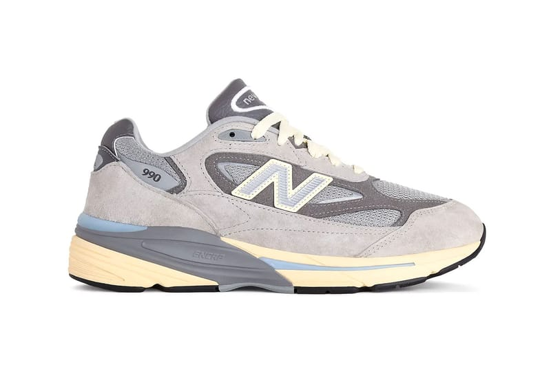
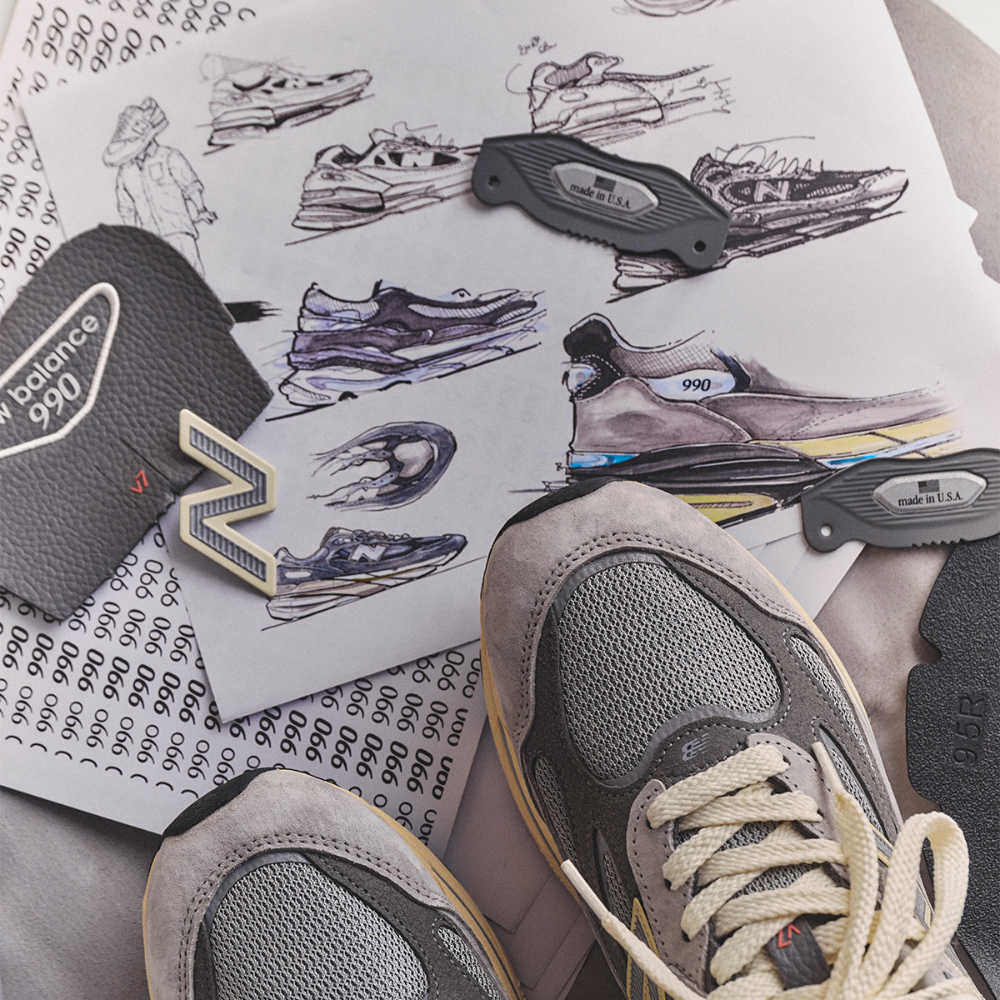
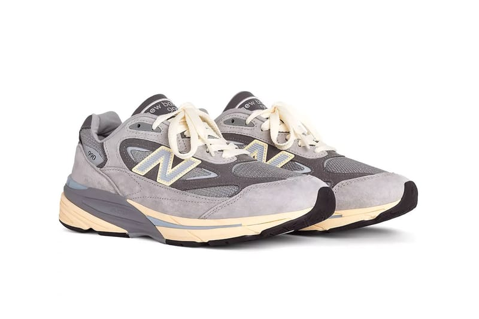
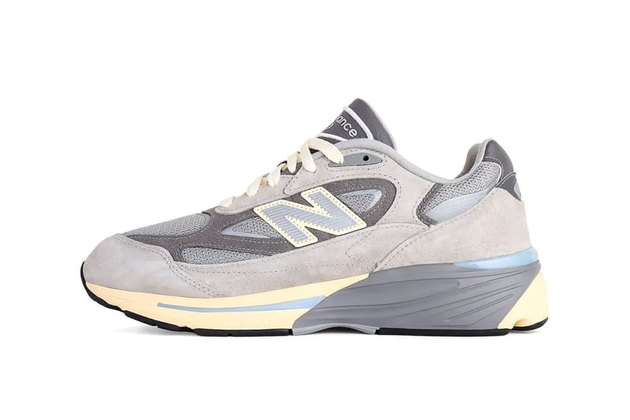
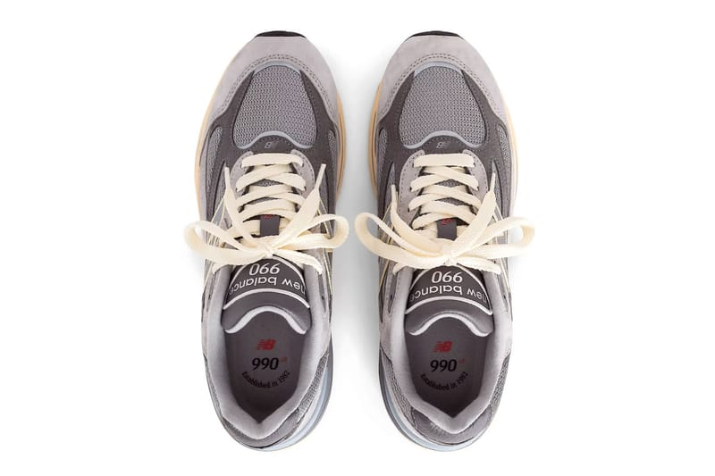
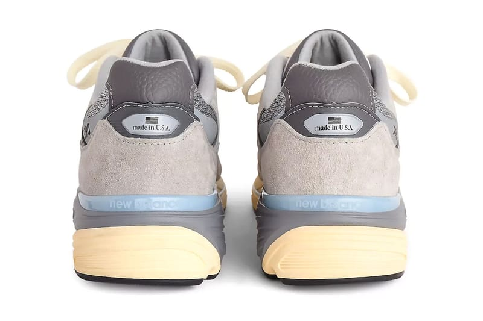
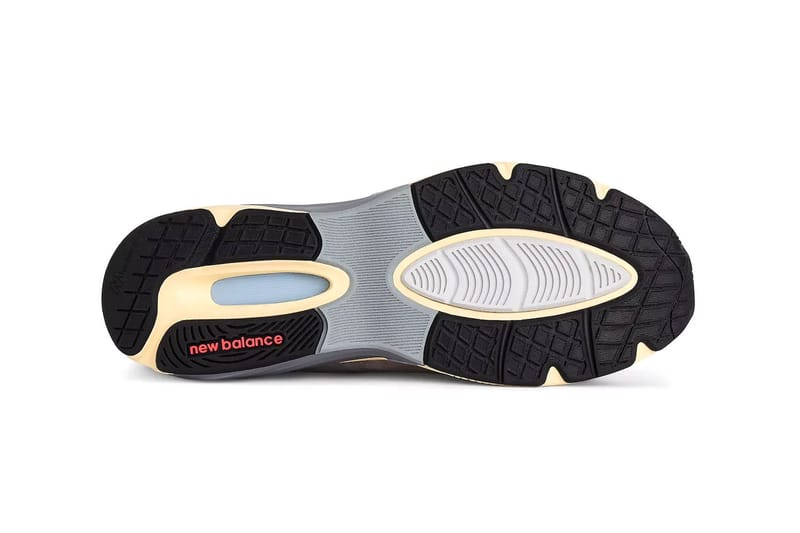
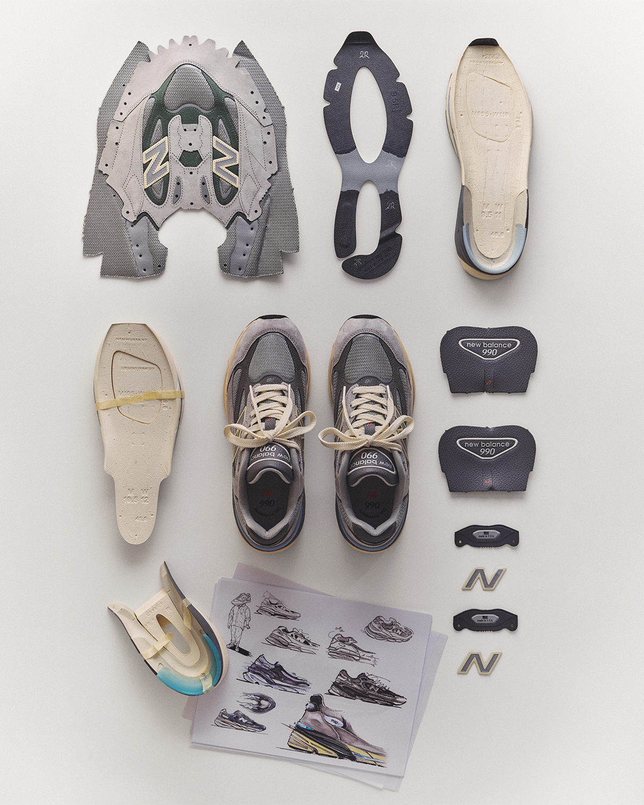
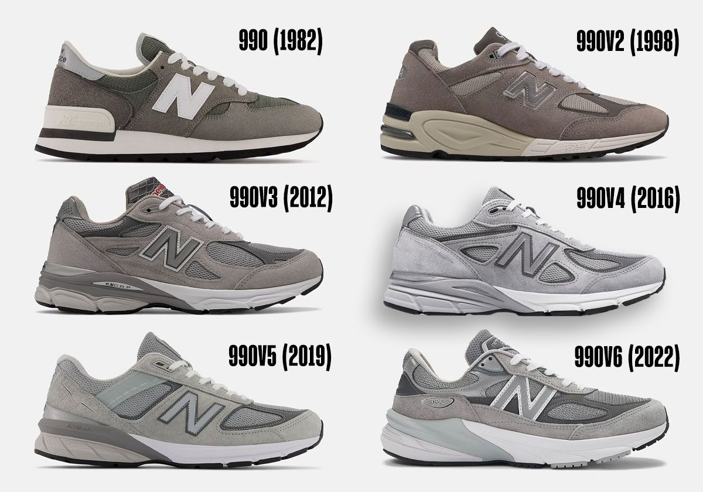

> [中文版 Chinese version](/life/new-balance-990v7-kool-grey-zh/)

On Friday morning, November 6, 2026, nearly 30,000 people waited in a virtual queue for the chance to buy a grey running shoe. By the next day, the New Balance Made in USA 990v7 was sold out on newbalance.com in most sizes. One shopper told LinkedIn she joined the queue at 7:14 a.m. as number 29,749, with an estimated wait of more than an hour — and no guarantee a pair would be left at the end of it.

This is a shoe with no celebrity athlete on the box, no limited-edition collaboration, no raffle for a hyped colorway. It is the seventh generation of a franchise that began in 1982 as an attempt to build the best running shoe possible, regardless of cost. It is grey. It costs $200. And for one morning, it was the hardest shoe in the world to buy.

That contradiction is the whole story of the 990v7. One half is a product story: the first generational update to New Balance’s flagship in four years, with a redesigned upper and a reworked cushioning system that the brand says is softer and more responsive than anything the line has offered before. The other half is a cultural story: a shoe once mocked as the ultimate “dad shoe” now sells out on launch day with a ballet-themed global campaign starring Rosalía. Both halves are true at the same time, and the interesting question is how a shoe this deliberately un-flashy keeps pulling it off.

One honest note up front: this is not a wear-test review. The shoe went on sale two days ago, and no independent publication has put meaningful miles on a retail pair yet. An early video review exists — Sean Go published an on-foot look on October 25 — but the long-term comfort verdicts will take weeks. What follows is a long first look: the history, the design, what actually changed from the v6, and what the launch-day sellout does and doesn’t mean — with the claims that can be checked separated from the ones that cannot.

*The New Balance Made in USA 990v7 “Kool Grey” (U990GR7): pigskin suede and mesh in layered greys, with pale blue and soft yellow accents on the enlarged N logo and midsole. Image: New Balance official imagery, via Hypebeast.*

## The facts

| | |
|---|---|
| **Model** | New Balance Made in USA 990v7 |
| **Style code** | U990GR7 |
| **Colorway** | Kool Grey / Calcium–Light Arctic Grey (New Balance US spells it “Kool Gray”) |
| **Release date** | Friday, November 6, 2026, 10:00 a.m. ET / 7:00 a.m. PT |
| **Retail price** | $200 in the US ($199.99 on newbalance.com) · £210 in the UK · S$289 in Singapore · ¥49,500 in Japan · NT$8,880 in Taiwan |
| **Where** | newbalance.com (members-only product) and select retailers worldwide |
| **Sizing** | Unisex |
| **Launch status** | Sold out in most sizes on newbalance.com within a day of launch (snapshot, November 8, 2026) |

The 990v7 is the first new generation of the 990 since the v6 arrived in 2022 — a four-year gap, the longest the franchise has gone between generations since the sixteen-year wait between the original and the v2.

## Why this shoe matters: 1982, $100, and a bet on quality

The 990 began with a brief that sounds absurd today and sounded absurd then: build the best running shoe possible, regardless of cost. New Balance spent four years developing it, and when the original 990 launched in 1982 it carried a $100 retail price — unprecedented for a running shoe at the time, roughly double what the competition was charging. The bet was that some runners would pay for the best, and the bet paid off: the 990 established the franchise’s premium positioning and its signature look — grey suede and mesh — in one move.

Over the next four decades the line evolved through six generations, and the shoes kept finding new audiences the brand never planned for. The 990v2 arrived in 1998 with visible ABZORB cushioning in the heel. The 990v3 came in 2012 for the line’s 30th anniversary, with a more substantial upper and prominent N branding, and became one of the most celebrated silhouettes in the franchise. The v4 (2016) and v5 (2019) refined the formula, the v5 adding a TPU support component along the lateral side. The v6 (2022) was the biggest break in the line’s history: it introduced FuelCell cushioning to the franchise and eliminated the traditional midfoot saddle, giving the shoe a cleaner, more streamlined look that split longtime fans.

Meanwhile, the shoe itself was quietly becoming something else. Steve Jobs famously wore earlier 990s on stage at Apple events. The “dad shoe” label, meant as an insult, became a badge — and then a fashion statement, as the grey 990 moved from suburban sidewalks to runways and street-style photography. New Balance’s own brand president, Chris Davis, put it plainly in the v7 launch materials: the 990v7’s “versatile excellence continues to make it beloved by supermodels in London and dads in Ohio alike.” That sentence is the entire marketing strategy in one line.

*The design process: sketches, material swatches and “made in U.S.A.” hardware around the finished shoe. New Balance describes the v7’s design philosophy as “memories from the future.” Image: New Balance official imagery, via Sneaker News.*

## The design, piece by piece

The debut colorway is exactly what a 990 launch colorway should be: grey, but not one grey. The Kool Grey build layers light grey pigskin suede over darker grey suede overlays, with tonal grey mesh at the toe box and quarters, and then breaks the monochrome with two quiet accents — pale blue and soft yellow — on the N logo and the midsole. It is a long way from the flat grey of the original; it is also unmistakably a 990.

Working through the details:

- **The upper.** Pigskin suede, breathable mesh, refined leather trims and synthetic suede “sway bars” — the structural overlays that trace supporting paths across the upper. The big change from the v6 is structural: the v6 dropped the midfoot saddle and went streamlined; the v7 brings layered panels and additional structure back, closer to earlier generations. The result reads less like a modern runner and more like a classic 990 — which is the point.
- **The N logo.** Larger and more prominent on both sides, with proportions that recall the 990v3’s branding. It carries a lined texture with pale blue filling and a soft yellow border — the same color pairing that shows up on the midsole tooling, tying the upper and the sole together.
- **The midsole.** A two-tone unit with a deliberately pre-yellowed, aged finish — the vintage look is baked in, not something the shoe has to earn over years of wear. ENCAP branding is visible on the lateral side.
- **The heel.** A “made in U.S.A.” badge sits on the heel counter, above a pale blue band carrying the New Balance wordmark. The Made in USA line means a domestic value of 70% or more, per the company’s own definition — and at $200, the v7 holds the same price as the v6 despite the new tooling.
- **The tongue and collar.** The tongue carries the New Balance 990 branding with a small red v7 mark; the collar and tongue use a dark leather-look material that contrasts with the grey suede around it.
- **The outsole.** Black Ndurance rubber with a grey midfoot shank window and a red New Balance wordmark at the heel — built for durability and grip rather than show.

*The pair: cream laces, dark leather-look tongue and collar, and the pre-yellowed midsole that gives the launch colorway its slightly vintage cast. Image: New Balance official imagery, via Hypebeast.*

## What’s new versus the 990v6

If you own the v6, the v7 looks familiar at a glance and different the longer you look. The changes break down into three groups.

**First, the upper goes back to structure.** The v6’s clean, saddle-free upper was the most divisive thing about it — some fans loved the modern minimalism, others felt it had lost the 990’s identity. The v7 reverses that call: layered suede panels, a more traditional arrangement of overlays and mesh underlays, and a bigger N. Sneaker News, which ranked the v7 second in the entire 990 series before it had even released — a leap of faith, by its own admission — described the silhouette as “a meeting point between the v2 and v6, pulling from the best of both generations.”

**Second, the cushioning gets softer and more complex.** The v6 introduced FuelCell to the franchise; the v7 keeps it but reworks it into a full-length, dual-density setup — a softer heel crash pad and softer material under the forefoot for cushioning and energy return, with a denser upper frame in the forefoot for support. ENCAP stays, combining lightweight foam with a durable polyurethane rim for structure. The genuinely new piece is a TPU midfoot shank, added for motion control and stability. The CR heel device — the stability clip New Balance has used across the line — remains.

**Third, the finish is deliberately aged.** The pre-yellowed midsole and the slightly worn-looking branding give a brand-new shoe the patina of a pair that has been loved for years. It is a design choice with a clear audience in mind: people who buy 990s because they look like they have always been there.

*Medial side: the same layered suede and mesh construction, with the enlarged N logo and the grey ENCAP midsole wedge. Image: New Balance official imagery, via Hypebeast.*

## The technology, honestly assessed

Let’s be direct about what the v7 is and isn’t. The 990 stopped being a performance running shoe years ago — the original was a road runner, but nobody is buying a $200 grey suede shoe in 2026 to set a personal best. The FuelCell, ENCAP, CR device and TPU shank are real technologies, and the dual-density midsole is a genuine engineering step over the v6’s single-density setup. But the honest way to judge this shoe is as an all-day, everyday shoe: walking comfort, stability underfoot, and whether the materials hold up to daily wear.

On that basis, the v7’s pitch is coherent. The softer FuelCell should make the first step feel plusher than the v6, which some wearers found firm; the denser forefoot frame and TPU shank are there to stop the softer foam from feeling sloppy; and ENCAP plus the CR device keep the stability the 990 is known for. The pigskin suede and mesh upper is the same premium construction the line has traded on for decades — and the same reason the shoe needs a little care: suede shows water and scuffs, and the light grey will not hide dirt the way the black colorways do.

What we cannot say yet is how the softer foam holds up over months, or whether the new shank changes the walking gait in a way that matters. New Balance’s claims are the brand’s claims, not a wear test. The early video review from Sean Go (October 25) exists, but a two-day-old shoe has no long-term verdict from anyone. Buy the v7 for what it is on day one — a beautifully made, very comfortable-looking everyday shoe — not for a comfort promise that hasn’t been tested yet.

*Top-down: the tongue carries “new balance 990” branding with a red v7 mark, and the insole reads “990 — established in 1982.” Image: New Balance official imagery, via Hypebeast.*

## The campaign: ballet, Rosalía, and “Dad’s Back”

The launch campaign is called “Dad’s Back,” and it is the most self-aware thing New Balance has done with the 990 in years. The centerpiece is Rosalía, the Spanish singer and brand ambassador, fronting a ballet-themed shoot — pointe shoes, relevés, soft pinks, the grey 990 in a dance studio. The joke lands because it is true: the 990 has always been a shoe for people who stand on their feet all day, whether that means a dad, a dancer, or a supermodel.

The global rollout enlists a deliberately wide cast: Rosalía, K-pop star IU, Duke basketball sensation Cooper Flagg, and Buffalo Bills quarterback Josh Allen. The range is the message — the same shoe, four completely different worlds. The campaign rolled out alongside a slow teaser build: a billboard in New York’s Chinatown, a Tokyo festival display, Joe Freshgoods previewing the shoe on Instagram, and Rosalía spotted jogging through Manhattan in an unreleased pair weeks before launch. By the time official images dropped on October 21, the shoe had already been seen on enough famous feet to feel familiar.

That slow reveal is worth noting because it is the opposite of how most hyped shoes launch. There was no surprise drop, no countdown timer, no raffle. New Balance showed the shoe for weeks, named the date and the price, and opened the store at 10 a.m. — and still sold out. The demand was not manufactured scarcity. It was forty-four years of goodwill, arriving all at once.

*The heel: “made in U.S.A.” badge, pale blue New Balance wordmark band, and the pre-yellowed midsole. New Balance defines its Made in USA footwear as having a domestic value of 70% or more. Image: New Balance official imagery, via Hypebeast.*

## The market reaction: a queue, a sellout, and a reality check

The launch numbers are the kind that usually belong to a Jordan retro, not a grey New Balance. Inc.com reported that nearly 30,000 people waited in the virtual queue on launch morning, that the shoe was sold out on newbalance.com in most sizes within a day, and that the product page had recorded 26,172 views in the last 24 hours. If all 30,000 queue members had bought a pair, Inc. noted, that would be roughly $6 million in revenue — a back-of-the-envelope figure, but a useful sense of scale. New Balance itself is on a run: $9.2 billion in sales last year, up 19% year over year, aiming for $10 billion by the end of 2026.

Three things to keep straight about the sellout. First, the 990v7 was a members-only product on newbalance.com — you had to log in or become a member to buy — which concentrates demand into one channel and makes a sellout more likely than a wide general release. Second, select retailers worldwide also carried the shoe, so “sold out on newbalance.com” is not “sold out everywhere” — sizes were still listed at some retailers on launch weekend. Third, this is a snapshot from November 8, 2026, and restocks are a matter of when, not if: the 990 is a mainline franchise, not a limited collaboration, and New Balance has every incentive to keep the v7 in stock for years.

The useful context is what happened to the v6. SneakerPulse’s resale tracking, published November 3, found the median 990v6 sold 34% under retail over the prior 90 days — a grey v6 at $134 against a $200 retail — with only two of 26 tracked 990v6 styles selling at or above retail. That is the normal fate of a mainline 990: it is a shoe people buy to wear, not to flip, and the resale market prices it accordingly. The v7’s launch-day queue is real demand, but it is demand from wearers, and wearers do not pay premiums for long. If you want the Kool Grey, the smart move is patience: wait for the restock, buy at $200, and let the launch-week markup burn itself out.

*The outsole: black Ndurance rubber with a grey TPU shank window and a red New Balance wordmark. Image: New Balance official imagery, via Hypebeast.*

## Who should buy it — and who should pass

**Buy it if:** you have been waiting for a new 990 generation — this is the first in four years, and the return of the layered upper alone makes it the most “990” 990 since the v5. Buy it if the v6 felt too firm or too plain for you; the softer FuelCell and the restored structure are direct answers to both complaints. Buy it if you want the definitive grey everyday shoe and you are willing to wait for a restock rather than pay a launch-week premium.

**Think twice if:** you already own a v6 in good condition — the v7 is a refinement, not a reinvention, and from more than a few feet away the shoes are cousins, not strangers. Think twice if you need a shoe for actual running; the 990 is a lifestyle shoe now, and New Balance makes lighter, faster shoes for the job. And think twice if you were buying it as an investment: the v6’s resale history is the warning label, and the v7 is a mainline shoe that will be restocked.

**On sizing:** New Balance has not published v7-specific fit guidance, and there are no long-term wear reports yet. The 990 line has historically run true to size with generous width options, but the v7’s reworked upper and softer midsole mean your v6 size is a starting point, not a guarantee — try a pair on if you can, especially if you are between sizes.

*Deconstructed: the upper, the FuelCell midsole, the TPU shank, the heel hardware and the sketches — every layer of the v7 laid out. Image: New Balance official imagery, via Sneaker News.*

## Verdict: the shoe earned the queue

The New Balance 990v7 is, on its own terms, a success — and the launch proved it before any reviewer could. A grey suede shoe with no collaboration, no athlete endorsement on the box and no artificial scarcity drew a 30,000-person queue and sold out in a day, on the strength of a 44-year-old promise: the best-made everyday shoe New Balance knows how to build. The v7 keeps that promise and improves the parts that needed improving — a softer midsole, a more stable platform, an upper that looks like a 990 again.

What is unresolved is not the shoe but the price of its own success. At $200, the v7 is the most expensive mainline 990 yet in nominal terms — though it holds the v6’s price, which is a quiet achievement in itself. The question is whether New Balance can keep the shoe in stock at a pace that matches the demand it just proved exists, or whether the Kool Grey becomes a shoe you have to hunt for. If the answer is “restock soon, at retail,” then the v7 is simply the best 990 in years, available to anyone who wants one. That is the outcome the shoe deserves — and the one its buyers should hold New Balance to.

*Forty-four years of grey: the 990 (1982), v2 (1998), v3 (2012), v4 (2016), v5 (2019) and v6 (2022). The v7 is the seventh generation. Image: Sneaker News.*

**The facts, as of November 8, 2026:** released November 6, 2026, 10:00 a.m. ET, at newbalance.com (members only) and select retailers worldwide; $200 US ($199.99 on newbalance.com), £210 UK, S$289 Singapore, ¥49,500 Japan, NT$8,880 Taiwan; style code U990GR7; colorway Kool Grey/Calcium–Light Arctic Grey; unisex sizing; sold out in most sizes on newbalance.com within a day (Inc.com, November 6); ~30,000 people in the launch-morning virtual queue (Inc.com; LinkedIn). Prices and availability are a snapshot from November 8, 2026 and are subject to change. This is not a wear-test review: the shoe went on sale November 6 and no independent long-term wear test of a retail pair exists yet.

**Sources:** [New Balance — Made in USA 990v7 (official product page)](https://www.newbalance.com/pd/made-in-usa-990v7/U990GR7-D-12.html) · [Sneaker News — New Balance 990v7: Everything You Need To Know](https://sneakernews.com/2026/10/21/new-balance-990v7-release-date/) · [Sneaker News — Ranking The New Balance 990 Series](https://sneakernews.com/2026/10/27/ranking-the-new-balance-990-series/) · [Hypebeast — New Balance 990v7 Made in USA “Kool Grey”](https://hypebeast.com/2026/10/new-balance-990v7-made-in-usa-kool-grey-u990gr7-official-look-release-info) · [Hypebae — Rosalía Fronts New Balance’s 990v7 Campaign](https://hypebae.com/2026/11/rosalia-new-balance-made-in-usa-990v7-campaign-sneaker-drop-where-to-buy) · [Inc.com — New Balance 990v7 Dad Shoe Virtual Queue Launch](https://www.inc.com/annabel-burba/new-balance-990v7-dad-shoe-virtual-queue-launch/91432768) · [Sole Retriever — Compared: New Balance 990v6 vs 990v7](https://www.soleretriever.com/news/articles/compared-new-balance-990v6-vs-990v7) · [SneakerPulse — New Balance 990v6 Resale Prices](https://www.sneakers-pulse.com/blog/2026-11-03-new-balance-9060-2002r-990v6/) · [Sean Go — New Balance 990 V7 “Kool Gray” Review (video)](https://www.youtube.com/watch?v=p83-o2H5fs0)
