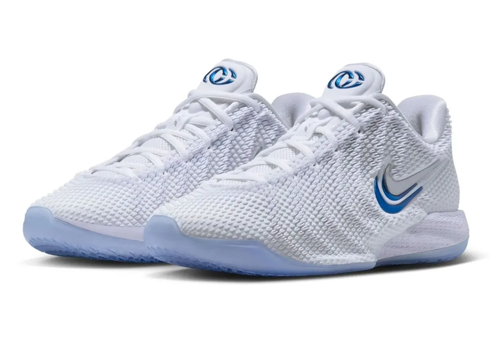
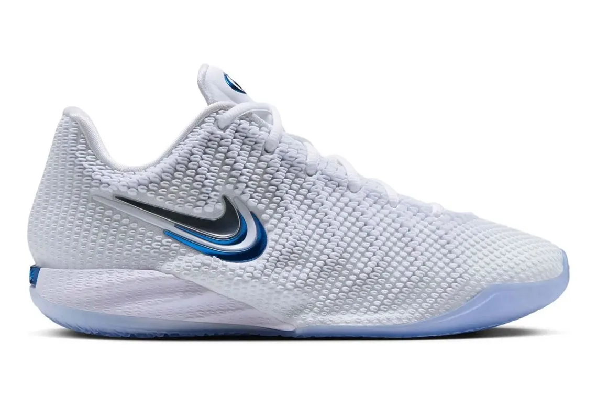
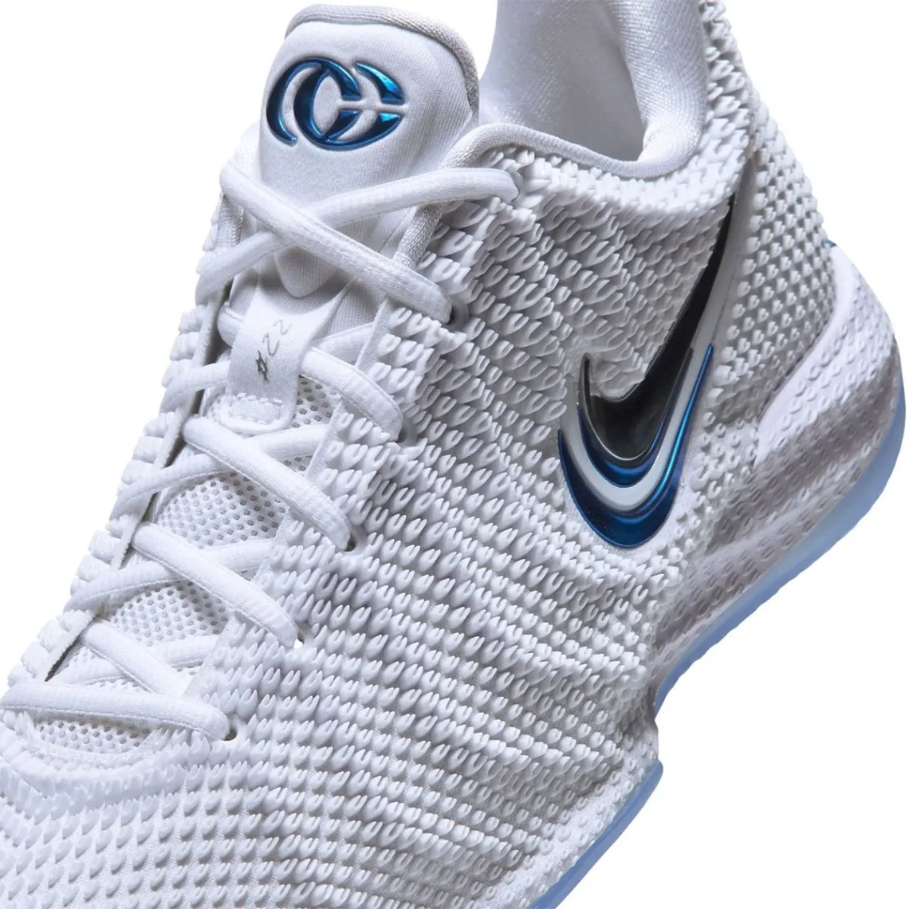
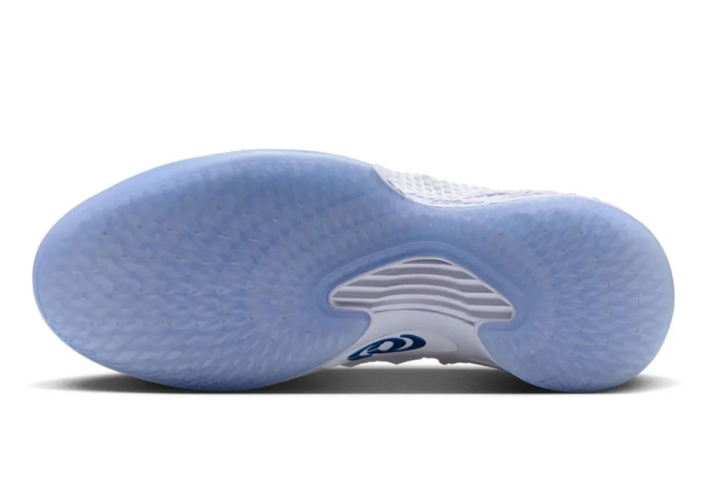
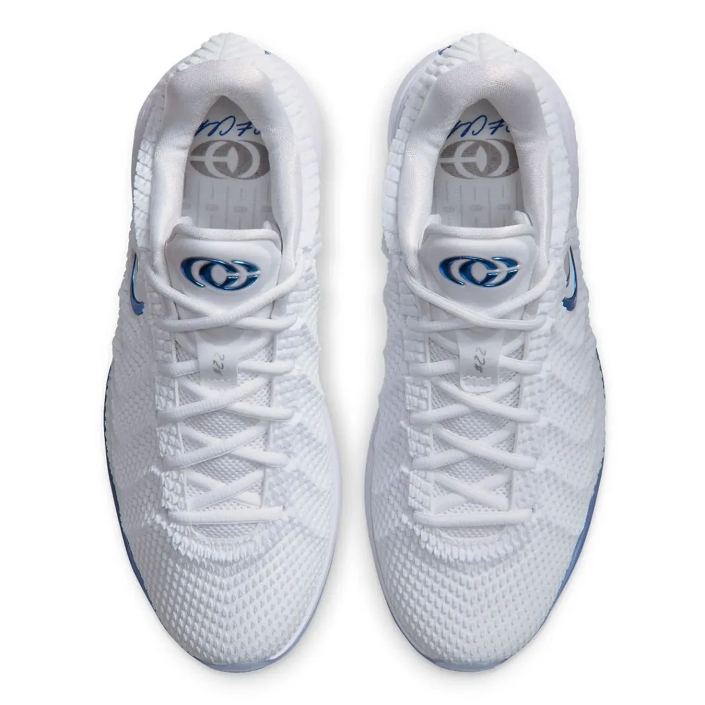
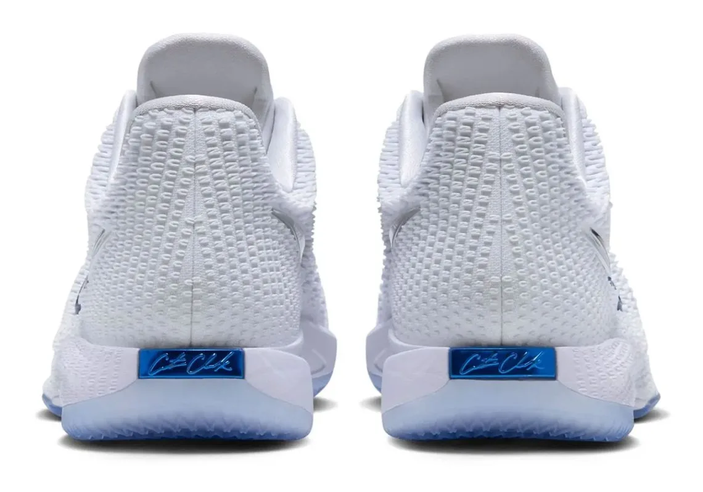
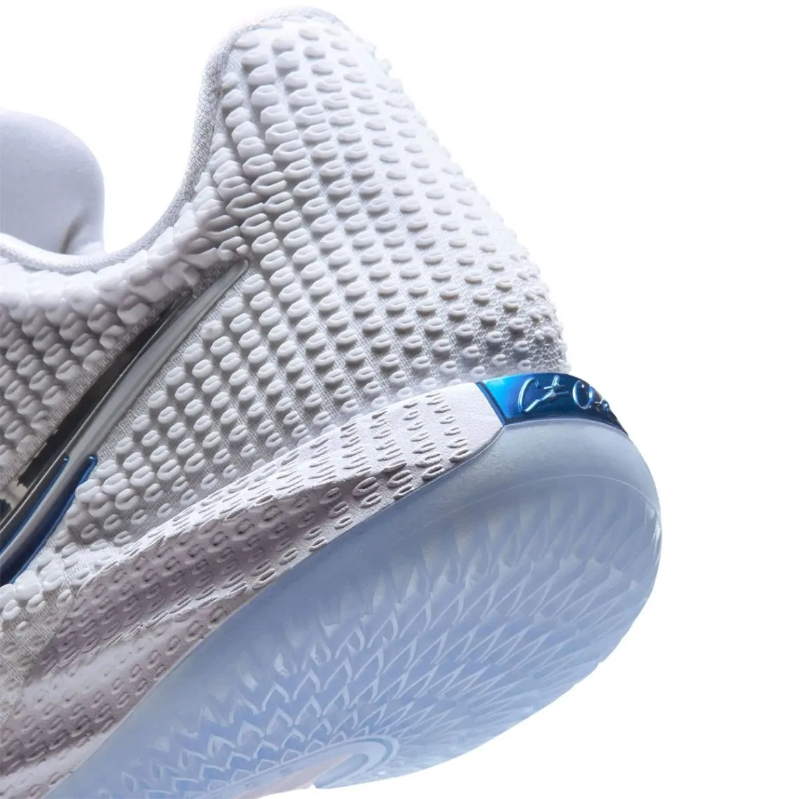

> [English version 英文版](/life/nike-caitlin-1-ice-cold/)

一个签名系列里，有一种配色只有在线本身已经站稳之后才成立。首发配色必须“喊”出来——要一眼讲清楚，为什么这位球员配得上有一双写着她名字的鞋。到了第四、第五款，就可以“低语”了：它可以默认你已经知道故事，只想要那个最干净的版本。

Nike Caitlin 1 “Ice Cold”（IH7423-100）就是这声低语，而且来得正是时候。它将于 2026 年 11 月 24 日（周二）以 140 美元正式发售，此前两天刚在印第安纳州做了一次小规模的家乡提前发售。所有在跟这双鞋的媒体都用了同一个判断：这是至今最安静的一款 Caitlin 1。没有故事配色、没有造型梗、没有节日噱头。白色网面、冰蓝色外底，以及一种只有凑近看才能发现秘密的纹理。

这份克制本身就是故事，也是它成为今日选题的原因。Grailify 今天（11 月 23 日）发布的第 48 周热门发售榜单，把这双鞋排在第一位，排在 Pharrell Jellyfish 补货、香槟主题 SB Dunk、Kobe Elite 和黑色星期五的 Air Jordan 4 “Bred” 前面。Sneaker News 11 月 12 日发布了它的官方图解析；Athlon、Indianapolis Star 和 Sneaker Shop Talk 都在跟踪它的发售进程；Foot Locker 和 Hibbett 都把它列进了发售日历。这里的热度不是抽签狂热，而是可度量的、持续的需求：Nike 历史上关注度最高的女子签名系列，走到了“一个纯白配色就能成为头条”的阶段。

## 基本事实

| | |
|---|---|
| **型号** | Nike Caitlin 1 “Ice Cold” |
| **货号** | IH7423-100 |
| **配色** | White / Racer Blue（白 / 竞速蓝） |
| **发售日期** | 2026 年 11 月 24 日（周二）——经 Nike、SNKRS、Foot Locker、Hibbett 及部分零售商正式发售 |
| **提前发售** | 2026 年 11 月 21 日（周六）上午 9:30（中部时间）——Sneakers 4 Santa Shootout 现场限量发售，地点为印第安纳州 Brownsburg 高中（Hibbett 主办） |
| **售价** | 成人款 140 美元——2026 年 11 月 23 日查询的 snapshot，subject to change（该系列大童款 115 美元 / 幼童款 105 美元） |
| **尺码** | Unisex / 成人尺码（Athlon 口径）；Caitlin 1 全系提供全家庭尺码 |
| **鞋面** | 网面 + Nike Opticast——高度不一的浇铸聚氨酯节点 |
| **缓震** | 全掌 Cushlon 泡棉中底 + 前掌铰接式 Air Zoom Turbo 气垫 |
| **发售类型** | 常规发售，非仅抽签 |

## “Ice Cold” 到底是什么——以及它最初叫什么

先把名字说清，因为这双鞋已经有两个名字了。Caitlin Clark 在发售周期早期穿着这款配色上场时，它曾以 “Snow White”（白雪公主）的昵称流传。Sneaker News 明确指出：随着官方图发布，这个名字已经被弃用——这不是迪士尼联名，这双鞋也没想往那个方向靠。“Ice Cold” 才是官方名，而且更贴切：这里的“冷”是一种色温，不是童话。

鞋身本身刻意简单。白色网面覆盖了鞋面大部分，上面叠着白色的 Opticast 支撑结构；鞋舌、鞋垫和中底都保持白色。颜色只活在标识和脚下：鞋舌上的 Caitlin 标识是双色冰蓝，Swoosh 是白、银、冰蓝三层叠加，外底是双色蓝——全鞋颜色最集中的地方就在外底。后跟有一块金属蓝色的签名牌，印着 Clark 的签名。正如 Athlon 所说，这是一双“看起来相当简单，直到你注意到”它藏了什么的鞋——而它藏的，正是整个设计构想。

*整双：白色网面与 Opticast、白银冰蓝三层叠加的 Swoosh、半透明蓝色外底。图片：Nike，经 Sneaker News。*

*外侧面：Opticast 节点贯穿整个鞋面，位于叠加 Swoosh 之下。图片：Nike，经 Sneaker News。*

## Opticast：这双鞋的技术本身

每个签名鞋都需要一个能用一句话讲清的核心想法，而 Caitlin 1 的这个想法是真正全新的。Nike Opticast 是一套浇铸聚氨酯节点系统——高度不一的凸起节点直接浇铸在鞋面上。Nike 的说法是，它能在运动中减少阻力，同时形成支撑与包裹的分区。Clark 在 New Heights 播客上说过：“我们放进这双鞋的技术，是 Nike 从未在任何篮球鞋上用过的。”就 Opticast 而言，这句话是字面意义上的真话：这是第一双使用这种结构的 Nike 篮球鞋。

这些节点不是贴在性能概念上的装饰——它们本身就是性能概念，装饰是 Nike 第二步才做的事。节点的纹样取材于三分线弧度的涟漪——正是定义 Clark 比赛的那记投篮——而且节点被排布成：外侧形成一连串 “C” 形（她的姓名首字母），内侧重复 “2” 形（她的球衣号码 22 号）。在 “Ice Cold” 上，这一点比在任何其他配色上都更重要，因为全白鞋面让纹理成为你唯一能看到的东西。在那些响亮的配色里——黑绿的 “Halloween”、为她堪萨斯城酋长队球迷身份而做的红色 “Sea of Red”、致敬 Taylor Swift 的 “Friendship Bracelet”——是颜色在说话。而在这里，纹理必须独自完成表达，而它做得到，因为节点在做真实的结构工作：高度不同意味着刚度不同，意味着鞋面可以在后卫落脚、变向的位置提供支撑，在脚需要弯曲的位置保持灵活。

看特写图就能看懂这个逻辑：节点在前掌和中足最密、最高——包裹最重要的地方——而它们之间的网面依然可见，那正是透气性的来源。这是一件聪明的工程，正因为它第一眼看起来不像工程——它看起来像纹理，只有第二眼看过去，才会解析出首字母和号码。

*鞋面特写：白色网面上的浇铸 Opticast 节点、鞋舌上的金属蓝“CC”标识、鞋带扣上的小“22”。图片：Nike，经 Sneaker News。*

这正是整个 Caitlin 1 系列的设计哲学，用最直白的话说就是：Clark 给设计团队（据 SneakerFiles，设计师为 Ben Nethongkome 和 Alex Zerzan）定了三个目标——提升她的第一步、后撤步和出手释放。鞋上的每一处都能追溯到这三个动作。Opticast 鞋面围绕速度和快速变向而建；缓震围绕急停跳投而建；叙事围绕投篮本身而建。

## 脚下：Zoom Turbo、Cushlon，以及只有翻过鞋才能看到的口号

在 Opticast 鞋面之下，Caitlin 1 使用全掌 Cushlon 泡棉中底，搭配前掌铰接式 Air Zoom Turbo 气垫——一个调校为贴近脚底的气垫单元，设计目标是在快速变向和后撤步时提供灵敏回弹，同时由 Cushlon 让整体脚感保持顺滑、可控。一块中足稳定板把两者连接起来，橡胶外底使用以 “C” 为灵感的抓纹图案。这套组合是明确为后卫而调的，而且调得有道理：这是一双为“射程、节奏、靠运球创造空间”这种打法而做的鞋，而不是为篮下需要最大缓震保护的大个子做的。

外底也是这双鞋藏性格的地方。把任何一双 Caitlin 1 翻过来，你都会在橡胶上看到 Clark 的个人口号——“Shoot More Threes”（多投三分）、“From Anywhere”（在任何位置）、“It was never a long shot”（这从来不是一次勉强的远投）。在 “Ice Cold” 上，半透明的冰蓝外底让抓纹图案本身成为视觉事件：C 形人字纹在前掌和后跟放射展开，中足的稳定板透过半透明橡胶可见，上面带着 “CC” 标识——这是全鞋唯一让一件“硬件”透出来的地方。这是这个系列一直在讲的同一个笑话的克制版本：这双鞋最响亮的部分，在它的底下。

*外底：冰蓝色半透明橡胶覆盖 C 形抓纹，中足可见稳定板与“CC”标识。图片：Nike，经 Sneaker News。*

## 为什么一双纯白鞋是正确的“第四幕”

语境决定了这款配色为什么有趣，而不只是好看。Caitlin 1 于 2026 年 10 月 1 日全球首发（中国 9 月 24 日），首发配色是 “Racer Blue” 和 “Warning Code”，售价 140 美元。此后 Nike 用 Jordan Brand 运营复刻系列的方式运营这条线：每个配色都是 Clark 人生的一章。“Sea of Red” 给酋长队；“Friendship Bracelet” 给 Swift；10 月 30 日以 150 美元发售的 “Halloween”，讲的是她童年怕黑猫的故事；“Midnight Fever” 纪念一个破纪录之夜；11 月 21 日发售的 “Cave Stone”，走向大地色、近工装的那一端。

“Ice Cold” 是这一切之后的一杯清水——定价也悄悄说明了这一点。140 美元比 “Halloween” 便宜 10 美元，与首发 “Racer Blue” 持平。这是这条线在讲了一个月故事配色之后，回到基础价格和基础想法，瞄准的是另一类买家：不是追故事的收藏者，而是球员、给打球的孩子买鞋的家长，以及想要一双能配一切的签名鞋的球迷。

这是一个真实的商业决策，值得点名。Caitlin 1 是多年来第一双在性能叙事上有真研发投入的女子篮球签名鞋，而不是把名字贴在一双生活方式鞋上——Opticast 是新技术，Zoom Turbo 的调校是为后卫而做的，全家庭尺码（成人 140 / 大童 115 / 幼童 105 美元）把它当作一个平台，而不是一次性的产品。一个平台需要一双白鞋。每条伟大的签名系列都有一双：那双不讲故事、只讲鞋本身的鞋，周二能穿去训练，周五能穿去吃饭。“Ice Cold” 就是 Nike 为 Caitlin 系列争取这个位置的尝试，而早期证据——周六在印第安纳州家乡提前发售的限量货被买走、第 48 周榜单把它排在第一、所有零售商日历都挂着它——表明这个赌注正在见效。

*俯视图：双鞋舌上的“CC”、“22”鞋带扣、鞋口内侧印着的 Clark 签名。图片：Nike，经 Sneaker News。*

*后跟视图：Opticast 纹理包裹后跟，下方是金属蓝签名牌。图片：Nike，经 Sneaker News。*

## Brownsburg 的提前发售说明了什么

“Ice Cold” 没有等到周二才见到它的受众。11 月 21 日（周六），Hibbett 在印第安纳州 Brownsburg 高中的 Sneakers 4 Santa Shootout 活动上做了提前发售——限量、仅限现场、上午 9:30（中部时间）开始。Indianapolis Star 11 月 17 日报道了这场活动，Sneaker Shop Talk 11 月 20 日跟进了提前发售的消息。

这是一个小细节，却是整个故事里最说明问题的一个。Brownsburg 不是旗舰城市，那只是一个高中体育馆、一场女子篮球活动、一场慈善投篮赛——而且它在印第安纳州，Clark 的职业主场。Nike 和 Hibbett 选择把第一批鞋给到看她打球的社区、给到一场为打球的高中女生办的活动，而不是给纽约或洛杉矶的球鞋精品店。这是一个与这双鞋定位完全一致的分发选择：这首先是一双给球员的性能签名鞋，其次才是收藏品。

它也透露了需求的信号。提前发售的货量被描述为限量，而且仅限现场——你必须人在那里。如果明天的正式发售延续这条线此前几款的走势，预计会是常规发售 Caitlin 1 的标准模式：在 Nike、SNKRS、Foot Locker 和 Hibbett 有售，热门尺码先走，之后以波次补货，而不是一次售罄。这不是仅抽签的限量款，而是一款非常受欢迎的鞋的常规发售——那是另一种意义上的难买：不是买不到，但也不能睡过头。

## 它到底好不好穿：平台实测怎么说

在给出选购建议之前，先说一句诚实的话：这款配色明天才发售，目前没有任何人发布过 “Ice Cold” 本款的上脚实测。它的鞋面材料和外底配方与系列其他配色共用——但请把下面的内容理解为对 Caitlin 1 这个平台的评价，而不是对这一双鞋第一周表现的结论。

这个平台已经在更早的配色上被测过了，结论真实地呈现出一种有用的分化：SoleGrind 对首发配色的早期评测很热情——“感觉 Nike 这次是真用了心”——称赞 Opticast 鞋面的包裹、前掌 Zoom Turbo 在变向和后撤步时的响应，以及在 140 美元价位做一双真性能鞋而不是生活方式致敬款的决定。WearTesters 也把 Caitlin 1 放进了它的评测轮换里，与它的 Jordan 和 Kobe 评测并列。而至少有一家独立视频实测对这条线更挑剔，称它的场上表现在极高预期之下“说实话有点令人失望”——这提醒我们：新鞋面技术加新缓震调校，并不自动等于年度最佳实战鞋，而且对一双热度这么高的签名鞋，标尺本来就被抬到了不讲理的高度。

把两种说法放在一起，才是诚实的图景。技术是真的、是新的；脚感是明确为后卫而设的——据该系列的选购指南，常规脚型合脚、按正常码选，宽脚建议大半码——而且这双鞋奖励的是像它的名字主人那样打球的人：快第一步、急停、超远射程。它不是一双最大缓震的鞋，也没打算做。如果你想要 Nike 最软的脚感，这条线不适合你；如果你想要贴地感、包裹感，以及一双在你从比合理位置更远的地方出手时能在脚上“消失”的鞋，它正好对路。

*后跟细节：后跟的 Opticast 节点、蓝色签名牌、后部上包的半透明外底。图片：Nike，经 Sneaker News。*

## 它在这一周、以及签名鞋格局中的位置

“Ice Cold” 不是独自到来的。它领衔的是一个真正拥挤的感恩节周：Pharrell × adidas Adistar Jellyfish “Triple Black” 将在黑色星期五前后以 300 美元补货，Nike SB Dunk Low “Champagne” 11 月 27 日发售，Kobe Elite 9 “Multicolor” 同日上市，而这一周最大的复刻款 Air Jordan 4 “Bred” 将于 11 月 27 日黑色星期五以 230 美元登场。注意力和钱包的竞争都很激烈，有必要说清 Caitlin 1 在其中的位置。

它是这组鞋里 by far 最便宜的一双，也是唯一一双现役球员首个签名系列的鞋——其他都是复刻或名人联名。140 美元比 Jordan 4 便宜 90 美元，比 Jellyfish 便宜 160 美元，而且它是五双里唯一一双首先作为“能真穿着打一整个赛季”的性能篮球鞋而建的。这不是在贬低其他几双——“Bred” 是圣杯，Jellyfish 是设计物件——但这正是 “Ice Cold” 能领跑第 48 周榜单的原因：它是这一周日历里，孩子真能开口要、真能拿到、真能穿去训练的那一双。

这里还有一个更大的判断，值得直说。女子签名鞋在历史上一直被当作小众里的小众：一双男款系列的配色、一双挂着名字的生活方式鞋、一次发售完就消失的限量款。Caitlin 1 是这三者的反面：从零开始的性能构建、一项新技术、一个排进 2027 年的完整配色计划、全家庭尺码，以及一次被 Nike 放在台前而不是藏起来的发售。它能不能成为经典，取决于接下来两个赛季——这条线能不能保住性能信誉，配色能不能在不重复自己的前提下继续找到新故事，以及 “Ice Cold” 这双白鞋能不能成为它被设计成的那个“常青款”。但头两个月已经回答了发售时最重要的问题：这是一条真正的签名系列，还是一个营销时刻？它是一条真正的系列。而白鞋恰恰证明了这一点——只有真正的系列，才配有一双安静的鞋。

## 选购建议

四点，按顺序。第一，时机：正式发售是 11 月 24 日（周二），渠道包括 Nike、SNKRS、Foot Locker、Hibbett 及部分零售商；如果一个渠道你的码没了，先去其他渠道看看，再考虑加价买——常规发售的 Caitlin 1 此前都是波次补货的。第二，尺码：该系列脚感偏 snug，常规脚型按正常码；宽脚大半码；如果能去店里试，一定要试，因为 Opticast 鞋面不像针织那样有延展性。第三，用途：这首先是一双室内后卫鞋——低帮、C 形抓纹、为变向和急停跳投调校的前掌 Zoom Turbo——其次才是一双干净的白色生活轮换鞋；白色网面会显脏，半透明外底在室外场会沾灰，想让它一直保持 “ice cold”，就把它留在室内。第四，性价比：140 美元是这条线的基础价，也是正确的入场点——比 “Halloween” 便宜 10 美元，技术与系列其他配色完全一致，而且这是两年后最不容易显得过时的配色。

## 结论

Nike Caitlin 1 “Ice Cold” 是这条线里最不戏剧化的一双，而这正是它的成就。在用故事——酋长队、友谊手链、黑猫——完成首发之后，Nike 做了那双根本不需要故事的鞋：白色网面、脚下冰蓝、一种凑近看才能读出主人首字母和号码的纹理。技术是真的，价格是全系最公道的，而 Brownsburg 的家乡提前发售选对了第一批受众。

这不是一双为故事而买的鞋。这是一双因为故事已经讲完、现在你只是想要这双鞋本身而买的鞋。对于一条才走过两个月的首个签名系列来说，这是可能发生的最好的事。

*价格为 2026 年 11 月 23 日查询的 snapshot，subject to change。来源：Sneaker News（Nike Caitlin 1 “White/Racer Blue” 官方图解析，2026 年 11 月 12 日——11 月 24 日发售、140 美元、“Snow White” 昵称弃用、Clark 曾穿该配色上场、叠加 Swoosh）；Athlon（Nike Caitlin 1 “Ice Cold” 发售指南，2026 年 11 月 18 日——IH7423-100、White/Racer Blue、带“C”与“2”的 Opticast 节点、Air Zoom Turbo 与 Cushlon、unisex 尺码、Foot Locker 与 Hibbett 日历、比“Halloween”便宜 10 美元）；Indianapolis Star（2026 年 11 月 17 日——Sneakers 4 Santa Shootout 提前发售，Brownsburg 高中，现场限量）；Sneaker Shop Talk（2026 年 11 月 20 日——11 月 21 日提前发售，上午 9:30 中部时间，Hibbett）；SneakerFiles（Caitlin 1 配色指南——2026 年 10 月 1 日全球首发、中国 9 月 24 日、设计师 Ben Nethongkome 与 Alex Zerzan、全家庭定价 140/115/105 美元）；Grailify（第 48 周热门发售，2026 年 11 月 23 日——“Ice Cold”领跑本周，11 月 24 日）；SoleGrind 与 Athlon 首发报道（Opticast 为浇铸聚氨酯节点、Cushlon + 前掌 Air Zoom Turbo、外底口号“Shoot More Threes”/“From Anywhere”/“It was never a long shot”、Clark 经 New Heights 播客讲述的三个设计目标）。写作时 “Ice Cold” 本款尚无上脚实测；性能讨论基于该平台更早配色的评测。*
